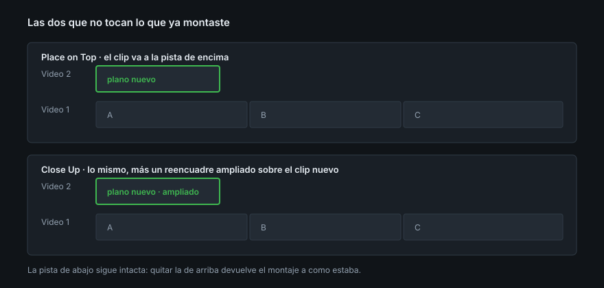

# Editar sobre la pista de arriba

> Hay una familia de planos que no forma parte de la continuidad: el recurso que tapa un
> corte feo, el primer plano de las manos, el inserto del cartel. No sustituyen a nada:
> van encima. Close Up y Place on Top son las dos herramientas que los colocan sin tocar
> el montaje que ya funciona.

## 🎯 Objetivos

- Explicar qué es una pista superior y por qué lo de arriba tapa lo de abajo
- Distinguir Place on Top de Close Up
- Colocar planos de recurso sin alterar la continuidad ni la duración de la pieza
- Saber por qué la pista de arriba es la red de seguridad de la primera pasada

---

## 1. Qué problema resuelve

En una pieza con alguien hablando aparece siempre el mismo problema. Has cortado dos
trozos de la misma entrevista y, al pegarlos, la persona **salta**: estaba mirando a un
lado y ahora al otro, tenía las manos abajo y ahora arriba. El montaje se nota.

> [!NOTE]
> **Salto de eje** o *jump cut*: el corte entre dos trozos del mismo plano que produce un
> salto visible, porque la imagen es casi idéntica pero no del todo. Es el efecto
> secundario inevitable de acortar una entrevista.

La solución que usa todo el mundo desde que existe el montaje es tapar el salto con otra
imagen: un plano de las manos, del sitio, de quien escucha. Se llama **plano de recurso**
(*b-roll*, *cutaway*), y su característica es que **no sustituye a nada**: el audio sigue
siendo el de la entrevista, y por debajo el plano original sigue ahí.

Eso pide una pista por encima. Y colocar algo en una pista por encima con las herramientas
del archivo anterior es imposible: todas trabajan sobre la pista principal y todas mueven
lo que hay.

---

## 2. Cómo funciona

### 2.1 Las pistas se apilan y la de arriba gana

Una timeline tiene varias pistas de vídeo, numeradas de abajo arriba: `Video 1`,
`Video 2`, `Video 3`. La regla es simple: **si hay algo en una pista superior, es lo que
se ve**. Lo de abajo sigue existiendo, pero queda tapado mientras dure lo de arriba.

El audio no funciona así: las pistas de audio **se suman**, no se tapan. Por eso un
recurso puesto encima cambia la imagen y no cambia el sonido, que es exactamente lo que se
quiere.

### 2.2 Place on Top

Coloca el clip marcado en la pista **inmediatamente superior**, en el destino que marca el
indicador, y crea esa pista si no existía.

Lo que **no** hace, y es su valor entero:

- No desplaza nada.
- No sustituye nada.
- No cambia la duración de la pieza.

### 2.3 Close Up

Hace lo mismo y además aplica al clip nuevo un **reencuadre ampliado**: un recorte hacia
dentro de la imagen que simula un plano más cerrado.

> [!NOTE]
> **Reencuadre**: ampliar digitalmente la imagen y quedarse con una parte. No es un zoom
> óptico: no hay más detalle, se está usando menos superficie del sensor grabado. Un
> reencuadre moderado sobre material de 1920×1080 en una timeline de 1920×1080 pierde
> nitidez, y cuanto más se amplía, más.

Sirve para el caso concreto de sacar un primer plano de un plano abierto: dos ángulos de
la misma entrevista grabada con una sola cámara, por ejemplo. Es de las pocas cosas de la
Cut page pensadas para un flujo muy rápido de una sola cámara.

> [!IMPORTANT]
> Close Up es un **atajo**, no un control. El encuadre exacto se ajusta después con los
> controles de transformación de la Edit page, que es la Semana 10. Si te importa dónde
> queda encuadrada la cara, ese ajuste no es de esta semana.

---

## 3. Cómo se hace en Resolve 21

Las dos son botones de la barra de herramientas de la Cut page y siguen el mismo ciclo que
las demás: material marcado con `I` y `O`, cabezal donde quieres, mirar el indicador,
pulsar.

La diferencia con Smart Insert y Ripple Overwrite es lo que ocurre después: aparece una
pista `Video 2` (si no la había) con el clip nuevo dentro, y `Video 1` sigue exactamente
igual que antes.

### 3.1 Dónde se usan, en la práctica

| Situación | Herramienta |
| --------- | ----------- |
| Tapar un salto entre dos trozos de entrevista | **Place on Top** con un recurso |
| Enseñar lo que la persona está describiendo | **Place on Top** |
| Un inserto: un cartel, un objeto, un detalle | **Place on Top** |
| Sacar un primer plano de un plano abierto | **Close Up** |
| Dar variedad a una entrevista de una sola cámara | **Close Up**, con moderación |

### 3.2 La duración manda

Un recurso puesto encima dura lo que dura, y mientras dura tapa. Como referencia de
primera pasada: **entre dos y cuatro segundos**. Menos de dos no da tiempo a leer la
imagen; más de cuatro y el espectador se olvida de que había alguien hablando.

Y una regla que ahorra disgustos: **que empiece antes del salto y termine después**. Un
recurso que empieza justo en el corte no lo tapa: lo subraya.

### 3.3 Cuánto es demasiado

Con Close Up, poco. Dos o tres en una pieza de cinco minutos pasan desapercibidos; diez
convierten la pieza en un vaivén, y como cada uno pierde nitidez, se nota además en la
imagen.

Con Place on Top el límite es otro: si tapas tanto que casi nunca se ve a quien habla, la
pieza deja de tener a nadie dentro. El recurso acompaña; no sustituye.

---

## 4. Por qué esta pista es la red de seguridad

Hay una propiedad de la pista de arriba que la convierte en el mejor sitio para probar
cosas durante una primera pasada:

> **Todo lo que pongas en `Video 2` se puede quitar sin tocar el montaje.** Seleccionas,
> borras, y la pieza vuelve exactamente a como estaba. No hay ripple, no hay huecos, no
> hay nada que recolocar.

De ahí salen dos costumbres que conviene coger esta semana:

- **En la duda, arriba.** Si no sabes si un plano va a funcionar, ponlo encima. Probar
  arriba es gratis; probar abajo cuesta un `Ctrl+Z` bien dado y, si te das cuenta tarde,
  bastante más.
- **La estructura, abajo; los adornos, arriba.** `Video 1` es lo que sostiene la pieza y
  no se toca sin motivo. `Video 2` es donde se experimenta.

También explica el orden de trabajo de la semana, y por qué la práctica 02 va antes que la
03: cerrar `Video 1` primero significa que ningún ripple posterior va a descolocar lo que
pongas encima.

---

> [!TIP]
> Para ver qué hay debajo de un recurso sin borrarlo, desactiva la pista `Video 2` desde
> su cabecera y reproduce. Es la forma rápida de comprobar si el recurso está tapando algo
> que en realidad querías conservar, y de decidir si el problema era el recurso o el corte
> que había debajo.

---

## 5. Antipatrones

| Antipatrón | Por qué duele | Qué hacer |
| ---------- | ------------- | --------- |
| Tapar un salto con Ripple Overwrite | Te llevas por delante el audio de la entrevista | Place on Top: el sonido de abajo sigue |
| Recursos que empiezan justo en el corte | Subrayan el salto en vez de taparlo | Que empiecen antes y acaben después |
| Close Up en todos los planos | Cansa y pierde nitidez en cada uno | Dos o tres por pieza, y con motivo |
| Recursos de siete segundos | El espectador olvida de qué se hablaba | Entre dos y cuatro, en bruto |
| Ajustar el encuadre del Close Up aquí | Los controles finos son de la Edit page | Semana 10 |
| Montar la pieza entera en la pista de arriba | Te quedas sin estructura y sin red | La continuidad va en `Video 1` |
| Poner recursos antes de cerrar la estructura | Un ripple posterior los descoloca todos | `Video 1` primero |

---

## 6. Trucos

| Truco | Cómo |
| ----- | ---- |
| Tapar un salto de entrevista sin tocar el audio | Place on Top con un recurso encima |
| Probar un plano sin arriesgar el montaje | Ponlo en la pista de arriba: quitarlo lo deja como estaba |
| Sacar dos ángulos de una cámara sola | Close Up, con moderación |
| Que el recurso tape de verdad | Que empiece antes del corte y acabe después |
| Saber cuánto dura un recurso en bruto | Entre dos y cuatro segundos |
| Ver qué hay debajo de un recurso | Desactiva la pista de arriba y reproduce |

---

## 📚 Recursos Adicionales

- [DaVinci Resolve Reference Manual](https://www.blackmagicdesign.com/support/family/davinci-resolve-and-fusion) — el capítulo de la Cut page documenta Close Up y Place on Top y el reencuadre que aplica el primero.
- [Semana 10 · Velocidad, transformaciones y estabilización](../../week-10-velocidad_transformaciones_y_estabilizacion/README.md) — los controles de transformación con los que se ajusta a mano el encuadre que Close Up aproxima.
- [Semana 11 · Títulos, Text+, efectos y compuestos](../../week-11-titulos_texto_plus_efectos_y_compuestos/README.md) — el resto de cosas que viven en las pistas superiores y por qué llegan después del montaje.

---

## ✅ Checklist de Verificación

- [ ] Sé por qué lo de la pista superior tapa lo de abajo, y por qué el audio no
- [ ] Sé qué es un plano de recurso y para qué sirve
- [ ] Distingo Place on Top de Close Up
- [ ] Sé que Close Up pierde nitidez y por qué
- [ ] Coloco los recursos empezando antes del corte y acabando después
- [ ] Uso la pista de arriba para probar sin arriesgar el montaje

---

| Anterior | Actual | Siguiente |
| -------- | ------ | --------- |
| [07 · Corregir el montaje ya hecho](07-corregir-el-montaje-ya-hecho.md) | **08 · Editar sobre la pista de arriba** | [09 · El sync bin](09-el-sync-bin.md) |

← [Volver a la Semana 06](../README.md)
