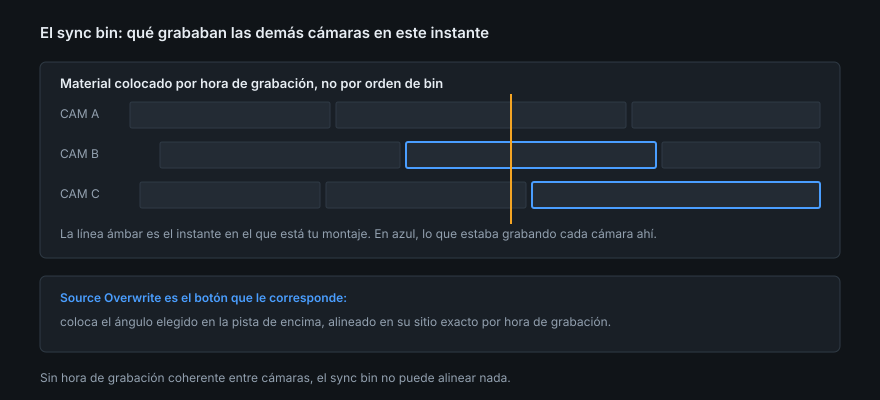

# El sync bin

> Con tres cámaras grabando lo mismo, montar significa contestar mil veces la misma
> pregunta: "¿qué estaban haciendo las otras dos en este instante?". El sync bin la
> contesta antes de que la formules, y Source Overwrite coloca la respuesta en su sitio de
> un botón.

## 🎯 Objetivos

- Explicar qué muestra el sync bin y de dónde saca la alineación
- Montar material de varias cámaras sin crear un clip multicámara
- Usar Source Overwrite y saber por qué es la herramienta que le corresponde
- Reconocer cuándo el sync bin no puede funcionar, y qué hacer entonces

---

## 1. Qué problema resuelve

Grabaste una escena con tres cámaras. En la Semana 05 las sincronizaste y preparaste un
clip multicámara. Ahora hay que montar, y montar aquí no es elegir planos: es **elegir
ángulos**, decenas de veces, y cada elección necesita saber qué ofrecían los otros ángulos
en ese momento exacto.

Hacerlo a mano es un bucle miserable: abrir el clip de la cámara B, buscar el instante,
mirar, cerrar, abrir la C, buscar el mismo instante, mirar. Por cada corte.

El sync bin da la vuelta a la pregunta. En vez de que tú busques el instante en cada clip,
**es el material el que se coloca solo** en el instante donde está tu montaje.

---

## 2. Cómo funciona

El sync bin es una vista del media pool que, en lugar de listar clips por nombre, los
coloca **por hora de grabación**. Y muestra los que estaban grabando en el instante donde
tienes el cabezal de la timeline.

Muevas donde muevas el cabezal, la vista se actualiza: siempre enseña las alternativas de
ese momento. Elegir un ángulo pasa de ser una búsqueda a ser una mirada.

### 2.1 De dónde sale la alineación

De la **hora de grabación**: el timecode o la marca de tiempo que cada cámara escribió en
el archivo mientras grababa. Es la misma información con la que la Semana 05 sincronizaba
por timecode.

> [!IMPORTANT]
> Si las cámaras no tenían la hora coherente entre sí, el sync bin alinea mal, y alinea
> mal en silencio: la vista se llena de material que no corresponde a ese instante.
> Compruébalo antes de montar, no después. Un desfase de horas se ve enseguida; uno de
> segundos es el que engaña.

### 2.2 Sync bin y clip multicámara no son lo mismo

Los dos resuelven el problema de varias cámaras, y conviene no mezclarlos:

| | Clip multicámara (Semana 05) | Sync bin (esta semana) |
| - | ---------------------------- | ---------------------- |
| Qué es | Un elemento del media pool con los ángulos dentro | Una forma de ver el media pool |
| Qué hay que preparar | Crearlo, con su método de sincronización | Nada: material con hora coherente |
| Cómo se monta | Cambiando de ángulo activo mientras reproduces | Eligiendo el ángulo y pulsando Source Overwrite |
| Dónde vive el montaje | Un solo clip con el ángulo elegido en cada tramo | Clips reales, en pistas reales |
| Dónde se aprende a fondo | Semana 12 | Aquí |

El sync bin es más directo y deja una timeline más fácil de entender más adelante. El clip
multicámara es más cómodo cuando hay que cambiar de ángulo muchas veces por minuto.

---

## 3. Cómo se hace en Resolve 21

El sync bin se activa desde el media pool de la Cut page. Al activarlo, la vista cambia:
en lugar de la lista de clips aparece el material colocado por hora, alineado con el
instante del cabezal.
*Verificado en 21.0.4.5, agosto de 2026.*

### 3.1 Source Overwrite, la herramienta que le corresponde

Source Overwrite es el sexto botón de la barra de herramientas, y hace una cosa muy
concreta: coloca el ángulo seleccionado **en la pista de encima, alineado en su sitio
exacto por hora de grabación**.

Eso último es lo que la separa de Place on Top. Place on Top coloca donde está el cabezal;
Source Overwrite coloca donde le corresponde **en el tiempo real de la grabación**, de modo
que la imagen de la cámara B cae sincronizada con el sonido que ya tienes montado.

> [!NOTE]
> Por eso Source Overwrite solo tiene sentido con material que comparte hora de grabación.
> Con material suelto, la herramienta de la pista de encima es Place on Top.

### 3.2 El flujo de montaje multicámara en la Cut page

Es sorprendentemente corto, y es lo que hace la práctica 04:

1. **Monta la base con la cámara principal.** Normalmente la que tiene el mejor sonido o
   el plano más general. Con Append, como en el archivo 06.
2. **Activa el sync bin.**
3. **Recorre tu montaje.** Donde quieras cambiar de ángulo, para el cabezal.
4. **Elige el ángulo** que muestre mejor ese momento.
5. **Pulsa Source Overwrite.** El ángulo cae encima, sincronizado.
6. **Sigue.**

El sonido no se toca en ningún momento: sigue siendo el de la pista base. Es la misma
lógica del archivo 08 —la imagen se tapa, el audio se suma— aplicada a varias cámaras.

### 3.3 Cuándo cambiar de ángulo

Tres criterios que funcionan y no dependen del programa:

- **Cuando pasa algo que se ve mejor desde otro sitio.** Alguien señala algo, y hay una
  cámara que lo enseña.
- **Cuando el plano lleva demasiado tiempo quieto.** En material hablado, entre diez y
  veinte segundos sin cambio empieza a pesar.
- **Cuando hay un salto que tapar.** El mismo caso del archivo 08, resuelto con un ángulo
  en vez de con un recurso.

Y un criterio que **no** funciona: cambiar cada equis segundos porque sí. Se nota, cansa y
no aporta.

---

## 4. Cuando el sync bin no puede ayudarte

No siempre se puede usar, y reconocerlo pronto ahorra una tarde:

| Situación | Qué pasa | Qué hacer |
| --------- | -------- | --------- |
| Las cámaras no tenían la hora coherente | Alinea material que no corresponde | Sincroniza y monta con el clip multicámara de la Semana 05 |
| Una cámara grabó sin sonido | La alineación por hora sigue valiendo | Comprueba a ojo un punto conocido antes de fiarte |
| Las cámaras arrancaron y pararon en momentos distintos | Normal: hay huecos en algunos ángulos | El sync bin los enseña vacíos; elige lo que haya |
| Material de días distintos en el mismo bin | La vista se llena de cosas que no vienen a cuento | Un bin por escena o por jornada |
| Una sola cámara | No hay nada que alinear | Place on Top, archivo 08 |

> [!TIP]
> La comprobación de treinta segundos, y merece la pena hacerla siempre: coloca el cabezal
> en un momento reconocible —una palmada, alguien que entra por la puerta— y mira si los
> ángulos que aparecen enseñan **ese mismo momento**. Si no, la hora de grabación no es
> fiable y todo lo que montes con el sync bin estará desplazado.

---

## 5. El sonido en un montaje de varias cámaras

Es la parte que más problemas da y la que menos se explica, así que conviene dejarla clara
antes de la práctica.

Con tres cámaras tienes tres pistas de audio del mismo momento. Si suenan las tres a la
vez, el resultado no es "más sonido": es un eco. Las tres grabaciones llegan con
milésimas de segundo de diferencia porque cada cámara estaba a otra distancia, y esa diferencia
mínima es exactamente lo que produce un sonido metálico y hueco.

La regla, entonces:

> **Suena una pista de audio, y solo una.** La del micrófono mejor colocado, que casi
> nunca es la de la cámara con el plano más bonito.

En la práctica, y por eso el flujo del apartado 3.2 empieza donde empieza:

- **La base se monta con la cámara del mejor sonido.** Su audio es el de la pieza.
- **Los ángulos que colocas encima aportan imagen, no sonido.** Sus pistas de audio se
  silencian o se desactivan.
- **El audio de referencia no se borra.** Se deja silenciado, exactamente igual que en la
  Semana 05: si algo se tuerce, es lo único que permite recomponer la sincronía.

Ajustar de verdad ese sonido —niveles, ecualización, el paso de una fuente a otra— es la
Fase 4, Semanas 13 a 15. Aquí solo hay que asegurarse de que suena una, y de que es la
buena.

---

## 6. Antipatrones

| Antipatrón | Por qué duele | Qué hacer |
| ---------- | ------------- | --------- |
| Montar multicámara sin comprobar la alineación | Toda la pieza queda desplazada y se descubre tarde | La comprobación del punto reconocible, antes de empezar |
| Cambiar de ángulo cada cinco segundos por sistema | Se nota el mecanismo y cansa | Cambia cuando haya un motivo |
| Usar Source Overwrite con material sin hora común | No hay nada que alinear | Place on Top |
| Montar la base con la cámara del peor sonido | Arrastras un problema de audio a toda la pieza | Base con el mejor sonido; los demás ángulos, encima |
| Mezclar varias escenas en el bin del sync bin | La vista se vuelve ilegible | Un bin por escena |
| Rehacer la base para cambiar un ángulo | La base no se toca: los ángulos van encima | Source Overwrite, y ya |

---

## 7. Trucos

| Truco | Cómo |
| ----- | ---- |
| Ver qué grababan las demás cámaras en este instante | Activa el sync bin y mueve el cabezal |
| Comprobar que la alineación es real | Cabezal en un momento reconocible: ¿coinciden los ángulos? |
| Colocar un ángulo ya sincronizado de un botón | Source Overwrite, que alinea por hora de grabación |
| No tocar nunca el sonido al cambiar de imagen | La base lleva el audio; los ángulos van encima |
| Mantener la vista legible | Un bin por escena o por jornada |
| Saber cuándo no usarlo | Sin hora coherente entre cámaras, clip multicámara de la Semana 05 |

---

## 📚 Recursos Adicionales

- [DaVinci Resolve Reference Manual](https://www.blackmagicdesign.com/support/family/davinci-resolve-and-fusion) — el capítulo de la Cut page documenta el sync bin y Source Overwrite; el de *Multicam Editing*, la alternativa con clip multicámara.
- [Semana 05 · Proxies, caché y sincronización](../../week-05-proxies_cache_y_sincronizacion/README.md) — la sincronización por timecode y por forma de onda de la que depende todo esto.
- [Semana 12 · Multicámara, subtítulos y gestión de timeline](../../week-12-multicam_subtitulos_y_gestion_de_timeline/README.md) — el montaje multicámara completo, con ángulos y cambios en directo.

---

## ✅ Checklist de Verificación

- [ ] Sé qué muestra el sync bin y de dónde saca la alineación
- [ ] Sé comprobar en treinta segundos si la alineación es fiable
- [ ] Distingo el sync bin de un clip multicámara
- [ ] Sé qué hace Source Overwrite y en qué se diferencia de Place on Top
- [ ] Monto la base con la cámara del mejor sonido
- [ ] Sé cuándo el sync bin no puede funcionar y qué usar en su lugar

---

| Anterior | Actual | Siguiente |
| -------- | ------ | --------- |
| [08 · Editar sobre la pista de arriba](08-editar-sobre-la-pista-de-arriba.md) | **09 · El sync bin** | — |

← [Volver a la Semana 06](../README.md)
