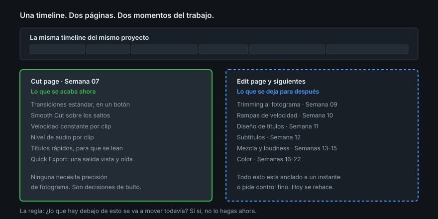

# Qué se acaba en Cut y qué se deja para Edit

> Tu pieza ya existe de principio a fin. Ahora hay que decidir qué se le hace aquí, en la
> Cut page, y qué se deja para las cinco semanas de Edit que vienen. Decidirlo mal cuesta
> el doble de trabajo: lo que se hace dos veces es lo que se hizo antes de tiempo.

## 🎯 Objetivos

- Distinguir **montaje bruto** de **acabado**, y saber qué decide cada pasada
- Enumerar las seis cosas que la Cut page acaba bien y por qué son esas seis
- Enumerar lo que **no** se toca esta semana, y en qué semana toca cada cosa
- Explicar por qué las dos páginas trabajan sobre la misma timeline y qué implica eso
- Aplicar la regla de decisión: **¿esto se va a mover todavía?**

---

## 1. Qué problema resuelve

La Semana 06 terminó con una pieza completa y fea. Completa quiere decir que llega al
final; fea quiere decir que los cortes son aproximados, no hay ni un rótulo, y el sonido es
el que trajo cada clip.

El problema ahora es de **orden de trabajo**, no de herramientas. Todo lo que queda por
hacer —afinar cada corte, poner transiciones, rotular, mezclar, etalonar, componer,
entregar— se puede hacer en cualquier orden. Pero solo hay un orden que no obliga a
repetir trabajo, y es este:

> **Primero lo que cambia la duración. Después lo que se pega a un momento concreto.**

Una transición, un rótulo o un pico de música están **anclados a un instante**. Si después
mueves un corte anterior, todo lo anclado se descoloca. Por eso el acabado empieza por lo
que todavía puede cambiar de sitio y termina por lo que ya no se mueve.

La Cut page es exactamente la página de la primera mitad de esa lista.

---

## 2. Cómo funciona

### 2.1 Las dos páginas son la misma timeline

Esto ya se dijo en la Semana 06 y esta semana tiene consecuencias prácticas: `Shift+3`
(Cut) y `Shift+4` (Edit) no exportan, no convierten y no copian nada. Enseñan **la misma
timeline del mismo proyecto** con controles distintos.

Así que la frontera de este archivo no es técnica. No hay casi nada que la Cut page pueda
hacer y la Edit no. La frontera es de **velocidad**: la Cut page hace algunas cosas en un
botón que en Edit cuestan cuatro, y a cambio no ofrece el control fino que Edit sí tiene.

### 2.2 Lo que la Cut page acaba bien

Seis cosas, y son las seis de esta semana:

| Qué | Por qué aquí |
| --- | ------------ |
| **Transiciones estándar** | Un botón coloca una disolvencia de un segundo en el corte más cercano |
| **Smooth Cut sobre saltos** | Un botón, y es la reparación más rentable de una entrevista |
| **Cambios de velocidad** | El panel `Speed` de las herramientas de clip: un multiplicador y nada más |
| **Nivel de audio por clip** | Un deslizador en esas mismas herramientas |
| **Títulos rápidos** | El navegador de títulos y arrastrar; el texto se escribe en el visor |
| **Una salida vista y oída** | `File > Quick Export`, sin pasar por la Deliver page |

Lo que tienen en común: **ninguna necesita precisión de fotograma**. Una disolvencia de un
segundo, un plano al 50 %, un rótulo de cinco segundos. Son decisiones de bulto.

### 2.3 Lo que NO se toca esta semana

| Qué | Cuándo toca | Por qué esperar |
| --- | ----------- | --------------- |
| Afinar cada corte al fotograma | Semana 09 | Un corte afinado hoy se desafina en cuanto muevas algo antes |
| Keyframes y rampas de velocidad | Semana 10 | Piden los controles de retime de la Edit page |
| Rótulos con animación y diseño | Semana 11 | Piden el Inspector completo y `Text+` |
| Subtítulos | Semana 12 | Piden pista de subtítulos y su flujo propio |
| Mezcla, música y loudness | Semanas 13-15 | Mezclar lo que aún se va a mover es tirar el trabajo |
| Cualquier corrección de color | Semanas 16-22 | Etalonar un plano que puede salir de la pieza |
| Composición, keying, gráficos | Semanas 23-27 | Lo mismo, y multiplicado por el tiempo de render |
| El master de verdad | Semanas 28-29 | El Quick Export de esta semana es una prueba, no una entrega |

### 2.4 La regla que decide

Cuando dudes si algo toca ahora, hazte una sola pregunta:

> **¿Lo que hay debajo de esto se va a mover todavía?**

Si la respuesta es sí, no lo hagas ahora. Un rótulo sobre un plano que vas a recortar en la
Semana 09 hay que recolocarlo en la Semana 09. Una disolvencia sobre un corte que vas a
mover es una disolvencia que hay que rehacer.

Y por eso esta semana tiene un orden interno que tampoco es negociable: **primero se cierra
la estructura, después se pone lo anclado**. Las prácticas van en ese orden.

---

## 3. Cómo se hace en Resolve 21

### 3.1 La copia de trabajo

Antes de tocar nada, se duplica la timeline. No es prudencia genérica: es la convención del
bootcamp, escrita en
[`docs/proyecto-hilo-conductor.md`](../../../docs/proyecto-hilo-conductor.md).

Clic derecho sobre la timeline en el media pool > **`Duplicate Timeline`**, y se renombra la
copia. `BC-Montaje-v1` se queda como estaba, congelada, y el acabado va sobre
`BC-Montaje-v2`.

Sirve para tres cosas concretas:

1. **Volver atrás** si el acabado sale peor que el bruto, que pasa más de lo que parece.
2. **Comparar** las dos versiones, que es como se aprende a ver la diferencia.
3. **Tener evidencia** del progreso para la auditoría de la Semana 36.

> [!WARNING]
> Duplicar no es renombrar. Si renombras `BC-Montaje-v1` como `BC-Montaje-v2` no tienes dos
> versiones: tienes una con otro nombre, y el montaje bruto de la Semana 06 ha dejado de
> existir. El check `montaje-v1-conservada` comprueba exactamente eso.

### 3.2 Los tres menús de la barra de la Cut page

Casi todo lo de esta semana sale de tres iconos de la barra de herramientas de la timeline
de la Cut page. Conviene saberse los nombres, porque las prácticas los citan:

- **`Timeline Options`** — cómo se ve y se comporta la timeline: `Ripple On`, `Snap`,
  `Display Clip Names`, `Display Speed Keyframes`, `Set Default Transition`,
  `Fixed Playhead`, `Boring Detector`.
- **`Timeline Actions`** — lo que añade o modifica la timeline entera: `Add Video Track`,
  `Split Clips`, `Add Marker`, `Add Dissolve to All Edits`, `Add Transition to All Edits`,
  `Clear Transition from All Edits`.
- **`Edit Actions`** — lo que ajusta clips: `Trim Start to Playhead`, `Trim End to
  Playhead`, `Resync Clip`.

*Contenido de los tres menús verificado en el DaVinci Resolve 21 Reference Manual,
capítulo 33 «Using the Cut Page», agosto de 2026.*

### 3.3 El reparto de pistas

La Cut page tiene una idea muy concreta de para qué sirve cada pista, y esta semana la
completa:

| Pista | Qué lleva | Comportamiento |
| ----- | --------- | -------------- |
| `Video 1` | La continuidad: el *A-roll* | Cualquier cambio hace ripple: lo de la derecha se recoloca solo |
| `Video 2` | Los recursos: el *B-roll* | Mover o redimensionar un clip aquí **no** afecta a nada más |
| `Video 3` | Los títulos, desde esta semana | Igual que `Video 2`: independiente |

> [!NOTE]
> **A-roll** y **B-roll** son los nombres de oficio. El *A-roll* es el material que sostiene
> el relato —quien habla, la acción principal—; el *B-roll* es lo que se pone encima para
> ilustrar, tapar o dar aire. En el manual de Resolve aparecen así, en inglés, sin traducir.

Que las pistas de arriba no hagan ripple es lo que las convierte en el sitio seguro para lo
anclado: un rótulo en `Video 3` se puede arrastrar cinco fotogramas sin que la pieza cambie
de duración.

---

## 4. Antipatrones

| Antipatrón | Por qué duele | Qué hacer |
| ---------- | ------------- | --------- |
| Acabar sobre `BC-Montaje-v1` | Pierdes el bruto y no puedes comparar ni volver | `Duplicate Timeline` y trabaja en `v2` |
| Renombrar en vez de duplicar | Lo mismo, pero creyendo que tienes dos | Comprueba que las dos aparecen en el media pool |
| Poner rótulos antes de cerrar la estructura | Un ripple posterior los descoloca todos | Estructura primero, anclado después |
| Afinar cortes al fotograma esta semana | Es trabajo de la Semana 09 y se pierde | Bulto ahora, precisión luego |
| Meter música porque «ya se ve la pieza» | La mezcla es la Fase 4 y se rehace entera | Nota en `notas-de-montaje.md` y sigue |
| Corregir el color de un plano que te gusta | Puede no llegar a la Semana 16 | Nada de color hasta la Fase 5 |
| Tratar el Quick Export como la entrega | Es una prueba de bulto, sin control de bitrate | El master de verdad es la Semana 28 |
| Irse a la Edit page a los diez minutos | Se pierde la velocidad, que es el motivo de la página | Si algo pide Edit de verdad, apúntalo para la Semana 08 |

---

## 5. Trucos

| Truco | Cómo |
| ----- | ---- |
| Decidir si algo toca ahora | ¿Lo que hay debajo se va a mover todavía? |
| Congelar el bruto antes de acabarlo | `Duplicate Timeline` y trabaja siempre en la copia |
| Ver las dos versiones seguidas | Doble clic alterna entre `v1` y `v2` en el media pool |
| Encontrar cualquier ajuste de la timeline | Los tres iconos: `Timeline Options`, `Timeline Actions`, `Edit Actions` |
| Saber en qué pista va algo | ¿Necesita que la pieza se recoloque? `Video 1`. ¿No? Encima |
| No perder una idea que no toca | Una línea en `notas-de-montaje.md` y sigues montando |

---

## 📚 Recursos Adicionales

- [DaVinci Resolve Reference Manual](https://www.blackmagicdesign.com/support/family/davinci-resolve-and-fusion) — capítulo 33, «Using the Cut Page»: la barra de herramientas, los tres menús y el reparto de pistas.
- [`docs/proyecto-hilo-conductor.md`](../../../docs/proyecto-hilo-conductor.md) — la convención de versionado del bootcamp y la tabla de qué añade cada fase.
- [Semana 08 · Edit page: anatomía y edición básica](../../week-08-edit_page_anatomia_y_edicion_basica/README.md) — la otra mitad de la frontera, con el control fino que aquí no hay.

---

## ✅ Checklist de Verificación

- [ ] Sé qué diferencia hay entre montaje bruto y acabado
- [ ] Puedo nombrar las seis cosas que la Cut page acaba bien
- [ ] Sé qué no se toca esta semana y en qué semana toca cada cosa
- [ ] Entiendo por qué se duplica la timeline antes de acabarla
- [ ] Sé qué hay en `Timeline Options`, `Timeline Actions` y `Edit Actions`
- [ ] Aplico la regla: ¿lo que hay debajo se va a mover todavía?

---

| Anterior | Actual | Siguiente |
| -------- | ------ | --------- |
| [Semana 07](../README.md) | **01 · Qué se acaba en Cut y qué se deja para Edit** | [02 · Las colas de un plano](02-las-colas-de-un-plano.md) |

← [Volver a la Semana 07](../README.md)
