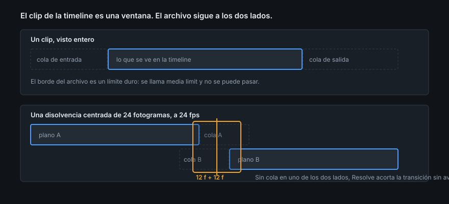

# Las colas de un plano

> Una transición no se dibuja: se hace con material que ya tenías y no estabas usando. Si
> no lo tienes, Resolve no puede inventarlo, y ahí es donde se descubre si la Semana 06 se
> montó con margen o al fotograma.

## 🎯 Objetivos

- Definir **cola** (*handle*) y distinguirla del clip que se ve en la timeline
- Explicar por qué una disolvencia consume material de los dos clips a la vez
- Calcular cuánta cola hace falta para una transición de una duración dada
- Reconocer los tres síntomas de que a un corte le faltan colas
- Saber qué hacer cuando un corte no tiene colas suficientes

---

## 1. Qué problema resuelve

En la Semana 06 marcaste cada plano con `I` y `O` sobre el source tape. Al hacerlo dejaste
fuera dos trozos: lo que hay **antes** del punto de entrada y lo que hay **después** del
punto de salida. Ese material sigue en el archivo, sigue enlazado desde el media pool, y no
se ve en la timeline.

Se llama **cola** —en inglés *handle*, y a los dos extremos juntos, *heads and tails*— y es
la reserva con la que se trabaja después.

El problema que resuelve tener colas es sencillo de enunciar y caro de descubrir tarde:

> **Cualquier operación que alargue un clip o superponga dos necesita material que ahora
> mismo no se ve. Si no existe, la operación no se puede hacer.**

No es un aviso teórico. El manual lo dice literalmente al explicar cómo se añaden
transiciones: *«If there is no overlap between the heads and tails of the two clips, you may
not be able to add a transition where you want»* — si no hay solape entre las colas de los
dos clips, puede que no puedas poner la transición donde quieres.

---

## 2. Cómo funciona



### 2.1 El clip que ves es una ventana

Un clip en la timeline no es un archivo: es una **ventana** sobre un archivo. La ventana
tiene un punto de entrada y uno de salida, y el archivo sigue existiendo entero a los dos
lados.

```
archivo completo   |=================================================|
cola de entrada    |========|
lo que se ve                |=====================|
cola de salida                                    |================|
```

Cuando arrastras el borde de un clip para alargarlo, no estás estirando nada: estás
**moviendo la ventana**, y lo que aparece es material que ya estaba grabado. Por eso hay un
límite duro: el borde del archivo. En Resolve, ese límite se llama **media limit** y, cuando
lo alcanzas, el clip deja de alargarse por mucho que arrastres.

### 2.2 Una disolvencia gasta colas de los dos lados

Una **disolvencia** (*dissolve*) es una superposición: durante un rato se ven los dos planos
a la vez, el que sale desapareciendo y el que entra apareciendo. Para que eso ocurra, los
dos clips tienen que existir **en el mismo instante**.

El que sale tiene que seguir un poco más allá de su punto de salida. El que entra tiene que
empezar un poco antes de su punto de entrada. Es decir: la disolvencia se come cola de
salida del primero y cola de entrada del segundo.

### 2.3 Cuánta cola hace falta

Depende de dónde se coloque la transición respecto al corte, y esto es lo que más confunde:

| Alineación | Qué cola consume | Cuánta |
| ---------- | ---------------- | ------ |
| **Centrada en el corte** (`Center on Edit`) | De los dos clips | La mitad de la duración a cada lado |
| **Termina en el corte** (`End on Edit`) | Solo del clip que entra | La duración entera |
| **Empieza en el corte** (`Start on Edit`) | Solo del clip que sale | La duración entera |

Con una disolvencia centrada de **1 segundo a 24 fps** —la que pone el botón por defecto—
hacen falta **12 fotogramas** de cola de salida en el primer clip y **12** de cola de
entrada en el segundo. Con la misma disolvencia alineada al final del corte, hacen falta
**24 fotogramas** seguidos en el clip que entra, y ninguna en el otro.

> [!NOTE]
> **Fotograma** (*frame*) es cada una de las imágenes fijas que componen el vídeo. A 24 fps
> hay 24 por segundo, así que medio segundo son 12 fotogramas. La Semana 01 define esto en
> detalle; aquí importa porque las colas se cuentan en fotogramas, no en segundos.

### 2.4 Qué pasa cuando no hay cola

Resolve no falla con un error rojo. Hace algo peor, porque es silencioso: **acorta la
transición** a lo que las colas permitan. El manual lo dice al describir la duración por
defecto: un segundo, *«o lo que permitan las colas solapadas del punto de corte
seleccionado»*.

Los tres síntomas de que te quedaste sin cola:

1. **La transición sale más corta de lo que pediste** y no la puedes alargar.
2. **El clip no se deja alargar** al arrastrar su borde: ha llegado al media limit.
3. **La transición aparece descentrada** respecto al corte, porque solo cabía a un lado.

---

## 3. Cómo se hace en Resolve 21

### 3.1 Ver cuánta cola tiene un clip

La Cut page tiene una ventaja concreta para esto: en el modo **`Source Tape`** y en el
visor, la tira de imágenes atenúa las colas para que veas de un vistazo el rango marcado
frente al archivo entero. Es la forma rápida de comprobar si un plano llegó a la timeline
con margen o al límite.

En la timeline, el indicio inmediato es el intento: arrastra el borde de un clip un poco
hacia fuera y mira si se mueve. Si no se mueve, no hay cola. Deshaz con `Ctrl+Z` (Win) /
`Cmd+Z` (Mac).

### 3.2 Cuánta cola dejar

La costumbre del oficio, y la que este bootcamp usa a partir de aquí:

> **Un segundo por lado como mínimo. Dos, si el material lo permite.**

A 24 fps son 24 y 48 fotogramas respectivamente. Con un segundo por lado caben todas las
transiciones estándar y sobra para los ajustes de la Semana 09.

### 3.3 Los tres arreglos cuando falta cola

En orden de lo que menos daño hace a la pieza:

1. **Acortar la transición.** Una disolvencia de 12 fotogramas se lee igual que una de 24 y
   necesita la mitad de cola. En la mayoría de los casos, esto lo resuelve.
2. **Mover el corte.** Si el plano de al lado tiene material de sobra, recorta un poco por
   ahí y gana margen. Es trabajo de la Semana 09, pero un ajuste grosero se puede hacer ya.
3. **No poner transición ahí.** Es una respuesta legítima y con frecuencia la correcta:
   véase el archivo 03, donde se argumenta que casi todas las transiciones sobran.

Lo que **no** es un arreglo: alargar el clip repitiendo fotogramas, congelar el último
fotograma para rellenar, o ralentizar el plano para «ganar» duración. Las tres se ven, y se
ven mal.

> [!IMPORTANT]
> Si al empezar esta semana descubres que **muchos** cortes no tienen cola, no es un
> problema de esta semana: es que la primera pasada se marcó demasiado justa. Anótalo en
> `notas-de-montaje.md` y cambia el hábito ya, porque la Semana 09 entera —ripple, roll,
> slip, slide— vive de las colas. Sin colas no hay trimming posible.

---

## 4. Antipatrones

| Antipatrón | Por qué duele | Qué hacer |
| ---------- | ------------- | --------- |
| Marcar los planos al fotograma exacto | Te deja sin transiciones y sin trimming | Un segundo de margen por lado, mínimo |
| Insistir en una disolvencia de un segundo sin cola | Sale corta, descentrada, o no sale | Acórtala, o no la pongas |
| Congelar el último fotograma para rellenar | Se ve: la imagen se queda quieta y luego arranca | Acorta la transición |
| Ralentizar un plano para ganar duración | Se ve, y encima cambia el ritmo | Elige otro plano o mueve el corte |
| Creer que Resolve avisa cuando falta cola | No avisa: acorta la transición en silencio | Comprueba la duración real de la transición |
| Confundir cola con clip | Lleva a pensar que se puede alargar cualquier cosa | El clip es una ventana; el archivo tiene bordes |

---

## 5. Trucos

| Truco | Cómo |
| ----- | ---- |
| Saber si un clip tiene cola en dos segundos | Arrastra su borde hacia fuera: si no se mueve, no hay |
| Ver el rango marcado frente al archivo entero | La tira de imágenes atenúa las colas en el visor |
| Que una transición quepa siempre | Pídela de 12 fotogramas en vez de 24 |
| Gastar cola de un solo lado | Alineación `Start on Edit` o `End on Edit` en vez de centrada |
| No volver a quedarte sin cola | Al marcar con `I` y `O`, un segundo de sobra por lado |
| Detectar el problema antes de tener 40 cortes | Prueba dos o tres cortes al empezar la semana |

---

## 📚 Recursos Adicionales

- [DaVinci Resolve Reference Manual](https://www.blackmagicdesign.com/support/family/davinci-resolve-and-fusion) — capítulo 38, «Video and Audio Effects in the Cut Page»: la nota sobre el solape de colas y la duración real de una transición.
- [Semana 09 · Trimming quirúrgico](../../week-09-trimming_quirurgico/README.md) — la semana que vive enteramente de las colas: ripple, roll, slip y slide.
- [Semana 06 · Append: la primera pasada](../../week-06-cut_page_edicion_veloz/1-teoria/06-append-la-primera-pasada.md) — donde se marcaron los puntos que definieron tus colas.

---

## ✅ Checklist de Verificación

- [ ] Sé qué es una cola y dónde está en un clip de la timeline
- [ ] Entiendo que el clip de la timeline es una ventana sobre el archivo
- [ ] Sé cuánta cola consume una disolvencia según su alineación
- [ ] Puedo calcular los fotogramas de cola que pide una transición a 24 fps
- [ ] Reconozco los tres síntomas de que falta cola
- [ ] Sé los tres arreglos y cuál hace menos daño

---

| Anterior | Actual | Siguiente |
| -------- | ------ | --------- |
| [01 · Qué se acaba en Cut y qué se deja para Edit](01-que-se-acaba-en-cut.md) | **02 · Las colas de un plano** | [03 · Transiciones y disolvencias](03-transiciones-y-disolvencias.md) |

← [Volver a la Semana 07](../README.md)
