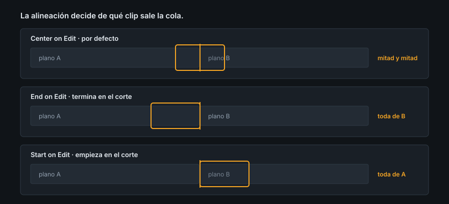

# Transiciones y disolvencias

> La Cut page pone una disolvencia en un botón. Que sea tan fácil es exactamente el
> problema: la pregunta no es cómo se pone, sino por qué habría que ponerla, y la respuesta
> honesta casi siempre es que no.

## 🎯 Objetivos

- Definir **transición** y saber qué significa por defecto un corte seco
- Enumerar los tres significados que una disolvencia comunica de verdad
- Colocar, alinear, cambiar de duración y quitar una transición en la Cut page
- Elegir entre los tres botones `Cut`, `Dissolve` y `Smooth Cut`
- Reconocer el antipatrón número uno de la semana: la transición decorativa

---

## 1. Qué problema resuelve

Un **corte** es el cambio instantáneo de un plano al siguiente: el fotograma 100 es el
plano A y el 101 es el plano B. No hay nada en medio. Es el noventa y muchos por ciento de
cualquier pieza profesional, y es lo que llevas montado desde la Semana 06.

Una **transición** es cualquier otra cosa: un tramo en el que los dos planos conviven o se
sustituyen progresivamente. La más común, con diferencia, es la **disolvencia**
(*cross dissolve*), en la que uno se desvanece mientras el otro aparece.

El problema que resuelve una transición no es estético, es **de lectura**. El manual lo
enuncia sin adornos: sirve para indicar *«un cambio de tema, un cambio de localización o el
paso del tiempo»*. Tres significados, y ninguno es «que quede bonito».

Dicho de otra forma: una disolvencia es un signo de puntuación. Si la pones donde no hay
frase que separar, el lector se para a buscar un sentido que no está.

---

## 2. Cómo funciona

### 2.1 Los tres significados legítimos

| Significado | Cuándo | Ejemplo típico |
| ----------- | ------ | -------------- |
| **Paso del tiempo** | Entre dos momentos separados por horas o días | El final de una jornada y la mañana siguiente |
| **Cambio de sitio** | Cuando la acción salta a otra localización | Salir de la entrevista y entrar en el exterior |
| **Cambio de tema** | Entre dos bloques del relato | El final de la apertura y el principio del desarrollo |

Fuera de esos tres, hay un cuarto uso técnico y muy distinto: **tapar un salto** dentro de
un mismo plano. Ese no se hace con una disolvencia, se hace con `Smooth Cut`, y tiene su
propio archivo (el 04).

### 2.2 Las tres alineaciones

Una transición ocupa un tramo, y ese tramo se puede colocar de tres formas respecto al
corte. Los nombres son los del menú contextual de Resolve:

- **`Center on Edit`** — mitad antes del corte, mitad después. Es la opción por defecto y
  la que se lee como una disolvencia normal.
- **`End on Edit`** — la transición termina justo en el corte. El plano que entra aparece
  ya limpio en el corte.
- **`Start on Edit`** — la transición empieza en el corte. El plano que sale sigue
  desvaneciéndose después.

La alineación no es solo estética: cambia **de qué clip sale la cola**, que es lo que
explica el archivo 02. Cuando una disolvencia centrada no cabe, con frecuencia sí cabe
alineada a un lado.

### 2.3 La duración

Por defecto, la Cut page pone **un segundo**. A 24 fps, 24 fotogramas.

Un segundo es mucho. Se nota, y se nota como una decisión. Para una disolvencia que solo
tiene que respirar entre dos bloques, entre **12 y 16 fotogramas** suele bastar y necesita
la mitad de cola. Para un paso del tiempo largo y deliberado, un segundo o más tiene
sentido.

Lo que no tiene sentido es no haberlo decidido.

---

## 3. Cómo se hace en Resolve 21

### 3.1 Los tres botones

La Cut page tiene tres botones dedicados junto a la media pool: **`Cut`**, **`Dissolve`** y
**`Smooth Cut`**. Los tres actúan sobre el **punto de corte más cercano al cabezal**, igual
que las herramientas de edición de la Semana 06 actúan sobre el destino que marca el
indicador inteligente.

| Botón | Qué hace |
| ----- | -------- |
| **`Dissolve`** | Añade un `Cross Dissolve` de un segundo en el corte más cercano |
| **`Smooth Cut`** | Añade un `Smooth Cut` de un segundo en el corte más cercano |
| **`Cut`** | Quita la transición del corte más cercano y lo devuelve a corte seco |

### 3.2 La ruta de teclado, que es la estable

Los botones cambian de sitio entre versiones; los comandos no. El camino de teclado son dos
teclas:

1. **`V`** — selecciona el punto de corte más cercano al cabezal.
2. **`Ctrl+T`** (Win) / **`Cmd+T`** (Mac) — añade la transición estándar al punto
   seleccionado.

Y una tercera para la alineación:

3. **`U`** — pulsada varias veces sobre un punto de corte seleccionado, alterna entre
   seleccionar el **principio**, el **centro** y el **final** del corte. La transición que
   añadas después toma la alineación de lo que hayas seleccionado.

> [!TIP]
> Como siempre en este bootcamp: los atajos concretos se comprueban en
> `DaVinci Resolve > Keyboard Customization`, buscando el comando por su nombre en inglés.
> Gana lo que diga tu instalación.

### 3.3 Cambiar y quitar

Con la transición ya puesta, clic derecho sobre ella en la timeline abre el menú que
importa:

- **`Change Transition Type`** — cambiarla por otra sin borrarla.
- **`Change Duration`** — la duración, en segundos y en fotogramas a la vez.
- **`Alignment Options`** — `Start on Edit`, `Center on Edit`, `End on Edit`.
- **`Set as Default Transition`** — que esta sea la que ponga el botón a partir de ahora.

Para quitarla: selecciónala en la timeline y pulsa `Delete`, o coloca el cabezal cerca y
pulsa el botón **`Cut`**.

Y también se puede arrastrar el borde de una transición en la timeline para alargarla o
acortarla; crece simétricamente alrededor del corte.

### 3.4 Las dos operaciones masivas, y por qué son una trampa

En el icono **`Timeline Actions`** hay tres comandos que afectan a la timeline entera:

- **`Add Dissolve to All Edits`** — pone un `Cross Dissolve` en **todos** los cortes.
- **`Add Transition to All Edits`** — pone la última transición usada en todos.
- **`Clear Transition from All Edits`** — quita todas.

> [!WARNING]
> `Add Dissolve to All Edits` es la forma más rápida de estropear una pieza entera. Una
> disolvencia en cada corte no significa nada, porque un signo de puntuación que se repite
> siempre deja de ser un signo. Además consume cola en todos los cortes a la vez, y donde
> no haya, la transición saldrá corta sin avisar.
>
> El único de los tres que se usa con normalidad es `Clear Transition from All Edits`, para
> volver al principio cuando el experimento salió mal.

### 3.5 Cambiar la transición por defecto

Por defecto, la transición estándar es un `Cross Dissolve`. Se cambia en
`Timeline Options > Set Default Transition`, que abre una ventana donde se elige **tipo,
duración y alineación**. Es el sitio para bajar el segundo por defecto a 12 fotogramas si
esa va a ser tu costumbre.

*Botones, comandos, menú contextual y ventana de transición por defecto verificados en el
DaVinci Resolve 21 Reference Manual, capítulos 33 y 38, agosto de 2026.*

---

## 4. Antipatrones

| Antipatrón | Por qué duele | Qué hacer |
| ---------- | ------------- | --------- |
| Una disolvencia en cada corte | Deja de significar nada y la pieza se vuelve blanda | Solo en los tres significados legítimos |
| `Add Dissolve to All Edits` | El anterior, pero de golpe y en toda la pieza | `Clear Transition from All Edits` y empezar de nuevo |
| Transiciones llamativas: barridos, giros, ruedas | Se leen como un efecto, no como puntuación | Corte seco, o disolvencia |
| Tapar un salto con una disolvencia | Se ve el fantasma de la cara desplazada | `Smooth Cut`, archivo 04 |
| Dejar siempre el segundo por defecto | Una decisión que no tomaste | `Change Duration`, o cambia el valor por defecto |
| Poner transiciones antes de cerrar la estructura | Un ripple posterior las descoloca | Estructura primero |
| Insistir donde no hay cola | Sale corta o descentrada, en silencio | Acórtala, muévela o quítala |

---

## 5. Trucos

| Truco | Cómo |
| ----- | ---- |
| Poner una disolvencia sin ratón | `V` para seleccionar el corte, `Ctrl+T` / `Cmd+T` para añadirla |
| Elegir la alineación desde el teclado | `U` alterna principio, centro y final antes de `Ctrl+T` |
| Quitar una transición | Selecciónala y `Delete`, o el botón `Cut` con el cabezal cerca |
| Ajustar la duración con los dos números a la vista | Clic derecho > `Change Duration`: segundos y fotogramas |
| Que el botón ponga siempre lo que tú quieres | `Timeline Options > Set Default Transition` |
| Deshacer un experimento masivo | `Timeline Actions > Clear Transition from All Edits` |
| Saber si una transición sobra | Quítala y reproduce el corte: si no la echas de menos, sobraba |

---

## 📚 Recursos Adicionales

- [DaVinci Resolve Reference Manual](https://www.blackmagicdesign.com/support/family/davinci-resolve-and-fusion) — capítulo 38: los tres botones, las alineaciones, el menú contextual de la transición y las acciones masivas.
- [Semana 11 · Títulos, Text+, efectos y compuestos](../../week-11-titulos_texto_plus_efectos_y_compuestos/README.md) — donde los efectos y las transiciones se parametrizan de verdad, con el Inspector.
- [Semana 09 · Trimming quirúrgico](../../week-09-trimming_quirurgico/README.md) — el ajuste fino de los cortes sobre los que hoy decides si va o no va una transición.

---

## ✅ Checklist de Verificación

- [ ] Sé qué es un corte y qué es una transición
- [ ] Puedo nombrar los tres significados legítimos de una disolvencia
- [ ] Sé qué hacen los botones `Cut`, `Dissolve` y `Smooth Cut`
- [ ] Sé poner una transición con `V` y `Ctrl+T` / `Cmd+T`
- [ ] Sé cambiar su duración, su tipo y su alineación
- [ ] Entiendo por qué `Add Dissolve to All Edits` es una mala idea

---

| Anterior | Actual | Siguiente |
| -------- | ------ | --------- |
| [02 · Las colas de un plano](02-las-colas-de-un-plano.md) | **03 · Transiciones y disolvencias** | [04 · Smooth Cut](04-smooth-cut.md) |

← [Volver a la Semana 07](../README.md)
