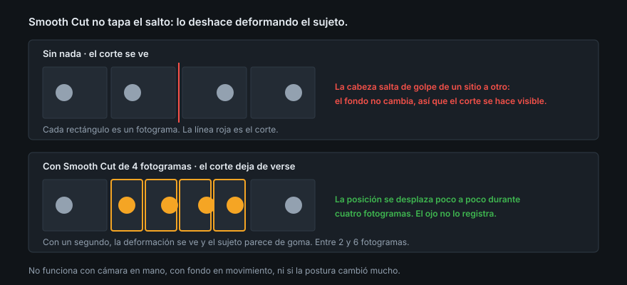

# Smooth Cut

> El defecto más visible de cualquier entrevista es el salto que deja quitar un «eeeh». La
> Semana 06 lo tapaba con un plano de recurso. Esta semana hay una segunda respuesta, que
> no gasta recurso y que dura cuatro fotogramas.

## 🎯 Objetivos

- Definir **salto de montaje** (*jump cut*) y por qué se ve tan mal
- Explicar qué hace `Smooth Cut` y en qué se diferencia de una disolvencia
- Saber en qué material funciona y en cuál no, antes de gastar el intento
- Elegir la duración correcta, que no es la que pone por defecto
- Decidir entre `Smooth Cut` y un plano de recurso

---

## 1. Qué problema resuelve

Tienes a alguien hablando en plano fijo. Quitas una pausa, una repetición o una muletilla, y
pegas los dos trozos. El resultado es un **salto de montaje**: la persona da un respingo,
porque su cabeza estaba en un sitio antes del corte y en otro después.

El ojo lo detecta al instante. No porque sea una imagen imposible, sino porque el fondo no
cambia: cuando todo lo demás se queda quieto y solo salta el sujeto, el corte se vuelve
visible.

Hasta ahora tenías una respuesta: tapar el salto con un plano de recurso en `Video 2`, que
es lo que hiciste en la práctica 03 de la Semana 06. Es buena respuesta, pero tiene un coste
—consume recurso, y el recurso se acaba— y un límite: si tapas todos los saltos, no se ve a
quien habla.

`Smooth Cut` es la segunda respuesta. No tapa el salto: lo **deshace**.

---

## 2. Cómo funciona

### 2.1 Qué hace exactamente

`Smooth Cut` es una transición, pero no mezcla imágenes: **deforma una para convertirla en
la otra**. Analiza los mismos rasgos a los dos lados del corte —una cara, un hombro, una
línea del fondo— y los mueve progresivamente de la posición que tenían antes a la que tienen
después.

Si funciona, el resultado no parece un efecto: parece que la persona nunca se movió.

En DaVinci Resolve 21 esto lo hace un procesado llamado **Speed Warp**, basado en el motor
neuronal del programa. *Comportamiento y nombre verificados en el Reference Manual,
capítulo 38, agosto de 2026; la nota del manual precisa que Speed Warp sustituyó al
procesado por flujo óptico anterior a partir de la versión 20.*

### 2.2 Los dos modos

Al aplicarlo aparece un desplegable **`Mode`** con dos opciones:

| Modo | Qué hace | Cuándo |
| ---- | -------- | ------ |
| **`Better`** | Preserva el movimiento del sujeto durante la transición. Es el valor por defecto | Casi siempre |
| **`Faster`** | Deforma entre dos imágenes fijas, la de salida y la de entrada | Cuando `Better` produce artefactos raros |

Empieza siempre por `Better`. `Faster` no es «para ir rápido»: es otro algoritmo, que a
veces acierta donde el bueno falla.

### 2.3 Dónde funciona y dónde no

Esto es lo que hay que saber **antes** de intentarlo, porque analizar y mirar el resultado
cuesta minutos:

| Funciona bien | Funciona mal |
| ------------- | ------------ |
| Entrevista sentada, plano fijo | Cámara en mano o con movimiento |
| Primeros planos con poco fondo | Fondo con gente o coches moviéndose |
| El sujeto casi en la misma posición a los dos lados | El sujeto cambia mucho de postura |
| Fondo quieto | El sujeto gira la cabeza o gesticula en el corte |

La regla, en una línea: **cuanto más se mueva el fondo y más cambie la postura, peor el
resultado**. Si la persona estaba mirando a cámara y en el otro trozo está mirando al suelo,
no hay algoritmo que lo arregle: eso pide un plano de recurso.

### 2.4 La duración, que es lo contrario de lo que parece

El botón pone **un segundo** por defecto, como cualquier transición. Para `Smooth Cut`, un
segundo es demasiado: la deformación se hace visible y el sujeto parece de goma.

> **`Smooth Cut` funciona mejor entre 2 y 6 fotogramas.**

A 24 fps son entre una décima y una cuarta parte de segundo. Lo bastante para que el ojo no
registre el salto, lo bastante poco para que no registre la deformación tampoco.

Es el ajuste que más cambia el resultado y el que más gente se salta.

---

## 3. Cómo se hace en Resolve 21

### 3.1 El ciclo completo

1. **Coloca el cabezal** en el corte del salto, o cerca.
2. **Pulsa el botón `Smooth Cut`**, junto a la media pool. Entra un `Smooth Cut` de un
   segundo en el corte más cercano.
3. **Clic derecho sobre la transición > `Change Duration`** y ponla en **4 fotogramas**.
4. **Reproduce el corte** a velocidad normal, sin pausas, dos o tres veces.
5. **Decide.** Si ves la deformación, prueba 2 fotogramas. Si sigue viéndose, quítala y tapa
   el salto con un recurso.

El paso 4 no se salta y no se hace fotograma a fotograma: **un `Smooth Cut` siempre se ve
mal parado y a cámara lenta**. Lo que importa es si se ve a velocidad de reproducción.

### 3.2 Quitarlo

Igual que cualquier transición: selecciónala y `Delete`, o el botón `Cut` con el cabezal
cerca del corte.

### 3.3 Cuándo elegir cada respuesta

| Situación | Respuesta |
| --------- | --------- |
| Salto pequeño, plano fijo, fondo quieto | `Smooth Cut` de 2-6 fotogramas |
| Salto grande, o el sujeto cambió de postura | Plano de recurso en `Video 2` |
| Fondo con movimiento | Plano de recurso |
| Ya has tapado tres saltos seguidos con recurso | `Smooth Cut`, para que se vea a quien habla |
| No tienes recurso que pegue ahí | `Smooth Cut`, y si falla, deja el salto |

Y una respuesta más que también es válida: **dejar el salto**. Hay formatos —vlog,
divulgación, entrevista de calle— donde el salto es parte del lenguaje y disimularlo suena
falso. Lo que no vale es que esté ahí por descuido.

### 3.4 Un caso completo, de principio a fin

Tienes una entrevista de dos minutos y has quitado tres muletillas. Quedan tres saltos, en
el 0:18, el 0:47 y el 1:32.

1. **Miras los tres antes de tocar nada.** El del 0:18 es un plano fijo con el fondo quieto;
   el del 0:47 tiene a alguien pasando por detrás; en el del 1:32 la persona ha girado el
   cuerpo.
2. **Decides por adelantado**: `Smooth Cut` en el 0:18; recurso en el 0:47 y en el 1:32.
3. **Aplicas el `Smooth Cut`** del 0:18 y lo bajas a 4 fotogramas.
4. **Reproduces desde el 0:14 hasta el 0:22**, dos veces, a velocidad normal.
5. **Aceptas o descartas.** Si lo descartas, `Delete` y recurso, como los otros dos.

Cinco minutos para tres saltos, y la decisión tomada mirando el material en vez de probando
a ciegas. Ese es todo el método.

---

## 4. Antipatrones

| Antipatrón | Por qué duele | Qué hacer |
| ---------- | ------------- | --------- |
| Dejar el `Smooth Cut` en un segundo | La deformación se ve y el sujeto parece de goma | 2-6 fotogramas |
| Usarlo con cámara en mano | El fondo se retuerce | Plano de recurso |
| Usarlo cuando el sujeto cambió de postura | Aparece un fantasma a medio camino | Plano de recurso |
| Juzgarlo fotograma a fotograma | Siempre se ve mal así; no es como se va a ver | Reproduce a velocidad normal |
| Ponerlo en todos los saltos de la pieza | Se acumulan los pequeños fallos y se notan | Alterna con recursos |
| Usar una disolvencia para tapar un salto | Se ven las dos posiciones a la vez, superpuestas | `Smooth Cut` o recurso |
| Aplicarlo antes de cerrar la estructura | Un ripple posterior lo deja en otro corte | Estructura primero |

---

## 5. Trucos

| Truco | Cómo |
| ----- | ---- |
| Que un `Smooth Cut` no se note | Cámbialo a 4 fotogramas nada más ponerlo |
| Juzgarlo bien | A velocidad normal, dos o tres pases, sin parar |
| Saber si el material le va a ir | ¿Se mueve el fondo? ¿Cambió la postura? Si sí a alguna, no |
| Probar el otro algoritmo antes de rendirte | El desplegable `Mode`: de `Better` a `Faster` |
| No agotar los planos de recurso | Alterna: recurso donde falla, `Smooth Cut` donde funciona |
| Quitarlo rápido | Cabezal cerca del corte y botón `Cut` |
| Decidir los tres saltos de golpe | Míralos todos antes de aplicar ninguno |
| Diagnosticar por el síntoma | Goma: duración. Fantasma: postura. Fondo hirviendo: movimiento |

---

## 📚 Recursos Adicionales

- [DaVinci Resolve Reference Manual](https://www.blackmagicdesign.com/support/family/davinci-resolve-and-fusion) — capítulo 38, sección «Adding Smooth Cuts»: los dos modos, el rango de duración recomendado y los límites del material.
- [Semana 06 · Editar sobre la pista de arriba](../../week-06-cut_page_edicion_veloz/1-teoria/08-editar-sobre-la-pista-de-arriba.md) — la otra respuesta al mismo problema: tapar el salto con recurso.
- [Semana 14 · Limpieza de diálogo y FairlightFX](../../week-14-limpieza_de_dialogo_y_fairlight_fx/README.md) — el lado sonoro del mismo recorte: qué le pasa al audio cuando quitas una muletilla.

---

## ✅ Checklist de Verificación

- [ ] Sé qué es un salto de montaje y por qué se ve
- [ ] Sé qué hace `Smooth Cut` y en qué se diferencia de una disolvencia
- [ ] Puedo decir, mirando un plano, si `Smooth Cut` va a funcionar
- [ ] Sé que la duración buena está entre 2 y 6 fotogramas
- [ ] Lo juzgo reproduciendo a velocidad normal, no parado
- [ ] Sé cuándo usar recurso en su lugar, y cuándo dejar el salto
- [ ] Reconozco los tres fallos típicos y sé qué cambiar en cada uno

---

| Anterior | Actual | Siguiente |
| -------- | ------ | --------- |
| [03 · Transiciones y disolvencias](03-transiciones-y-disolvencias.md) | **04 · Smooth Cut** | [05 · Cambios de velocidad](05-cambios-de-velocidad.md) |

← [Volver a la Semana 07](../README.md)
