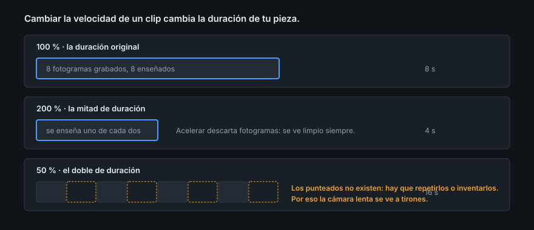

# Cambios de velocidad

> Acelerar un plano no es un efecto: es una forma de arreglar un problema de duración sin
> tirar el plano. Y tiene un peaje que casi nadie menciona hasta que se ve en pantalla.

## 🎯 Objetivos

- Explicar qué le pasa a la **duración** de un clip cuando cambias su velocidad
- Enumerar los tres usos honestos de un cambio de velocidad en un montaje
- Aplicar un cambio de velocidad constante desde las herramientas de la Cut page
- Entender por qué la cámara lenta se ve a saltos y cuándo no se ve
- Saber qué le pasa al audio, y por qué esta semana casi siempre hay que bajarlo

---

## 1. Qué problema resuelve

Tienes un plano que funciona pero dura de más: un travelling de doce segundos que en la
pieza pide seis. Tienes tres salidas.

1. **Cortarlo.** Te quedas con seis segundos y pierdes el recorrido entero.
2. **Quitarlo.** Pierdes el plano.
3. **Acelerarlo al 200 %.** El recorrido entero, en seis segundos.

La tercera es lo que resuelve un cambio de velocidad: **cambiar la duración sin cambiar el
contenido**. Es lo mismo que hace un time-lapse, en pequeño.

Y al revés: un gesto que pasa demasiado rápido para leerse —una mirada, un impacto, una
mano que coge algo— puede ralentizarse para que se lea.

---

## 2. Cómo funciona

### 2.1 Velocidad y duración son la misma cosa

Un clip tiene un número fijo de fotogramas grabados. La velocidad decide **cuántos de esos
fotogramas se enseñan por segundo de timeline**:

| Velocidad | Qué pasa | Duración en la timeline |
| --------- | -------- | ----------------------- |
| **100 %** | Un fotograma grabado por fotograma de timeline | La original |
| **200 %** | Se enseña uno de cada dos | **La mitad** |
| **50 %** | Cada fotograma se enseña dos veces | **El doble** |
| **-100 %** | Los mismos, en orden inverso | La original, hacia atrás |

De aquí sale la consecuencia que importa esta semana:

> [!IMPORTANT]
> **Cambiar la velocidad de un clip en `Video 1` cambia la duración de tu pieza.** Y como
> `Video 1` hace ripple, todo lo que viene detrás se recoloca. Si ya tienes rótulos o
> recursos colocados encima, se descolocan. Por eso los cambios de velocidad van **antes**
> que los títulos, y por eso la práctica 03 los pone en ese orden.

### 2.2 Por qué la cámara lenta se ve a saltos

Cuando ralentizas al 50 %, Resolve tiene que enseñar 24 fotogramas por segundo de timeline
pero solo tiene 12 grabados para ese segundo. Le faltan 12, y solo puede hacer dos cosas:

- **Repetir** cada fotograma dos veces. El movimiento se ve escalonado, a tirones.
- **Inventar** los fotogramas intermedios interpolando entre los que hay. Se ve más fluido,
  pero puede producir deformaciones alrededor de lo que se mueve rápido.

Por eso la cámara lenta buena **se graba, no se hace**: un plano rodado a 120 fps tiene 120
fotogramas por segundo y se puede llevar al 20 % sin inventar nada. Un plano rodado a 24 fps
no.

> [!NOTE]
> **Interpolar** es calcular un valor intermedio a partir de dos conocidos. En vídeo,
> inventar el fotograma que iría entre dos grabados. Es lo mismo que hace `Smooth Cut` del
> archivo 04, aplicado a todo el clip en vez de a un corte.

La regla práctica, para material grabado a 24 fps:

| Ralentización | Resultado |
| ------------- | --------- |
| Hasta el 80 % | Casi imperceptible |
| 50 % | Se nota; aceptable en planos con poco movimiento |
| Por debajo del 40 % | Se ve mal, salvo que el plano esté casi quieto |

Acelerar, en cambio, no tiene ese problema: sobran fotogramas y se descartan. Un 200 % o un
400 % se ven limpios siempre.

### 2.3 Qué le pasa al audio

El audio del clip cambia de velocidad con la imagen —no hay forma de separarlos aquí— pero
Resolve lo procesa para que **el tono no cambie**: una voz acelerada no suena aguda, suena
rápida. Es lo que se llama corrección de tono, y en la Cut page está siempre activa.

Suena rápida, eso sí. Y una voz al 200 % es ininteligible. En la práctica:

> **Un clip al que le cambias la velocidad casi siempre hay que silenciarlo o bajarlo
> mucho.** Es una decisión de audio, y va en el archivo 06.

### 2.4 Los tres usos honestos

| Uso | Qué resuelve | Rango típico |
| --- | ------------ | ------------ |
| **Ajustar duración** | Un plano que funciona pero dura de más | 110-200 % |
| **Dejar leer un gesto** | Algo que pasa demasiado rápido | 50-80 % |
| **Comprimir un proceso** | Un montaje, un trayecto, una preparación | 200-800 % |

Y el uso deshonesto, que es el número uno: **ralentizar porque queda dramático**. Se nota, y
lo que se nota es que no había nada que enseñar.

---

## 3. Cómo se hace en Resolve 21

### 3.1 El panel `Speed` de las herramientas de clip

En la Cut page los efectos de clip viven en el mismo sitio: el botón **`Tools`** de la barra
del visor. Al pulsarlo aparece una fila de categorías —`Transform`, `Crop`, `Dynamic Zoom`,
`Composite`, **`Speed`**, `Stabilization`, `Lens Correction`, `Color`, `Audio`— y cada una
despliega sus controles debajo del visor.

`Speed` tiene tres controles:

| Control | Qué hace |
| ------- | -------- |
| **`Speed`** | El multiplicador. `200` es el doble de rápido; un valor negativo, hacia atrás |
| **`Duration`** | La duración resultante. Es la misma información, dicha al revés |
| **`Add Speed Point`** | Añade un punto de cambio de velocidad en el cabezal |

Las dos primeras están enlazadas: cambia una y la otra se recalcula sola. Si sabes cuánto
tiene que durar el plano, escribe la duración y deja que Resolve calcule el porcentaje.

Cada categoría de `Tools` tiene además dos controles compartidos: un **interruptor** a la
izquierda, que desactiva el efecto sin perder los ajustes, y un **reinicio** a la derecha,
que lo devuelve todo a su valor por defecto. El interruptor es la forma de comparar el antes
y el después sin deshacer.

*Controles de `Tools` y del panel `Speed` verificados en el DaVinci Resolve 21 Reference
Manual, capítulo 38, agosto de 2026.*

### 3.2 `Add Speed Point`: lo que no toca esta semana

`Add Speed Point` es el principio de una **rampa de velocidad**: un plano que empieza a
velocidad normal, acelera y vuelve. Es un efecto de keyframes, se controla desde la Edit
page y es materia de la **Semana 10**.

Esta semana, velocidad **constante** por clip. Un número, y ya.

### 3.3 Ver qué clips llevan velocidad cambiada

En `Timeline Options` hay un interruptor llamado **`Display Speed Keyframes`** que muestra
sobre el clip los puntos de velocidad. Y **`Display Clip Status`** muestra los iconos de
estado de las operaciones aplicadas a cada clip.

Vale la pena dejarlos activados esta semana: un cambio de velocidad no se ve mirando la
timeline, y a los tres días no te acuerdas de cuáles tocaste.

---

## 4. Antipatrones

| Antipatrón | Por qué duele | Qué hacer |
| ---------- | ------------- | --------- |
| Ralentizar por debajo del 40 % material a 24 fps | Se ve a tirones o deformado | Grábalo a alta cadencia, o no lo ralentices |
| Cambiar velocidades después de poner títulos | La pieza cambia de duración y se descoloca todo | Velocidad antes, títulos después |
| Dejar sonando un clip acelerado | Suena a comedia involuntaria | Silénciarlo o bajarlo mucho |
| Ralentizar «porque queda épico» | Se nota que no había nada que enseñar | Los tres usos honestos, y ninguno más |
| Usar `Add Speed Point` esta semana | Es una rampa: keyframes, Edit page, Semana 10 | Velocidad constante |
| Ajustar el porcentaje a ojo | Tardas el triple | Escribe la duración que quieres en `Duration` |
| No recordar qué clips tocaste | Se descubre en la Semana 09, mal | `Display Speed Keyframes` y `Display Clip Status` |

---

## 5. Trucos

| Truco | Cómo |
| ----- | ---- |
| Que un plano dure exactamente lo que quieres | Escribe la duración en `Duration`, no el porcentaje |
| Comparar con y sin efecto | El interruptor de la izquierda de la categoría, en `Tools` |
| Volver al principio sin deshacer | El reinicio de la derecha de la categoría |
| Un plano hacia atrás | Un valor negativo en `Speed` |
| Ver de un vistazo qué clips llevan velocidad | `Timeline Options > Display Speed Keyframes` |
| Ralentización que no se ve | No bajes del 80 % con material a 24 fps |
| Aceleración segura | Acelerar nunca inventa fotogramas: 200 % o 400 % se ven limpios |

---

## 📚 Recursos Adicionales

- [DaVinci Resolve Reference Manual](https://www.blackmagicdesign.com/support/family/davinci-resolve-and-fusion) — capítulo 38, secciones «Clip Tools» y «Speed»: los tres controles y los controles compartidos de cada categoría.
- [Semana 10 · Velocidad, transformaciones y estabilización](../../week-10-velocidad_transformaciones_y_estabilizacion/README.md) — las rampas de velocidad con keyframes, que es donde `Add Speed Point` cobra sentido.
- [Semana 01 · Fundamentos de imagen en movimiento](../../week-01-fundamentos_de_imagen_en_movimiento/README.md) — fps y cadencia de grabación: por qué la cámara lenta buena se graba en vez de hacerse.

---

## ✅ Checklist de Verificación

- [ ] Sé por qué cambiar la velocidad cambia la duración del clip
- [ ] Entiendo que eso hace ripple y descoloca lo que hay encima
- [ ] Sé por qué la cámara lenta a 24 fps se ve a saltos
- [ ] Conozco los tres usos honestos de un cambio de velocidad
- [ ] Sé usar `Speed` y `Duration` desde el botón `Tools`
- [ ] Sé que el audio se corrige de tono pero casi siempre hay que bajarlo

---

| Anterior | Actual | Siguiente |
| -------- | ------ | --------- |
| [04 · Smooth Cut](04-smooth-cut.md) | **05 · Cambios de velocidad** | [06 · Audio básico en la Cut page](06-audio-basico-en-la-cut-page.md) |

← [Volver a la Semana 07](../README.md)
