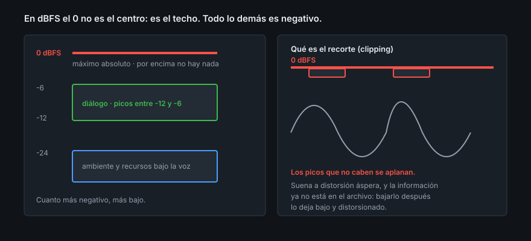

# Audio básico en la Cut page

> El sonido de tu pieza ahora mismo es lo que trajo cada clip: uno alto, otro bajo, otro con
> aire. No toca mezclar —eso es la Fase 4— pero sí toca dejarlo audible, porque una pieza
> que no se puede oír no se puede juzgar.

## 🎯 Objetivos

- Definir **dBFS** y saber qué significa el 0 en un medidor digital
- Distinguir **nivelar** de **mezclar**, y saber cuál toca esta semana
- Ajustar el volumen de un clip desde las herramientas de la Cut page
- Usar `Ripple Delete Silence` sabiendo exactamente qué borra
- Saber qué cosas de audio **no** existen en la Cut page y dónde están

---

## 1. Qué problema resuelve

Reproduce tu pieza entera con auriculares. Vas a encontrar tres cosas, siempre las mismas:

1. **Clips que suenan mucho más alto que los demás.** Cada cámara y cada micrófono graban a
   niveles distintos.
2. **Clips que no deberían sonar.** Los planos de recurso de `Video 2` traen su propio audio,
   que se suma al de debajo y ensucia la voz.
3. **Silencios largos** dentro de la entrevista: pausas, respiraciones, el ruido de la sala.

Ninguna de las tres es un problema de mezcla. Son problemas de **nivelado**: poner cada
cosa en un rango razonable para que la pieza se pueda escuchar de principio a fin sin tocar
el volumen del ordenador.

La diferencia importa:

| | Qué es | Cuándo |
| --- | --- | --- |
| **Nivelar** | Que nada reviente y que todo se oiga | Esta semana |
| **Mezclar** | Decidir la relación entre voz, música y ambiente, a un objetivo medido | Semanas 13-15 |

---

## 2. Cómo funciona

### 2.1 El 0 es el techo, no el centro

En audio digital el volumen se mide en **dBFS**: *decibelios relativos a fondo de escala*
(*decibels relative to Full Scale*). La escala funciona al revés de lo que uno espera:

- **0 dBFS** es el máximo absoluto que un archivo digital puede representar. No hay nada
  por encima.
- Todo lo demás es **negativo**: -6 dBFS, -12 dBFS, -20 dBFS. Cuanto más negativo, más bajo.

Si una señal intenta pasar de 0, no suena más fuerte: se **recorta** (*clipping*). Los picos
que no caben se aplanan, y eso se oye como una distorsión áspera que **no se puede
deshacer**, porque la información no está en el archivo.

> [!WARNING]
> El recorte no es un problema de volumen: es pérdida de información. Bajar después un clip
> recortado lo deja bajo **y** distorsionado. Si un clip llega recortado de la grabación, la
> única solución de verdad es volver a grabarlo. Anótalo en `notas-de-montaje.md`.

### 2.2 Dónde tiene que estar la voz

Los valores de referencia para esta semana, que son de nivelado y no de entrega:

| Material | Rango sano |
| -------- | ---------- |
| Diálogo, voz principal | Picos entre **-12 y -6 dBFS** |
| Ambiente y recursos bajo la voz | **-24 dBFS** o menos |
| Cualquier cosa | **Nunca** tocando 0 dBFS |

Estos números son un suelo de trabajo, no un estándar de entrega. El estándar de entrega se
mide en **LUFS** y no en dBFS, es otra magnitud, y es materia de la Semana 15. Aquí solo se
trata de que la pieza se pueda escuchar.

### 2.3 Qué hay y qué no hay en la Cut page

La Cut page tiene, para audio, exactamente esto:

| Hay | Dónde |
| --- | ----- |
| Un **deslizador de volumen** por clip | `Tools > Audio`, en la barra del visor |
| **Silenciar una pista entera** | El control de mute en la cabecera de la pista |
| **`Ripple Delete Silence`** | `Clip > Audio Operations > Ripple Delete Silence` |
| **Elegir con qué pistas de audio se edita** | `Timeline Options > Edit Using (Audio Track)` |

Y no tiene: fundidos de entrada y salida por clip, ecualización, compresión, medidores de
loudness, buses, ni automatización. Todo eso vive en las páginas Edit y Fairlight, y es la
Fase 4.

No es una carencia: es la misma frontera del archivo 01. La Cut page nivela; Fairlight
mezcla.

---

## 3. Cómo se hace en Resolve 21

### 3.1 El nivel de un clip

1. Selecciona el clip en la timeline.
2. Pulsa **`Tools`** en la barra del visor.
3. Elige la categoría **`Audio`**.
4. Mueve el deslizador de volumen.

Ese deslizador es **el mismo ajuste de volumen del clip** que verás en las páginas Edit y
Fairlight: no es un control paralelo ni un duplicado. Lo que hagas aquí lo encontrarás allí.

### 3.2 Los recursos de `Video 2`, uno por uno

Es el arreglo más rentable de la semana y cuesta dos minutos:

Para cada plano de recurso que colocaste en la Semana 06, baja su volumen hasta que no
interfiera con la voz de debajo. En la mayoría de los casos, hasta el silencio.

La excepción son los recursos con sonido propio que aporta algo —una máquina funcionando, el
mar, una calle— donde un poco de nivel debajo de la voz enriquece. «Un poco» significa que
sigues entendiendo cada palabra sin esfuerzo.

### 3.3 `Ripple Delete Silence`

Analiza un clip de audio, encuentra los tramos por debajo de un umbral y los **borra
cerrando el hueco**. Es la forma rápida de quitar las pausas largas de una entrevista.

`Clip > Audio Operations > Ripple Delete Silence`, con el clip seleccionado. La ventana tiene
cinco parámetros:

| Parámetro | Qué hace |
| --------- | -------- |
| **`Threshold`** | El nivel en dB por debajo del cual se considera silencio. Más alto, más se borra |
| **`Pre Head`** | Cuánto silencio se conserva **antes** de cada tramo audible |
| **`Post Tail`** | Cuánto se conserva **después** |
| **`Minimum to Trip`** | El silencio mínimo, en fotogramas, que hay que encontrar para borrarlo |
| **`Crossfade audio`** | Aplica un fundido cruzado entre los trozos que quedan |

> [!WARNING]
> `Ripple Delete Silence` es una operación con ripple: **acorta la pieza y recoloca todo lo
> que viene detrás**. Y borra imagen además de sonido, porque en `Video 1` la imagen y el
> audio van juntos, así que **crea saltos de montaje**: exactamente los que arregla el
> archivo 04.
>
> Consecuencias prácticas: se hace **antes** de poner nada en las pistas de encima, y
> después hay que repasar los saltos. Exporta el proyecto antes de lanzarla.

Empieza con valores conservadores: un `Minimum to Trip` alto —del orden de un segundo, 24
fotogramas— borra solo las pausas largas y deja el ritmo natural del habla. Un valor bajo
deja el diálogo picado y antinatural.

### 3.4 Silenciar una pista entera

En la cabecera de cada pista hay controles para **ampliar** la pista, **bloquearla**,
**silenciar el audio** y **desactivar el vídeo**. Silenciar `Video 2` entera es la forma
rápida de comprobar si los recursos están molestando: silencias, reproduces, comparas.

*Controles de cabecera de pista, panel `Audio` de `Tools` y parámetros de
`Ripple Delete Silence` verificados en el DaVinci Resolve 21 Reference Manual,
capítulos 33 y 38, agosto de 2026.*

---

## 4. Antipatrones

| Antipatrón | Por qué duele | Qué hacer |
| ---------- | ------------- | --------- |
| Subir un clip bajo hasta que toque 0 dBFS | Recorta, y el recorte no se deshace | Picos entre -12 y -6 dBFS |
| Dejar sonando el audio de los recursos | Ensucia la voz y no te das cuenta hasta la Fase 4 | Bájalos uno a uno |
| Meter música esta semana | Se rehace entera en la Semana 15 | Anótala y sigue |
| Mezclar «ya que estoy» | La pieza aún se va a mover: la mezcla se pierde | Nivelar ahora, mezclar en la Fase 4 |
| `Ripple Delete Silence` con umbral agresivo | Diálogo picado, respiraciones cortadas | `Minimum to Trip` alto, y escuchar |
| Lanzarla con títulos ya colocados | Hace ripple y los descoloca todos | Antes de tocar `Video 2` y `Video 3` |
| Juzgar el nivel con los altavoces del portátil | No tienen graves y engañan | Auriculares, siempre los mismos |
| Confundir dBFS con LUFS | Son magnitudes distintas | dBFS ahora; LUFS en la Semana 15 |

---

## 5. Trucos

| Truco | Cómo |
| ----- | ---- |
| Bajar el volumen de un clip | `Tools > Audio` y el deslizador |
| Comprobar si los recursos molestan | Silencia `Video 2` desde su cabecera y compara |
| Quitar pausas largas de una entrevista | `Clip > Audio Operations > Ripple Delete Silence` |
| Que no te pique el diálogo | Sube `Minimum to Trip` a un segundo o más |
| Saber si algo recorta | Si el medidor toca el 0, ya es tarde: baja el clip |
| Escuchar la pieza como se va a oír | Auriculares, y siempre los mismos |
| No perder una idea de sonido | Una línea en `notas-de-montaje.md`, apartado de audio |

---

## 📚 Recursos Adicionales

- [DaVinci Resolve Reference Manual](https://www.blackmagicdesign.com/support/family/davinci-resolve-and-fusion) — capítulo 38, secciones «Audio» y «Ripple Delete Silence for Selected Clip»: el deslizador y los cinco parámetros.
- [Semana 13 · Fairlight: anatomía y mezcla base](../../week-13-fairlight_anatomia_y_mezcla_base/README.md) — dónde empieza la mezcla de verdad: pistas, buses y medidores.
- [Semana 15 · Diseño sonoro, música y loudness](../../week-15-diseno_sonoro_musica_y_loudness/README.md) — LUFS, el objetivo de entrega y por qué dBFS no basta.

---

## ✅ Checklist de Verificación

- [ ] Sé qué es el dBFS y por qué el 0 es un techo
- [ ] Sé en qué rango tiene que estar el diálogo esta semana
- [ ] Distingo nivelar de mezclar y sé cuál toca ahora
- [ ] Sé bajar el volumen de un clip desde `Tools > Audio`
- [ ] Sé qué borra `Ripple Delete Silence` y qué efectos secundarios tiene
- [ ] Sé qué cosas de audio no existen en la Cut page y dónde están

---

| Anterior | Actual | Siguiente |
| -------- | ------ | --------- |
| [05 · Cambios de velocidad](05-cambios-de-velocidad.md) | **06 · Audio básico en la Cut page** | [07 · Títulos rápidos](07-titulos-rapidos.md) |

← [Volver a la Semana 07](../README.md)
