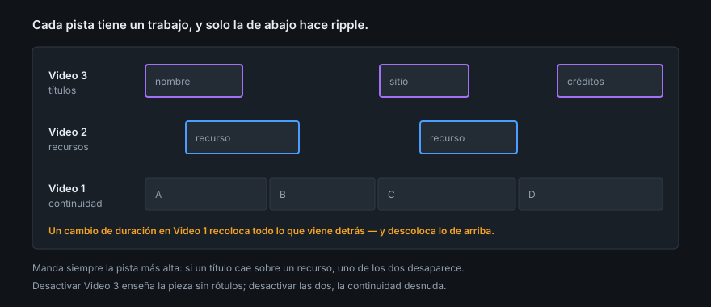

# Títulos rápidos

> Un rótulo con el nombre de quien habla es la diferencia entre una pieza que se entiende y
> otra que no. Y es lo último que se pone, porque está clavado a un instante concreto que
> todavía se puede mover.

## 🎯 Objetivos

- Distinguir **título** de **generador** y saber qué hay en cada categoría
- Explicar por qué los títulos van en su propia pista y no sobre `Video 2`
- Colocar un título, escribir su texto y cambiar su duración en la Cut page
- Saber qué se ajusta aquí y qué se deja para la Semana 11
- Escribir un rótulo que sirva: qué información lleva y cuánto dura

---

## 1. Qué problema resuelve

Hay tres cosas que una pieza no puede decir con imágenes y que el espectador necesita:

1. **Quién es esa persona.** Nombre y, si hace falta, en qué calidad habla.
2. **Dónde y cuándo estamos.** Un rótulo de sitio o de fecha ahorra dos minutos de montaje.
3. **De qué va esto.** El título de la pieza al principio, los créditos al final.

Nada de eso se resuelve montando mejor. Se resuelve escribiéndolo en pantalla.

El problema secundario, y el que ordena este archivo, es **cuándo** ponerlos. Un rótulo está
anclado: aparece en el segundo 34 porque en el segundo 34 esa persona empieza a hablar. Si
después mueves un corte anterior, el rótulo se queda donde estaba y la persona ya no. Por
eso los títulos son lo último de la semana.

---

## 2. Cómo funciona



### 2.1 Un título es un clip

En la timeline, un título se comporta como cualquier otro clip: ocupa un tramo, se arrastra,
se alarga, se acorta y se borra igual. La diferencia es que no viene de un archivo: lo genera
Resolve. Por eso a esta familia se la llama **generadores** (*generators*): producen imagen
en vez de leerla del disco.

Un título es un generador con texto encima.

### 2.2 Las dos categorías

El navegador de títulos presenta dos grupos, y elegir mal cuesta tiempo:

| Categoría | Qué son | Cuándo |
| --------- | ------- | ------ |
| **`Titles`** | Títulos simples, sin animación, muy personalizables | Esta semana, siempre |
| **`Fusion Titles`** | Títulos complejos, con animación ya montada | Semana 11, y con criterio |

Dentro de `Titles`, el más flexible es el que se llama **`Text`**: un bloque de texto sobre
transparencia, sin adornos. Es el que hace falta esta semana y es el que se usa en la
práctica.

> [!NOTE]
> Existe además `Text+`, que es el motor de texto de Fusion metido en la timeline: mucho más
> potente y mucho más lento de configurar. Se estudia en la **Semana 11**. Esta semana, `Text`
> a secas.

### 2.3 Por qué en su propia pista

Un título podría ir en `Video 2`, encima de los recursos. No conviene, por tres razones
concretas:

1. **Se pisan.** Si un rótulo cae donde hay un recurso, uno de los dos desaparece: en la
   timeline manda siempre la pista más alta.
2. **No se encuentran.** Buscar seis rótulos entre veinte recursos, en la Semana 11, es
   perder la tarde.
3. **No se pueden apagar de golpe.** Con los títulos en `Video 3`, desactivar esa pista te
   enseña la pieza sin rótulos en un clic. Es como se comprueba si un rótulo tapa algo
   importante.

De ahí el reparto que fija esta semana y que dura hasta el final del bootcamp:

```
Video 3   títulos
Video 2   recursos (B-roll)
Video 1   continuidad (A-roll)
```

El check `montaje-v2-pista-de-titulos` comprueba precisamente que existan las tres.

### 2.4 Cuánto dura un rótulo

La duración por defecto de un generador en Resolve es de **5 segundos**. Para un rótulo de
nombre es demasiado.

La medida que funciona es de lectura, no de reloj: **el tiempo de leerlo dos veces, sin
prisa**. Para un nombre y un cargo, entre 3 y 4 segundos. Para el título de la pieza, lo que
pida la apertura.

Y el momento: un rótulo de nombre entra **un segundo después** de que la persona empiece a
hablar, no a la vez. Si entra a la vez, compite con la voz.

---

## 3. Cómo se hace en Resolve 21

### 3.1 Colocar el primero

1. Abre el navegador de títulos de la Cut page y elige la categoría **`Titles`**.
2. Localiza **`Text`**.
3. **Arrástralo a la zona gris vacía** que hay encima de `Video 2`. Resolve crea `Video 3`
   sola al soltarlo.
4. Ajusta su posición y su longitud arrastrando el clip y sus bordes.

Si prefieres crear la pista antes, está en **`Timeline Actions > Add Video Track`**.

> [!TIP]
> Antes de arrastrar nada, puedes previsualizar: con **`Hover Scrub Preview`** activado en el
> menú de opciones del navegador de títulos, pasar el ratón por encima de una miniatura
> enseña el título en el visor. Ahorra colocar tres para quedarte con uno.

### 3.2 Escribir el texto

Con el cabezal sobre el título:

- **Doble clic sobre el texto en el visor** lo pone en modo edición y se escribe ahí mismo,
  como en cualquier editor.
- **Un clic** muestra los controles en pantalla de posición, escala y rotación.

Al arrastrar el texto, se pega solo al centro horizontal, al centro vertical y a los tercios
del encuadre. `Shift` mientras arrastras restringe el movimiento a un solo eje.

### 3.3 Fuente, color y lo demás

Doble clic sobre el título abre sus parámetros en el **Video Inspector**: tipografía, tamaño,
color, sombra, fondo, y los mismos controles de transformación y recorte que cualquier clip.

Esta semana, lo mínimo: que se lea. Es decir, dos cosas y ninguna más.

1. **Contraste suficiente** contra lo que hay detrás. Texto claro sobre imagen oscura, o al
   revés. Si la imagen detrás es media, una sombra o un fondo resuelven.
2. **Tamaño legible** en la pantalla en la que se vaya a ver. Si lo tuyo acaba en un móvil,
   compruébalo mirando el visor pequeño, no a pantalla completa.

El diseño de verdad —jerarquía, familia tipográfica, animación de entrada— es la Semana 11.
Aquí basta con que la información esté y se lea.

### 3.4 Qué escribir

| Tipo de rótulo | Qué lleva | Duración |
| -------------- | --------- | -------- |
| **Nombre** | Nombre y, si aporta, en qué calidad habla | 3-4 s |
| **Sitio o fecha** | Lo mínimo para situar | 2-3 s |
| **Título de la pieza** | El título, y nada más | Lo que pida la apertura |
| **Cierre** | Autoría, fecha, licencia del material usado | 5 s o más |

El rótulo de cierre no es decorativo: si tu pieza usa material con licencia Creative Commons
del pack de medios, la atribución **va ahí**. Es la condición de la licencia.

*Categorías del navegador, duración por defecto de un generador, edición de texto en el visor
y controles del Inspector verificados en el DaVinci Resolve 21 Reference Manual, capítulo 38,
sección «Titles», agosto de 2026.*

---

## 4. Antipatrones

| Antipatrón | Por qué duele | Qué hacer |
| ---------- | ------------- | --------- |
| Poner títulos antes de cerrar la estructura | Cualquier ripple posterior los descoloca | Lo último de la semana |
| Mezclar títulos y recursos en `Video 2` | Se pisan y no se encuentran | `Video 3` para títulos |
| Empezar por un `Fusion Title` | Traen animación y ajustes que aún no sabes tocar | `Titles > Text` |
| Dejar los 5 segundos por defecto | Es una duración que no decidiste | El tiempo de leerlo dos veces |
| Un rótulo que entra a la vez que la voz | Compite con lo que dice | Un segundo después |
| Texto blanco sobre imagen clara | No se lee, y no lo ves porque sabes qué pone | Sombra, fondo, o cambia el plano |
| Ponerse a diseñar tipografía esta semana | Es la Semana 11 y se rehace | Que se lea, y ya |
| Olvidar la atribución del material CC | Incumple la licencia | Rótulo de cierre con las atribuciones |

---

## 5. Trucos

| Truco | Cómo |
| ----- | ---- |
| Crear la pista de títulos sin menús | Arrastra el primer título a la zona gris de encima de `Video 2` |
| Ver un título antes de colocarlo | `Hover Scrub Preview` y pasa el ratón por la miniatura |
| Escribir el texto donde se ve | Doble clic sobre el texto en el visor |
| Centrar un rótulo sin ajustar números | Al arrastrarlo se pega al centro y a los tercios |
| Mover en un solo eje | `Shift` mientras arrastras |
| Ver la pieza sin rótulos | Desactiva `Video 3` desde su cabecera |
| Comprobar que se lee en móvil | Míralo en el visor pequeño, no a pantalla completa |
| Duplicar un rótulo con el mismo formato | Copia el clip de título y cambia solo el texto |

---

## 📚 Recursos Adicionales

- [DaVinci Resolve Reference Manual](https://www.blackmagicdesign.com/support/family/davinci-resolve-and-fusion) — capítulo 38, sección «Titles»: las dos categorías, la duración por defecto y la edición en el visor.
- [Semana 11 · Títulos, Text+, efectos y compuestos](../../week-11-titulos_texto_plus_efectos_y_compuestos/README.md) — `Text` frente a `Text+`, animación y diseño tipográfico de verdad.
- [`docs/pack-de-medios.md`](../../../docs/pack-de-medios.md) — de dónde sale el material y qué licencia tiene cada fuente, que es lo que hay que atribuir en el rótulo de cierre.

---

## ✅ Checklist de Verificación

- [ ] Sé qué es un generador y por qué un título es uno
- [ ] Distingo `Titles` de `Fusion Titles` y sé cuál toca ahora
- [ ] Sé por qué los títulos van en `Video 3` y no en `Video 2`
- [ ] Sé crear la pista arrastrando el primer título a la zona gris
- [ ] Sé escribir y colocar el texto desde el visor
- [ ] Sé cuánto tiene que durar un rótulo y cuándo tiene que entrar
- [ ] Sé que la atribución del material con licencia va en el rótulo de cierre

---

| Anterior | Actual | Siguiente |
| -------- | ------ | --------- |
| [06 · Audio básico en la Cut page](06-audio-basico-en-la-cut-page.md) | **07 · Títulos rápidos** | [08 · El detector de aburrimiento](08-el-detector-de-aburrimiento.md) |

← [Volver a la Semana 07](../README.md)
