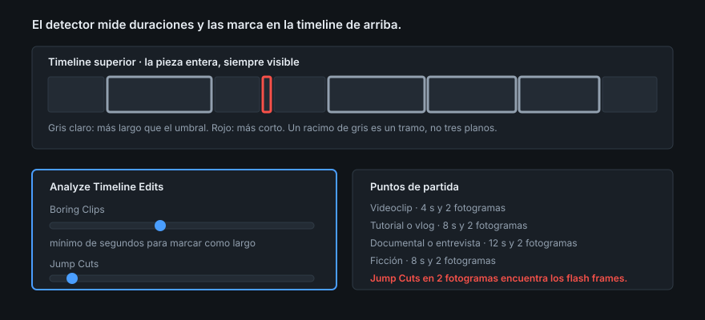

# El detector de aburrimiento

> Hay dos defectos de ritmo que el ojo no ve cuando lleva tres horas montando: el plano que
> dura demasiado y el que dura dos fotogramas. Resolve los marca en color, y además sabe
> decirte qué trozos has usado dos veces.

## 🎯 Objetivos

- Explicar qué analiza el **Boring Detector** y qué colores usa
- Fijar sus dos umbrales con un criterio, no con el valor por defecto
- Definir **flash frame** y saber por qué aparece sin que nadie lo ponga
- Explicar qué es un **plano repetido** y por qué molesta al espectador
- Activar la detección de fotogramas duplicados y leer lo que muestra

---

## 1. Qué problema resuelve

Al revisar tu propia pieza por décima vez dejas de verla. Sabes lo que viene, así que tu
cabeza rellena y el ritmo real desaparece. Es el motivo de que las revisiones tardías
detecten menos que las primeras.

Hay dos defectos que se escapan siempre por eso:

1. **El plano largo.** Un plano que dura ocho segundos cuando la pieza pide tres. Tú no lo
   notas porque estás pensando en el siguiente; el espectador se descuelga.
2. **El plano de dos fotogramas.** Un resto de un borrado, un clip que se coló al pegar. En
   pantalla es un parpadeo. En la timeline, a la escala normal, es invisible.

Y hay un tercero, que no es de duración sino de contenido: **el plano repetido**. Has usado
el mismo trozo de material en dos sitios. El espectador lo reconoce aunque no sepa por qué, y
la pieza pierde credibilidad.

Los tres se detectan con dos herramientas que no cuestan nada de activar.

---

## 2. Cómo funciona

### 2.1 El Boring Detector

Hace un análisis **en vivo** de la duración de cada clip de la timeline y resalta los que se
salen de los márgenes que le hayas dado. No juzga el contenido: solo mide duraciones. El
nombre es una broma de Blackmagic, pero la herramienta es seria.

Marca dos cosas, con dos colores, **en la timeline de arriba**:

| Color | Qué marca | Qué significa |
| ----- | --------- | ------------- |
| **Gris claro** | Clips **más largos** que el umbral `Boring Clips` | Candidato a acortar |
| **Rojo** | Clips **más cortos** que el umbral `Jump Cuts` | Casi siempre un error |

Que marque en la timeline de arriba es el detalle que lo hace útil: esa timeline muestra la
pieza entera siempre, así que ves de un vistazo **dónde se concentran** los problemas. Tres
marcas grises seguidas en el minuto cuatro no son tres planos largos: son un tramo que se
hace largo.

Es **persistente**: una vez activado sigue analizando mientras editas. Se apaga volviendo a
pulsarlo.

### 2.2 Los dos umbrales

La ventana se llama **`Analyze Timeline Edits`** y tiene dos deslizadores:

- **`Boring Clips`** — el **mínimo de segundos** que tiene que durar un clip para que lo
  marque como demasiado largo.
- **`Jump Cuts`** — el **máximo de fotogramas** por debajo del cual lo marca como demasiado
  corto.

No hay un valor correcto universal, porque dependen del formato. Puntos de partida:

| Tu pieza | `Boring Clips` | `Jump Cuts` |
| -------- | -------------- | ----------- |
| Videoclip, pieza de ritmo rápido | 4 s | 2 fotogramas |
| Tutorial, vlog, divulgación | 8 s | 2 fotogramas |
| Documental, entrevista | 12 s | 2 fotogramas |
| Ficción | 8 s | 2 fotogramas |

`Jump Cuts` en **2 fotogramas** es el ajuste que el propio manual recomienda para encontrar
**flash frames**, y vale para cualquier formato.

> [!NOTE]
> Un **flash frame** es un clip de uno o dos fotogramas que nadie puso a propósito. Sale de
> borrar mal, de arrastrar con el imán desactivado o de pegar en el sitio equivocado. En
> pantalla es un fogonazo de una imagen que no pinta nada. Es de los defectos que más
> delatan a una pieza y de los más fáciles de arreglar.

### 2.3 Los fotogramas duplicados

Es otra herramienta y otro problema. **`View > Show Duplicate Frames`** activa la detección
de fotogramas duplicados —lo que en el oficio se llama *dupe detection*— y dibuja **barras de
color sobre los clips** de la timeline allí donde un mismo rango de fotogramas se ha usado
más de una vez.

No es lo mismo que usar dos veces el mismo archivo: usar dos trozos distintos de un clip
largo es normal y no se marca. Lo que marca es que **el mismo trozo** esté en dos sitios.

Por qué importa:

- En una **entrevista**, un trozo repetido de recurso se reconoce y desconcierta.
- En un **documental**, repetir un plano de archivo puede ser una decisión, pero tiene que
  ser una decisión.
- En cualquier pieza, es la señal de que estás corto de material y lo estás estirando: eso
  se anota en `notas-de-montaje.md`, apartado «lo que falta grabar».

*Umbrales, colores y comportamiento del Boring Detector verificados en el DaVinci Resolve 21
Reference Manual, capítulo 35, sección «The Boring Detector»; `Show Duplicate Frames`
documentado en el capítulo 41, «Duplicate Frame Detection». Agosto de 2026.*

> [!IMPORTANT]
> El manual documenta `Show Duplicate Frames` en el capítulo de la **Edit page**. `View` es
> un menú global y la timeline es la misma en las dos páginas, pero **compruébalo en tu
> instalación**: abre `View` desde la Cut page y busca la opción. Si no aparece ahí, pasa a
> Edit con `Shift+4`, actívala, mira lo que marca y vuelve con `Shift+3`. Es la primera vez
> del bootcamp en que cambiar de página es la respuesta correcta, y es exactamente la
> frontera del archivo 01.

---

## 3. Cómo se hace en Resolve 21

### 3.1 La pasada de detección

Se hace **una vez**, al principio del acabado, y se hace entera antes de arreglar nada:

1. **`Timeline Options > Boring Detector`.**
2. En `Analyze Timeline Edits`, pon los dos umbrales según tu formato y pulsa **`Analyze`**.
3. **Mira la timeline de arriba** y anota dónde hay gris y dónde hay rojo. No arregles
   todavía.
4. **`View > Show Duplicate Frames`.** Anota los tramos con barra de color.
5. Ahora sí: arregla, en el orden del apartado siguiente.

El paso 3 es el que la gente se salta, y es el que hace que la herramienta valga: si arreglas
según encuentras, cambias las duraciones mientras el detector analiza y acabas persiguiéndote
la cola.

### 3.2 Qué hacer con cada marca

| Marca | Diagnóstico | Arreglo |
| ----- | ----------- | ------- |
| **Rojo** de 1-2 fotogramas | Flash frame: basura | Borrar con ripple, sin pensarlo |
| **Rojo** de 5-10 fotogramas | Puede ser un corte muy rápido a propósito | Reproducir y decidir |
| **Gris** aislado | Un plano largo que quizá lo pide | Reproducir: ¿te descuelgas? |
| **Gris** en racimo | Un tramo entero que se hace largo | Problema de estructura, no de planos |
| **Barra de duplicado** | El mismo trozo dos veces | Cambiar uno de los dos, o anotar que falta material |

La distinción entre gris aislado y gris en racimo es la más valiosa de la tabla. Un plano
largo se acorta; un racimo de planos largos no se arregla acortando cinco planos, se arregla
quitando el tramo o cambiándolo de sitio.

### 3.3 Dejarlo encendido

El Boring Detector no molesta y sigue analizando mientras editas, así que déjalo activado el
resto de la semana. Cuando alargues un plano de más, te lo va a decir en el momento.

---

## 4. Antipatrones

| Antipatrón | Por qué duele | Qué hacer |
| ---------- | ------------- | --------- |
| Arreglar según vas encontrando | Cambias duraciones mientras analizas | Detectar entero, arreglar después |
| Dejar los umbrales por defecto | No dicen nada sobre tu formato | Ponlos según la tabla y ajústalos |
| Acortar todo lo que salga gris | El detector mide, no juzga | Reproduce y decide tú |
| Ignorar los rojos de dos fotogramas | Son parpadeos visibles en pantalla | Borrado con ripple, siempre |
| Tratar un racimo de grises como planos sueltos | El problema es el tramo, no los planos | Replantea el tramo entero |
| Repetir un trozo porque no hay más material | Se reconoce y resta credibilidad | Cámbialo, o anótalo como material que falta |
| Fiarse solo del detector | No sabe si un plano aporta | Es un mapa, no un veredicto |

---

## 5. Trucos

| Truco | Cómo |
| ----- | ---- |
| Encontrar los flash frames de golpe | `Jump Cuts` a 2 fotogramas y mira los rojos |
| Ver dónde se hace larga tu pieza | Los racimos de gris en la timeline de arriba |
| Detectar planos repetidos | `View > Show Duplicate Frames` |
| No perseguirte la cola | Detectar entero primero, arreglar después |
| Vigilancia continua sin esfuerzo | Deja el Boring Detector encendido toda la semana |
| Ajustar el umbral a tu formato | Documental 12 s, tutorial 8 s, videoclip 4 s |
| Apagarlo | Vuelve a pulsar `Timeline Options > Boring Detector` |

---

## 📚 Recursos Adicionales

- [DaVinci Resolve Reference Manual](https://www.blackmagicdesign.com/support/family/davinci-resolve-and-fusion) — capítulo 35, «The Boring Detector», y capítulo 41, «Duplicate Frame Detection».
- [Semana 06 · Fast review](../../week-06-cut_page_edicion_veloz/1-teoria/04-fast-review.md) — la otra herramienta de revisión de ritmo, la que se usa antes que esta.
- [Semana 09 · Trimming quirúrgico](../../week-09-trimming_quirurgico/README.md) — donde se corrigen de verdad los planos que el detector marca en gris.

---

## ✅ Checklist de Verificación

- [ ] Sé qué analiza el Boring Detector y qué significa cada color
- [ ] Sé fijar los dos umbrales según el formato de mi pieza
- [ ] Sé qué es un flash frame y de dónde sale
- [ ] Sé activar la detección de fotogramas duplicados
- [ ] Distingo un gris aislado de un racimo de grises
- [ ] Detecto entero antes de arreglar nada

---

| Anterior | Actual | Siguiente |
| -------- | ------ | --------- |
| [07 · Títulos rápidos](07-titulos-rapidos.md) | **08 · El detector de aburrimiento** | [09 · Quick Export](09-quick-export.md) |

← [Volver a la Semana 07](../README.md)
