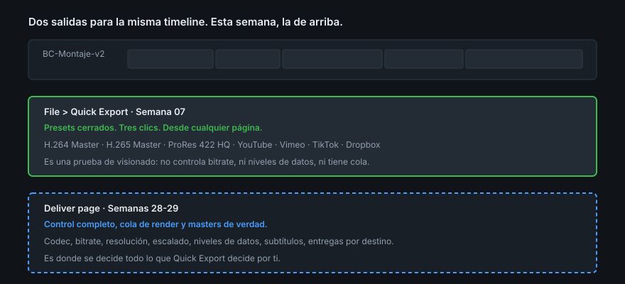

# Quick Export

> Ninguna pieza está terminada hasta que alguien la ha visto fuera del programa. Quick
> Export saca un archivo en tres clics desde cualquier página, y es lo que convierte el
> montaje en algo que se puede enseñar.

## 🎯 Objetivos

- Explicar qué hace `File > Quick Export` y en qué se diferencia de la Deliver page
- Exportar la pieza entera, o un tramo marcado, sin salir de la Cut page
- Elegir el preset correcto entre los que trae Resolve 21
- Entender por qué esto es una prueba y no la entrega
- Volver a importar lo exportado y comprobarlo, que es la mitad del ejercicio

---

## 1. Qué problema resuelve

Tu pieza vive dentro de un proyecto de Resolve. Eso significa tres cosas incómodas:

1. **No se la puedes enseñar a nadie** que no tenga Resolve y tu material.
2. **No la puedes ver como se va a ver**: la reproducción dentro del programa está afectada
   por la caché, por los proxies de la Semana 05 y por lo que haga tu ordenador ese día.
3. **No la puedes ver en otra pantalla**: en el móvil, en el televisor, en el portátil de
   otra persona.

Los tres se resuelven con un archivo de vídeo normal. Y hasta la Semana 28 no toca aprender
la Deliver page, que es donde se hacen los masters de verdad, con control de codec, bitrate,
niveles de datos y cola de render.

Quick Export es el atajo: **un archivo razonable, ahora, sin decidir nada técnico**.

---

## 2. Cómo funciona



### 2.1 Un preset cerrado

Quick Export no te pregunta por el codec, ni por el bitrate, ni por la resolución. Te enseña
una fila de **presets** con su icono, eliges uno y ya. Cada preset lleva dentro todas esas
decisiones tomadas.

Esa es su virtud y su límite a la vez:

| Ventaja | Límite |
| ------- | ------ |
| Tres clics y tienes archivo | No controlas el bitrate ni la calidad fina |
| Funciona desde cualquier página | No hay cola: exporta uno y esperas |
| No hay nada que configurar mal | No sirve para una entrega profesional |

### 2.2 Qué presets hay

En esta instalación de **DaVinci Resolve 21.0.4.5 Free**, los presets disponibles en el
proyecto son estos —*consultados por la API de scripting el 29 de agosto de 2026*:

`H.264 Master`, `H.265 Master`, `ProRes 422 HQ`, `HyperDeck`, `YouTube` en 720p, 1080p, 1440p
y 2160p, `Vimeo` en 720p, 1080p y 2160p, `TikTok` en 720p y 1080p, `Dropbox` en 720p, 1080p y
2160p, `Presentations`, `IMF - Generic`, `Audio Only`, y los de intercambio con otros
programas (`FCP`, `Premiere XML`, `AVID AAF`, `Pro Tools`).

El diálogo de Quick Export enseña un subconjunto de esos, como iconos. Para esta semana:

| Para qué | Preset |
| -------- | ------ |
| Verla tú, en tu ordenador o en el móvil | **`H.264 Master`** |
| Enseñarla a alguien por un enlace | El de la plataforma que vayas a usar |
| Que ocupe menos con la misma calidad | `H.265 Master`, si tu reproductor lo abre |

**`H.264`** es el codec de vídeo más compatible que existe: lo abre cualquier móvil,
cualquier navegador y cualquier televisor de la última década. Es la elección por defecto
para una prueba, y lo será hasta que la Semana 28 explique cuándo no basta.

> [!NOTE]
> Un **preset** es un conjunto de ajustes guardado con un nombre. Un **codec** es el
> algoritmo que comprime el vídeo —H.264, H.265, ProRes—; un **contenedor** es el archivo que
> lo envuelve, normalmente `.mp4` o `.mov`. La Semana 02 lo explica entero; aquí basta con
> saber que el preset decide las dos cosas por ti.

### 2.3 La subida directa, y por qué esta semana no

Quick Export puede **exportar y subir** a YouTube, Vimeo y Dropbox en una sola operación,
autenticándose con tu cuenta.

Esta semana no se usa, y por una razón concreta: lo que vas a exportar es un montaje bruto
acabado, sin mezclar y sin etalonar. Publicarlo no aporta nada y sí puede aportar un
problema, porque el material del pack de medios tiene licencias que hay que atribuir y aún no
has puesto los créditos completos. La publicación es la **Semana 36**.

### 2.4 Exportar solo un tramo

Si marcas un punto de entrada y uno de salida **en la timeline** con `I` y `O` antes de
abrir el diálogo, Quick Export exporta solo ese tramo. Sin marcas, exporta la timeline
entera.

Es lo que hace práctico enseñar un minuto concreto a alguien sin esperar el render de los
seis.

---

## 3. Cómo se hace en Resolve 21

### 3.1 Los cuatro pasos

1. *(Opcional)* Marca `I` y `O` en la timeline para exportar solo un tramo.
2. **`File > Quick Export`**.
3. Elige un preset de la fila de iconos y pulsa **`Export`**.
4. Elige carpeta y nombre, y **`Save`**. Aparece una barra de progreso.

Funciona igual desde la Cut, la Edit, la Fairlight y la Color page. *Procedimiento verificado
en el DaVinci Resolve 21 Reference Manual, capítulo 39, «Quick Export», agosto de 2026.*

### 3.2 Dónde guardarlo y cómo llamarlo

En la carpeta de entregas de tu estructura de disco, la que fijaste en la Semana 02:

```
BC-Resolve/03-entregas/
```

Y con un nombre que diga qué es y de cuándo:

```
BC-Montaje-v2-semana07.mp4
```

No `final.mp4`, no `export1.mp4`. Dentro de veinte semanas vas a tener quince archivos ahí y
el nombre es lo único que los distingue.

### 3.3 La parte que casi nadie hace: comprobarlo

Exportar no es terminar. Terminar es **haber comprobado que lo exportado está bien**, y para
eso hay que verlo fuera de Resolve:

1. Ábrelo con el reproductor de tu sistema, **no** con Resolve.
2. Ve la pieza entera, con auriculares, sin parar y sin adelantar.
3. Mira cuatro cosas concretas: que **empieza y acaba** donde debe, que **no hay parpadeos a
   negro**, que **se oye** todo el diálogo y que **los rótulos se leen**.
4. Si puedes, míralo también **en el móvil**. Los rótulos que se leen en un monitor de 27
   pulgadas a veces no se leen en seis.

Y después, el paso que esta semana verifica el autograder: **vuelve a importarlo al
proyecto**, a un bin llamado `12-Entregas`. Tiene dos motivos que no son burocráticos:

- **Comprueba que el archivo es válido.** Si Resolve lo abre y lo reproduce, el archivo está
  bien escrito.
- **Deja constancia de la versión.** En la Semana 36 vas a auditar tu progreso, y tener las
  entregas de cada fase dentro del proyecto es lo que hace posible esa auditoría.

### 3.4 Qué esperar del archivo

Una pieza de cinco minutos a 1080p con `H.264 Master` sale en el orden de **100-300 MB** y
tarda entre uno y varios minutos, según tu ordenador. Si sale de 10 MB, algo va mal: casi
siempre es que exportaste solo un tramo marcado sin darte cuenta.

> [!WARNING]
> El archivo que sale de aquí **no es un master**. Es una prueba de visionado. No lo uses
> como fuente para volver a montar, no lo entregues a nadie como versión final, y no lo
> conserves como si fuera el original: lo valioso sigue siendo tu proyecto y tu material. La
> Semana 28 explica qué es un master de verdad y por qué esto no lo es.

---

## 4. Antipatrones

| Antipatrón | Por qué duele | Qué hacer |
| ---------- | ------------- | --------- |
| Exportar y no mirarlo | Es la mitad del ejercicio, y la que enseña | Verlo entero, fuera de Resolve |
| Llamarlo `final.mp4` | En veinte semanas no sabrás cuál es cuál | `BC-Montaje-v2-semana07.mp4` |
| Tratar el Quick Export como el master | No controla bitrate ni niveles | El master es la Semana 28 |
| Subirlo a una plataforma esta semana | Sin mezcla, sin color y sin créditos | La publicación es la Semana 36 |
| Exportar con puntos `I` y `O` olvidados | Sale un trozo y crees que está roto | Comprueba que no hay marcas antes |
| Guardarlo en el escritorio | Se pierde entre lo demás | `BC-Resolve/03-entregas/` |
| Borrar el proyecto porque «ya tengo el vídeo» | El vídeo no se puede volver a montar | El proyecto es lo valioso |
| No volver a importarlo | Pierdes la comprobación y el rastro de versiones | Bin `12-Entregas` |

---

## 5. Trucos

| Truco | Cómo |
| ----- | ---- |
| Sacar un archivo desde cualquier página | `File > Quick Export`, funciona en Cut, Edit, Fairlight y Color |
| Exportar solo un minuto | Marca `I` y `O` en la timeline antes de abrir el diálogo |
| El preset que abre en todas partes | `H.264 Master` |
| Ver los presets como lista en vez de iconos | El icono de vista de lista, dentro del diálogo |
| Saber si exportaste de más o de menos | Mira el tamaño del archivo: 5 min a 1080p son cientos de MB |
| Comprobar que el archivo es válido | Reimpórtalo al proyecto y reprodúcelo |
| Ver si los rótulos se leen de verdad | Míralo en el móvil, no solo en el monitor |
| Dejar rastro de cada fase | Un bin `12-Entregas` con la exportación de cada semana grande |

---

## 📚 Recursos Adicionales

- [DaVinci Resolve Reference Manual](https://www.blackmagicdesign.com/support/family/davinci-resolve-and-fusion) — capítulo 39, «Quick Export»: el procedimiento completo y cómo añadir presets propios desde la Deliver page.
- [Semana 28 · Deliver page: render y codecs](../../week-28-deliver_page_render_y_codecs/README.md) — el master de verdad: ajustes de render, codecs, presets y cola.
- [Semana 02 · Codecs, contenedores y flujo de datos](../../week-02-codecs_contenedores_y_flujo_de_datos/README.md) — qué es H.264, qué es un contenedor y por qué `.mp4` lo abre todo.

---

## ✅ Checklist de Verificación

- [ ] Sé qué hace `File > Quick Export` y en qué se diferencia de la Deliver page
- [ ] Sé exportar la pieza entera y también un tramo marcado
- [ ] Sé qué preset elegir para una prueba de visionado
- [ ] Entiendo por qué esto no es un master
- [ ] Guardo el archivo en `03-entregas/` con un nombre que dice qué es
- [ ] Lo veo entero fuera de Resolve antes de darlo por bueno
- [ ] Lo reimporto al bin `12-Entregas`

---

| Anterior | Actual | Siguiente |
| -------- | ------ | --------- |
| [08 · El detector de aburrimiento](08-el-detector-de-aburrimiento.md) | **09 · Quick Export** | [Semana 07](../README.md) |

← [Volver a la Semana 07](../README.md)
