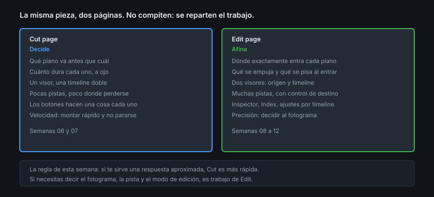

# Por qué existe la Edit page

> Ya sabes montar. Lo hiciste en las Semanas 06 y 07 y tienes una pieza que se puede ver.
> Entonces, ¿para qué una segunda página de montaje? Porque la Cut page contesta rápido y la
> Edit page contesta exacto, y a partir de aquí las preguntas cambian.

## 🎯 Objetivos

- Explicar qué problema tiene la Cut page que la Edit page resuelve
- Nombrar las cuatro cosas que la Edit page añade y que la Cut page no tiene
- Aplicar la regla que decide en qué página se hace cada cosa
- Entender que las dos páginas trabajan sobre la **misma** timeline, no sobre copias
- Situar las cinco semanas de la Fase 3 y qué aporta cada una

---

## 1. Qué problema resuelve

La Cut page está diseñada alrededor de una idea: **que no te pares**. Un visor, una timeline
doble, botones que hacen una cosa cada uno y ningún diálogo de confirmación. Eso es
exactamente lo que quieres cuando la pregunta es «¿este plano va antes o después de aquel?».

El problema aparece cuando la pregunta deja de ser esa. Cuando lo que quieres decir es:

> «Este plano entra **en la pista 2**, **empezando en el fotograma 00:01:23:11**, **empujando**
> lo que hay detrás, y **sin traerse su audio**.»

En la Cut page no hay forma de decir eso. No porque esté mal hecha, sino porque no es su
trabajo: la Cut page decide **qué y en qué orden**; la Edit page decide **dónde exactamente y
con qué consecuencias**.

Ese es el salto de esta semana. No estás aprendiendo a montar otra vez: estás aprendiendo a
ser **específico**.

---

## 2. Cómo funciona

### 2.1 Lo primero, y lo más importante: es la misma timeline

Esto confunde a mucha gente que llega de otros programas, así que conviene decirlo antes que
nada:

> **`BC-Montaje-v2` es una sola timeline. La Cut page y la Edit page son dos formas de mirarla
> y de tocarla, no dos copias.**

Si abres tu montaje en la Edit page, es el mismo. Si mueves un clip en la Edit page y vuelves
a la Cut page, está movido. El cabezal está en el mismo sitio en las dos. No hay importación,
no hay conversión y no hay nada que se pueda perder por cambiar de página.

Por eso el salto de esta semana no tiene riesgo: puedes abrir tu pieza en la Edit page, mirarla
y volver, sin que pase nada.

### 2.2 Las cuatro cosas que la Edit page añade

**Un segundo visor.** La Cut page tiene un visor que enseña una cosa u otra. La Edit page tiene
dos a la vez: el **Source Viewer** con el clip como está en su archivo, y el **Timeline Viewer**
con la pieza montada. Los dos tienen sus propios puntos de entrada y salida, y eso es lo que
hace posible la edición de tres puntos.

**Control de destino.** En la Cut page, un clip entra donde Resolve decide. En la Edit page hay
un control —el **Source Track Selector**— donde tú dices qué pista del clip entra en qué pista
de la timeline, y qué partes del clip no entran.

**Modos de edición explícitos.** En la Cut page tienes `Smart Insert`, `Append`, `Ripple
Overwrite`, `Close Up` y `Place on Top`, y cada botón decide bastante por ti. En la Edit page
eliges entre `Insert`, `Overwrite`, `Replace`, `Fit to Fill`, `Place on Top`, `Ripple Overwrite`
y `Append at End`, y cada uno le hace algo distinto y predecible al resto de la pieza.

**El Inspector.** El panel donde se ajusta un clip: posición, escala, recorte, velocidad,
volumen, transiciones. En la Cut page hay una versión reducida en `Tools`; en la Edit page está
entero.

### 2.3 Lo que la Cut page sigue haciendo mejor

No es una página que se abandona. Sigue siendo más rápida para:

| Tarea | Por qué ahí |
| ----- | ----------- |
| Ver todo el material seguido | El `Source Tape` no existe en la Edit page |
| Un primer montaje de cero | Menos controles, menos decisiones, más velocidad |
| Revisar la pieza entera rápido | `Fast Review` no existe en la Edit page |
| Sincronizar material de varias cámaras | El `Sync Bin` es de la Cut page |
| Sacar un archivo rápido | `File > Quick Export` está en las dos, pero el flujo es el de Cut |

Un profesional usa las dos, y cambia de una a otra varias veces en la misma sesión. Cambiar de
página cuesta una tecla y no rompe nada.

### 2.4 Lo que no cambia al pasar a la Edit page

Conviene tener claro qué **no** es distinto, porque ahorra buscar cosas que están donde
estaban:

- **El media pool es el mismo.** Los bins `01-Basicos` … `12-Entregas` de las semanas
  anteriores están ahí, con el mismo contenido y en el mismo sitio.
- **Los proxies y la caché son los mismos.** Lo que optimizaste en la Semana 05 sigue
  sirviendo; no hay que volver a generar nada.
- **Los ajustes del proyecto son los mismos.** El `Timeline frame rate` de 24 fps que fijaste
  en la Semana 01 gobierna igual, y sigue igual de bloqueado.
- **El verificador es el mismo.** Habla con el puente, no con la página que tengas abierta.

Lo único que cambia es **cuánto puedes decir** sobre cada operación que haces.

---

## 3. Cómo se hace en Resolve 21

### 3.1 Abrir la Edit page

Dos formas, equivalentes:

- El botón **`Edit`** en la barra inferior de páginas
- El atajo `Shift+4` (Win) / `Shift+4` (Mac), igual que `Shift+3` entra en la Cut page

> [!NOTE]
> Los atajos de página siguen el orden de la barra inferior. Si en tu instalación no
> responden, compruébalo en `DaVinci Resolve > Keyboard Customization` buscando el comando por
> nombre: manda tu instalación, por encima de cualquier lista escrita.

### 3.2 La regla que decide en qué página se hace algo

Esta es la regla del bootcamp, y se puede aplicar en dos segundos:

> **¿Puedo decir lo que quiero sin nombrar una pista y un fotograma?**
>
> Si **sí** → Cut page. Es más rápida.
> Si **no** → Edit page. Es la única que te deja decirlo.

Ejemplos:

| Lo que quieres | Página | Por qué |
| -------------- | ------ | ------- |
| «Este plano después de aquel» | Cut | No hay ni pista ni fotograma en la frase |
| «Este plano en `Video 2`, encima del otro» | Edit | Hay una pista |
| «Que este corte caiga justo cuando suena el golpe» | Edit | Hay un fotograma |
| «Quitar los 40 segundos que sobran del principio» | Cut | Ninguna de las dos cosas |
| «Meter esto sin que se mueva lo de detrás» | Edit | Estás eligiendo un modo de edición |

### 3.3 Qué hay en las cinco semanas de la Fase 3

Para que sepas dónde encaja lo de esta semana:

| Semana | Qué añade |
| ------ | --------- |
| **08 · esta** | La interfaz, los dos visores, las pistas, tres puntos y los modos de edición |
| **09** | Trimming: ripple, roll, slip, slide, dynamic trim, JKL |
| **10** | Velocidad, transformaciones, keyframes y estabilización |
| **11** | Títulos de verdad, Text+, efectos, adjustment clips y compound clips |
| **12** | Multicámara, subtítulos, versiones de timeline e intercambio con otros programas |

Esta semana es la base de las otras cuatro. Nada de lo que viene después funciona si el
control de destino y los modos de edición no están claros.

---

## 4. Antipatrones

| Antipatrón | Por qué duele | Qué hacer |
| ---------- | ------------- | --------- |
| Creer que hay que «pasar» el montaje a la Edit page | No hay nada que pasar: es la misma timeline | Cambia de página y sigue |
| Abandonar la Cut page al llegar aquí | Pierdes el `Source Tape`, el `Sync Bin` y el `Fast Review` | Usa las dos, según la pregunta |
| Montar de cero en la Edit page por «ser más profesional» | Es más lenta para lo que la Cut hace bien | Primer montaje en Cut, precisión en Edit |
| Empezar a afinar cortes al fotograma esta semana | Eso es trimming y es la Semana 09 | Esta semana se aprende a colocar, no a afinar |
| Duplicar la timeline «por si acaso» al cambiar de página | Cambiar de página no modifica nada | Duplica cuando cambies de fase, no de página |

---

## 5. Trucos

| Truco | Cómo |
| ----- | ---- |
| Saber en qué página estás sin mirar | El cabezal y la selección se conservan; la barra inferior marca la activa |
| Decidir la página en dos segundos | ¿La frase menciona una pista o un fotograma? |
| Volver a la Cut page para revisar | `Fast Review` sigue siendo la forma más rápida de ver la pieza |
| Comprobar que es la misma timeline | Mueve el cabezal en Cut, cambia a Edit: está donde lo dejaste |
| Encontrar cualquier atajo de página | `DaVinci Resolve > Keyboard Customization`, busca el comando por nombre |

---

## 📚 Recursos Adicionales

- [DaVinci Resolve Reference Manual](https://www.blackmagicdesign.com/support/family/davinci-resolve-and-fusion) — capítulo 40, «Using the Edit Page»: el recorrido completo de la interfaz.
- [Semana 07 · Qué se acaba en Cut y qué se deja para Edit](../../week-07-cut_page_acabado_y_quick_export/1-teoria/01-que-se-acaba-en-cut.md) — la otra mitad de esta discusión, vista desde la Cut page.
- [Semana 09 · Trimming quirúrgico](../../week-09-trimming_quirurgico/README.md) — lo que viene justo después y para lo que esta semana prepara.

---

## ✅ Checklist de Verificación

- [ ] Sé que la Cut page y la Edit page trabajan sobre la misma timeline
- [ ] Puedo nombrar las cuatro cosas que añade la Edit page
- [ ] Sé tres cosas que la Cut page sigue haciendo mejor
- [ ] Puedo aplicar la regla de «pista o fotograma» a un caso concreto
- [ ] Sé qué semana de la Fase 3 se ocupa de qué

---

| Anterior | Actual | Siguiente |
| -------- | ------ | --------- |
| [Semana 08](../README.md) | **01 · Por qué existe la Edit page** | [02 · Anatomía de la Edit page](02-anatomia-de-la-edit-page.md) |

← [Volver a la Semana 08](../README.md)
