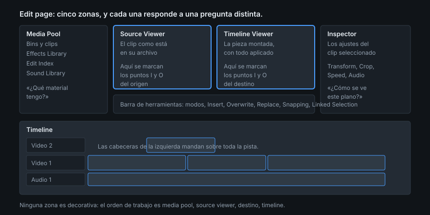

# Anatomía de la Edit page

> Cinco zonas y una barra de herramientas. Cada zona contesta una pregunta distinta, y saber
> cuál contesta cuál es la diferencia entre trabajar y buscar cosas.

## 🎯 Objetivos

- Localizar las cinco zonas de la Edit page y decir qué hace cada una
- Reconocer los controles de la barra de herramientas y para qué sirve cada uno
- Distinguir los cuatro modos de edición de la barra: selección, trim, dynamic trim y cuchilla
- Saber abrir y cerrar los paneles laterales sin perder el sitio
- Usar el `Index` para navegar por una timeline larga

---

## 1. Qué problema resuelve

La Edit page tiene muchos más controles que la Cut page. Ese es su valor y también su
dificultad: la primera vez que se abre parece que hay botones por todas partes y ninguno
explica qué hace.

El problema que resuelve conocer la anatomía es de tiempo perdido. Buscar dónde está el
control del volumen, o por qué no aparece el visor de origen, o dónde se apagan las pistas,
son minutos que se van todos los días. Con la pantalla entendida, cada cosa está en un sitio
que se puede razonar.

Y hay un problema peor que el tiempo: **tocar un control sin saber cuál es**. En la Edit page
hay botones que cambian el comportamiento de todo lo que hagas después —el modo de edición, el
imán, el enlace de audio y vídeo— y sus efectos no son evidentes hasta tres operaciones más
tarde.

---

## 2. Cómo funciona

### 2.1 Las cinco zonas

| Zona | Dónde | Qué pregunta contesta |
| ---- | ----- | --------------------- |
| **Media pool y bibliotecas** | Arriba a la izquierda | «¿Qué material tengo?» |
| **Source Viewer** | Arriba al centro, izquierda | «¿Qué trozo de este clip quiero?» |
| **Timeline Viewer** | Arriba al centro, derecha | «¿Cómo va quedando la pieza?» |
| **Inspector** | Arriba a la derecha | «¿Cómo se ve y se oye este clip?» |
| **Timeline** | Abajo, ocupando todo el ancho | «¿Dónde está cada cosa?» |

Los paneles laterales se abren y se cierran con los botones de la **barra de interfaz**, arriba
del todo: `Media Pool`, `Effects`, `Index`, `Sound Library`, `Mixer`, `Metadata`, `Inspector`.
Cerrarlos no pierde nada: la timeline y los visores crecen para ocupar el hueco.

### 2.2 Lo que hay dentro del panel izquierdo

No es solo el media pool. En ese mismo espacio conviven varias herramientas, y se cambia entre
ellas con los botones de la barra de interfaz:

- **`Media Pool`** — los bins y los clips, igual que en la Media page
- **`Effects`** — la biblioteca: transiciones, títulos, generadores, efectos y filtros
- **`Index`** — dos pestañas útiles esta semana: **`Edit Index`**, la lista de todos los cortes
  de la timeline, y **`Tracks`**, la lista de todas las pistas con sus controles
- **`Sound Library`** — efectos de sonido, si tienes alguna biblioteca instalada

### 2.3 La barra de herramientas, control a control

Está justo encima de la timeline. De izquierda a derecha, los que importan esta semana:

| Control | Qué hace |
| ------- | -------- |
| **`Timeline View Options`** | Cómo se ven los clips: tira de imágenes, miniatura o minimizado, ondas de audio, altura de las pistas |
| **Keyframe Editor** | Abre el editor de fotogramas clave dentro de la timeline (Semana 10) |
| **Voiceover** | Graba voz directamente sobre la timeline (Fase 4) |
| **`Selection Mode`** | El modo normal: mover clips, cambiar su tamaño, seleccionar |
| **`Trim Edit Mode`** | El modo de trimming: slip, slide, ripple y roll (Semana 09) |
| **`Dynamic Trim Mode`** | Trimming con las teclas J, K y L (Semana 09) |
| **`Blade Edit Mode`** | La cuchilla: cortar clips haciendo clic |
| **`Insert Clip`** | Hace un `Insert` con lo que haya en el Source Viewer |
| **`Overwrite Clip`** | Hace un `Overwrite` con lo que haya en el Source Viewer |
| **`Replace Clip`** | Hace un `Replace` con lo que haya en el Source Viewer |
| **`Snapping`** | El imán: los bordes, los marcadores y el cabezal se pegan entre sí |
| **`Linked Selection`** | Si al seleccionar el vídeo de un clip se selecciona también su audio |
| **`Position Lock`** | Impide mover clips a izquierda o derecha y bloquea todo ripple |
| **`Flag`** y **`Add Marker`** | Banderas de clip y marcadores de fotograma |
| **Zoom** | `Full Extent Zoom`, `Detail Zoom`, `Custom Zoom` y el deslizador |

A la derecha del todo hay tres controles de **monitorización de audio**: un interruptor de
sonido, un deslizador de volumen y un botón `DIM` que baja el volumen momentáneamente.

> [!IMPORTANT]
> Esos tres controles afectan **solo a lo que tú oyes**, no a la mezcla ni al archivo que
> exportes. Bajar ahí el volumen no baja el volumen de la pieza. Es el error de audio más
> repetido de la Fase 3, y se descubre al exportar.

### 2.4 Los cuatro modos y por qué son un modo

`Selection`, `Trim Edit`, `Dynamic Trim` y `Blade Edit` no son herramientas que se usan y se
sueltan: son **modos**, es decir, estados en los que el programa se queda. Mientras estás en
`Blade Edit Mode`, cada clic sobre un clip lo corta. Mientras estás en `Trim Edit Mode`,
arrastrar el borde de un clip hace cosas distintas de las que hace en `Selection Mode`.

Esta semana se trabaja **siempre en `Selection Mode`**, atajo `A`. Los otros tres son la
Semana 09. Si algo se comporta raro, lo primero que hay que mirar es en qué modo estás.

---

## 3. Cómo se hace en Resolve 21

### 3.1 Recorrer la interfaz sin romper nada

Todo lo de esta sección es reversible y no toca la timeline:

1. Abre `BC-Montaje-v2` y cambia a la Edit page
2. Abre y cierra `Media Pool`, `Effects`, `Index` e `Inspector` desde la barra de interfaz
3. Abre `Timeline View Options` y prueba las tres formas de ver los clips
4. Sube y baja la altura de las pistas con el deslizador de ese mismo menú
5. Prueba `Full Extent Zoom` y `Detail Zoom`, y vuelve con `Shift+Z`

`Shift+Z` alterna entre ver la timeline entera y el nivel de zoom anterior. Es el atajo que
más se usa de toda la página.

### 3.2 El `Index` y sus dos pestañas

Se abre desde el botón `Index` de la barra de interfaz.

**`Edit Index`** lista todos los cortes de la timeline en orden, con su número, su pista, su
timecode de entrada y salida y el nombre del clip. Doble clic en una línea lleva el cabezal
ahí. En una pieza de cuarenta cortes es más rápido que buscar a ojo.

**`Tracks`** lista todas las pistas con sus controles —bloqueo, activación, color, nombre— en
una sola columna. Es más cómodo que las cabeceras cuando hay muchas pistas, y además permite
reordenarlas arrastrando.

### 3.3 Guardar el sitio: los layouts

La disposición de los paneles se puede guardar. `Workspace > Layout Presets` guarda la
disposición actual con un nombre y la recupera después. Y si has movido algo y no sabes qué,
`Workspace > Reset UI Layout` devuelve la página a su estado de fábrica.

> [!NOTE]
> `Reset UI Layout` **no toca tu proyecto**: solo coloca los paneles. Es seguro usarlo cuando
> la pantalla se ha quedado rara, y es lo primero que hay que probar antes de dar por perdido
> un panel que ha desaparecido.

### 3.4 `Timeline View Options`, que es más útil de lo que parece

Es el desplegable del extremo izquierdo de la barra de herramientas, y decide cómo se ve la
timeline. Merece dos minutos porque cambia mucho la comodidad del trabajo:

- **Cómo se dibujan los clips**: tira de imágenes (*filmstrip*), miniatura o minimizado. La tira
  de imágenes ayuda a reconocer planos de un vistazo; el modo minimizado cabe más pieza en
  pantalla, pero **esconde los nombres de las pistas**
- **Ondas de audio**: activarlas o no. Con ondas se ve dónde hay voz y dónde silencio sin
  reproducir
- **Altura de las pistas de vídeo y de audio**, con dos deslizadores independientes
- **Timelines apiladas** (*stacked timelines*): ver dos timelines a la vez, una encima de otra

Una configuración que funciona bien para esta semana: tira de imágenes, ondas activadas, pistas
de vídeo altas y pistas de audio medianas.

---

## 4. Antipatrones

| Antipatrón | Por qué duele | Qué hacer |
| ---------- | ------------- | --------- |
| Trabajar con todos los paneles abiertos | La timeline se queda con cuatro centímetros de alto | Abre solo el que estés usando |
| Bajar el volumen desde la barra de herramientas | Solo baja lo que oyes tú; el archivo sale igual | El volumen del clip está en el Inspector |
| Quedarse en `Blade Edit Mode` sin darse cuenta | Cada clic corta un clip | Vuelve a `Selection Mode` con `A` |
| Buscar un corte a ojo en una timeline larga | Se tarda diez veces más | `Edit Index`, doble clic en la línea |
| Dar por perdido un panel que ha desaparecido | Suele estar cerrado, no roto | `Workspace > Reset UI Layout` |
| Cambiar la altura de las pistas y no saber volver | Parece que el proyecto se ha estropeado | El deslizador de `Timeline View Options` |

---

## 5. Trucos

| Truco | Cómo |
| ----- | ---- |
| Ver la timeline entera y volver | `Shift+Z` |
| Ganar espacio vertical de golpe | Cierra `Media Pool` e `Inspector` |
| Encontrar un corte por su número | `Index > Edit Index`, doble clic en la línea |
| Manejar muchas pistas sin marearse | `Index > Tracks` en vez de las cabeceras |
| Volver al modo normal desde cualquier modo | `A` |
| Recuperar la pantalla cuando se ha desordenado | `Workspace > Reset UI Layout` |
| Guardar tu disposición favorita | `Workspace > Layout Presets` |
| Ver las ondas de audio sin agrandar las pistas | `Timeline View Options`, activa las ondas |

---

## 📚 Recursos Adicionales

- [DaVinci Resolve Reference Manual](https://www.blackmagicdesign.com/support/family/davinci-resolve-and-fusion) — capítulo 40, «Using the Edit Page»: la lista completa de los controles de la barra de herramientas, uno a uno.
- [Semana 03 · Las siete páginas](../../week-03-resolve_21_anatomia_bases_de_datos_y_preferencias/README.md) — dónde encaja la Edit page en el recorrido general del programa.
- [docs/atajos-de-teclado.md](../../../docs/atajos-de-teclado.md) — cómo comprobar cualquier atajo contra tu propia instalación.

---

## ✅ Checklist de Verificación

- [ ] Sé qué pregunta contesta cada una de las cinco zonas
- [ ] Puedo abrir y cerrar los paneles laterales sin perder nada
- [ ] Sé qué hacen `Snapping`, `Linked Selection` y `Position Lock`
- [ ] Entiendo que los cuatro modos son estados, no herramientas
- [ ] Sé que los controles de audio de la barra solo afectan a lo que oigo
- [ ] Sé abrir el `Index` y usar sus dos pestañas

---

| Anterior | Actual | Siguiente |
| -------- | ------ | --------- |
| [01 · Por qué existe la Edit page](01-por-que-existe-la-edit-page.md) | **02 · Anatomía de la Edit page** | [03 · Los dos visores](03-los-dos-visores.md) |

← [Volver a la Semana 08](../README.md)
