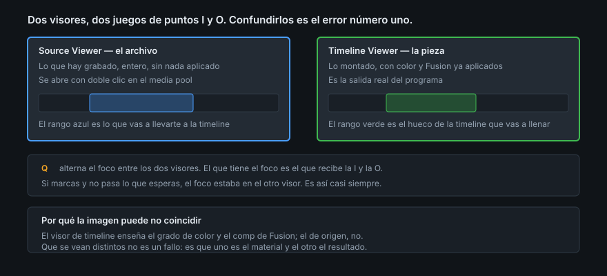

# Los dos visores

> El visor de origen enseña el material. El visor de timeline enseña el resultado. Cada uno
> tiene sus propios puntos de entrada y salida, y casi todo lo que sale mal en una edición de
> tres puntos es haber marcado en el visor equivocado.

## 🎯 Objetivos

- Distinguir el **Source Viewer** del **Timeline Viewer** y saber qué enseña cada uno
- Cambiar el foco entre los dos y saber cuál lo tiene en cada momento
- Abrir un clip en el visor de origen de tres formas distintas
- Marcar y borrar puntos de entrada y salida en cada visor
- Entender por qué la imagen de los dos visores puede no coincidir

---

## 1. Qué problema resuelve

En la Cut page hay un visor. Cuando miras un clip del media pool, enseña el clip; cuando
reproduces la timeline, enseña la timeline. Funciona porque en la Cut page nunca necesitas
mirar las dos cosas **a la vez**.

En la Edit page sí. La operación central de la semana es:

> «De **este** trozo del clip, a **este** hueco de la timeline.»

Son dos rangos, en dos sitios distintos, y hay que verlos los dos para decidir. Por eso hay dos
visores: no es un lujo de pantalla grande, es lo que hace posible la edición de tres puntos.

Y de ahí sale el error más frecuente de la Fase 3 entera: marcar una entrada creyendo que la
estás poniendo en el origen cuando el foco estaba en la timeline, o al revés. El resultado no
es un mensaje de error; es una edición que hace algo distinto de lo que querías.

---

## 2. Cómo funciona

### 2.1 El Source Viewer: el material

Enseña **un clip tal y como está en su archivo**. Se abre desde el media pool y no sabe nada de
tu montaje: no le afecta lo que haya en la timeline, ni las pistas, ni el orden.

Debajo tiene su propia **barra de reproducción** (*jog bar*), con la duración total del clip y,
si has marcado puntos, la duración del rango marcado.

Lo que marcas aquí con `I` y `O` es **qué parte del clip te vas a llevar**.

### 2.2 El Timeline Viewer: el resultado

Enseña **la timeline abierta en la posición del cabezal**. Y enseña algo más que el Source
Viewer: aquí ya están aplicados el etalonaje de la Color page y los compuestos de la Fusion
page, porque este visor muestra la salida real del programa.

Lo que marcas aquí con `I` y `O` es **qué parte de la timeline vas a afectar**.

### 2.3 Por qué la imagen puede no coincidir

Es normal y no es un fallo. Un mismo plano puede verse distinto en los dos visores porque:

- El de timeline aplica el **grado de color** y el **comp de Fusion**; el de origen, no.
- Si tienes activada la gestión de color de Resolve, o un LUT de origen, el visor de origen los
  aplica también, pero el resultado final sigue saliendo del visor de timeline.

> [!NOTE]
> **LUT** (*Look Up Table*, «tabla de consulta») es un archivo que convierte cada color de
> entrada en otro de salida. Se usa para pasar material grabado en **log** —un modo de grabación
> plano y desaturado que guarda más información— a un aspecto normal de pantalla. La Semana 16
> lo explica entero; aquí solo importa saber que puede hacer que los dos visores no coincidan.

### 2.4 El foco: cuál de los dos recibe las teclas

Solo uno de los dos visores tiene el **foco** en cada momento, y es el que recibe `I`, `O`, la
barra espaciadora y las teclas de navegación.

- Se cambia con la tecla **`Q`**
- También se cambia haciendo clic sobre el visor
- El que tiene el foco se distingue por su borde resaltado

Esto no es un detalle de interfaz: es la causa más común de «le he dicho que entre aquí y ha
entrado en otro sitio».

---

## 3. Cómo se hace en Resolve 21

### 3.1 Abrir un clip en el Source Viewer

Tres formas, según lo que estés haciendo:

1. **Doble clic** sobre el clip en el media pool
2. Seleccionarlo y pulsar **`Return`**
3. **Pasar el ratón** por encima de la miniatura, si `Live Media Preview` está activo: el visor
   de origen va enseñando el fotograma por el que pasas

La tercera es la más rápida para buscar; las dos primeras son las que dejan el clip **cargado**
en el visor, que es lo que hace falta para editar.

> [!TIP]
> El menú de tres puntos del visor tiene `Previous Clip` y `Next Clip`, que recorren los clips
> abiertos recientemente sin volver al media pool.

### 3.2 Marcar y borrar puntos

Con el foco en el visor que corresponda:

| Acción | Tecla |
| ------ | ----- |
| Poner un punto de entrada | `I` |
| Poner un punto de salida | `O` |
| Borrar el punto de entrada | `Alt+I` (Win) / `Opt+I` (Mac) |
| Borrar el punto de salida | `Alt+O` (Win) / `Opt+O` (Mac) |
| Borrar los dos de golpe | `Alt+X` (Win) / `Opt+X` (Mac) |

En la timeline, la zona que queda **fuera** del rango marcado se atenúa. Es la forma rápida de
comprobar de un vistazo qué has marcado, sin leer timecodes.

### 3.3 El modo de un solo visor

`Workspace > Single Viewer Mode` esconde el visor de origen y deja uno solo, que enseña una cosa
u otra según lo que tengas seleccionado. Sirve en pantallas pequeñas y deja el visor mucho más
grande.

> [!WARNING]
> Con un solo visor, la edición de tres puntos sigue funcionando, pero **dejas de ver los dos
> rangos a la vez**, que es justo lo que hace comprensible la operación. Esta semana trabaja con
> los dos visores. Cuando la mecánica esté aprendida, elige lo que prefieras.

### 3.4 Los controles que comparten los dos

- **Zoom**: `Fit` ajusta la imagen al tamaño disponible; los porcentajes amplían
- **Campo de duración**, arriba a la izquierda: la duración total del clip, o la del rango
  marcado si hay puntos puestos
- **Nombre**, en el centro de la barra de título: en el visor de origen es un desplegable con
  los clips abiertos recientemente; en el de timeline, con las timelines del proyecto
- **Barra de timecode**: se enseña con `Show Timecode Toolbar` desde el menú de tres puntos

### 3.5 Ver la onda de audio dentro del visor de origen

Marcar por imagen es fácil; marcar por sonido, no, y en una entrevista casi siempre marcas por
sonido: donde empieza una frase, donde acaba, dónde está la respiración que sobra.

El menú de tres puntos del visor de origen tiene dos opciones para eso:

- **`Show Zoomed Audio Waveform`** — una porción ampliada de la onda que va pasando mientras
  reproduces. Sirve para localizar una palabra o un golpe concreto.
- **`Show Full Clip Audio Waveform`** — la onda del clip entero, con el rango marcado entre `I`
  y `O` resaltado. Sirve para navegar por el clip usando la forma del sonido como mapa.

Con cualquiera de las dos, la onda se dibuja superpuesta sobre la imagen, en la parte de abajo.

### 3.6 Dos indicadores que conviene reconocer

El visor avisa de dos situaciones con un icono en una esquina, y las dos importan a partir de
esta semana:

- **Primer o último fotograma disponible.** Si el cabezal está en el borde del material, aparece
  un indicador abajo a la izquierda o a la derecha. Es la forma visual de decir «aquí se acabó la
  cola»: lo mismo que la Semana 07 medía arrastrando el borde del clip.
- **Final de la secuencia.** Si en la timeline estás en el primer fotograma de negro después del
  último clip, aparece un indicador de fin de secuencia. Evita la confusión de ver negro y pensar
  que hay un hueco.

Y para ver la pieza sin nada alrededor: `Workspace > Viewer Mode > Cinema Viewer`, atajo `P`,
pone el visor con foco a pantalla completa. Se sale con la misma tecla.

---

## 4. Antipatrones

| Antipatrón | Por qué duele | Qué hacer |
| ---------- | ------------- | --------- |
| Marcar sin mirar qué visor tiene el foco | La edición hace algo distinto de lo esperado | `Q` antes de marcar, siempre |
| Creer que el visor de origen enseña el resultado final | No lleva ni color ni Fusion | El resultado está en el de timeline |
| Dejar puntos viejos puestos de una edición anterior | La siguiente edición los usa sin avisar | `Alt+X` / `Opt+X` antes de empezar |
| Buscar clips a doble clic uno por uno | Es lento | Pasa el ratón con `Live Media Preview` |
| Trabajar en `Single Viewer Mode` esta semana | Dejas de ver la mitad de la operación | Dos visores hasta que la mecánica esté clara |
| Pensar que los visores no coinciden por un fallo | Es el comportamiento normal | Uno es el material, el otro el resultado |

---

## 5. Trucos

| Truco | Cómo |
| ----- | ---- |
| Cambiar de visor sin ratón | `Q` |
| Saber cuál tiene el foco | El borde resaltado |
| Limpiar los puntos antes de una edición nueva | `Alt+X` (Win) / `Opt+X` (Mac) |
| Ver cuánto dura lo que has marcado | El campo de duración del visor cambia solo |
| Ver de un vistazo qué hay marcado en la timeline | Lo de fuera del rango se atenúa |
| Buscar un plano rápido | Pasa el ratón por las miniaturas del media pool |
| Volver al clip anterior sin buscarlo | Menú de tres puntos `> Previous Clip` |
| Ganar tamaño de imagen en un portátil | `Workspace > Single Viewer Mode` |
| Ver el timecode dentro del visor | Menú de tres puntos `> Show Timecode Toolbar` |
| Marcar por sonido y no por imagen | Menú de tres puntos `> Show Full Clip Audio Waveform` |
| Saber que te has quedado sin cola | El indicador de primer o último fotograma, en la esquina |
| Ver la pieza a pantalla completa | `Workspace > Viewer Mode > Cinema Viewer`, atajo `P` |

---

## 📚 Recursos Adicionales

- [DaVinci Resolve Reference Manual](https://www.blackmagicdesign.com/support/family/davinci-resolve-and-fusion) — capítulo 40, «Using the Edit Page», secciones «Source and Timeline Viewers» y «Opening Clips in the Source Viewer».
- [Semana 06 · El source tape](../../week-06-cut_page_edicion_veloz/README.md) — la otra forma de recorrer material, la de la Cut page.
- [07 · La edición de tres puntos](07-la-edicion-de-tres-puntos.md) — para qué sirve todo esto, dos archivos más adelante.

---

## ✅ Checklist de Verificación

- [ ] Sé qué enseña cada visor y en qué se diferencian
- [ ] Cambio el foco con `Q` y sé reconocer cuál lo tiene
- [ ] Abro un clip en el visor de origen de tres formas
- [ ] Pongo y borro puntos de entrada y salida sin dudar
- [ ] Sé por qué la imagen de los dos visores puede no coincidir
- [ ] Entiendo por qué esta semana se trabaja con los dos visores abiertos

---

| Anterior | Actual | Siguiente |
| -------- | ------ | --------- |
| [02 · Anatomía de la Edit page](02-anatomia-de-la-edit-page.md) | **03 · Los dos visores** | [04 · La timeline y sus pistas](04-la-timeline-y-sus-pistas.md) |

← [Volver a la Semana 08](../README.md)
