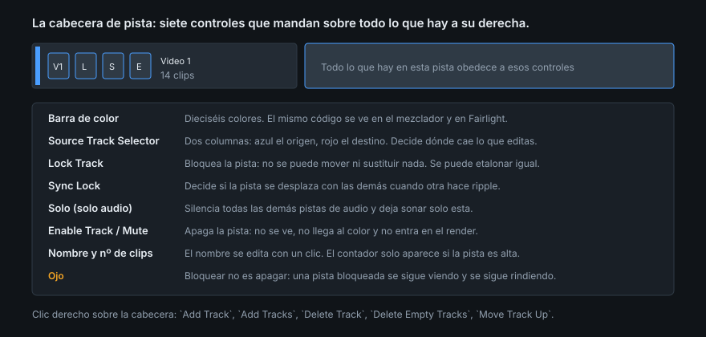

# La timeline y sus pistas

> Una pista no es una fila donde caben clips: es un conjunto de reglas que se aplican a todo lo
> que hay en ella. Bloqueo, sincronía, visibilidad, sonido. Media hora entendiendo la cabecera
> de pista ahorra semanas de operaciones que hacen algo raro.

## 🎯 Objetivos

- Nombrar los siete controles de la cabecera de pista y decir qué hace cada uno
- Distinguir **bloquear** una pista de **apagarla**, que no es lo mismo
- Explicar qué hace el `Sync Lock` y por qué existe
- Añadir, borrar, mover y renombrar pistas
- Usar el `Tracks Index` cuando hay más pistas de las que caben en pantalla

---

## 1. Qué problema resuelve

En la Semana 07 ya usaste tres pistas de vídeo: continuidad, recursos y títulos. Las creaste
arrastrando y las apagaste desde su cabecera, y con eso bastaba.

A partir de esta semana no basta, por dos motivos.

El primero es que los modos de edición **actúan sobre pistas concretas**. `Insert` empuja lo que
hay en unas pistas y no en otras; `Place on Top` crea una pista nueva si hace falta. Sin saber
qué pista está haciendo qué, esas operaciones parecen aleatorias.

El segundo es que a partir de aquí las piezas crecen. Una pieza acabada tiene tres o cuatro
pistas de vídeo y cinco o seis de audio —diálogo, ambiente, efectos, música, voz en off— y
encontrar por qué algo no se oye en una timeline así es imposible si los controles de la
cabecera no están claros.

---

## 2. Cómo funciona

### 2.1 La jerarquía: quién tapa a quién

La regla es la misma que en la Cut page y conviene repetirla porque lo explica casi todo:

> **En vídeo manda la pista más alta. Lo que hay en `Video 3` tapa lo que hay en `Video 2`, que
> tapa lo que hay en `Video 1`.**
>
> **En audio no hay jerarquía: todas las pistas suenan a la vez, sumadas.**

Por eso los títulos van arriba y la continuidad abajo. Y por eso una pieza puede sonar a barullo
sin que ninguna pista esté «mal»: simplemente suenan todas.

### 2.2 Los siete controles de la cabecera

De izquierda a derecha:

| Control | Qué hace |
| ------- | -------- |
| **Color de pista** | Dieciséis colores. El mismo código se ve en el mezclador de la Edit page y en el de Fairlight |
| **`Source Track Selector`** | Dos columnas de iconos, azul y rojo: de dónde viene y a dónde va lo que edites. Es el archivo 05 entero |
| **`Lock Track`** | Bloquea la pista: nada se puede mover, sustituir ni editar. Sí se puede etalonar |
| **`Sync Lock`** | Decide si esta pista se desplaza cuando otra hace ripple |
| **`Solo`** (solo audio) | Silencia todas las demás pistas de audio |
| **`Enable Track` / `Mute`** | Apaga la pista entera |
| **Nombre y nº de clips** | El nombre se edita con un clic; el contador solo aparece si la pista es lo bastante alta |

Las pistas de audio muestran además el **tipo de canal**: mono, estéreo, 5.1, 7.1 o adaptativo.

### 2.3 Bloquear no es apagar

Es la confusión más cara de las dos, porque las consecuencias no se ven hasta el render:

| | `Lock Track` | `Enable Track` apagado |
| - | ------------ | ---------------------- |
| ¿Se ve en el visor? | Sí | No |
| ¿Se puede mover o editar? | No | Sí |
| ¿Entra en el render? | Sí | **No** |
| ¿Llega a la Color page? | Sí | No |
| Para qué sirve | Proteger algo que ya está bien | Comparar, o quitar algo temporalmente |

> [!WARNING]
> Una pista apagada **no se exporta**. Si apagas `Video 2` para comparar y se te olvida
> encenderla, la entrega sale sin los recursos y no hay ningún aviso. Comprobar las cabeceras
> antes de exportar es parte del procedimiento de entrega desde esta semana.

### 2.4 El `Sync Lock`, que es el que nadie entiende

Está activado por defecto, y solo hace algo cuando ocurre un **ripple**: una operación que
cambia la duración de algo y desplaza lo que viene detrás.

- **Activado**: cuando otra pista hace ripple, esta se desplaza con ella. Todo se mantiene en
  sincronía.
- **Desactivado**: esta pista se queda quieta. El ripple ocurre solo en las pistas que lo tienen
  activado.

Ejemplo concreto con tu montaje: tienes diálogo en `Audio 1` y un rótulo en `Video 3`. Si borras
un plano de `Video 1` con ripple y `Video 3` tiene `Sync Lock` activado, el rótulo se desplaza y
sigue cayendo donde tenía que caer. Si lo tiene desactivado, el rótulo se queda donde estaba y
ahora rotula el plano equivocado.

La regla práctica: **déjalo activado en todas las pistas**, y desactívalo solo cuando quieras
deliberadamente que algo no se mueva —una música que tiene que quedarse donde está, por
ejemplo—. Y vuelve a activarlo después.

---

## 3. Cómo se hace en Resolve 21

### 3.1 Añadir, borrar y mover pistas

Todo desde el **clic derecho sobre la cabecera de una pista**:

| Qué quieres | Comando |
| ----------- | ------- |
| Una pista de vídeo o de audio | `Add Track` — la de vídeo aparece **encima** de aquella sobre la que hiciste clic; la de audio, **debajo** |
| Varias de golpe, en un sitio concreto | `Add Tracks` — abre un diálogo con el número, la posición y el tipo de canal |
| Borrar una pista | `Delete Track` |
| Borrar todas las pistas vacías | `Delete Empty Tracks` |
| Subir o bajar una pista con sus clips | `Move Track Up` / `Move Track Down` |

> [!WARNING]
> `Delete Track` **borra también los clips que haya en esa pista**, sin preguntar. Si lo que
> quieres es dejar de ver la pista, apágala con `Enable Track`. Antes de borrar una pista con
> contenido, guarda con `Ctrl+S` (Win) / `Cmd+S` (Mac): así el deshacer tiene a dónde volver.

### 3.2 Poner nombre a las pistas

No es cosmética. Un nombre de pista se ve en el mezclador de la Edit page y en el de Fairlight,
y a partir de la Fase 4 es lo que te dice qué canal estás tocando.

1. Pon la vista de la timeline en tira de imágenes o miniatura, y las pistas lo bastante altas
   para que se lea el nombre —los nombres no aparecen en la vista minimizada
2. Haz clic sobre el nombre por defecto (`Video 1`, `Audio 1`)
3. Escribe el tuyo y pulsa `Return`

Nombres que funcionan: `Continuidad`, `Recursos`, `Titulos`, `Dialogo`, `Ambiente`, `Musica`.
Sin acentos ni caracteres raros, porque estos nombres viajan a los archivos de intercambio de la
Semana 12.

### 3.3 El `Tracks Index`

`Index > Tracks` enseña todas las pistas en una lista, con sus controles y más información de
audio que las cabeceras. Con seis pistas o más es más cómodo que la timeline, y permite
reordenarlas arrastrando por el campo del número.

### 3.4 Encender y apagar varias pistas de golpe

Los botones de las cabeceras admiten **clic y arrastre**: pulsas sobre el control de una pista y,
sin soltar, arrastras hacia arriba o hacia abajo para poner todas las demás en el mismo estado.
Es la forma rápida de bloquear todas las pistas de vídeo, o de silenciar todo el audio menos una.

---

## 4. Antipatrones

| Antipatrón | Por qué duele | Qué hacer |
| ---------- | ------------- | --------- |
| Confundir bloquear con apagar | Una pista apagada no se exporta | La tabla de 2.3, y comprobar antes de exportar |
| Desactivar el `Sync Lock` «para que no moleste» | Los rótulos y el audio dejan de acompañar a la imagen | Déjalo activado salvo motivo concreto |
| Borrar una pista para dejar de verla | `Delete Track` se lleva los clips | Apágala con `Enable Track` |
| Dejar las pistas con su nombre por defecto | En Fairlight no sabrás cuál es cuál | Ponles nombre esta semana, no en la 13 |
| Meterlo todo en `Video 1` y `Audio 1` | Nada se puede apagar por separado | Una pista por función |
| Buscar el control de una pista en una timeline de diez | Se tarda más de lo que parece | `Index > Tracks` |
| Poner acentos en los nombres de pista | Los archivos de intercambio los estropean | Sin acentos, siempre |

---

## 5. Trucos

| Truco | Cómo |
| ----- | ---- |
| Bloquear o desbloquear todas las pistas de vídeo | `Alt+Shift+9` (Win) / `Opt+Shift+9` (Mac) |
| Poner varias cabeceras en el mismo estado | Clic sobre un control y arrastra hacia arriba o abajo |
| Limpiar una timeline llena de pistas vacías | Clic derecho en la cabecera `> Delete Empty Tracks` |
| Añadir varias pistas donde tú quieras | `Add Tracks`, con su diálogo, en vez de `Add Track` |
| Ver el nombre de las pistas | Súbeles la altura: en vista minimizada no se leen |
| Saber cuántos clips tiene una pista | El contador de la cabecera, si es lo bastante alta |
| Oír solo una pista de audio | El botón `S` de su cabecera |
| Reordenar pistas sin arrastrar clips | `Index > Tracks`, arrastra por el número |
| Proteger el montaje mientras tocas los recursos | Bloquea `Video 1` y `Audio 1` |

---

## 📚 Recursos Adicionales

- [DaVinci Resolve Reference Manual](https://www.blackmagicdesign.com/support/family/davinci-resolve-and-fusion) — capítulo 40 para los controles de la cabecera y capítulo 41, «Creating and Working with Timelines», para añadir, borrar y renombrar pistas.
- [Semana 07 · Títulos rápidos](../../week-07-cut_page_acabado_y_quick_export/1-teoria/07-titulos-rapidos.md) — por qué los títulos tienen su propia pista, que es el mismo razonamiento llevado a todas las demás.
- [Semana 13 · Fairlight: anatomía y mezcla base](../../week-13-fairlight_anatomia_y_mezcla_base/README.md) — donde los nombres de pista que pongas esta semana empiezan a valer.

---

## ✅ Checklist de Verificación

- [ ] Sé los siete controles de la cabecera y qué hace cada uno
- [ ] Distingo bloquear de apagar, y sé cuál impide el render
- [ ] Puedo explicar el `Sync Lock` con un ejemplo de mi propia pieza
- [ ] Añado, borro, muevo y renombro pistas sin dudar
- [ ] Sé que `Delete Track` se lleva los clips
- [ ] Uso el `Tracks Index` cuando hay muchas pistas

---

| Anterior | Actual | Siguiente |
| -------- | ------ | --------- |
| [03 · Los dos visores](03-los-dos-visores.md) | **04 · La timeline y sus pistas** | [05 · El selector de pistas de origen](05-el-selector-de-pistas-de-origen.md) |

← [Volver a la Semana 08](../README.md)
