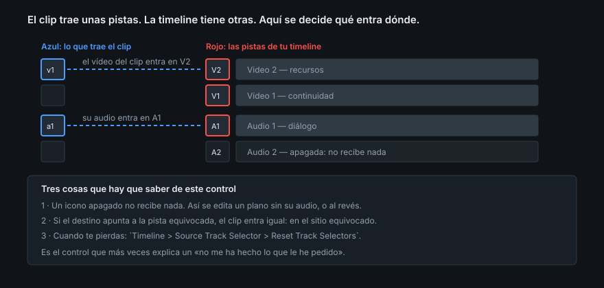

# El selector de pistas de origen

> Un clip trae unas pistas. Tu timeline tiene otras. Este control es donde se dice cuál va con
> cuál, y es el único de la Edit page que puede hacer que una edición perfectamente ejecutada
> acabe en el sitio equivocado.

## 🎯 Objetivos

- Leer el `Source Track Selector`: qué es la columna azul y qué es la roja
- Conectar la pista de vídeo o de audio de un clip con la pista de destino que quieras
- Editar un clip **sin** su audio, o solo su audio
- Reconocer los síntomas de un destino mal puesto
- Volver al estado por defecto cuando te has perdido

---

## 1. Qué problema resuelve

Un clip grabado con una cámara y un micro trae, como poco, una pista de vídeo y una de audio.
Puede traer cuatro de audio, si se grabó con varios micros. Tu timeline tiene sus propias
pistas, con sus propios usos: `Video 1` para la continuidad, `Video 2` para los recursos, `Audio
1` para el diálogo, `Audio 2` para el ambiente.

Cuando editas ese clip, hay que decidir **qué componente del clip va a qué pista de la
timeline**. En la Cut page esa decisión la toma Resolve por ti, con reglas razonables. En la
Edit page la tomas tú, y por eso puedes hacer cosas que en la Cut page no:

- Traerte solo la imagen de un plano y dejar fuera su sonido, porque debajo ya hay una voz
- Traerte solo el sonido, para usarlo como ambiente sin que se vea la imagen
- Poner un plano en `Video 2` para que quede **encima** de otro que ya está montado
- Mandar el micro de corbata a `Audio 1` y el de ambiente a `Audio 2`, del mismo clip

Ninguna de esas cuatro se puede hacer sin este control.

---

## 2. Cómo funciona



### 2.1 Dos columnas, dos significados

El control vive en la **cabecera de cada pista**, y son dos iconos rectangulares por fila:

- **La columna de la izquierda, en azul: el origen.** Son las pistas que trae el clip que
  tengas seleccionado en el media pool o cargado en el visor de origen. Un clip con una pista de
  vídeo y dos de audio enseña `v1`, `a1` y `a2`.
- **La columna de la derecha, en rojo: el destino.** Son las pistas de tu timeline: `V1`, `V2`,
  `A1`, `A2`…

La fila en la que coinciden un icono azul y uno rojo dice: **esto de aquí va a parar aquí**.

> [!NOTE]
> La convención de color es constante en toda la página: **azul es lo que viene del material,
> rojo es lo que hay en la timeline**. Cuando en la Semana 09 aparezcan los indicadores de
> trimming, siguen el mismo código.

### 2.2 Un icono apagado no recibe nada

Cada icono se puede desactivar con un clic. Un icono de origen apagado significa: **esta parte
del clip no entra**. Un icono de destino apagado significa: **esta pista no recibe nada**.

Eso es lo que permite editar un plano sin su audio: apagas el icono de audio del origen, haces la
edición, y en la timeline aparece solo la imagen.

Los iconos desactivados se ven sin resaltar. Es una diferencia visual pequeña y es la causa de
la mitad de los «no me ha traído el sonido».

### 2.3 Qué pasa si el destino está mal

Nada visible, y ese es el problema. Resolve no comprueba si lo que estás haciendo tiene sentido:
hace exactamente lo que dice el control. Los síntomas típicos:

| Síntoma | Qué pasó |
| ------- | -------- |
| El plano entró pero no se ve | Entró en una pista que está debajo de otra con contenido |
| El plano entró y tapó el montaje | El destino de vídeo apuntaba a una pista alta |
| No hay sonido | El icono de audio del origen estaba apagado |
| Hay sonido y no hay imagen | Al revés |
| El plano no entró en ningún sitio | Todos los destinos apagados |
| Se movió lo que no debía | El destino apuntaba a una pista con `Sync Lock` |

La forma de no llegar aquí es un hábito de dos segundos: **mirar la cabecera antes de cada
edición**, igual que se mira el retrovisor.

### 2.4 El control no solo decide dónde entra: decide sobre qué actúas

Esto sorprende a todo el mundo la primera vez. El `Source Track Selector` no gobierna únicamente
las ediciones nuevas: varios comandos de la Edit page miran **qué pistas tienen el destino
activado** para decidir sobre cuál actuar.

Dos casos que vas a encontrar esta misma semana:

- **`V`, que selecciona el punto de corte más cercano al cabezal**, lo busca en la pista más baja
  que tenga el destino activado. Si tienes el destino en `V2`, selecciona un corte de `V2` aunque
  estés mirando `V1`.
- **Pegar clips.** Lo que copies se pega en la pista más baja con el destino activado, no en la
  pista de la que lo copiaste.

La consecuencia práctica: cuando un comando actúa sobre una pista que no esperabas, la primera
sospecha no es el comando, es el destino.

### 2.5 Cuando el clip trae más pistas que tu timeline

Un clip grabado con una grabadora externa puede traer cuatro, seis u ocho pistas de audio. Tu
timeline tiene dos. No pasa nada: las pistas de origen que no estén conectadas a ningún destino
simplemente no entran.

Lo que **sí** hay que decidir es cuál de todas quieres. Un clip con cuatro micros trae en `a1` el
de corbata, en `a2` la caña, y en `a3` y `a4` el ambiente —o cualquier otro reparto: eso lo sabe
quien grabó, y por eso la Semana 04 insistía en anotar el reparto de canales en la metadata.

---

## 3. Cómo se hace en Resolve 21

### 3.1 Cambiar el destino, cuatro formas

| Forma | Cómo |
| ----- | ---- |
| Arrastrando | Arrastra el icono azul hasta la pista de la timeline que quieras |
| Con dos clics | Clic en el icono azul, después clic en el icono rojo de la pista de destino |
| Con el teclado | `Ctrl+Shift+↑` / `↓` (Win) / `Cmd+Shift+↑` / `↓` (Mac) mueve el destino de vídeo; `Ctrl+Alt+↑` / `↓` (Win) / `Cmd+Opt+↑` / `↓` (Mac) el de audio |
| Con un número | `Alt+1` … `Alt+8` (Win) / `Opt+1` … `Opt+8` (Mac) manda el vídeo a esa pista; `Alt+Ctrl+1` … `8` (Win) / `Opt+Cmd+1` … `8` (Mac) el audio |

Y desde el menú, con todos los comandos y sus atajos: `Timeline > Source Track Selector`.

### 3.2 Elegir qué canal de audio va a qué pista

Un clip puede traer más pistas de audio que las que quieres usar. Con **clic derecho sobre un
icono de audio azul** se abre un menú que permite mandar otra pista de audio del origen a esa
pista de destino. Es la forma de decir «de este clip, quiero el canal 3 en mi `Audio 1`».

### 3.3 Activar y desactivar

- Clic sobre un icono ya asignado, de origen o de destino, lo apaga; otro clic lo vuelve a
  encender
- Se puede usar el clic y arrastre sobre varias cabeceras para poner varias en el mismo estado

### 3.4 El botón de emergencia

Cuando has cambiado los selectores tantas veces que ya no sabes en qué estado están:

```
Timeline > Source Track Selector > Reset Track Selectors
```

Vuelve todo a su valor por defecto: el vídeo del origen a `V1`, el audio a `A1`, todo encendido.
Es una operación segura, no toca la timeline y es lo primero que hay que probar cuando una
edición hace algo incomprensible.

### 3.5 El hábito de los tres segundos

Antes de cada edición, en este orden:

1. **¿Qué está cargado en el visor de origen?** El nombre está en su barra de título
2. **¿Dónde apuntan los destinos?** Mira las cabeceras: azul y rojo en la misma fila
3. **¿Qué está apagado?** Lo que no esté resaltado no va a entrar

Tres segundos. Cuando el hábito está cogido, los problemas de destino desaparecen del todo.

---

## 4. Antipatrones

| Antipatrón | Por qué duele | Qué hacer |
| ---------- | ------------- | --------- |
| Editar sin mirar las cabeceras | El clip entra donde diga el control, no donde quieras | El hábito de los tres segundos |
| Dejar el destino en `V2` de la edición anterior | El siguiente plano tapa el montaje | Devuélvelo a `V1` al terminar |
| Buscar el clip que «no ha entrado» | Sí entró: en una pista apagada o tapada | Mira todas las pistas, no solo la que esperabas |
| Apagar el audio del origen y olvidarlo | Media hora de planos mudos | Enciéndelo en cuanto acabes el bloque |
| Toquetear los selectores hasta que funcione | Acabas sin saber en qué estado estás | `Reset Track Selectors` y empieza de nuevo |
| Creer que Resolve avisa de un destino absurdo | No avisa nunca | Comprobarlo es tu trabajo |

---

## 5. Trucos

| Truco | Cómo |
| ----- | ---- |
| Mandar el vídeo a una pista sin ratón | `Alt+1` … `Alt+8` (Win) / `Opt+1` … `Opt+8` (Mac) |
| Mandar el audio a una pista sin ratón | `Alt+Ctrl+1` … `8` (Win) / `Opt+Cmd+1` … `8` (Mac) |
| Editar un plano sin su sonido | Apaga el icono de audio del origen |
| Traerse solo el sonido de un plano | Apaga el icono de vídeo del origen |
| Elegir qué canal de audio usar | Clic derecho sobre el icono de audio azul |
| Salir de cualquier lío | `Timeline > Source Track Selector > Reset Track Selectors` |
| Ver de un vistazo si algo está apagado | Los iconos sin resaltar no reciben nada |
| Encontrar todos los comandos con sus atajos | El submenú `Timeline > Source Track Selector` |

---

## 📚 Recursos Adicionales

- [DaVinci Resolve Reference Manual](https://www.blackmagicdesign.com/support/family/davinci-resolve-and-fusion) — capítulo 46, «Three- and Four-Point Editing», sección «Using the Source Track Selector».
- [04 · La timeline y sus pistas](04-la-timeline-y-sus-pistas.md) — el resto de controles de la misma cabecera.
- [08 · Los modos de edición](08-los-modos-de-edicion.md) — lo que hace cada modo depende de a dónde apunte este control.

---

## ✅ Checklist de Verificación

- [ ] Sé qué es la columna azul y qué es la roja
- [ ] Cambio el destino de vídeo y el de audio de dos formas distintas
- [ ] Sé editar un plano sin su audio
- [ ] Reconozco los síntomas de un destino mal puesto
- [ ] Sé volver al estado por defecto con `Reset Track Selectors`
- [ ] Tengo el hábito de mirar las cabeceras antes de editar

---

| Anterior | Actual | Siguiente |
| -------- | ------ | --------- |
| [04 · La timeline y sus pistas](04-la-timeline-y-sus-pistas.md) | **05 · El selector de pistas de origen** | [06 · Crear timelines y sus ajustes](06-crear-timelines-y-sus-ajustes.md) |

← [Volver a la Semana 08](../README.md)
