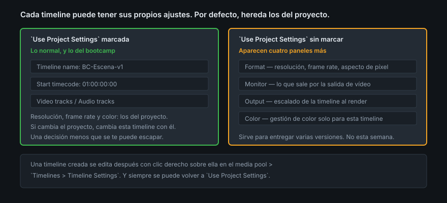

# Crear timelines y sus ajustes

> Una timeline no es «la línea de tiempo del proyecto»: es un objeto que vive en un bin, que se
> puede duplicar, exportar y respaldar, y que puede tener sus propios ajustes de formato. Saber
> eso cambia cómo se organiza el trabajo de aquí a la Semana 36.

## 🎯 Objetivos

- Crear una timeline vacía y entender cada campo del diálogo
- Saber dónde se guarda una timeline y por qué eso importa
- Decidir entre heredar los ajustes del proyecto o darle los suyos
- Cambiar los ajustes de una timeline ya creada
- Conocer los respaldos automáticos de timeline y para qué sirven

---

## 1. Qué problema resuelve

Hasta ahora tus timelines han aparecido casi solas: `BC-Montaje-v1` en la Semana 06,
`BC-Sync-Cut-v1` con el sync bin, `BC-Montaje-v2` duplicando la anterior. No has tenido que
decidir nada sobre ellas.

Esta semana creas una desde cero, y el diálogo que aparece pregunta seis cosas. Ninguna es
inocente:

- El **número de pistas** decide con qué estructura empiezas
- El **timecode de inicio** decide cómo se leen todas las referencias temporales de la pieza
- El **tipo de canal de audio** decide si tus pistas son mono o estéreo, y eso condiciona la
  Fase 4 entera
- La casilla de **ajustes del proyecto** decide si esta timeline va a 24 fps como todo lo demás
  o a otra cosa

Y hay una decisión que el diálogo no pregunta pero que ya has tomado sin darte cuenta: **en qué
bin va a caer**. Porque una timeline se guarda en el bin que tengas seleccionado, exactamente
igual que un clip importado.

---

## 2. Cómo funciona

### 2.1 Una timeline es un objeto del media pool

Vive en un bin, se puede arrastrar a otro, se puede renombrar, duplicar y borrar. En la lista de
clips aparece como una fila más, con su nombre y su duración.

Esto tiene dos consecuencias prácticas:

1. **Se guarda donde estés.** Si tienes seleccionado el bin `03-Entrevistas`, la timeline nueva
   cae ahí. Por eso conviene tener seleccionado `Master`, o un bin dedicado, antes de crearla.
2. **Se puede perder de vista.** En un proyecto con doce bins, una timeline en el bin equivocado
   es una timeline que no encuentras. La preferencia `Smart Bin for Timelines`, en el panel
   `Editing` de `Preferences > User`, crea un bin inteligente que reúne todas las timelines del
   proyecto sin cambiarlas de sitio.

### 2.2 Los campos del diálogo, uno a uno

`File > New Timeline` abre la ventana **`New Timeline Options`**:

| Campo | Qué decide | Qué poner esta semana |
| ----- | ---------- | --------------------- |
| **`Start Timecode`** | El timecode del primer fotograma | Déjalo como está |
| **`Timeline Name`** | El nombre. El verificador lo lee literalmente | `BC-Escena-v1` |
| **`No. of Video Tracks`** | Cuántas pistas de vídeo nace teniendo | 2 |
| **`No. of Audio Tracks`** | Cuántas de audio | 3 |
| **`Audio Track Type`** | Mono, estéreo, 5.1, 7.1 o adaptativo | El que tenga tu material |
| **`Empty Timeline`** | Marcado, nace vacía | **Marcado** |
| **`Use Custom Settings`** | Abre las pestañas de ajustes propios | No lo toques |

> [!WARNING]
> Si **desmarcas** `Empty Timeline`, Resolve crea la timeline con **todo el material de todos
> los bins del media pool** dentro, uno detrás de otro. Es útil para revisar dailies y es una
> sorpresa desagradable si no lo esperabas: tu timeline nueva aparece con doscientos clips.
> Déjalo marcado.

### 2.3 Heredar o no heredar

Por defecto, una timeline nueva copia del proyecto la resolución, el frame rate, los ajustes de
monitorización y la gestión de color. Es lo que quieres casi siempre, y es lo que quieres en este
bootcamp: tu proyecto va a **24 fps** desde la Semana 01 y todas las timelines deben ir con él.

Desmarcando `Use Project Settings` —o pulsando `Use Custom Settings`, que es el mismo camino con
otro rótulo— aparecen cuatro paneles:

| Panel | Qué contiene |
| ----- | ------------ |
| **`Format`** | Resolución, frame rate, aspecto de píxel, tratamiento de resoluciones que no encajan |
| **`Monitor`** | Lo que sale por la salida de vídeo externa |
| **`Output`** | El escalado de la timeline hacia el render |
| **`Color`** | Gestión de color solo para esta timeline |

Sirve para casos reales —entregar la misma pieza en dos resoluciones, por ejemplo— y no es cosa
de esta semana. La Semana 29 los usa de verdad.

> [!IMPORTANT]
> Una timeline con un frame rate distinto del proyecto es la forma más silenciosa de romper una
> pieza: los planos duran otra cosa, el audio se desincroniza poco a poco y el problema aparece
> a los diez minutos de montaje. Si no tienes un motivo escrito, deja `Use Project Settings`.

### 2.4 Duplicar frente a crear

Duplicar una timeline —clic derecho sobre ella en el media pool, `Duplicate Timeline`— hace una
copia independiente con todo su contenido. Es lo que hiciste en la Semana 07 y lo que harás en
la 09.

La regla del bootcamp, que ya conoces:

> **Al cambiar de fase, se duplica. Al empezar algo distinto, se crea.**

Esta semana se **crea**, porque la escena que vas a montar no es una versión de tu montaje: es
una pieza de trabajo nueva sobre el mismo material.

---

## 3. Cómo se hace en Resolve 21

### 3.1 Crear la timeline

1. En el media pool, **selecciona el bin** donde quieres que caiga
2. `File > New Timeline`, atajo `Ctrl+N` (Win) / `Cmd+N` (Mac)
   — o clic derecho en el media pool `> Timelines > Create New Timeline`
3. Rellena los campos de la tabla de 2.2
4. **`Create New Timeline`**

La timeline nueva se abre sola y pasa a ser la timeline activa.

### 3.2 Cambiar los ajustes de una timeline existente

Clic derecho sobre la timeline en el media pool `> Timelines > Timeline Settings`. Se abre el
diálogo `Edit Timeline` con las pestañas `Format`, `Monitor`, `Output` y `Color`, y un botón
`Use Project Settings` para volver a heredar.

### 3.3 Los respaldos automáticos de timeline

Resolve puede guardar copias periódicas de cada timeline por su cuenta, siempre que esté marcada
la casilla **`Timeline Backups`** en `Preferences > User > Project Save and Load`. Se guardan
solo cuando ha habido cambios, así que estar un rato sin tocar nada no gasta respaldos.

Para volver a una copia anterior: clic derecho sobre la timeline en el media pool
`> Restore Timeline Backup`, y elige de la lista, que está ordenada por fecha y hora.

> [!NOTE]
> Restaurar **no machaca** tu timeline actual: la copia entra en el media pool como una timeline
> nueva, con la palabra `Backup` añadida al nombre. Eso significa que restaurar es seguro y que
> puedes comparar las dos antes de decidir.

Y se puede crear un punto de respaldo a mano, con nombre propio, antes de un cambio grande:
`File > Create Timeline Backup`, atajo `Alt+Ctrl+S` (Win) / `Opt+Cmd+S` (Mac).

> [!NOTE]
> En la Semana 03 viste estos archivos en disco: se llaman `Timeline.<AAAAMMDDHHMMSS>`. Aquello
> era la vista desde el sistema de archivos; esto es la misma cosa vista desde el programa.

Esto **no** sustituye a tu respaldo semanal. `File > Export Project` guarda el proyecto entero
en un `.drp` que puedes llevarte a otro ordenador; los respaldos de timeline solo existen dentro
de esta biblioteca y de este proyecto.

### 3.4 Exportar una timeline sola

Un archivo **`.drt`** contiene una timeline y la información de sus clips, sin los medios. Sirve
para pasar un montaje de un proyecto a otro que tenga el mismo material.

- Una sola: selecciónala en el media pool y `File > Export > Export AAF, XML, DRT`, atajo
  `Ctrl+Shift+O` (Win) / `Cmd+Shift+O` (Mac). En el diálogo, elige el formato
  `DaVinci Resolve Timeline Files (*.drt)`
- Varias de golpe: selecciónalas, clic derecho `> Timelines > Export > DaVinci Resolve Timeline
  Files`, y elige la carpeta

Los formatos de intercambio con otros programas —XML, AAF, EDL, OTIO— salen por la misma puerta
y son la Semana 12.

---

## 4. Antipatrones

| Antipatrón | Por qué duele | Qué hacer |
| ---------- | ------------- | --------- |
| Crear la timeline con un bin cualquiera seleccionado | Acaba donde no la buscarás | Selecciona el bin antes de crearla |
| Desmarcar `Empty Timeline` sin querer | Nace con todo el material dentro | Déjalo marcado |
| Dar a la timeline un frame rate propio | Desincroniza el audio sin avisar | `Use Project Settings` salvo motivo escrito |
| Nacer con una sola pista de audio | Todo acaba mezclado en `A1` | Tres pistas desde el principio |
| Confiar solo en los respaldos automáticos | Viven dentro de la biblioteca | `File > Export Project` cada semana |
| Duplicar cuando toca crear | Acabas con seis versiones que no son versiones | Duplicar al cambiar de fase, crear al empezar algo nuevo |
| Nombres con espacios o acentos | El verificador y los archivos de intercambio se atragantan | Guiones y `BC-` delante |

---

## 5. Trucos

| Truco | Cómo |
| ----- | ---- |
| Crear una timeline sin menús | `Ctrl+N` (Win) / `Cmd+N` (Mac) |
| Que la timeline caiga donde quieres | Selecciona el bin **antes** |
| Tener todas las timelines a la vista | `Preferences > User > Editing > Smart Bin for Timelines` |
| Nacer con la estructura de pistas ya hecha | Rellena `No. of Video Tracks` y `No. of Audio Tracks` en el diálogo |
| Fijar tus valores por defecto | `Preferences > User > Editing > New Timeline Settings` |
| Recuperar una timeline de hace dos horas | Clic derecho `> Restore Timeline Backup` |
| Marcar un punto seguro antes de un cambio grande | `File > Create Timeline Backup` |
| Llevarte solo un montaje a otro proyecto | Exporta un `.drt` |
| Comprobar los ajustes de una timeline ya hecha | Clic derecho `> Timelines > Timeline Settings` |

---

## 📚 Recursos Adicionales

- [DaVinci Resolve Reference Manual](https://www.blackmagicdesign.com/support/family/davinci-resolve-and-fusion) — capítulo 41, «Creating and Working with Timelines»: el diálogo completo, los respaldos y la exportación de `.drt`.
- [Semana 03 · Bases de datos y respaldos](../../week-03-resolve_21_anatomia_bases_de_datos_y_preferencias/README.md) — dónde vive todo esto en el disco.
- [docs/proyecto-hilo-conductor.md](../../../docs/proyecto-hilo-conductor.md) — la convención de nombres y versiones del bootcamp entero.

---

## ✅ Checklist de Verificación

- [ ] Sé que una timeline se guarda en el bin que esté seleccionado
- [ ] Puedo explicar cada campo del diálogo `New Timeline Options`
- [ ] Sé qué pasa si desmarco `Empty Timeline`
- [ ] Entiendo por qué no debo darle un frame rate propio
- [ ] Sé cambiar los ajustes de una timeline ya creada
- [ ] Sé dónde están los respaldos automáticos y por qué no bastan

---

| Anterior | Actual | Siguiente |
| -------- | ------ | --------- |
| [05 · El selector de pistas de origen](05-el-selector-de-pistas-de-origen.md) | **06 · Crear timelines y sus ajustes** | [07 · La edición de tres puntos](07-la-edicion-de-tres-puntos.md) |

← [Volver a la Semana 08](../README.md)
