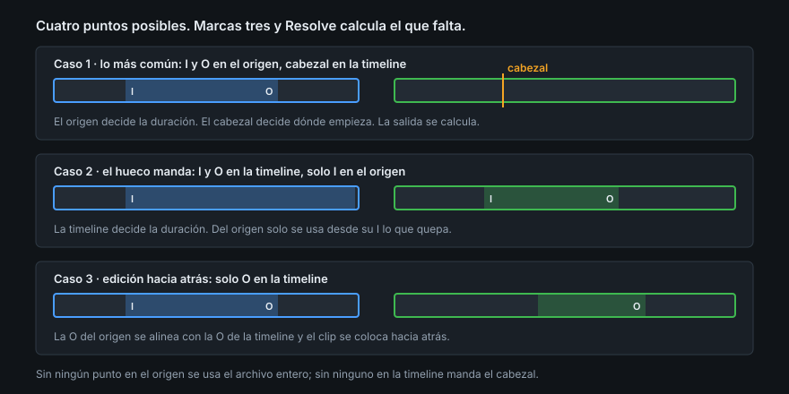

# La edición de tres puntos

> Una edición necesita cuatro datos: dónde empieza y dónde acaba el trozo del clip, y dónde
> empieza y dónde acaba el hueco de la timeline. Marcas tres y Resolve calcula el cuarto. Toda
> la Edit page gira alrededor de esta idea.

## 🎯 Objetivos

- Enumerar los cuatro puntos de una edición y saber cuál se calcula solo
- Aplicar las cinco reglas que gobiernan qué pasa según los puntos que marques
- Montar un plano de duración exacta contra un hueco exacto
- Entender qué es una **edición hacia atrás** (*backtiming*) y cuándo se usa
- Reconocer las marcas de previsualización y qué te están diciendo

---

## 1. Qué problema resuelve

Hasta ahora, cuando querías meter un plano en el montaje, lo metías y luego lo ajustabas.
Funciona mientras la pieza es corta y no hay nada que respetar.

Deja de funcionar en cuanto hay algo que respetar. Tres ejemplos reales:

- Hay un hueco de **3 segundos y 11 fotogramas** entre dos planos y necesitas taparlo con un
  recurso. Ni uno más ni uno menos: si sobra, pisas el plano siguiente; si falta, queda negro.
- El plano tiene que **acabar** exactamente cuando entra la voz que ya está montada. Dónde
  empiece te da igual, pero el final es innegociable.
- Quieres sustituir un plano por otro **sin cambiar la duración de la pieza**, porque hay un
  rótulo encima que está colocado al fotograma.

La edición de tres puntos resuelve los tres, y sin calcular nada a mano. Tú dices qué es lo
fijo, y Resolve deduce el resto.

---

## 2. Cómo funciona

### 2.1 Los cuatro puntos

| Punto | Dónde se marca | Qué dice |
| ----- | -------------- | -------- |
| **Entrada de origen** | Source Viewer, `I` | Desde qué fotograma del clip |
| **Salida de origen** | Source Viewer, `O` | Hasta qué fotograma del clip |
| **Entrada de destino** | Timeline, `I` | Desde qué fotograma de la pieza |
| **Salida de destino** | Timeline, `O` | Hasta qué fotograma de la pieza |

Y la idea central:

> **Con tres de esos cuatro, la edición ya está completamente definida. El cuarto no aporta
> información nueva: se deduce.**

Si sabes qué trozo del clip quieres y dónde empieza en la timeline, ya sabes dónde acaba. Si
sabes qué hueco quieres llenar y desde qué fotograma del clip, ya sabes hasta dónde vas a
llegar.

### 2.2 Las reglas, tal y como las aplica Resolve

Estas son las cinco situaciones y lo que Resolve hace en cada una. Vienen del manual y merece la
pena leerlas despacio, porque explican prácticamente todo lo que puede pasar:

| Lo que has marcado | Qué hace Resolve |
| ------------------ | ---------------- |
| **No hay entrada en el origen** | Usa el primer fotograma del material como entrada |
| **No hay salida en el origen** | Usa el último fotograma del material como salida |
| **No hay ni entrada ni salida en la timeline** | Usa el **cabezal** como entrada |
| **Entrada en la timeline, sin salida** | Mete el rango entero del origen empezando en esa entrada |
| **Salida en la timeline, sin entrada** | **Edición hacia atrás**: alinea la salida del origen con la salida de la timeline |

Y dos casos más:

- **Entrada y salida en la timeline, y solo salida en el origen**: también va hacia atrás, y son
  los puntos de la timeline los que deciden la duración.
- **Los cuatro puntos marcados**: mandan los de la timeline para la duración, y la entrada del
  origen se alinea con la entrada de la timeline. Es un caso especial, y lo normal es que quieras
  usar `Fit to Fill` en vez de `Overwrite` cuando marcas los cuatro. El archivo 08 lo explica.

### 2.3 La edición hacia atrás, que suena rara y es utilísima

*Backtiming* es marcar solo el **final**. Suena poco intuitivo hasta que aparece el caso, y el
caso aparece constantemente:

> El recurso tiene que **terminar** justo cuando la voz dice «y entonces se cayó». Cuándo empiece
> me da igual: lo que no puede pasar es que siga sonando después.

Marcas la salida en la timeline en ese fotograma exacto, marcas el rango que quieres del origen,
y Resolve coloca el plano **hacia atrás** desde ahí. No has calculado nada.

El otro caso clásico: un plano que tiene que acabar en el corte de música. La música ya está
montada; el plano se coloca desde el final.

### 2.4 Las marcas de previsualización

Cuando tienes puntos marcados, aparecen en los visores unas **marcas de previsualización**
(*preview marks*): indicadores del punto que Resolve va a calcular. Son la respuesta visual a
«¿qué va a pasar cuando pulse el botón?».

Además, una **barra gruesa** en la barra de reproducción indica qué parte se va a usar cuando
falta un punto: si solo has marcado la salida del origen, la barra se extiende hacia la
izquierda desde ella, diciéndote «todo esto es lo que voy a coger».

Las marcas de previsualización se pueden **arrastrar**, y al hacerlo cambia el punto
correspondiente del otro lado. Es una forma de ajustar la edición antes de ejecutarla.

---

## 3. Cómo se hace en Resolve 21

### 3.1 El caso más común, paso a paso

El 80 % de tus ediciones son este:

1. **Carga el clip** en el Source Viewer (doble clic en el media pool)
2. Con el foco en el visor de origen —`Q` si hace falta—, marca **`I`** y **`O`**
3. **Comprueba el destino** en las cabeceras: azul y rojo donde tienen que estar
4. Pon el **cabezal** de la timeline donde quieres que empiece
5. **`F10`** para un `Overwrite`, o el botón `Overwrite Clip` de la barra

Tres puntos: los dos del origen y el cabezal. El cuarto se calcula.

### 3.2 El caso del hueco exacto

1. En la **timeline**, marca `I` y `O` en los dos extremos del hueco
2. En el **origen**, marca solo `I`: desde qué fotograma quieres empezar a coger
3. Comprueba el destino
4. `F10`

La duración la manda la timeline. Del origen se coge, desde su `I`, exactamente lo que quepa.

### 3.3 El caso hacia atrás

1. En la **timeline**, marca solo `O`, en el fotograma donde tiene que acabar
2. En el **origen**, marca `I` y `O`
3. `F10`

El plano queda colocado terminando justo ahí.

### 3.4 Limpiar antes de empezar

Los puntos se quedan puestos entre edición y edición. Es cómodo cuando lo sabes y una fuente de
sorpresas cuando no.

| Acción | Atajo |
| ------ | ----- |
| Borrar la entrada | `Alt+I` (Win) / `Opt+I` (Mac) |
| Borrar la salida | `Alt+O` (Win) / `Opt+O` (Mac) |
| Borrar las dos | `Alt+X` (Win) / `Opt+X` (Mac) |

Costumbre que ahorra disgustos: **`Alt+X` en la timeline antes de cada edición nueva**, salvo
que los puntos que hay puestos sean justo los que quieres usar.

### 3.5 Cómo comprobar lo que has marcado sin leer timecodes

- En el **visor**, el campo de duración enseña la duración del rango marcado, no la del clip
- En la **timeline**, todo lo que queda fuera del rango se atenúa
- La barra gruesa de la barra de reproducción enseña qué se va a usar cuando falta un punto

---

## 4. Antipatrones

| Antipatrón | Por qué duele | Qué hacer |
| ---------- | ------------- | --------- |
| Marcar los cuatro puntos «para asegurar» | Sobra uno, y si no cuadran manda la timeline | Marca tres y deja que calcule |
| Dejar puntos viejos de la edición anterior | La edición nueva los usa | `Alt+X` / `Opt+X` antes de empezar |
| Calcular la duración a mano y marcarla | Es justo lo que hace el programa | Marca el hueco y ya está |
| Marcar en el visor equivocado | La edición hace otra cosa | `Q`, y mira qué visor tiene el borde resaltado |
| No usar nunca el backtiming | Te obliga a ajustar el final a mano después | Marca solo la `O` de la timeline |
| Ignorar las marcas de previsualización | Te dicen lo que va a pasar antes de que pase | Míralas antes de pulsar |
| Editar sin comprobar el destino | Los tres puntos estaban bien y el plano acabó en otra pista | El hábito del archivo 05 |

---

## 5. Trucos

| Truco | Cómo |
| ----- | ---- |
| Limpiar puntos antes de cada edición | `Alt+X` (Win) / `Opt+X` (Mac) |
| Ver la duración de lo que has marcado | El campo de duración del visor |
| Ver el hueco marcado sin leer números | Lo de fuera del rango se atenúa |
| Colocar un plano por su final | Marca solo la `O` en la timeline |
| Llenar un hueco exacto | `I` y `O` en la timeline, solo `I` en el origen |
| Saber qué se va a usar cuando falta un punto | La barra gruesa de la barra de reproducción |
| Ajustar la edición antes de ejecutarla | Arrastra una marca de previsualización |
| Usar el cabezal como entrada | No marques nada en la timeline: el cabezal manda |

---

## 📚 Recursos Adicionales

- [DaVinci Resolve Reference Manual](https://www.blackmagicdesign.com/support/family/davinci-resolve-and-fusion) — capítulo 46, «Three- and Four-Point Editing», sección «The Rules of Three-Point Editing»: la tabla de reglas de 2.2, en su versión original.
- [03 · Los dos visores](03-los-dos-visores.md) — dónde se marca cada punto y cómo no confundirse de visor.
- [08 · Los modos de edición](08-los-modos-de-edicion.md) — qué botón pulsar una vez marcados los puntos.

---

## ✅ Checklist de Verificación

- [ ] Sé cuáles son los cuatro puntos y dónde se marca cada uno
- [ ] Puedo recitar las cinco reglas de qué pasa según lo que falte
- [ ] Sé montar contra un hueco de duración exacta
- [ ] Sé hacer una edición hacia atrás y para qué sirve
- [ ] Limpio los puntos antes de cada edición nueva
- [ ] Sé leer las marcas de previsualización y la barra gruesa

---

| Anterior | Actual | Siguiente |
| -------- | ------ | --------- |
| [06 · Crear timelines y sus ajustes](06-crear-timelines-y-sus-ajustes.md) | **07 · La edición de tres puntos** | [08 · Los modos de edición](08-los-modos-de-edicion.md) |

← [Volver a la Semana 08](../README.md)
