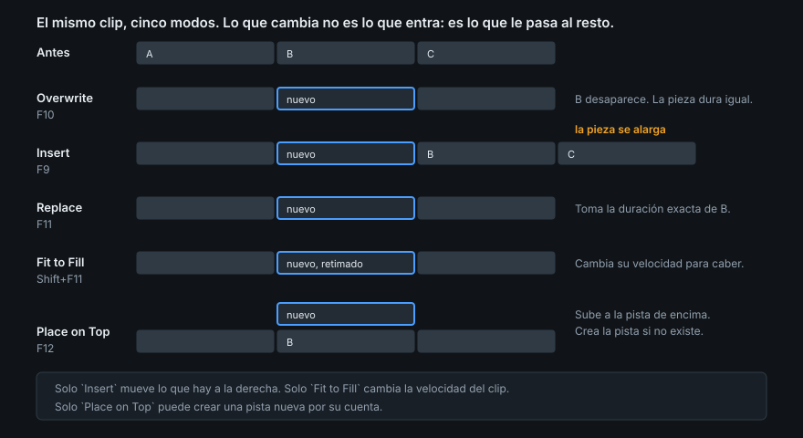

# Los modos de edición

> Ya sabes qué trozo quieres y dónde va. Falta la tercera decisión, que es la que distingue a la
> Edit page: qué le pasa al resto de la pieza cuando ese plano entra. Siete respuestas posibles,
> y elegir mal se paga tres cortes más adelante.

## 🎯 Objetivos

- Distinguir los siete modos de edición y decir qué hace cada uno con la timeline
- Saber cuáles alargan la pieza y cuáles no
- Elegir el modo correcto a partir de lo que quieres conseguir
- Conocer el único modo que cambia la velocidad del clip y el único que crea pistas
- Usar los atajos de teclado de cada modo

---

## 1. Qué problema resuelve

En la Semana 07 aprendiste una regla dura: **cualquier cosa que cambie la duración de algo en
`Video 1` descoloca lo que hay en las pistas de encima**. Un rótulo que estaba bien colocado deja
de estarlo. Un recurso deja de tapar lo que tapaba.

Los modos de edición son la respuesta a esa regla. Cada uno decide una cosa distinta:

- ¿Lo que ya estaba **se borra** o **se aparta**?
- ¿La pieza **dura lo mismo** o **se alarga**?
- ¿El clip nuevo **cabe como es** o **se estira** para caber?
- ¿Entra en la pista que digo o **sube** a la de encima?

Elegir bien es lo que separa «he metido un plano» de «he metido un plano y no he roto nada».

---

## 2. Cómo funciona

### 2.1 La tabla que resume la semana

| Modo | Atajo | Qué le hace a lo que ya había | ¿Cambia la duración de la pieza? |
| ---- | ----- | ----------------------------- | -------------------------------- |
| **`Overwrite`** | `F10` | Lo borra donde cae el clip nuevo | No |
| **`Insert`** | `F9` | Lo parte y lo empuja a la derecha | **Sí, la alarga** |
| **`Replace`** | `F11` | Sustituye el clip que cruza el cabezal | No |
| **`Fit to Fill`** | `Shift+F11` | Nada: llena un hueco marcado | No |
| **`Place on Top`** | `F12` | Nada: sube a la pista de encima | No |
| **`Ripple Overwrite`** | `Shift+F10` | Sustituye y recoloca lo de detrás | **Sí, la alarga o la acorta** |
| **`Append to End`** | `Shift+F12` | Nada: se pone al final de todo | **Sí, la alarga** |

Los tres que cambian la duración son los que hay que pensar dos veces. Los otros cuatro son
seguros en ese sentido.

### 2.2 `Overwrite`: el que se usa siempre

Pisa. Lo que hubiera en la timeline donde cae el clip nuevo desaparece, y la pieza dura
exactamente lo mismo que antes.

Es el modo por defecto y el que más vas a usar: montar la primera pasada, sustituir un plano por
otro de la misma duración, tapar algo. Como no mueve nada, no descoloca ni rótulos ni recursos.

### 2.3 `Insert`: el que empuja

Parte lo que hay en el cabezal y empuja todo lo que venía detrás hacia la derecha, la duración
del clip nuevo. La pieza se alarga.

Hay un detalle que sorprende y conviene saber: **los clips de otras pistas que se solapan hacia
la izquierda del punto de inserción no se mueven**. Si tienes una música en `Audio 2` que empezó
antes del punto donde insertas, esa música se queda donde estaba mientras el resto se desplaza.
Es coherente —lo que ya había empezado no se parte— y es una fuente de desincronizaciones si no
lo esperas.

### 2.4 `Replace`: el que respeta la duración

Es el más listo de los siete y el peor entendido. No necesitas marcar **ningún** punto:

1. Pones el cabezal de la **timeline** en el fotograma que quieres hacer coincidir
2. Pones el cabezal del **origen** en el fotograma del clip que tiene que caer ahí
3. `F11`

Resolve sustituye el clip de la timeline que cruza el cabezal por el nuevo, **usando la duración
del clip que había** y alineando los dos fotogramas que has elegido.

Para qué sirve exactamente: cuando necesitas que una acción del clip nuevo caiga en un fotograma
concreto de la pieza. Un golpe, una palabra, una puerta que se cierra. Es la forma más rápida de
sincronizar algo sin contar fotogramas.

### 2.5 `Fit to Fill`: el único que cambia la velocidad

Es el único modo que usa los **cuatro** puntos, y el único que **retima** el clip: lo acelera o
lo ralentiza para que el rango que has marcado del origen llene exactamente el rango que has
marcado de la timeline.

Sirve cuando tienes un hueco y un plano que no mide lo mismo, y la diferencia es pequeña. Si el
plano es un poco corto, sale una cámara lenta ligera; si es un poco largo, sale acelerado.

> [!WARNING]
> Todo lo que la Semana 07 decía sobre la velocidad sigue valiendo: por debajo del 80 % con
> material grabado a 24 fps, la cámara lenta empieza a verse a tirones. `Fit to Fill` no avisa
> del porcentaje al que ha dejado el plano; hay que mirarlo después en el Inspector.

### 2.6 `Place on Top`: el único que crea pistas

Sube el clip a la **primera pista vacía por encima** de lo que haya en el cabezal o en el rango
marcado —y por **debajo**, si es audio—, **sin hacer caso al destino** que tengas puesto en las
cabeceras. Si no hay ninguna pista libre, la crea.

Es el modo de los rótulos, de los recursos que van encima y de las versiones de un plano que
quieres conservar debajo.

### 2.7 `Ripple Overwrite`: sustituir y recolocar

Sustituye un clip entero de la timeline por otro **de duración distinta**, y desplaza todo lo
que viene detrás para que no queden ni huecos ni solapes: a la derecha si el nuevo es más largo,
a la izquierda si es más corto.

Dos formas de usarlo:

- **Sin puntos en la timeline**: sustituye entero el clip que cruce el cabezal. Hay que borrar
  los puntos con `Alt+X` / `Opt+X` primero, o no funciona así
- **Con `I` y `O` en la timeline**: sustituye ese tramo exacto

Es potente y es el que más descoloca las pistas de encima, porque mueve todo lo que viene
detrás.

### 2.8 `Append to End`: al final de todo

Pone el clip después del último, sin tocar nada. Es el equivalente al `Append` de la Cut page
con el que montaste la primera pasada en la Semana 06.

---

## 3. Cómo se hace en Resolve 21

### 3.1 Las tres formas de ejecutar cualquier modo

1. **El menú `Edit`**, donde están todos con sus nombres completos
2. **El atajo** de la tabla de 2.1
3. **Arrastrar el clip al visor de timeline** y soltarlo sobre la zona del modo que quieras

Tres de ellos tienen además su propio botón en la barra de herramientas: `Insert Clip`,
`Overwrite Clip` y `Replace Clip`.

### 3.2 Cómo elegir el modo: la pregunta de una frase

| Lo que quieres | Modo |
| -------------- | ---- |
| «Que este plano ocupe el sitio de este otro» | `Overwrite` |
| «Que esto entre aquí y lo demás se corra» | `Insert` |
| «Que esta acción caiga justo en este fotograma» | `Replace` |
| «Que este plano llene este hueco exacto» | `Fit to Fill` |
| «Que esto vaya encima, sin tocar lo de abajo» | `Place on Top` |
| «Cambiar este plano por otro más largo sin dejar hueco» | `Ripple Overwrite` |
| «Ponlo al final y ya lo colocaré» | `Append to End` |

### 3.3 Deshacer

Todos los modos son reversibles con `Ctrl+Z` (Win) / `Cmd+Z` (Mac), y conviene usarlo sin
reparos: probar un modo, mirar qué ha pasado y deshacer es la forma más rápida de aprender la
diferencia entre `Overwrite` y `Ripple Overwrite`.

> [!TIP]
> Antes de probar modos nuevos sobre tu montaje bueno, hazlo en la timeline de prácticas de la
> semana. Deshacer funciona, pero encadenar seis operaciones y deshacerlas todas es más lento
> que trabajar en un sitio donde no importa.

---

## 4. Antipatrones

| Antipatrón | Por qué duele | Qué hacer |
| ---------- | ------------- | --------- |
| Usar `Insert` sin pensar en las pistas de encima | Los rótulos y los recursos se descolocan | `Overwrite` salvo que quieras alargar la pieza |
| Usar `Overwrite` cuando querías `Insert` | Te has comido un plano sin darte cuenta | Mira la duración de la pieza después de editar |
| Marcar cuatro puntos y hacer `Overwrite` | La timeline manda y el plano sale recortado | Con cuatro puntos, `Fit to Fill` |
| No mirar a qué velocidad ha quedado un `Fit to Fill` | Puede haber salido al 45 % y verse a tirones | Compruébalo en el Inspector |
| Esperar que `Place on Top` respete el destino | No lo mira: sube a la primera pista libre | Es su comportamiento, no un fallo |
| `Ripple Overwrite` con puntos viejos puestos | Actúa sobre un tramo que no querías | `Alt+X` / `Opt+X` antes |
| Aprenderse los siete de golpe | No hacen falta los siete | `Overwrite`, `Insert` y `Place on Top` cubren el 90 % |

---

## 5. Trucos

| Truco | Cómo |
| ----- | ---- |
| El modo por defecto sin pensar | `F10`, `Overwrite` |
| Meter algo sin comerte nada | `F9`, `Insert`, y comprueba las pistas de encima |
| Sincronizar una acción con un fotograma | `F11`, `Replace`, con los dos cabezales colocados |
| Llenar un hueco con un plano que no mide | `Shift+F11`, `Fit to Fill` |
| Poner un rótulo encima sin crear la pista a mano | `F12`, `Place on Top` |
| Cambiar un plano por otro de otra duración | `Shift+F10`, `Ripple Overwrite`, sin puntos en la timeline |
| Aparcar un plano al final para colocarlo luego | `Shift+F12`, `Append to End` |
| Ver todos los modos a la vez | Arrastra el clip sobre el visor de timeline |
| Entender la diferencia entre dos modos | Haz uno, mira, `Ctrl+Z`, haz el otro |

---

## 📚 Recursos Adicionales

- [DaVinci Resolve Reference Manual](https://www.blackmagicdesign.com/support/family/davinci-resolve-and-fusion) — capítulo 46, «Three- and Four-Point Editing»: una sección por modo, con antes y después.
- [Semana 07 · Cambios de velocidad](../../week-07-cut_page_acabado_y_quick_export/1-teoria/05-cambios-de-velocidad.md) — por qué hay que mirar a qué velocidad deja un plano el `Fit to Fill`.
- [09 · Arrastrar y el overlay del visor](09-arrastrar-y-el-overlay-del-visor.md) — la tercera forma de ejecutar cualquiera de estos modos.

---

## ✅ Checklist de Verificación

- [ ] Sé qué hace cada uno de los siete modos con lo que ya había
- [ ] Sé cuáles tres cambian la duración de la pieza
- [ ] Sé cuál es el único que retima el clip
- [ ] Sé cuál es el único que puede crear una pista
- [ ] Puedo elegir el modo a partir de una frase de lo que quiero
- [ ] Conozco los atajos de los siete

---

| Anterior | Actual | Siguiente |
| -------- | ------ | --------- |
| [07 · La edición de tres puntos](07-la-edicion-de-tres-puntos.md) | **08 · Los modos de edición** | [09 · Arrastrar y el overlay del visor](09-arrastrar-y-el-overlay-del-visor.md) |

← [Volver a la Semana 08](../README.md)
