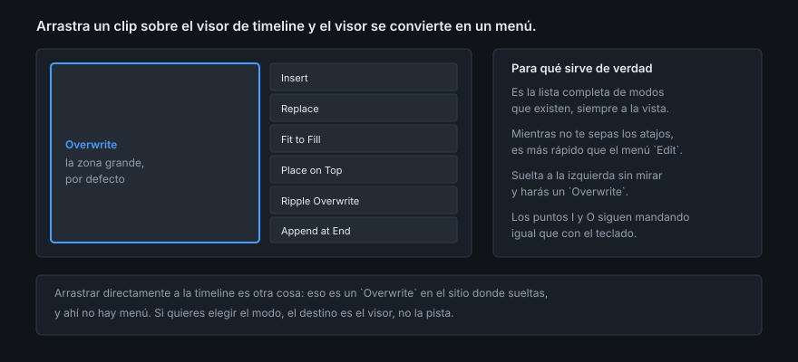

# Arrastrar y el overlay del visor

> Los atajos son más rápidos, pero hay que sabérselos. Mientras no te los sepas, arrastrar el
> clip sobre el visor de timeline te enseña los siete modos a la vez y te deja elegir soltando.
> Y hay tres interruptores en la barra que deciden cómo se comporta todo lo que arrastres.

## 🎯 Objetivos

- Usar el **overlay de edición** del visor de timeline para elegir el modo
- Distinguir arrastrar **al visor** de arrastrar **a la timeline**
- Insertar arrastrando, con su combinación de teclas
- Entender qué hacen `Snapping`, `Linked Selection` y `Position Lock`
- Elegir la vista y el zoom adecuados para cada tipo de edición

---

## 1. Qué problema resuelve

Los siete modos del archivo anterior tienen un problema de aprendizaje: son siete atajos con
teclas de función y modificadores, y nadie se los aprende en una tarde. Mientras tanto, el menú
`Edit` obliga a soltar el ratón, abrir, leer y elegir.

El **overlay de edición** resuelve eso: arrastras el clip sobre el visor de timeline y el visor
se convierte en un menú con los siete modos escritos. Sueltas encima del que quieras. Es más
lento que el atajo y mucho más rápido que el menú, y además hace de recordatorio permanente de
qué modos existen.

Y hay un segundo problema, más silencioso: **arrastrar es impreciso**. Un clip que arrastras a
la timeline cae donde suelte el ratón, que casi nunca es el fotograma que querías. Para eso están
el imán y los controles de zoom.

---

## 2. Cómo funciona

### 2.1 El overlay

Al arrastrar un clip desde el media pool o desde el visor de origen **sobre el visor de
timeline**, aparecen unas zonas superpuestas:

- **La zona grande de la izquierda** es `Overwrite`, que es el modo por defecto
- **Las zonas pequeñas de la derecha** son `Insert`, `Replace`, `Fit to Fill`, `Place on Top`,
  `Ripple Overwrite` y `Append at End`

Sueltas encima de una y se ejecuta ese modo. Los puntos `I` y `O` que tengas marcados siguen
mandando exactamente igual que si hubieras pulsado el atajo: el overlay elige el **modo**, no
los **puntos**.

> [!TIP]
> Por defecto, la zona grande siempre es `Overwrite`. Si prefieres que recuerde el último modo
> que usaste, actívalo en `Preferences > User > Editing`, en la casilla que dice que el overlay
> conserva la última acción realizada. Está desactivada de fábrica.

### 2.2 Arrastrar al visor no es lo mismo que arrastrar a la timeline

Son dos operaciones distintas y conviene no mezclarlas:

| | Arrastrar al **visor** | Arrastrar a la **timeline** |
| - | ---------------------- | --------------------------- |
| ¿Eliges el modo? | Sí, con el overlay | No: es un `Overwrite` |
| ¿Dónde cae? | Donde digan los puntos y el destino | Donde sueltes el ratón |
| ¿Precisión? | Al fotograma | La del pulso, más el imán |
| Cuándo usarlo | Cuando importa dónde va | Cuando da igual el fotograma exacto |

### 2.3 Los tres interruptores de la barra

Están juntos en la barra de herramientas y cambian el comportamiento de todo lo que hagas
después. No hacen nada por sí solos, y por eso se olvidan encendidos o apagados.

**`Snapping`** — el imán, atajo `N`. Con él activado, los bordes de los clips, los marcadores y
el cabezal se pegan entre sí al arrastrar. Es lo que evita el hueco de un fotograma que no se ve
a simple vista y aparece como un parpadeo a negro en la exportación.

Y tiene un truco: **pulsando `N` mientras arrastras** se desactiva temporalmente, y al soltar
vuelve al estado en el que estaba. Sirve para colocar algo a un fotograma exacto en una zona
llena de cortes donde el imán no te deja.

**`Linked Selection`** — el enlace de audio y vídeo. Con él activado, seleccionar la imagen de un
clip selecciona también su sonido, y se mueven juntos. Con él desactivado, se pueden separar.

> [!IMPORTANT]
> Déjalo **activado**. Mover la imagen de un plano sin su sonido es la forma más fácil de
> desincronizar una pieza, y el problema no se ve: se oye, tres días después. Cuando necesites
> separarlos puntualmente, mantén pulsado `Alt` (Win) / `Opt` (Mac) al hacer clic, en vez de
> apagar el interruptor.

**`Position Lock`** — impide mover clips a izquierda o derecha y bloquea todas las operaciones de
ripple. Es un seguro para cuando estás tocando propiedades de los clips —color, tamaño, volumen—
y no quieres descolocar nada por un arrastre accidental.

### 2.4 El zoom, que también es una herramienta de precisión

| Control | Qué hace | Cuándo |
| ------- | -------- | ------ |
| **`Full Extent Zoom`** | Ajusta el zoom para que quepa siempre toda la pieza | Para navegar |
| **`Detail Zoom`** | Amplía sobre el cabezal hasta el nivel de fotograma | Para colocar algo exacto |
| **`Custom Zoom`** | El nivel que marque el deslizador | Para trabajar en un tramo |
| **`Shift+Z`** | Alterna entre la pieza entera y el zoom anterior | Constantemente |

La combinación que se usa todo el rato: `Shift+Z` para ver dónde estás, mover el cabezal,
`Shift+Z` otra vez para volver al detalle.

---

## 3. Cómo se hace en Resolve 21

### 3.1 Editar con el overlay

1. Marca los puntos que necesites, en el origen y en la timeline
2. Comprueba el destino en las cabeceras
3. Arrastra el clip **desde el media pool o desde el visor de origen** hasta el visor de timeline
4. Sin soltar, mueve el ratón sobre la zona del modo que quieras: se resalta
5. Suelta

Si te arrepientes a medio camino, saca el ratón del visor antes de soltar y no pasa nada.

### 3.2 Insertar arrastrando

Arrastrar a la timeline hace un `Overwrite`. Para que haga un `Insert`:

1. Selecciona uno o varios clips en el media pool, o abre uno en el visor de origen
2. Mantén pulsadas **`Ctrl+Shift`** (Win) / **`Cmd+Shift`** (Mac)
3. Arrastra a la timeline: los clips se van insertando en la posición del puntero
4. Suelta

Si seleccionas varios, el orden en que se montan es **el orden en el que están ordenados en el
media pool**. Cambiar la ordenación del bin cambia el resultado.

### 3.3 Vídeo solo o audio solo, de forma persistente

Debajo del visor de origen hay un desplegable que permite fijar si lo que edites va a llevar
**vídeo y audio**, **solo vídeo** o **solo audio**. Es equivalente a apagar los iconos del
selector de pistas, pero se queda puesto y se ve de un vistazo.

### 3.4 Arrastrar desde el sistema de archivos

Se puede arrastrar un archivo directamente desde el explorador de tu sistema a la timeline.
Funciona, y no es buena idea en este bootcamp: el archivo entra en el proyecto sin pasar por tu
estructura de bins, y en dos semanas no sabrás de dónde salió. Importa siempre por el media pool,
como en la Semana 04.

### 3.5 Dos usos de la tecla `C` que ahorran tiempo

La tecla `C` hace dos cosas distintas según dónde tengas el ratón, y las dos son de las que se
usan cien veces al día en cuanto se cogen:

- **Sobre un visor**: manteniendo `C` pulsada y moviendo el ratón de lado a lado se recorre el
  material a la velocidad del gesto, sin tocar el cabezal. Es la forma rápida de encontrar un
  momento concreto dentro de un clip largo.
- **Sobre la timeline**: lleva el cabezal a donde esté el puntero, sin arrastrar por la regla.

La segunda es la que convierte «acercar el cabezal a este corte» en un gesto en vez de tres.

---

## 4. Antipatrones

| Antipatrón | Por qué duele | Qué hacer |
| ---------- | ------------- | --------- |
| Arrastrar a la timeline cuando importa el fotograma | Cae donde suelte el ratón | Arrastra al visor, o usa los atajos |
| Trabajar con el imán apagado | Huecos de un fotograma que salen como parpadeos | `N` para encenderlo |
| Apagar `Linked Selection` y olvidarlo | Pierdes la sincronía de labios | Déjalo puesto; usa `Alt` / `Opt` puntualmente |
| Dejar `Position Lock` activado sin saberlo | Nada se mueve y parece que el programa falla | Míralo cuando algo no responda |
| Montar siempre al mismo nivel de zoom | O no ves el detalle o no ves la pieza | `Shift+Z` |
| Arrastrar archivos desde el explorador | El material entra sin organizar | Importa por el media pool |
| Usar el overlay para todo, siempre | Es más lento que el atajo | Úsalo para aprender, y ve pasándote al teclado |

---

## 5. Trucos

| Truco | Cómo |
| ----- | ---- |
| Ver los siete modos sin abrir el menú | Arrastra el clip sobre el visor de timeline |
| Cancelar un arrastre a medias | Saca el ratón del visor antes de soltar |
| Insertar arrastrando | `Ctrl+Shift` (Win) / `Cmd+Shift` (Mac) mientras arrastras |
| Encender y apagar el imán | `N` |
| Saltarte el imán solo esta vez | `N` mientras estás arrastrando |
| Separar audio de vídeo puntualmente | `Alt` (Win) / `Opt` (Mac) al hacer clic |
| Bloquear la pieza mientras tocas propiedades | `Position Lock` |
| Colocar algo al fotograma | `Detail Zoom` y luego `Shift+Z` para volver |
| Editar solo la imagen sin tocar el selector | El desplegable de debajo del visor de origen |
| Recorrer un clip largo a la velocidad del gesto | Mantén `C` y mueve el ratón sobre el visor |
| Llevar el cabezal donde está el ratón | `C` sobre la timeline |

---

## 📚 Recursos Adicionales

- [DaVinci Resolve Reference Manual](https://www.blackmagicdesign.com/support/family/davinci-resolve-and-fusion) — capítulo 40 para el overlay del visor, capítulo 41 para el imán y el zoom, capítulo 43 para arrastrar e insertar.
- [08 · Los modos de edición](08-los-modos-de-edicion.md) — qué hace cada una de las zonas del overlay.
- [Semana 09 · Trimming quirúrgico](../../week-09-trimming_quirurgico/README.md) — donde el imán y el zoom de detalle dejan de ser cómodos y pasan a ser imprescindibles.

---

## ✅ Checklist de Verificación

- [ ] Sé usar el overlay del visor para elegir el modo
- [ ] Distingo arrastrar al visor de arrastrar a la timeline
- [ ] Sé insertar arrastrando, con su combinación de teclas
- [ ] Sé qué hacen los tres interruptores de la barra
- [ ] Sé desactivar el imán temporalmente sin apagarlo
- [ ] Uso `Shift+Z` para moverme entre el detalle y la pieza entera

---

| Anterior | Actual | Siguiente |
| -------- | ------ | --------- |
| [08 · Los modos de edición](08-los-modos-de-edicion.md) | **09 · Arrastrar y el overlay del visor** | [Semana 08](../README.md) |

← [Volver a la Semana 08](../README.md)
