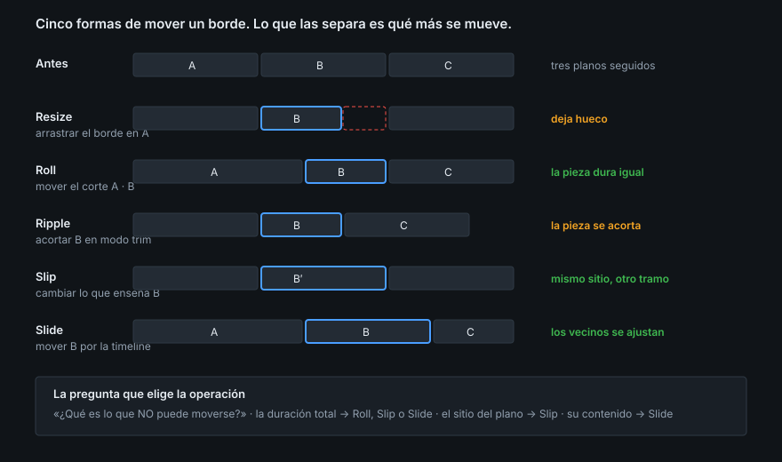

# Qué es el trimming

> Tu montaje ya cuenta la historia. Lo que le falta es que cada corte caiga en el fotograma
> exacto en el que tiene que caer, y eso no se arregla volviendo a montar: se arregla afinando lo
> que ya está puesto. A eso se le llama trimming, y el manual de Resolve abre su capítulo
> diciendo que es la mitad del trabajo.

## 🎯 Objetivos

- Distinguir **montar** de **afinar**, y saber en qué fase estás
- Nombrar las **cinco operaciones** de trimming y decir qué hace cada una
- Saber cuáles **cambian la duración** de la pieza y cuáles no
- Saber cuáles **rompen la sincronía** con el sonido y cuáles no
- Entender por qué el trimming necesita **colas** y qué pasa cuando no las hay
- Elegir la operación correcta a partir del problema que ves en pantalla

---

## 1. Qué problema resuelve

### 1.1 Montar y afinar son dos trabajos distintos

En las Semanas 06 y 07 montaste `BC-Montaje-v2` de principio a fin. En la Semana 08 aprendiste a
decidir **dónde entra** cada plano y **qué le pasa al resto** cuando entra. Las dos cosas son
montar: poner planos.

Esta semana no vas a poner ni un plano nuevo. Vas a coger los que ya están y mover sus bordes.

La diferencia importa porque son dos formas distintas de mirar la pieza:

| Montar | Afinar |
| ------ | ------ |
| ¿Está el plano que hace falta? | ¿Entra y sale cuando tiene que entrar y salir? |
| ¿Está en el orden correcto? | ¿Sobra medio segundo al principio? |
| ¿Se entiende lo que pasa? | ¿Se entiende **a la primera**? |
| Se hace con el material delante | Se hace con la pieza reproduciéndose |

Nadie afina bien mientras monta, porque afinar exige ver la pieza seguida, y montar exige pararla
cada cinco segundos. Por eso son dos pasadas, y por eso esta semana va después de la 08 y no antes.

### 1.2 Qué se ve cuando un montaje no está afinado

Un montaje bruto tiene siempre los mismos cuatro defectos, y ninguno es un error de bulto:

- **Los planos entran tarde.** Hay medio segundo de nada antes de que empiece lo que importa.
- **Los planos salen tarde.** La acción acabó y el plano sigue.
- **Los cortes se notan.** Se ve el salto porque el movimiento del plano que sale y el del plano
  que entra no se continúan.
- **La imagen y el sonido cortan a la vez, siempre.** Suena mecánico: la vida real no cambia de
  sitio y de sonido en el mismo fotograma.

Los cuatro se arreglan moviendo bordes. Ninguno se arregla poniendo otro plano.

> [!NOTE]
> **Cola** (*handle*): los fotogramas que un clip tiene grabados **más allá** de sus puntos de
> entrada y salida en la timeline. Si marcaste del segundo 3 al 7 de un clip que dura 12, tienes
> 3 segundos de cola por delante y 5 por detrás. El trimming se come colas: sin colas, muchas
> operaciones no se pueden hacer. Es el concepto de la Semana 07 y esta semana es donde se paga.

---

## 2. Cómo funciona

### 2.1 Las cinco operaciones

El manual de Resolve 21 las enumera así, en su capítulo 51. Son cinco formas distintas de mover
un borde, y se distinguen por **qué más se mueve** cuando tú mueves ese borde:

| Operación | Qué mueves | Qué pasa con lo demás | ¿Cambia la duración de la pieza? |
| --------- | ---------- | --------------------- | -------------------------------- |
| **`Resize`** | El final de un clip o el principio del siguiente | Nada: deja un hueco o pisa al vecino | **Sí** |
| **`Roll`** | El corte entre dos clips | Uno se alarga lo que el otro se acorta | No |
| **`Ripple`** | El final de un clip o el principio del siguiente | Todo lo que viene detrás se recoloca | **Sí** |
| **`Slip`** | El contenido de un clip | Nada: el clip sigue donde estaba y durando lo mismo | No |
| **`Slide`** | La posición de un clip | Sus dos vecinos se ajustan para que quepa | No |

Dicho en una frase cada una:

- **`Resize`** — «que este plano dure menos, y me da igual lo que quede detrás».
- **`Roll`** — «que el corte esté antes, pero que la pieza dure lo mismo».
- **`Ripple`** — «que este plano dure menos y todo lo demás se venga con él».
- **`Slip`** — «que este plano enseñe otro trozo del clip, en el mismo sitio y con la misma duración».
- **`Slide`** — «que este plano esté antes, quitándoselo al de su izquierda».

### 2.2 Las dos que se hacen sobre un corte y las dos que se hacen sobre un clip

Es la división que más ayuda a no confundirse:

**Sobre un corte** —el punto donde se tocan dos clips— actúan `Roll` y `Ripple`. Los dos mueven
el corte; se diferencian en si la pieza cambia de duración.

**Sobre un clip entero** actúan `Slip` y `Slide`. Los dos dejan la pieza durando lo mismo; se
diferencian en si lo que se mueve es el **contenido** del clip o su **posición**.

`Resize` está aparte: es lo que ya sabías hacer desde la Semana 06 arrastrando el borde de un
clip. El manual lo incluye en la lista por completitud, pero avisa de que «no suele contarse
como una operación de trim»: es la más simple y la que menos se usa cuando ya hay una pieza
montada, porque deja huecos.

### 2.3 La pregunta que decide: ¿qué no quiero que se mueva?

Las cinco operaciones existen porque en cada momento hay **algo** que no se puede tocar. Esa cosa
es la que elige la operación:

| Lo que no se puede tocar | Operación |
| ------------------------ | --------- |
| La duración total de la pieza | `Roll`, `Slip` o `Slide` |
| El sitio exacto donde cae este plano | `Slip` |
| El contenido de este plano | `Slide` |
| Nada: quiero que la pieza se acorte de verdad | `Ripple` |

Cuando en la Fase 4 haya música por debajo, la primera fila deja de ser una preferencia y pasa a
ser una regla dura: mover la duración total desincroniza todo lo que hay debajo. Por eso conviene
coger el hábito ahora, con la pieza todavía vacía de sonido.

---

## 3. Cómo se hace en Resolve 21

### 3.1 Dónde vive todo esto

Tres sitios, y conviene conocer los tres desde el principio:

1. **El menú `Trim`**, en la barra de menús. Están todos los comandos de la semana, muchos con su
   atajo escrito al lado.
2. **La barra de herramientas de la timeline**, donde están los cuatro modos: `Selection Mode`,
   `Trim Edit Mode`, `Dynamic Trim Mode` y `Blade Edit Mode`.
3. **El teclado**, que es donde de verdad se hace trimming cuando ya le has cogido el punto.

### 3.2 Los tres modos que importan esta semana

| Modo | Atajo | Para qué |
| ---- | ----- | -------- |
| **`Selection Mode`** | `A` | Mover clips y hacer `Resize` y `Roll` |
| **`Trim Edit Mode`** | `T` | Hacer `Ripple`, `Slip` y `Slide` |
| **`Dynamic Trim Mode`** | `W` | Afinar **mientras la pieza se reproduce**, con las teclas JKL |

`Dynamic Trim Mode` no sustituye a los otros dos: **funciona junto con ellos**. Lo que hace
depende de si tienes activo `Selection Mode` o `Trim Edit Mode` por debajo. Eso se ve en la
teoría 06.

### 3.3 El aviso que el propio manual escribe en mayúsculas

> [!WARNING]
> `Slip`, `Roll` y `Slide` cambian la relación de sincronía **del clip que estás ajustando** con
> su propio sonido, pero no tocan el resto de la timeline. **`Ripple` puede alterar la sincronía
> de tramos enteros de la pieza y de su banda sonora, así que hay que usarlo con cuidado extremo.**
>
> *Advertencia literal del capítulo 51 del DaVinci Resolve 21 Reference Manual.*

Esto no significa «no uses ripple». El ripple es la operación que de verdad acorta una pieza, y
acortar es el 80 % de afinar un montaje. Significa que el ripple necesita entender el `Sync Lock`
antes de usarse en serio, y eso es la teoría 07.

### 3.4 El orden de trabajo de la semana

Afinar tiene un orden, y saltárselo cuesta tiempo:

1. **Ver la pieza entera sin parar** y marcar dónde duele. No se toca nada todavía.
2. **Arreglar los planos que sobran enteros**, con `Ripple`.
3. **Afinar entradas y salidas**, con `Ripple` y `Roll`.
4. **Arreglar los cortes que se notan**, con `Slip` y `Slide`.
5. **Separar imagen y sonido** donde haga falta, con trim asimétrico.
6. **Volver a ver la pieza entera sin parar.**

Los pasos 1 y 6 no son opcionales y son los que más gente se salta. Afinar sin ver la pieza
seguida es afinar a ciegas: cada corte se ve perfecto aislado y horrible en su contexto.

---

## 4. Antipatrones

| Antipatrón | Por qué duele | Qué hacer |
| ---------- | ------------- | --------- |
| Afinar mientras montas | No se ve el conjunto; se afinan cortes que luego se borran | Montar entero, luego afinar |
| Empezar por el corte que más te molesta | Arreglas el síntoma de un plano que sobra entero | Pasada completa primero, lista de problemas después |
| Usar `Resize` para todo | Deja huecos que luego hay que buscar uno a uno | `Ripple` cierra el hueco por ti |
| Usar `Ripple` para todo | Descoloca todo lo que hay debajo y detrás | `Roll` cuando la duración no debe cambiar |
| Afinar el corte y no mirar el siguiente | Un corte no existe solo: se ve en su contexto | `/` para reproducir alrededor |
| Afinar sin colas | Resolve simplemente no te deja, y parece un fallo | Comprueba las colas antes de decidir la operación |
| Afinar al fotograma un plano que sobra entero | Media hora perdida en algo que se va a borrar | Primero lo que sobra, luego lo que se afina |
| Cortar siempre imagen y sonido a la vez | Suena mecánico y se nota | Trim asimétrico, teoría 08 |

---

## 5. Trucos

| Truco | Cómo |
| ----- | ---- |
| Ver la pieza entera sin tentaciones de tocarla | `Workspace > Viewer Mode > Cinema Viewer`, atajo `P` |
| Anotar un problema sin parar la reproducción | `M` mientras se reproduce; el marcador cae donde está el cabezal |
| Reproducir alrededor de lo que tengas seleccionado | Barra `/` |
| Volver al modo normal desde cualquier modo | `A` |
| Entrar y salir del modo trim | `T` para entrar, `A` para volver |
| Comprobar si un clip tiene colas | Los indicadores del visor de origen de la Semana 08 |
| Saber si la pieza ha cambiado de duración | Mira la duración total antes y después de cada operación |
| Comprobar el nombre exacto de un comando | El menú `Trim`, que los lista todos con su atajo |

---

## 📚 Recursos Adicionales

- [DaVinci Resolve Reference Manual](https://www.blackmagicdesign.com/support/family/davinci-resolve-and-fusion) — capítulo 51, «Trimming». La sección «Summarizing Trim Operations» es la definición oficial de las cinco operaciones, y es de donde sale la tabla de 2.1.
- [Semana 07 · Las colas de un plano](../../week-07-cut_page_acabado_y_quick_export/1-teoria/02-las-colas-de-un-plano.md) — de dónde salen las colas que esta semana se gasta.
- [Semana 08 · Los modos de edición](../../week-08-edit_page_anatomia_y_edicion_basica/1-teoria/08-los-modos-de-edicion.md) — la otra mitad: qué le pasa a la pieza cuando entra un plano nuevo.
- [02 · El modo trim frente al modo selección](02-el-modo-trim-frente-al-modo-seleccion.md) — el siguiente paso: por qué el mismo gesto hace dos cosas distintas.

---

## ✅ Checklist de Verificación

- [ ] Sé explicar la diferencia entre montar y afinar
- [ ] Puedo nombrar las cinco operaciones y decir qué mueve cada una
- [ ] Sé cuáles cambian la duración de la pieza
- [ ] Sé cuál es la que el manual marca como peligrosa y por qué
- [ ] Sé qué es una cola y por qué el trimming la necesita
- [ ] Conozco los tres modos de la barra de herramientas y sus atajos
- [ ] Sé el orden de trabajo de una pasada de afinado

---

| Anterior | Actual | Siguiente |
| -------- | ------ | --------- |
| — | **01 · Qué es el trimming** | [02 · El modo trim frente al modo selección](02-el-modo-trim-frente-al-modo-seleccion.md) |

← [Volver a la Semana 09](../README.md)
