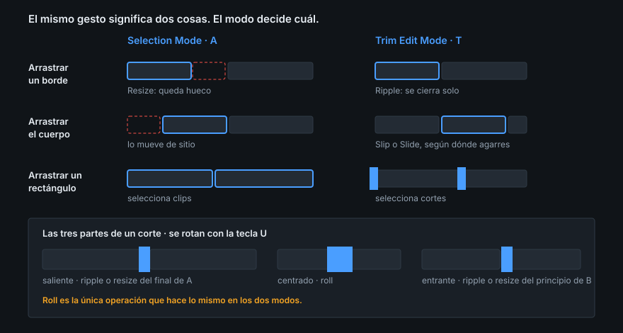

# El modo trim frente al modo selección

> Es el concepto que más confusión causa de toda la Fase 3: los mismos gestos, las mismas teclas
> y los mismos comandos hacen **cosas distintas** según el modo que tengas activo. No es un
> capricho de la interfaz. Es lo que te permite tener diez operaciones con cinco gestos.

## 🎯 Objetivos

- Distinguir `Selection Mode` de `Trim Edit Mode` y saber en cuál estás sin mirar
- Saber qué gestos cambian de significado al cambiar de modo
- Seleccionar cortes en vez de clips arrastrando un rectángulo
- Saber qué hace el modo trim con los huecos
- Usar la pulsación temporal para comparar los dos modos sin cambiar de modo
- Reconocer las tres partes de un corte y saber cuál tienes seleccionada

---

## 1. Qué problema resuelve

Un corte de una timeline tiene **tres cosas** que se pueden mover:

- El **final** del plano que sale
- El **principio** del plano que entra
- Los **dos a la vez**

Y un clip tiene otras dos:

- Su **contenido**
- Su **posición**

Son cinco cosas, y solo hay un ratón. Resolve podría haber puesto cinco herramientas en la barra
—como hacen otros programas— y obligarte a cambiar de herramienta cada vez. En vez de eso puso
**dos modos** y repartió las cinco operaciones entre ellos, de forma que el gesto que ya conoces
siga significando lo más parecido posible.

El resultado es que aprendes un gesto y obtienes dos operaciones. El coste es que **tienes que
saber en qué modo estás**, y ese es todo el problema de esta teoría.

---

## 2. Cómo funciona

### 2.1 La regla de una frase

> **En `Selection Mode` los clips se mueven y los bordes dejan hueco. En `Trim Edit Mode` los
> clips deslizan y los bordes recolocan la timeline.**

Todo lo demás son consecuencias de esa frase.

### 2.2 El mismo gesto, las dos lecturas

| Gesto | `Selection Mode` (`A`) | `Trim Edit Mode` (`T`) |
| ----- | ---------------------- | ---------------------- |
| Arrastrar el borde de un clip | `Resize`: deja hueco o pisa al vecino | `Ripple`: recoloca todo lo que viene detrás |
| Arrastrar el corte entre dos clips | `Roll` | `Roll` (igual en los dos modos) |
| Arrastrar el cuerpo de un clip | Lo **mueve** de sitio | `Slip` o `Slide`, según dónde agarres |
| Arrastrar un rectángulo por encima | Selecciona **clips** | Selecciona **cortes** |
| Teclas `,` y `.` sobre lo seleccionado | Redimensiona o mueve | Ripplea, desliza o cambia contenido |
| `E` (`Extend Edit`) | Redimensiona hasta el cabezal | **Ripplea** hasta el cabezal |
| `Shift+[` y `Shift+]` | Redimensionan | **Rippean** |

Fíjate en que `Roll` es el único que hace lo mismo en los dos modos. Es la operación más segura de
la semana precisamente por eso: no cambia la duración de la pieza y no depende del modo.

### 2.3 Las tres partes de un corte

Cuando seleccionas un corte, no seleccionas «el corte» sin más: seleccionas **una de sus tres
partes**, y Resolve te la dibuja distinta:

| Parte seleccionada | Qué es | Qué operación permite |
| ------------------ | ------ | --------------------- |
| **La mitad izquierda** | El final del plano que sale | `Resize` o `Ripple` de ese final |
| **El centro** | Las dos mitades a la vez | `Roll` |
| **La mitad derecha** | El principio del plano que entra | `Resize` o `Ripple` de ese principio |

Se cambia entre las tres con la tecla `U`, que va rotando: saliente, centrado, entrante. Es la
tecla que más se pulsa de la semana y la que menos gente conoce.

### 2.4 Seleccionar cortes con un rectángulo

En `Trim Edit Mode`, arrastrar un rectángulo por encima de varios clips **no selecciona los
clips**: selecciona los **cortes** que los unen.

Esto no es un efecto secundario: es la forma prevista de preparar una operación sobre muchos
cortes a la vez. El ejemplo que pone el propio manual es un bloque de catorce rótulos de créditos
que hay que acortar todos a la vez.

### 2.5 Qué hace el modo trim con los huecos

Un hueco —un tramo de negro entre dos clips— también tiene bordes, y en `Trim Edit Mode` esos
bordes se pueden ripplear igual que los de un clip. Rippear un hueco lo hace más grande o más
pequeño y desplaza a la vez todo lo que viene detrás.

Mientras rippleas contra un hueco, Resolve enseña un **visor partido en dos** que muestra a la vez
el plano que estás recortando y lo que se vea por el hueco desde las pistas de encima. Es la forma
rápida de cerrar un hueco que el verificador te ha marcado sin tener que buscarlo a ojo.

---

## 3. Cómo se hace en Resolve 21

### 3.1 Entrar y salir de cada modo

| Modo | Atajo | Botón |
| ---- | ----- | ----- |
| `Selection Mode` | `A` | El primero del grupo de cuatro, en la barra de herramientas |
| `Trim Edit Mode` | `T` | El segundo |

También están en el menú `Trim`, con su nombre completo.

### 3.2 La pulsación temporal: comparar sin cambiar de modo

El truco más útil de esta teoría, y viene documentado en el manual:

> Puedes alternar **temporalmente** entre el modo selección (`A`) y el modo trim (`T`) mientras
> usas estos operadores, para ver su efecto. Al soltar la tecla vuelves al modo que tenías
> seleccionado.

Es decir: mantener `T` pulsada mientras haces algo te pone en modo trim solo durante ese gesto.
Sirve para probar «¿y si esto lo hago rippleando?» sin perder el modo en el que estabas.

### 3.3 Cómo saber en qué modo estás sin mirar la barra

Tres señales, de más a menos fiable:

1. **El botón resaltado** en la barra de herramientas. Es lo seguro, pero hay que apartar la vista
   de la timeline.
2. **El puntero**, que cambia de forma al pasar por encima de un clip: en modo trim, sobre la
   mitad superior del clip enseña el cursor de `Slip` y sobre la barra de nombre el de `Slide`.
3. **Lo que pasa cuando arrastras**, que es la señal más cara: si te deja un hueco, estabas en
   `Selection Mode`.

> [!TIP]
> El hábito que ahorra más deshacer: **pulsa `A` cada vez que termines una operación de trim.**
> `Selection Mode` es el modo seguro —lo peor que hace es dejar un hueco visible— y así nunca te
> encuentras rippleando sin querer.

### 3.4 Qué comandos existen en el menú `Trim`

El menú `Trim` reúne todos los comandos de la semana. Unos cuantos no tienen atajo asignado de
fábrica, y el manual dice explícitamente que se les puede poner uno desde
`DaVinci Resolve > Keyboard Customization`. Los que interesan de momento:

- `Select Nearest Edit to Resize In` / `Resize Out`
- `Select Nearest Edit to Ripple In` / `Ripple Out`
- `Select Nearest Edit to Roll`
- `Select Nearest Clip to Move` / `to Slip` / `to Slide`

Cada uno hace dos cosas de golpe: selecciona el corte o el clip más cercano al cabezal **y** te
pone en el modo correcto para la operación que dice su nombre. Es la forma más rápida de trabajar
si te acostumbras a ellos, y la razón de que existan es exactamente el problema de esta teoría:
que acordarse del modo es lo que cuesta.

---

## 4. Antipatrones

| Antipatrón | Por qué duele | Qué hacer |
| ---------- | ------------- | --------- |
| Quedarse en `Trim Edit Mode` todo el rato | Cada arrastre distraído ripplea la pieza | `A` al terminar cada operación |
| Arrastrar bordes en `Selection Mode` para acortar | Deja huecos que el verificador encuentra y tú no | `T` y ripplea |
| No saber qué parte del corte tienes seleccionada | Haces un roll creyendo que rippleas | `U` rota entre las tres, y se ve en pantalla |
| Seleccionar clips cuando querías cortes | En modo trim el rectángulo selecciona cortes | Es el comportamiento: úsalo a favor |
| Cambiar de modo con el ratón | Son dos teclas: `A` y `T` | Pulsarlas es más rápido que apuntar |
| Arrastrar el cuerpo de un clip en modo trim sin querer | Has hecho un `Slip` y no te has enterado | Mira la duración total: no cambió, así que fue slip o slide |

---

## 5. Trucos

| Truco | Cómo |
| ----- | ---- |
| Volver al modo seguro | `A` |
| Entrar en modo trim | `T` |
| Probar el otro modo solo para este gesto | Mantén pulsada `A` o `T` mientras arrastras |
| Seleccionar el corte más cercano al cabezal | `V` |
| Seleccionar el clip que cruza el cabezal | `Shift+V` |
| Cambiar qué parte del corte está seleccionada | `U` |
| Elegir si trimas vídeo, audio o los dos | `Alt+U` (Win) / `Opt+U` (Mac) |
| Seleccionar diez cortes de golpe | Arrastra un rectángulo en modo trim |
| Cerrar un hueco sin buscarlo a ojo | Ripplea el borde del hueco en modo trim |
| Ponerle atajo a un comando del menú `Trim` | `DaVinci Resolve > Keyboard Customization` |

---

## 📚 Recursos Adicionales

- [DaVinci Resolve Reference Manual](https://www.blackmagicdesign.com/support/family/davinci-resolve-and-fusion) — capítulo 51, secciones «Selection-Based Trimming Using the Trim Tool» y «How the Trim Tool Differs From the Selection Tool».
- [Semana 08 · Anatomía de la Edit page](../../week-08-edit_page_anatomia_y_edicion_basica/1-teoria/02-anatomia-de-la-edit-page.md) — dónde está la barra de herramientas y qué más hay en ella.
- [03 · Ripple y roll](03-ripple-y-roll.md) — las dos operaciones que se hacen sobre un corte.

---

## ✅ Checklist de Verificación

- [ ] Sé enunciar la regla de una frase que separa los dos modos
- [ ] Sé qué hace arrastrar un borde en cada modo
- [ ] Sé qué hace arrastrar un rectángulo en cada modo
- [ ] Conozco las tres partes de un corte y la tecla que rota entre ellas
- [ ] Sé alternar temporalmente de modo sin cambiar de modo
- [ ] Sé qué es rippear un hueco y para qué sirve
- [ ] Tengo el hábito de volver a `A` al terminar

---

| Anterior | Actual | Siguiente |
| -------- | ------ | --------- |
| [01 · Qué es el trimming](01-que-es-el-trimming.md) | **02 · El modo trim frente al modo selección** | [03 · Ripple y roll](03-ripple-y-roll.md) |

← [Volver a la Semana 09](../README.md)
