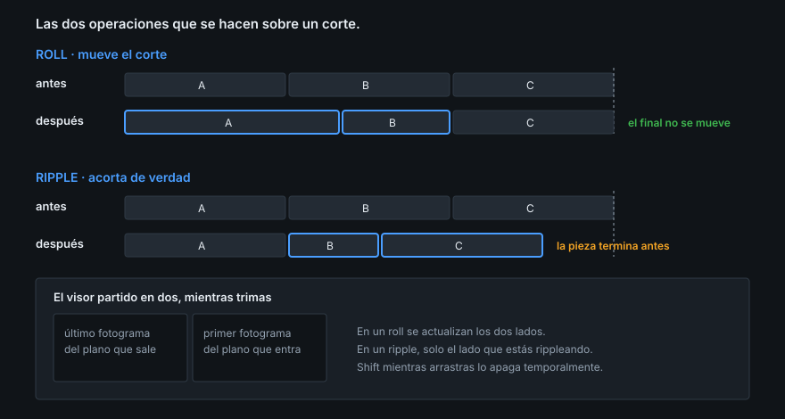

# Ripple y roll

> Las dos operaciones que se hacen sobre un corte. Una mueve el corte sin que la pieza cambie de
> duración; la otra acorta o alarga la pieza de verdad. Entre las dos resuelven la mitad larga de
> los problemas de un montaje bruto.

## 🎯 Objetivos

- Hacer un `Roll` y saber exactamente qué dos bordes se han movido
- Hacer un `Ripple` y saber qué parte de la timeline se ha desplazado
- Saber cuándo un `Roll` es imposible y por qué
- Reconocer el visor partido en dos y leer lo que enseña
- Ripplear varios cortes a la vez, con y sin la misma cantidad de fotogramas
- Elegir entre `Roll` y `Ripple` a partir del problema que ves

---

## 1. Qué problema resuelve

Un corte está mal por una de dos razones, y son razones distintas:

**«El corte está en el sitio equivocado.»** El plano que sale se acaba antes de tiempo o después
de tiempo. Lo que hay antes y lo que hay después está bien; lo que está mal es **dónde se pasa de
uno a otro**. Eso es un `Roll`.

**«Este plano dura demasiado.»** No es que el corte esté descolocado: es que el plano entero es
largo y hay que quitarle segundos. Si le quitas segundos sin más, queda un hueco. Eso es un
`Ripple`.

La diferencia se nota al mirar la duración total de la pieza: después de un `Roll` es la misma;
después de un `Ripple` no.

---

## 2. Cómo funciona

### 2.1 `Roll`: mover el corte

Un `Roll` mueve el corte a izquierda o derecha **alargando uno de los dos clips exactamente lo
que acorta el otro**. La pieza dura lo mismo antes y después, y nada de lo que viene detrás se
mueve un fotograma.

Es la operación más segura de la semana:

- No cambia la duración de la pieza
- No descoloca nada de las pistas de encima ni de debajo
- Funciona igual en `Selection Mode` y en `Trim Edit Mode`

Para qué se usa exactamente: para elegir **cuándo** se pasa de un plano al siguiente. Una entrevista
en la que el entrevistado termina una frase y el corte cae dos fotogramas tarde; un plano de acción
en el que el corte tiene que caer justo cuando el brazo llega arriba.

> [!IMPORTANT]
> Un `Roll` se come cola de un clip y se la devuelve al otro. Si el plano de la izquierda ya está
> enseñando su último fotograma grabado, no puedes rodar el corte hacia la derecha: no hay más
> material. Resolve simplemente no te deja pasar de ahí. No es un fallo, es que se acabó la cola.

### 2.2 `Ripple`: acortar de verdad

Un `Ripple` acorta o alarga el final de un clip o el principio del siguiente, y a la vez **mueve
todo lo que viene detrás** para que no quede hueco ni solape:

- Si acortas, todo lo de detrás se viene a la izquierda
- Si alargas, todo lo de detrás se va a la derecha

La pieza cambia de duración. Ese es el punto: es la operación con la que un montaje de nueve
minutos acaba durando siete.

### 2.3 El visor partido en dos

Mientras haces un `Roll` o un `Ripple`, el visor de timeline se parte en dos y enseña:

- A la izquierda, el **último fotograma** del plano que sale
- A la derecha, el **primer fotograma** del plano que entra

Es lo que te permite juzgar la continuidad del corte **mientras** lo mueves, en vez de mover,
soltar, reproducir y repetir. En un `Roll` se actualizan los dos lados a la vez; en un `Ripple`
se actualiza solo el lado que estás rippleando.

Dos ajustes que conviene conocer:

- **Mantener `Shift` mientras arrastras** apaga el visor partido temporalmente y te deja ver solo
  el fotograma que cruza el cabezal.
- `View > Enable Multiview Edit Preview` lo apaga o lo enciende del todo.

### 2.4 Rippear varios cortes a la vez

Se pueden seleccionar varios cortes y ripplearlos todos de golpe, y hay **dos comportamientos
distintos** según cómo lo hagas. Esto sorprende y conviene saberlo:

| Cómo lo haces | Qué pasa |
| ------------- | -------- |
| Arrastrando con el ratón | Resolve quita fotogramas **de uno en uno y de izquierda a derecha**: primero un fotograma a cada corte, luego el segundo a cada uno, y así. Sirve para que un bloque entero quepa en una duración concreta |
| Con `Ctrl` (Win) / `Cmd` (Mac) pulsado mientras arrastras | Quita **la misma cantidad a cada corte** |
| Con las teclas `,` y `.` | Quita la misma cantidad a cada corte |
| Escribiendo un timecode relativo | Quita la misma cantidad a cada corte |
| Con `Dynamic Trim` (teoría 06) | Quita la misma cantidad a cada corte |

La primera fila es la que resuelve el problema clásico de los créditos: catorce rótulos y hay que
quitarle ocho segundos al bloque entero, dé lo que dé en cada rótulo.

---

## 3. Cómo se hace en Resolve 21

### 3.1 `Roll` con el ratón

1. `A` o `T`, los dos valen
2. Arrastra el corte entre dos clips a izquierda o derecha
3. Mira el visor partido mientras arrastras
4. Suelta

### 3.2 `Roll` con el teclado

1. Pon el cabezal cerca del corte
2. `V` — selecciona el corte más cercano **y lleva el cabezal ahí**
3. Comprueba que tienes seleccionado el **centro** del corte; si no, `U` hasta que lo esté
4. `,` mueve el corte un fotograma a la izquierda, `.` un fotograma a la derecha
5. `Shift+,` y `Shift+.` lo mueven **cinco** fotogramas

> [!NOTE]
> Los cinco fotogramas del «salto rápido» son el valor de fábrica y se pueden cambiar en
> `Preferences > User > Editing`. Si tu pieza es a 24 fps, cinco fotogramas son unas dos décimas
> de segundo: el salto justo para notar la diferencia sin pasarte.

### 3.3 `Ripple` con el ratón

1. `T` — modo trim
2. Arrastra el borde del clip —no el corte entero— a su nueva posición
3. Suelta

La diferencia entre agarrar «el borde» y «el corte» es de píxeles, y por eso el teclado es más
fiable para esto.

### 3.4 `Ripple` con el teclado

1. `T`
2. `V` — selecciona el corte más cercano
3. `U` — hasta tener seleccionada la mitad que quieres, saliente o entrante
4. `,` y `.` para ripplear un fotograma, `Shift+,` y `Shift+.` para cinco

### 3.5 Trimar escribiendo un timecode

Los dos se pueden hacer con números, que es lo más rápido cuando ya sabes cuánto sobra:

1. Selecciona el centro de un corte para hacer `Roll`, o una mitad para hacer `Ripple`
2. Escribe el valor y pulsa `Enter`

Las reglas de escritura de timecode:

- Un valor sin signo es **absoluto**: el corte se va a ese timecode
- Un valor con `+` o `=` delante suma; con `-` delante, resta
- El par de cifras de más a la derecha son siempre **fotogramas**
- Un punto vale por un par de ceros: `+20.` suma veinte segundos exactos
- No hace falta escribir los dos puntos

Ejemplo práctico: seleccionas la mitad entrante de un corte, escribes `-12` y pulsas `Enter`. Has
rippleado doce fotogramas hacia atrás sin tocar el ratón.

### 3.6 Los comandos que se apoyan en el cabezal

Tres comandos hacen `Ripple` o `Resize` usando la posición del cabezal en vez de un arrastre. No
necesitan que selecciones nada:

| Comando | Atajo | Qué hace |
| ------- | ----- | -------- |
| `Extend Edit` | `E` | Lleva los cortes seleccionados hasta el cabezal |
| `Trim Start` | `Shift+[` | Mueve la **entrada** de todos los clips que cruzan el cabezal hasta el cabezal |
| `Trim End` | `Shift+]` | Mueve la **salida** de todos los clips que cruzan el cabezal hasta el cabezal |

`Trim Start` y `Trim End` **redimensionan en `Selection Mode` y rippean en `Trim Edit Mode`**: es
el ejemplo más claro de la teoría 02. Hay además dos versiones que rippean siempre, estés en el
modo que estés: `Ripple Start to Playhead` (`Ctrl+Shift+[` / `Cmd+Shift+[`) y `Ripple End to
Playhead` (`Ctrl+Shift+]` / `Cmd+Shift+]`).

> [!WARNING]
> `Trim Start` y `Trim End` actúan sobre **todos** los clips que crucen el cabezal en todas las
> pistas que tengan el selector de pistas activado. Si tienes tres pistas de vídeo y dos de audio
> con clips superpuestos ahí, se recortan los cinco. Para que afecte a uno solo, deja activado
> solo el selector de esa pista, o selecciona el clip a mano: **una selección manual siempre gana
> sobre los selectores de pista**.

---

## 4. Antipatrones

| Antipatrón | Por qué duele | Qué hacer |
| ---------- | ------------- | --------- |
| Ripplear cuando querías rodar | La pieza se acorta y todo lo de debajo se descoloca | Mira la duración total después de cada operación |
| Rodar cuando querías ripplear | El plano sigue durando lo mismo, solo cambiaste dónde corta | Si el problema es «dura mucho», es ripple |
| Arrastrar bordes a ojo | Un fotograma de más o de menos se nota en un corte de acción | `,` y `.` sobre una selección |
| Ignorar el visor partido | Te pierdes la única información que importa mientras trimas | Míralo: para eso está |
| Usar `Trim End` con todas las pistas activas | Recortas cinco clips creyendo que recortabas uno | Selecciona el clip a mano primero |
| Ripplear un bloque entero sin `Ctrl` / `Cmd` | Resolve reparte los fotogramas uno a uno y no sale lo que esperabas | Con `Ctrl` / `Cmd`, la misma cantidad a cada corte |
| Insistir en rodar un corte que no se mueve | No hay cola: no es un fallo de la aplicación | Cambia de plano o usa `Slip` en el vecino |

---

## 5. Trucos

| Truco | Cómo |
| ----- | ---- |
| Seleccionar el corte más cercano y saltar a él | `V` |
| Rotar entre saliente, centrado y entrante | `U` |
| Mover un fotograma | `,` y `.` |
| Mover cinco fotogramas | `Shift+,` y `Shift+.` |
| Cambiar cuántos fotogramas son el salto rápido | `Preferences > User > Editing` |
| Trimar por número en vez de a ojo | Selecciona y escribe `-12`, `+1.`, `Enter` |
| Ver el corte sin el visor partido | Mantén `Shift` mientras arrastras |
| Apagar el visor partido del todo | `View > Enable Multiview Edit Preview` |
| Llevar un corte exactamente al cabezal | `E` |
| Que todos los planos superpuestos acaben a la vez | Cabezal donde quieres y `Shift+]` |
| Acortar un bloque de rótulos por una cantidad exacta | Selecciona los cortes y arrastra con `Ctrl` / `Cmd` |
| Escuchar el resultado de un corte al momento | `/` |

---

## 📚 Recursos Adicionales

- [DaVinci Resolve Reference Manual](https://www.blackmagicdesign.com/support/family/davinci-resolve-and-fusion) — capítulo 51, secciones «Using the Trim Tool With the Mouse», «Trimming Using Timecode Entry» y «Trim Operations that are Targeted Using the Playhead».
- [Semana 07 · Las colas de un plano](../../week-07-cut_page_acabado_y_quick_export/1-teoria/02-las-colas-de-un-plano.md) — por qué un roll se puede quedar sin sitio.
- [04 · Slip y slide](04-slip-y-slide.md) — las otras dos operaciones, las que se hacen sobre un clip entero.
- [07 · El sync lock y las reglas del ripple](07-sync-lock-y-las-reglas-del-ripple.md) — qué se mueve exactamente cuando rippleas.

---

## ✅ Checklist de Verificación

- [ ] Sé qué dos bordes mueve un `Roll` y por qué la pieza dura lo mismo
- [ ] Sé qué parte de la timeline desplaza un `Ripple`
- [ ] Sé por qué un `Roll` a veces no se puede hacer
- [ ] Sé leer el visor partido en dos
- [ ] Sé hacer las dos operaciones con el teclado, sin ratón
- [ ] Sé trimar escribiendo un timecode relativo
- [ ] Sé qué hacen `Trim Start` y `Trim End` en cada modo
- [ ] Sé ripplear varios cortes por la misma cantidad

---

| Anterior | Actual | Siguiente |
| -------- | ------ | --------- |
| [02 · El modo trim frente al modo selección](02-el-modo-trim-frente-al-modo-seleccion.md) | **03 · Ripple y roll** | [04 · Slip y slide](04-slip-y-slide.md) |

← [Volver a la Semana 09](../README.md)
