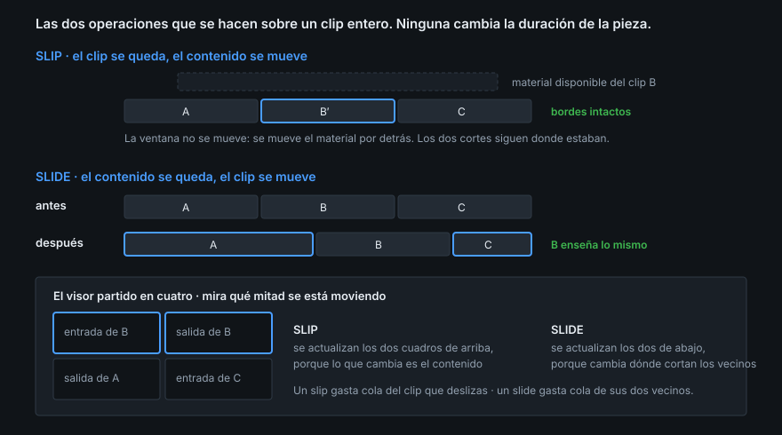

# Slip y slide

> Las dos operaciones que se hacen sobre un clip entero, y las dos que más cara de magia tienen la
> primera vez que las ves: la pieza no cambia de duración, nada se descoloca, y sin embargo el
> corte que no funcionaba ahora funciona.

## 🎯 Objetivos

- Hacer un `Slip` y saber que lo que cambia es el **contenido** del clip
- Hacer un `Slide` y saber que lo que cambia es su **posición**
- Leer el visor partido en cuatro y saber qué dos cuadros se actualizan en cada operación
- Saber por qué las dos necesitan colas y qué pasa cuando no las hay
- Alternar entre `Slip` y `Slide` con la tecla `S` y saber en cuál estás
- Elegir entre las dos a partir del problema que ves en pantalla

---

## 1. Qué problema resuelve

Hay un tipo de problema de montaje que no se arregla moviendo el corte, y es el más frecuente de
todos: **el plano está en el sitio correcto y dura lo correcto, pero enseña el momento
equivocado.**

Ejemplos concretos, de los que salen en cualquier pieza:

- El plano de apoyo dura tres segundos y está donde tiene que estar, pero en esos tres segundos la
  persona está quieta; medio segundo más adelante hay un gesto que sí cuenta algo.
- El plano de detalle entra bien, pero la mano ya está a mitad de camino: habría que verla salir.
- El corte se nota porque el movimiento del plano que sale no continúa en el que entra.

En los tres casos, mover el corte estropearía otra cosa. Lo que hace falta es **cambiar lo que se
ve dentro del hueco que ya existe**, o **mover ese hueco sin cambiar la duración de la pieza**.
Eso son `Slip` y `Slide`.

---

## 2. Cómo funciona

### 2.1 `Slip`: el clip se queda, el contenido se mueve

Un `Slip` deja el clip **exactamente donde está y durando exactamente lo mismo**, y cambia el
tramo del material original que se ve dentro.

Piensa en el clip de la timeline como una ventana de tres segundos abierta sobre un archivo de
doce segundos. Un `Slip` no mueve la ventana: mueve el archivo por detrás.

Consecuencias:

- La pieza dura lo mismo
- Nada de lo que hay antes ni después se mueve
- Los dos cortes que rodean al clip **siguen donde estaban**
- Lo único que cambia es **qué fotogramas se ven**

### 2.2 `Slide`: el contenido se queda, el clip se mueve

Un `Slide` deja el clip enseñando **exactamente los mismos fotogramas** y lo mueve a otro sitio de
la timeline. Para que no queden huecos, sus dos vecinos se ajustan solos: el de la izquierda se
alarga lo que el de la derecha se acorta, o al revés.

Consecuencias:

- La pieza dura lo mismo
- El clip que deslizas enseña lo mismo que antes
- **Sus dos vecinos cambian de duración**
- Los dos cortes que rodean al clip se mueven los dos, en el mismo sentido

### 2.3 La tabla que las separa

| | `Slip` | `Slide` |
| --- | --- | --- |
| ¿Se mueve el clip? | No | **Sí** |
| ¿Cambia lo que enseña el clip? | **Sí** | No |
| ¿Cambian de duración los vecinos? | No | **Sí** |
| ¿Cambia la duración de la pieza? | No | No |
| ¿Necesita colas? | En **el clip que deslizas** | En **los dos vecinos** |
| Problema que resuelve | «Este plano enseña el momento equivocado» | «Este plano tiene que llegar antes» |

### 2.4 El visor partido en cuatro

Mientras haces un `Slip` o un `Slide`, el visor enseña **cuatro** cuadros a la vez. No son
decorativos: son exactamente los cuatro fotogramas que definen los dos cortes que estás tocando.

- Arriba a la izquierda y arriba a la derecha: la **entrada y la salida del clip** que estás
  ajustando
- Abajo a la izquierda: la **salida del clip anterior**
- Abajo a la derecha: la **entrada del clip siguiente**

Y aquí está la parte útil: **en un `Slip` se actualizan los dos de arriba** —porque lo que cambia
es el contenido del clip— y **en un `Slide` se actualizan los dos de abajo** —porque lo que
cambia es dónde cortan sus vecinos—.

Si dudas de qué operación estás haciendo, mira qué mitad del visor se está moviendo.

Igual que con el visor partido en dos: `Shift` mientras arrastras lo apaga temporalmente, y
`View > Enable Multiview Edit Preview` lo apaga del todo.

### 2.5 Por qué las dos se quedan sin sitio

Las dos consumen cola, pero de sitios distintos:

- Un **`Slip`** gasta cola **del clip que deslizas**. Si el clip empieza en su primer fotograma
  grabado, no puedes deslizar hacia atrás.
- Un **`Slide`** gasta cola **de los vecinos**. Si el vecino de la derecha ya está enseñando su
  último fotograma, no puedes deslizar hacia la derecha.

Cuando eso pasa, Resolve simplemente frena: el arrastre deja de avanzar. Mientras deslizas, un
recuadro punteado dibuja **todo el material disponible** con el que puedes trabajar, y ahí se ve
de un vistazo cuánto margen te queda.

---

## 3. Cómo se hace en Resolve 21

### 3.1 Con el ratón

Las dos se hacen en `Trim Edit Mode` (`T`), y se distinguen **por dónde agarras el clip**:

| Operación | Dónde hacer clic |
| --------- | ---------------- |
| `Slip` | La **zona superior central** del clip |
| `Slide` | La **barra de nombre**, en la parte de abajo del clip |

Es un detalle de píxeles, y por eso el teclado es más fiable. El puntero cambia de forma al pasar
por encima de una zona y de la otra: esa es la confirmación de que vas a hacer lo que crees.

### 3.2 Con el teclado

1. `T` — modo trim
2. `Shift+V` — selecciona el clip que cruza el cabezal
3. `S` — alterna entre `Slip` y `Slide`
4. `,` y `.` para un fotograma, `Shift+,` y `Shift+.` para cinco

**Cómo saber en cuál de los dos estás**: el botón de `Dynamic Trim Mode` de la barra de
herramientas cambia de icono para indicarlo. También puedes elegirlo con clic derecho sobre ese
botón. Y, si ya estás arrastrando, la mitad del visor que se actualiza te lo dice.

> [!TIP]
> Si tienes clips superpuestos en varias pistas, `Shift+V` selecciona todos los que crucen el
> cabezal en pistas con el selector activado. Para coger uno solo, apaga el selector de las demás
> o haz clic sobre el clip a mano.

### 3.3 Escribiendo un timecode

Igual que `Roll` y `Ripple`:

1. Selecciona el clip
2. `S` si hace falta, para elegir `Slip` o `Slide`
3. Escribe el valor —`-8`, `+2.`— y pulsa `Enter`

### 3.4 Varios clips a la vez

- **`Slip`**: se pueden deslizar tantos clips como quieras a la vez, en cualquier combinación de
  pistas, **siempre que todos tengan colas**. Se seleccionan, se elige `Slip` y se arrastra o se
  usan `,` y `.`.
- **`Slide`**: también se pueden seleccionar varios. Si son **contiguos**, se deslizan juntos como
  si fueran uno solo.

### 3.5 `Slip` desde el visor de origen

Hay una segunda forma de hacer un `Slip`, útil cuando quieres ver el material completo mientras
decides: doble clic sobre un clip de la timeline lo abre en el `Source Viewer`, y ahí,
**manteniendo `Shift` mientras arrastras su punto de entrada o de salida**, deslizas el contenido
sin cambiar la duración.

> [!NOTE]
> Doble clic sobre un clip de la timeline lo abre en el visor de origen para trimarlo. Si lo que
> quieres es abrir el clip original del media pool en el punto exacto que estás viendo —lo que se
> llama un *match frame*—, mantén `Alt` (Win) / `Opt` (Mac) mientras haces el doble clic.

---

## 4. Antipatrones

| Antipatrón | Por qué duele | Qué hacer |
| ---------- | ------------- | --------- |
| Mover el corte cuando el problema es el contenido | Estropeas dos cortes para arreglar medio | Si el plano está bien colocado, es `Slip` |
| Confundir `Slip` con mover el clip | En modo trim no se mueve: se desliza el contenido | `A` para mover de verdad, `T` para deslizar |
| Usar `Slide` sin mirar a los vecinos | Les cambias la duración a los dos sin darte cuenta | Mira los dos cuadros de abajo del visor |
| Deslizar a ojo con el ratón | La diferencia entre bien y mal son tres fotogramas | `Shift+V` y luego `,` y `.` |
| Insistir cuando el arrastre no avanza | Se acabó la cola; no es un fallo | Mira el recuadro punteado del material disponible |
| No saber si estás en `Slip` o en `Slide` | Haces la operación contraria y no lo notas hasta después | Mira el icono del botón, o qué mitad del visor se mueve |
| Deslizar el clip pero no su audio | Imagen y sonido se van de sincronía | Con `Linked Selection` activado van juntos; teoría 08 |

---

## 5. Trucos

| Truco | Cómo |
| ----- | ---- |
| Seleccionar el clip que cruza el cabezal | `Shift+V` |
| Alternar entre `Slip` y `Slide` | `S` |
| Saber en cuál estás | El icono del botón `Dynamic Trim Mode` |
| Elegirlo con el ratón | Clic derecho sobre el botón `Dynamic Trim Mode` |
| Deslizar un fotograma exacto | `,` y `.` |
| Deslizar cinco | `Shift+,` y `Shift+.` |
| Deslizar por número | Selecciona y escribe `-8`, `Enter` |
| Ver cuánta cola te queda | El recuadro punteado que aparece al deslizar |
| Deslizar mirando el clip entero | Doble clic para abrirlo en el visor, `Shift` y arrastra un punto |
| Abrir el clip original en el fotograma que ves | `Alt` (Win) / `Opt` (Mac) + doble clic |
| Deslizar cuatro planos como si fueran uno | Selecciónalos contiguos y haz `Slide` |
| Ver solo el fotograma del cabezal mientras deslizas | Mantén `Shift` |

---

## 📚 Recursos Adicionales

- [DaVinci Resolve Reference Manual](https://www.blackmagicdesign.com/support/family/davinci-resolve-and-fusion) — capítulo 51, secciones «Using the Trim Tool With the Mouse», «Slipping Multiple Clips», «Sliding Multiple Clips» y «Trimming Clips in the Source Viewer».
- [Semana 07 · Las colas de un plano](../../week-07-cut_page_acabado_y_quick_export/1-teoria/02-las-colas-de-un-plano.md) — el recurso que estas dos operaciones gastan.
- [05 · Trimming con el teclado](05-trimming-con-el-teclado.md) — las teclas que hacen esto sin ratón, en orden.

---

## ✅ Checklist de Verificación

- [ ] Sé qué cambia un `Slip` y qué deja quieto
- [ ] Sé qué cambia un `Slide` y a quién le cambia la duración
- [ ] Sé qué dos cuadros del visor se actualizan en cada operación
- [ ] Sé de dónde saca cola cada una de las dos
- [ ] Sé alternar entre las dos y comprobar en cuál estoy
- [ ] Sé hacer las dos con el teclado
- [ ] Sé hacer un `Slip` desde el visor de origen

---

| Anterior | Actual | Siguiente |
| -------- | ------ | --------- |
| [03 · Ripple y roll](03-ripple-y-roll.md) | **04 · Slip y slide** | [05 · Trimming con el teclado](05-trimming-con-el-teclado.md) |

← [Volver a la Semana 09](../README.md)
