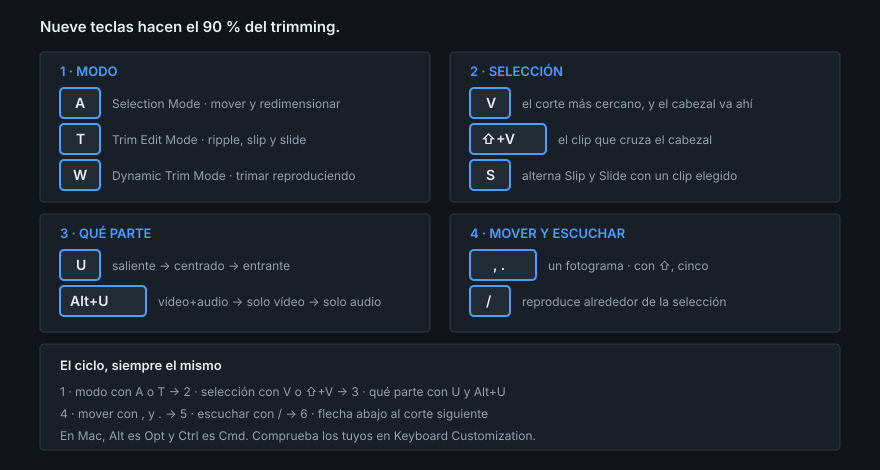

# Trimming con el teclado

> El trimming es la primera cosa de este bootcamp donde el ratón es objetivamente peor. Un
> fotograma son cuatro píxeles a un zoom normal; con el teclado, un fotograma es una tecla. Esta
> teoría es la lista corta de teclas que hay que tener en los dedos.

## 🎯 Objetivos

- Conocer las nueve teclas que hacen el 90 % del trimming
- Ejecutar el ciclo completo seleccionar → elegir parte → mover → escuchar sin tocar el ratón
- Usar `Alt+U` / `Opt+U` para trimar solo la imagen o solo el sonido
- Controlar qué pistas se ven afectadas por una operación de teclado
- Ajustar el salto rápido y el pre-roll a tu forma de trabajar
- Afinar un corte con la reproducción en bucle sin parar de reproducir

---

## 1. Qué problema resuelve

Un montaje de cinco minutos a 24 fps tiene unos siete mil doscientos fotogramas. Afinarlo bien
significa tomar decisiones de uno o dos fotogramas en cuarenta o cincuenta cortes.

Con el ratón, cada una de esas decisiones son: apuntar al borde, comprobar que el puntero es el
que quieres, arrastrar, comprobar cuánto has movido, corregir. Cinco gestos.

Con el teclado son dos teclas: `V` y `,`.

No es una cuestión de presumir de atajos. Es que un flujo de cinco gestos por corte hace que
dejes de afinar cortes a la mitad del montaje, y ese es el motivo real por el que la mayoría de
las piezas de aficionado están sin afinar.

---

## 2. Cómo funciona

### 2.1 Las nueve teclas

| Tecla | Qué hace |
| ----- | -------- |
| `A` | `Selection Mode` |
| `T` | `Trim Edit Mode` |
| `W` | `Dynamic Trim Mode` |
| `S` | Alterna entre `Slip` y `Slide` con un clip seleccionado en modo trim |
| `V` | Selecciona el **corte** más cercano al cabezal, y lleva el cabezal ahí |
| `Shift+V` | Selecciona el **clip o el hueco** que cruza el cabezal |
| `U` | Rota la selección del corte: saliente → centrado → entrante |
| `,` y `.` | Mueven la selección un fotograma a izquierda o derecha |
| `/` | Reproduce alrededor de lo que tengas seleccionado |

Con esas nueve se hacen las cinco operaciones de la semana. Todo lo demás son variantes.

### 2.2 El ciclo, en orden

Es siempre el mismo, y aprenderlo de memoria es la mitad de la semana:

1. **Modo.** `A` o `T`, según lo que vayas a hacer.
2. **Selección.** `V` para un corte, `Shift+V` para un clip.
3. **Qué parte.** `U` para elegir la mitad del corte. `Alt+U` / `Opt+U` para elegir si trimas
   vídeo, audio o los dos.
4. **Mover.** `,` y `.`, o `Shift+,` y `Shift+.` para cinco fotogramas.
5. **Escuchar.** `/`.
6. Si no está bien, vuelve al paso 4. Si está bien, `A` y flecha abajo al corte siguiente.

### 2.3 `Alt+U` / `Opt+U`, la tecla que separa imagen de sonido

Con un corte seleccionado, `Alt+U` (Win) / `Opt+U` (Mac) rota entre tres estados:

- **Vídeo + audio** — lo normal, los dos se mueven juntos
- **Solo vídeo**
- **Solo audio**

Es la puerta de entrada al trim asimétrico de la teoría 08, y es lo que te permite adelantar el
sonido de un plano sin adelantar su imagen sin tener que desenlazar nada a mano.

### 2.4 Quién decide sobre qué pistas actúas

Tres cosas, y en este orden de prioridad:

1. **Una selección manual gana siempre.** Si has hecho clic sobre un clip concreto, la operación
   afecta a ese clip y a ninguno más, digan lo que digan los selectores de pista.
2. **Si no hay selección manual**, mandan los **selectores de pista** de las cabeceras: la
   operación afecta a los clips de las pistas con el selector activado que crucen el cabezal o el
   rango marcado.
3. Hay atajos para encender y apagar esos selectores sin ratón:
   - `Alt+F1` … `Alt+F9` (Win) / `Opt+F1` … `Opt+F9` (Mac) para las pistas de **vídeo** 1 a 9
   - `Ctrl+Alt+F1` … `F9` (Win) / `Cmd+Opt+F1` … `F9` (Mac) para las de **audio** 1 a 9

> [!TIP]
> Para dejar activada una sola pista rápidamente, `Alt` (Win) / `Opt` (Mac) + clic sobre su
> selector de pista la deja en solitario. Es el gesto que evita el accidente más común de la
> semana: recortar cinco clips superpuestos cuando querías recortar uno.

---

## 3. Cómo se hace en Resolve 21

### 3.1 Las cinco operaciones, tecla a tecla

| Operación | Modo | Selección | Después |
| --------- | ---- | --------- | ------- |
| `Resize` | `A` | `V`, luego `U` hasta una mitad | `,` `.` |
| `Roll` | `A` o `T` | `V`, `U` hasta el centro | `,` `.` |
| `Ripple` | `T` | `V`, `U` hasta una mitad | `,` `.` |
| `Slip` | `T` | `Shift+V`, `S` hasta `Slip` | `,` `.` |
| `Slide` | `T` | `Shift+V`, `S` hasta `Slide` | `,` `.` |

Es la tabla que conviene tener al lado las primeras dos horas de práctica.

### 3.2 Moverse entre cortes

- **Flecha abajo** y **flecha arriba** llevan el cabezal **y la selección** al corte siguiente o
  al anterior. Es la forma de recorrer una pieza corte a corte sin tocar el ratón.
- Con clips superpuestos, se selecciona primero el de la pista de número más bajo y va subiendo
  con cada pulsación hasta llegar al de más arriba, y solo entonces salta al corte siguiente.

### 3.3 Afinar con la reproducción en bucle

Esta es la técnica que más rápido mejora un corte, y consiste en no parar de reproducir mientras
lo ajustas:

1. Cabezal cerca del corte, `V` para seleccionarlo
2. `U` para elegir la mitad, y `Alt+U` / `Opt+U` si quieres separar imagen y sonido
3. `Ctrl+/` (Win) / `Cmd+/` (Mac) — activa la reproducción en **bucle**
4. `/` — reproduce alrededor de la selección; con el bucle activado, no para
5. **Mientras suena**, `,` y `.` van moviendo el corte un fotograma. Si lo haces durante la cola
   final del bucle, la vuelta empieza inmediatamente y ves el cambio al momento
6. `Espacio` o `K` para parar

El pre-roll y el post-roll —cuántos segundos se reproducen antes y después de la selección— se
configuran en `Preferences > User > Editing`.

### 3.4 Los dos ajustes que conviene tocar el primer día

| Ajuste | Dónde | Por qué |
| ------ | ----- | ------- |
| Duración del salto rápido | `Preferences > User > Editing` | De fábrica son 5 fotogramas. A 24 fps son 0,2 s: suele estar bien, pero si tu pieza es de ritmo lento, 10 va mejor |
| Pre-roll y post-roll | `Preferences > User > Editing` | Lo que reproduce `/` alrededor del corte. Demasiado corto y no juzgas el corte en su contexto; demasiado largo y esperas |

### 3.5 Comprobar y cambiar cualquier atajo

Ninguna tabla de atajos sustituye a mirar la tuya:
`DaVinci Resolve > Keyboard Customization` —atajo `Alt+Ctrl+K` (Win) / `Opt+Cmd+K` (Mac)— busca
por el nombre inglés del comando y enseña la tecla que tiene asignada **en tu instalación**.

Es también donde se les asigna atajo a los comandos del menú `Trim` que no traen ninguno de
fábrica, como `Select Nearest Clip to Slip` o `Roll Start to Playhead`.

---

## 4. Antipatrones

| Antipatrón | Por qué duele | Qué hacer |
| ---------- | ------------- | --------- |
| Afinar con el ratón | Un fotograma son cuatro píxeles: no se apunta | `V` y luego `,` y `.` |
| Aprenderse las teclas de una en una según hacen falta | Nunca llegas a tenerlas en los dedos | Las nueve de 2.1, la primera hora |
| Pulsar `,` sin haber seleccionado nada | No pasa nada y no entiendes por qué | Selección primero, siempre |
| Olvidarte de `Alt+U` / `Opt+U` | Acabas desenlazando clips a mano y se te van de sincronía | Es una tecla y hace justo eso |
| No usar `/` | Afinas mirando fotogramas fijos en vez de escuchando el corte | `/` después de cada ajuste |
| Trimar con todas las pistas activas | Recortas cinco clips creyendo que recortas uno | `Alt` / `Opt` + clic sobre el selector de la pista que quieres |
| Cambiar el salto rápido a 20 fotogramas | Deja de ser afinar | 5 o 10 |

---

## 5. Trucos

| Truco | Cómo |
| ----- | ---- |
| Seleccionar el corte más cercano y saltar a él | `V` |
| Seleccionar el clip que cruza el cabezal | `Shift+V` |
| Rotar entre las tres partes del corte | `U` |
| Trimar solo la imagen o solo el sonido | `Alt+U` (Win) / `Opt+U` (Mac) |
| Alternar `Slip` y `Slide` | `S` |
| Recorrer la pieza corte a corte | Flecha arriba y flecha abajo |
| Escuchar el corte en su contexto | `/` |
| Reproducir en bucle mientras afinas | `Ctrl+/` (Win) / `Cmd+/` (Mac), luego `/` |
| Reproducir solo el tramo marcado | `Alt+/` (Win) / `Opt+/` (Mac) |
| Dejar activa una sola pista | `Alt` / `Opt` + clic sobre su selector |
| Encender o apagar el selector de una pista de vídeo | `Alt+F1` … `F9` (Win) / `Opt+F1` … `F9` (Mac) |
| Deseleccionar todo | `Ctrl+Shift+A` (Win) / `Cmd+Shift+A` (Mac) |
| Ver qué tecla tiene un comando en tu instalación | `Alt+Ctrl+K` (Win) / `Opt+Cmd+K` (Mac) |
| Cambiar cuántos fotogramas salta `Shift+,` | `Preferences > User > Editing` |

---

## 📚 Recursos Adicionales

- [DaVinci Resolve Reference Manual](https://www.blackmagicdesign.com/support/family/davinci-resolve-and-fusion) — capítulo 51, secciones «Trim Tool Operations With the Keyboard», «Important Trimming Keyboard Shortcuts» y «Keyboard Trimming During Looped Playback».
- [docs/atajos-de-teclado.md](../../../docs/atajos-de-teclado.md) — la tabla global del bootcamp, y cómo comprobar los tuyos.
- [06 · JKL y el dynamic trim](06-jkl-y-el-dynamic-trim.md) — el paso siguiente: trimar mientras la pieza se reproduce.

---

## ✅ Checklist de Verificación

- [ ] Me sé las nueve teclas de 2.1
- [ ] Puedo hacer las cinco operaciones sin tocar el ratón
- [ ] Sé qué hace `U` y qué hace `Alt+U` / `Opt+U`
- [ ] Sé qué manda cuando hay selección manual y selectores de pista a la vez
- [ ] Sé afinar un corte con la reproducción en bucle
- [ ] He mirado mis ajustes de salto rápido y de pre-roll
- [ ] Sé buscar cualquier atajo en mi instalación

---

| Anterior | Actual | Siguiente |
| -------- | ------ | --------- |
| [04 · Slip y slide](04-slip-y-slide.md) | **05 · Trimming con el teclado** | [06 · JKL y el dynamic trim](06-jkl-y-el-dynamic-trim.md) |

← [Volver a la Semana 09](../README.md)
