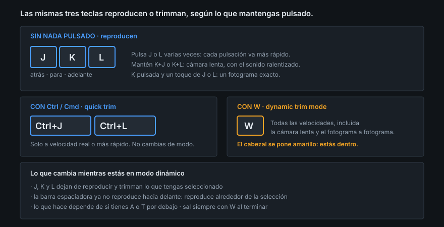

# JKL y el dynamic trim

> Todo lo anterior se hace con la pieza parada. Esto se hace con la pieza en marcha: reproduces,
> escuchas, y el corte se mueve mientras suena. Es la técnica que más se parece a montar con las
> manos y la que mejor resuelve los cortes que «no acaban de sonar bien» sin que sepas por qué.

## 🎯 Objetivos

- Manejar `J`, `K` y `L` para reproducir a cualquier velocidad y dirección
- Distinguir el **quick trim** del **modo dinámico** y saber cuándo usar cada uno
- Entrar y salir de `Dynamic Trim Mode` sin quedarte dentro por accidente
- Saber qué operación hace el modo dinámico según el modo que tengas por debajo
- Usar `Espacio` dentro del modo dinámico sabiendo que ya no reproduce hacia delante
- Elegir qué corte se monitoriza cuando trimas varios a la vez

---

## 1. Qué problema resuelve

Hay cortes que están mal y sabes exactamente cuántos fotogramas sobran. Esos se arreglan con
`,` y `.`, y son la mayoría.

Y hay cortes que están mal y **no sabes cuántos fotogramas sobran**. Sabes que el plano «se queda
un poco largo», que «entra tarde», que «no respira». Cuando el problema se describe con adverbios
en vez de con números, contar fotogramas no ayuda: hay que **sentirlo con la pieza en marcha**.

Eso es lo que resuelve el trimming dinámico. Reproduces, y mientras la pieza suena vas moviendo el
corte con las mismas teclas con las que controlas la reproducción. El manual lo dice sin rodeos:
trimar viendo el corte reproducirse tiene la ventaja de que te **implicas emocionalmente** en lo
que estás viendo, y de que experimentas el ritmo del plano tal y como suena.

---

## 2. Cómo funciona

### 2.1 JKL: las tres teclas de reproducción

Son las tres teclas de transporte que comparten casi todos los programas de montaje del mundo, y
en Resolve funcionan así:

| Teclas | Qué hace |
| ------ | -------- |
| `J` | Reproduce hacia atrás al 100 % |
| `K` | Para |
| `L` | Reproduce hacia delante al 100 % |
| `J` repetidas veces | Aumenta la velocidad hacia atrás en cada pulsación |
| `L` repetidas veces | Aumenta la velocidad hacia delante en cada pulsación |
| `Shift+J` | Rebobinado rápido |
| `Shift+L` | Avance rápido |
| `Shift+K` | Cámara lenta a 1/2, 1/4 o 1/8 de velocidad |
| `K`+`J` mantenidas | Cámara lenta hacia atrás, con el sonido también ralentizado |
| `K`+`L` mantenidas | Cámara lenta hacia delante |
| `K` pulsada y toques de `J` | Retrocede un fotograma por toque |
| `K` pulsada y toques de `L` | Avanza un fotograma por toque |

Cuando reproduces a una velocidad que no es el 100 %, aparece un **indicador de velocidad** a la
derecha del contador de fotogramas por segundo del visor.

Merece la pena aprenderlas aunque no fueras a hacer trimming dinámico: son la forma más rápida de
moverse por una pieza, mucho más que la barra espaciadora.

### 2.2 Las dos formas de trimar reproduciendo

Resolve tiene dos, y la diferencia importa:

| | **Quick trim** | **Modo dinámico** |
| --- | --- | --- |
| Cómo se activa | Nada: `Ctrl+J` / `Cmd+J` y `Ctrl+L` / `Cmd+L` | `W`, o `Trim > Dynamic Trim Mode` |
| Velocidades | Solo 100 % o más rápido | **Todas**, incluida cámara lenta y fotograma a fotograma |
| Cuándo usarlo | Un ajuste rápido, sin salir de lo que estabas haciendo | Afinar de verdad un corte concreto |
| Riesgo | Ninguno: no cambias de modo | Quedarte dentro sin darte cuenta |

### 2.3 El quick trim

Es literalmente esto: selecciona algo y mantén `Ctrl` (Win) / `Cmd` (Mac) mientras pulsas `J` o
`L`. La selección se trima mientras la pieza se reproduce.

Qué operación hace depende de lo que tengas seleccionado y del modo:

| Modo | Qué seleccionas | Operación |
| ---- | --------------- | --------- |
| `A` o `T` | El **centro** de un corte | `Roll` |
| `T` | Una **mitad** de un corte | `Ripple` |
| `A` | Una **mitad** de un corte | `Resize` |
| `A` | Un **clip** | Lo **mueve** |
| `T` | Un **clip**, con `S` para elegir | `Slip` o `Slide` |

Al terminar, `/` reproduce alrededor de la selección para ver cómo ha quedado.

### 2.4 El modo dinámico

`W` entra y sale. Lo que cambia mientras estás dentro:

- **El cabezal se pone amarillo.** Es el recordatorio permanente de que estás en modo dinámico.
- **El botón `Dynamic Trim Mode` de la barra se pone amarillo**, y su icono indica si estás en
  `Slip` o en `Slide`.
- **`J`, `K` y `L` dejan de reproducir y pasan a trimar** lo que tengas seleccionado.
- **La barra espaciadora deja de reproducir hacia delante**: pasa a ejecutar
  `Play Around Current Selection`, es decir, reproduce alrededor de lo seleccionado.

Al entrar en modo dinámico **sin nada seleccionado**, Resolve selecciona automáticamente el corte
más cercano al cabezal. Si ya tenías algo seleccionado, respeta tu selección.

> [!IMPORTANT]
> **Sal siempre del modo dinámico cuando acabes**, con `W`. Si te quedas dentro, `J`, `K` y `L`
> seguirán trimando cada vez que haya algo seleccionado, en vez de reproducir. Es el «¿por qué se
> me está descolocando la pieza sola?» más común de la semana.
>
> Truco de emergencia: dentro del modo dinámico, `J`, `K` y `L` **sí reproducen** si no hay nada
> seleccionado. `Ctrl+Shift+A` (Win) / `Cmd+Shift+A` (Mac) deselecciona todo.

### 2.5 Qué operación hace el modo dinámico

`Dynamic Trim Mode` no es un tercer modo independiente: **funciona encima de `Selection Mode` o de
`Trim Edit Mode`**, y lo que hace depende de cuál tengas por debajo.

| Debajo tienes | Con cortes seleccionados | Con clips seleccionados |
| ------------- | ------------------------ | ----------------------- |
| `Selection Mode` (`A`) | `Resize` o `Roll` | Mueve, o `Slip` con `S` |
| `Trim Edit Mode` (`T`) | `Ripple` o `Roll` | `Slip` o `Slide`, con `S` |

Es decir: entras en dinámico con `W`, y luego eliges con `A` o `T` qué clase de operación quieres.

---

## 3. Cómo se hace en Resolve 21

### 3.1 El procedimiento completo

1. **Coloca el cabezal** cerca del corte que quieres afinar
2. **`T`** si vas a ripplear, **`A`** si vas a redimensionar o mover
3. **`W`** — entras en modo dinámico; se selecciona solo el corte más cercano
4. **`U`** para elegir qué mitad del corte, **`Alt+U`** / **`Opt+U`** para elegir vídeo, audio o
   los dos
5. **`J`, `K`, `L`** para trimar mientras se reproduce:
   - `J`+`K` o `K`+`L` — cámara lenta con sonido ralentizado
   - `K` pulsada y toques de `J` o `L` — fotograma a fotograma
   - `J` o `L` — a velocidad real
   - `J` o `L` repetidas — cada vez más rápido
6. **`Espacio`** — reproduce alrededor de lo que acabas de trimar
7. **Flecha arriba o abajo** para pasar al corte siguiente, sin salir del modo
8. **`W`** para salir

Mientras trimas dinámicamente **suena todo el audio de todas las pistas** por las que va pasando
el cabezal. Ese es medio truco: estás juzgando el corte con la mezcla que tengas, no en silencio.

### 3.2 Trimar varios cortes a la vez

Se pueden seleccionar varios cortes y trimarlos todos dinámicamente. La pregunta que aparece es
cuál de ellos ves mientras trimas, y la respuesta es: **el que esté más cerca del cabezal**.

Dentro del modo dinámico, las **flechas izquierda y derecha** mueven el cabezal entre los cortes
seleccionados para elegir cuál monitorizas. Si el cabezal no está sobre ninguno, salta al más
cercano en cuanto empiezas a trimar.

### 3.3 Cuándo esta técnica gana de verdad

Tres casos concretos, y solo tres:

1. **El corte de un diálogo.** Cuánto silencio dejar antes de que el otro conteste no se decide
   contando fotogramas: se decide oyéndolo.
2. **Un plano que «se hace largo».** Reproduces, y en el momento en el que empiezas a impacientarte,
   ahí está el corte.
3. **Un corte de acción.** El fotograma exacto en el que el movimiento continúa se encuentra a
   cámara lenta con `K`+`L`, no parando la reproducción.

Para todo lo demás —cerrar un hueco, quitar tres fotogramas que ya has contado, deslizar un plano
de apoyo— el teclado de la teoría 05 es más rápido.

---

## 4. Antipatrones

| Antipatrón | Por qué duele | Qué hacer |
| ---------- | ------------- | --------- |
| Quedarse en modo dinámico | `J`, `K` y `L` siguen trimando y la pieza se descoloca sola | `W` al terminar, siempre |
| Buscar por qué la barra espaciadora no reproduce | Dentro del modo dinámico hace otra cosa | Es su comportamiento: `W` para salir |
| Usar el modo dinámico para todo | Para quitar tres fotogramas contados es más lento | `,` y `.` para lo que ya sabes cuánto es |
| Trimar dinámicamente en silencio | Pierdes la mitad de la información | Auriculares puestos |
| Entrar en dinámico con diez cosas seleccionadas | Trimas diez cortes sin verlos | Deselecciona con `Ctrl+Shift+A` / `Cmd+Shift+A` y entra limpio |
| Confundir el quick trim con el modo dinámico | El quick trim no va a cámara lenta y te frustras | Para ir despacio hace falta `W` |
| No mirar el cabezal | El color amarillo es el aviso y está siempre a la vista | Míralo antes de pulsar nada |

---

## 5. Trucos

| Truco | Cómo |
| ----- | ---- |
| Reproducir hacia atrás, parar, hacia delante | `J`, `K`, `L` |
| Ir más rápido | Pulsa `L` varias veces |
| Cámara lenta con sonido | Mantén `K`+`L` |
| Avanzar un fotograma | `K` pulsada y un toque de `L` |
| Trimar rápido sin cambiar de modo | `Ctrl+J` / `Ctrl+L` (Win) · `Cmd+J` / `Cmd+L` (Mac) |
| Entrar y salir del modo dinámico | `W` |
| Saber si estás en modo dinámico | El cabezal está amarillo |
| Saber si vas a hacer slip o slide | El icono del botón `Dynamic Trim Mode` |
| Oír cómo queda, dentro del modo dinámico | `Espacio` |
| Elegir qué corte monitorizas con varios seleccionados | Flechas izquierda y derecha |
| Pasar al corte siguiente sin salir | Flecha arriba y flecha abajo |
| Recuperar la reproducción normal sin salir del modo | Deselecciona todo con `Ctrl+Shift+A` / `Cmd+Shift+A` |

---

## 📚 Recursos Adicionales

- [DaVinci Resolve Reference Manual](https://www.blackmagicdesign.com/support/family/davinci-resolve-and-fusion) — capítulo 51, secciones «Dynamic JKL Trimming», «Quick Trimming» y «Dynamic Trimming (or "JKL Trimming")»; y capítulo 42, «Using JKL to Control Playback».
- [05 · Trimming con el teclado](05-trimming-con-el-teclado.md) — el otro flujo, el de la pieza parada.
- [07 · El sync lock y las reglas del ripple](07-sync-lock-y-las-reglas-del-ripple.md) — lo que hay que saber antes de ripplear en serio, dinámicamente o no.

---

## ✅ Checklist de Verificación

- [ ] Sé reproducir hacia atrás, hacia delante y a cámara lenta con `J`, `K` y `L`
- [ ] Sé avanzar fotograma a fotograma con `K` y toques
- [ ] Sé hacer un quick trim y qué operación hace en cada modo
- [ ] Sé entrar y salir del modo dinámico y reconocer que estoy dentro
- [ ] Sé que la barra espaciadora cambia de significado dentro del modo dinámico
- [ ] Sé qué operación hace el modo dinámico según tenga `A` o `T` por debajo
- [ ] Sé en qué tres casos esta técnica gana al teclado normal

---

| Anterior | Actual | Siguiente |
| -------- | ------ | --------- |
| [05 · Trimming con el teclado](05-trimming-con-el-teclado.md) | **06 · JKL y el dynamic trim** | [07 · El sync lock y las reglas del ripple](07-sync-lock-y-las-reglas-del-ripple.md) |

← [Volver a la Semana 09](../README.md)
