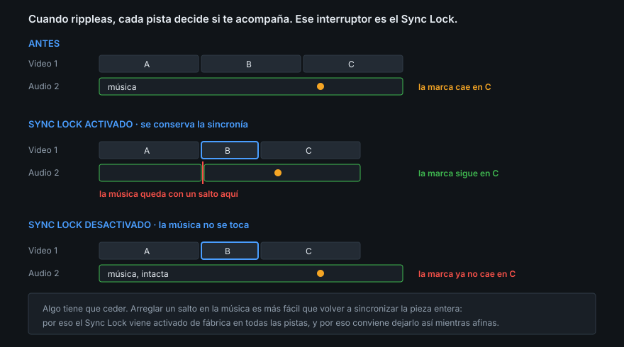

# El sync lock y las reglas del ripple

> El ripple es la operación que de verdad acorta una pieza, y es la única de la semana que puede
> desincronizar tramos enteros. La diferencia entre usarlo bien y romper el montaje cabe en un
> interruptor de la cabecera de pista que llevas ignorando desde la Semana 08.

## 🎯 Objetivos

- Enumerar las nueve operaciones que rippean la timeline
- Explicar qué hace el `Sync Lock` y qué pasa con él encendido y apagado
- Entender por qué Resolve **corta** un clip de otra pista al ripplear
- Decidir en qué pistas dejar el `Sync Lock` activado en tu pieza
- Usar los selectores de pista para acotar a qué clips afecta un ripple
- Saber qué hacen `Extend Edit`, `Trim Start` y `Trim End` en cada modo

---

## 1. Qué problema resuelve

Cuando acortas un plano de `Video 1` y todo lo que viene detrás se viene a la izquierda, hay una
pregunta que Resolve tiene que contestar por ti: **¿y lo que hay en las demás pistas?**

Hay dos respuestas posibles y las dos están mal la mitad de las veces:

- **«Que no se mueva nada de las otras pistas.»** Entonces el rótulo que estaba sobre el plano 12
  ahora está sobre el 13, y la música que caía en el corte cae dos segundos tarde. Todo se ha
  desincronizado.
- **«Que se mueva todo.»** Entonces la música entera se adelanta dos segundos, y si estaba
  colocada respecto a algo del principio de la pieza, se ha estropeado igual.

La respuesta de Resolve es más fina que las dos, y es la que hay que entender: **cada pista decide
por su cuenta**, con un interruptor que se llama `Sync Lock`.

---

## 2. Cómo funciona

### 2.1 Qué operaciones rippean

El manual las lista, y conviene tener la lista porque hay tres que no parecen ripples:

1. Borrar un clip o un hueco con ripple — la tecla `Forward Delete`, que es `Supr` en un teclado
   de Windows y `Fn+Supr` en un teclado Mac sin bloque numérico
2. Cortar un clip con ripple — `Ctrl+Shift+X` (Win) / `Cmd+Shift+X` (Mac)
3. Ripplear uno o varios cortes o huecos con la herramienta de trim (`T`)
4. `Extend Edit` (`E`), `Trim Start` (`Shift+[`) o `Trim End` (`Shift+]`) **en modo trim**
5. `Ripple Start to Playhead` o `Ripple End to Playhead`, en cualquier modo
6. Una edición `Insert` (`F9`) o una `Ripple Overwrite` (`Shift+F10`)
7. Cambiar la velocidad de un clip con los controles de retime **en modo trim**
8. El diálogo `Change Speed` con la casilla `Ripple Sequence` marcada
9. Cambiar de toma en un `Take Selector` con el control de ripple activado

Las que sorprenden son la 7 y la 8: **cambiar la velocidad de un clip puede ripplear la pieza**.
Eso es material de la Semana 10, pero conviene saber desde ahora que está en esta lista.

### 2.2 El `Sync Lock`

Es el icono que está **a la derecha del candado** en cada cabecera de pista, y viene **activado de
fábrica en todas las pistas**.

| Estado | Qué hace esa pista cuando otra rippea |
| ------ | ------------------------------------- |
| **Activado** | Se desplaza junto con las demás, para mantener la sincronía |
| **Desactivado** | No se mueve. El ripple sigue funcionando **dentro** de esa pista, pero esa pista no acompaña a las demás |

> [!NOTE]
> No confundir con los otros dos controles de la cabecera que se le parecen:
>
> - **`Lock Track`** (el candado) impide **editar** nada en esa pista. La pista se sigue viendo y
>   se sigue exportando.
> - **El selector de pista** decide si esa pista **recibe** ediciones y si los comandos que actúan
>   sobre el cabezal la tienen en cuenta.
> - **El `Sync Lock`** decide si esa pista **acompaña** a las demás en un ripple.
>
> Son tres cosas distintas y están una al lado de otra.

### 2.3 La parte que sorprende: Resolve corta la música

Con el `Sync Lock` activado en todas las pistas y rippleando un plano de `Video 1`, esto es lo que
pasa exactamente:

1. Todo lo que hay **después** del punto del ripple se desplaza, en todas las pistas
2. Para conseguirlo con un clip largo que **cruza** el punto del ripple —una música, un rótulo de
   diez segundos—, Resolve **hace un corte en ese clip justo en el punto del ripple** y recorta
3. Resultado: la música que iba después sigue sincronizada con la imagen, pero **la propia música
   tiene ahora un salto** en ese punto

El manual lo explica sin adornos: algo tenía que ceder, y lo que cede es la pista de música, para
que todo lo demás conserve su sincronía. Y añade la parte importante: **arreglar un salto en la
música es mucho más fácil que volver a sincronizar la pieza entera.**

### 2.4 Cómo se decide en qué pistas dejarlo

La regla práctica:

| Tipo de pista | `Sync Lock` | Por qué |
| ------------- | ----------- | ------- |
| Vídeo principal (`Continuidad`) | **Activado** | Es la referencia de todo lo demás |
| Recursos y planos de apoyo | **Activado** | Tienen que seguir tapando lo que tapaban |
| Diálogo | **Activado** | Es lo que más se nota si se desincroniza |
| Ambiente | **Activado** | Va pegado a la imagen que lo justifica |
| Música que suena de fondo toda la pieza | **Desactivado** mientras afinas | Si no, se te llena de cortes; se recoloca al final, de una vez |
| Rótulos ya colocados al fotograma | Depende | Activado si van pegados a un plano; desactivado si son de tiempo absoluto, como una cortinilla de inicio |

En tu pieza de esta semana todavía no hay música ni rótulos, así que la respuesta corta es: **déjalo
activado en todas**. Este apartado es para que en la Semana 15, cuando haya música, sepas dónde
está el interruptor.

### 2.5 Los selectores de pista acotan el ripple

Los comandos que se apoyan en el cabezal —`Trim Start`, `Trim End`, `Extend Edit` y los `Ripple
Start/End to Playhead`— actúan sobre **todos** los clips que crucen el cabezal en las pistas que
tengan el selector activado.

Dos formas de acotarlos:

- **Apagar el selector** de las pistas que no quieres tocar. `Alt` (Win) / `Opt` (Mac) + clic sobre
  el selector de una pista la deja activada en solitario.
- **Seleccionar el clip a mano.** Una selección manual **gana siempre** sobre los selectores de
  pista: si has hecho clic sobre un clip de `Video 1`, la operación afecta a ese y a ninguno más.

---

## 3. Cómo se hace en Resolve 21

### 3.1 Encender y apagar el `Sync Lock`

- **Con el ratón**: clic sobre el icono en la cabecera de la pista.
- **Varias pistas de golpe**: clic sobre el icono de una y arrastra hacia arriba o hacia abajo por
  encima de las demás cabeceras, igual que con los otros controles de la cabecera.

### 3.2 El procedimiento seguro para ripplear un tramo largo

1. **Antes de nada**, `File > Create Timeline Backup`. Es gratis y es el seguro de la semana
2. Decide qué pistas deben acompañar y cuáles no; ajusta sus `Sync Lock`
3. Haz el ripple
4. **Comprueba la duración total** de la pieza: tiene que haber cambiado exactamente lo que
   esperabas
5. **Comprueba las pistas de encima y de debajo** en el punto del ripple: ahí es donde Resolve
   habrá cortado algo si hacía falta
6. Reproduce el tramo entero, no solo el corte

### 3.3 `Extend Edit`, `Trim Start` y `Trim End`

Los tres usan el cabezal como destino, y los tres cambian de comportamiento con el modo:

| Comando | Atajo | En `Selection Mode` | En `Trim Edit Mode` |
| ------- | ----- | ------------------- | ------------------- |
| `Extend Edit` | `E` | Redimensiona los cortes seleccionados hasta el cabezal | **Rippea** hasta el cabezal |
| `Trim Start` | `Shift+[` | Redimensiona la entrada de los clips que cruzan el cabezal | **Rippea** esa entrada |
| `Trim End` | `Shift+]` | Redimensiona la salida | **Rippea** esa salida |

Y dos que rippean **siempre**, estés en el modo que estés:

- `Ripple Start to Playhead` — `Ctrl+Shift+[` (Win) / `Cmd+Shift+[` (Mac)
- `Ripple End to Playhead` — `Ctrl+Shift+]` (Win) / `Cmd+Shift+]` (Mac)

Diferencia entre `Extend Edit` y los otros dos: `Extend Edit` actúa sobre **los cortes que hayas
seleccionado**, y da igual si el cabezal cruza algún clip. `Trim Start` y `Trim End` actúan sobre
**los clips que cruzan el cabezal**, sin necesidad de seleccionar nada.

> [!TIP]
> El uso clásico de `Trim End`: tienes tres o cuatro clips superpuestos de duraciones distintas
> —un plano, un recurso encima y su sonido— y quieres que **acaben todos a la vez**. Pones el
> cabezal donde tienen que acabar y `Shift+]`. Los tres se recortan ahí.

### 3.4 En modo trim, quién manda en un `Extend Edit` de varias pistas

Un detalle fino que evita una sorpresa: si haces `Extend Edit` en modo trim con cortes
seleccionados en varias pistas, **la pista de vídeo de número más bajo con el selector activado es
la que decide cuánto se rippea el resto de la timeline**. Los cortes seleccionados en las demás
pistas simplemente se redimensionan hasta el cabezal.

---

## 4. Antipatrones

| Antipatrón | Por qué duele | Qué hacer |
| ---------- | ------------- | --------- |
| Apagar el `Sync Lock` de todo «por si acaso» | Cada ripple desincroniza la pieza y no te enteras hasta el final | Déjalo activado salvo motivo concreto |
| Ripplear sin mirar las otras pistas | Resolve ha cortado la música y no lo has visto | Mira siempre el punto del ripple en todas las pistas |
| Confundir `Sync Lock` con el candado | Bloqueas la pista y el ripple sigue desincronizando | Son controles distintos y contiguos |
| Ripplear un tramo largo sin respaldo | Deshacer diez operaciones encadenadas es peor que restaurar | `File > Create Timeline Backup` antes |
| Usar `Trim End` con todas las pistas activas | Recortas cuatro clips creyendo que recortas uno | `Alt` / `Opt` + clic sobre el selector de la pista que quieres |
| No mirar la duración total después de ripplear | El ripple es la única operación que la cambia: es tu confirmación | Míralo cada vez |
| Cambiar la velocidad de un clip en modo trim sin querer | Está en la lista de operaciones que rippean | `A` antes de tocar los controles de retime |

---

## 5. Trucos

| Truco | Cómo |
| ----- | ---- |
| Poner todas las pistas en el mismo estado de `Sync Lock` | Clic sobre el icono de una y arrastra por las demás cabeceras |
| Proteger una pista de los ripples | Apaga su `Sync Lock` |
| Dejar activo el selector de una sola pista | `Alt` (Win) / `Opt` (Mac) + clic sobre su selector |
| Acotar una operación a un solo clip | Selecciónalo a mano: gana sobre los selectores |
| Que varios clips superpuestos acaben a la vez | Cabezal donde toca y `Shift+]` |
| Que empiecen todos a la vez | Cabezal donde toca y `Shift+[` |
| Ripplear hasta el cabezal, sea cual sea el modo | `Ctrl+Shift+[` / `]` (Win) · `Cmd+Shift+[` / `]` (Mac) |
| Llevar un corte seleccionado exactamente al cabezal | `E` |
| Punto seguro antes de un ripple grande | `File > Create Timeline Backup` |
| Volver a una versión de hace dos horas | Clic derecho sobre la timeline `> Restore Timeline Backup` |

---

## 📚 Recursos Adicionales

- [DaVinci Resolve Reference Manual](https://www.blackmagicdesign.com/support/family/davinci-resolve-and-fusion) — capítulo 51, secciones «Ripple Editing Rules», «Sync Lock Controls», «Using the Source Track Selector to Control Trimming» y «Trim Operations that are Targeted Using the Playhead».
- [Semana 08 · La timeline y sus pistas](../../week-08-edit_page_anatomia_y_edicion_basica/1-teoria/04-la-timeline-y-sus-pistas.md) — los siete controles de la cabecera, incluido este.
- [08 · Trim asimétrico y split edits](08-trim-asimetrico-y-split-edits.md) — la técnica que separa imagen y sonido a propósito.

---

## ✅ Checklist de Verificación

- [ ] Sé enumerar las operaciones que rippean la timeline
- [ ] Sé qué hace el `Sync Lock` en cada estado
- [ ] Sé por qué Resolve corta un clip de otra pista al ripplear, y por qué está bien que lo haga
- [ ] Sé distinguir `Sync Lock`, `Lock Track` y el selector de pista
- [ ] Sé acotar un ripple a las pistas que quiero
- [ ] Sé qué hacen `Extend Edit`, `Trim Start` y `Trim End` en cada modo
- [ ] Tengo el hábito de mirar la duración total después de cada ripple

---

| Anterior | Actual | Siguiente |
| -------- | ------ | --------- |
| [06 · JKL y el dynamic trim](06-jkl-y-el-dynamic-trim.md) | **07 · El sync lock y las reglas del ripple** | [08 · Trim asimétrico y split edits](08-trim-asimetrico-y-split-edits.md) |

← [Volver a la Semana 09](../README.md)
