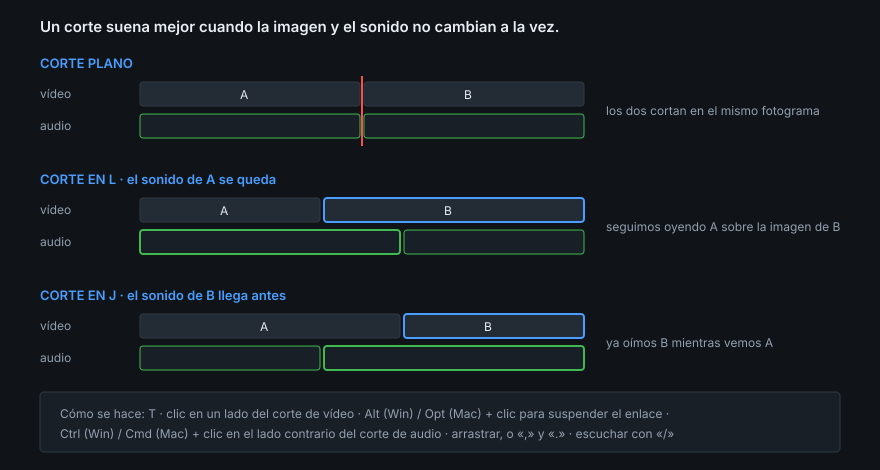

# Trim asimétrico y split edits

> El defecto que más delata a un montaje de principiante no es un corte mal puesto: es que
> **todos** los cortes de imagen y de sonido caen en el mismo fotograma. La vida no funciona así.
> Arreglarlo es una técnica con nombre, y se hace en diez minutos sobre una pieza ya montada.

## 🎯 Objetivos

- Explicar qué es un split edit y por qué suena mejor
- Distinguir un corte en L de un corte en J
- Hacer un trim asimétrico seleccionando dos cortes que se mueven en sentidos contrarios
- Usar `Linked Selection` y saber cuándo saltárselo
- Acortar los dos lados de un corte a la vez para apretar el montaje
- Recortar la cabeza y la cola de un plano conservando el centro

---

## 1. Qué problema resuelve

### 1.1 El corte plano

Cuando montas por tres puntos, cada plano entra con su imagen y su sonido pegados: los dos
empiezan en el fotograma 100 y los dos acaban en el 172. Todos los cortes de la pieza son así.

El resultado suena **mecánico**. La razón es simple: al cambiar de plano cambias de sitio, de
punto de vista y de ambiente sonoro **a la vez**, y el espectador nota el salto porque le llegan
tres avisos simultáneos.

### 1.2 El split edit

Un **split edit** —«edición partida»— es un corte en el que la imagen y el sonido **no cambian en
el mismo fotograma**. Uno de los dos se adelanta.

Y funciona por una razón concreta: cuando el sonido del plano siguiente ya está sonando antes de
que se vea la imagen, el espectador **ya está en la escena nueva** cuando llega el corte visual.
El corte deja de ser un aviso y pasa a ser una confirmación de algo que ya sabía.

### 1.3 Corte en L y corte en J

Los dos nombres vienen de la forma que dibujan los clips en la timeline:

| | **Corte en L** | **Corte en J** |
| --- | --- | --- |
| Qué se adelanta | Nada: el **sonido del plano que sale se queda** | El **sonido del plano que entra llega antes** |
| Qué oyes | Sigues oyendo lo anterior mientras ya ves lo nuevo | Ya oyes lo nuevo mientras todavía ves lo anterior |
| Para qué sirve | Cerrar una idea: la frase acaba mientras ya vemos la reacción | Anticipar: se oye la puerta antes de ver quién entra |
| Caso típico | Entrevista: la voz sigue sobre el plano de recurso | Documental: el ambiente del sitio entra antes que su imagen |

En una pieza bien montada hay unos cuantos de los dos, y no hace falta que sean muchos: cinco o
seis bien puestos cambian cómo suena la pieza entera.

---

## 2. Cómo funciona

### 2.1 Qué es un trim asimétrico

Un **trim asimétrico** es un trim en el que seleccionas **dos cortes que se mueven en sentidos
contrarios**. Es la mecánica que produce un split edit, y también sirve para otras dos cosas.

La regla es: **una selección por pista**, en tantas pistas como quieras. Seleccionas el lado
saliente de un corte en una pista y, con `Ctrl` (Win) / `Cmd` (Mac) pulsado, el lado entrante de
un corte en otra pista. Al arrastrar, cada uno se mueve **en dirección contraria** al otro.

### 2.2 Los tres usos del trim asimétrico

**Uno · El split edit.** Seleccionas el lado saliente del corte de vídeo y el lado entrante del
corte de audio del clip siguiente. Al trimar, la imagen y el sonido dejan de coincidir: tienes un
corte en J.

**Dos · Apretar los dos lados de un mismo corte.** Seleccionas la mitad saliente de un corte y,
con `Ctrl` / `Cmd`, la mitad entrante **del mismo corte**. Eso no hace un `Roll`: te deja acortar
los dos clips a la vez. En modo trim, la timeline se aprieta; en modo selección, se abre un hueco.

**Tres · Quitarle cabeza y cola a un plano conservando el centro.** Seleccionas el punto de
entrada **y** el de salida del mismo clip, y con la herramienta de trim los acercas los dos hacia
el centro. El plano se acorta por los dos extremos, la acción del medio se conserva y la timeline
se aprieta sola.

### 2.3 `Linked Selection`

Es el interruptor de la barra de herramientas que decide si seleccionar la imagen de un clip
selecciona también su sonido. Viene **activado**, y así tiene que estar el 95 % del tiempo: es lo
que evita que se te vayan de sincronía.

Para un split edit necesitas saltártelo, y hay dos formas:

- **Puntualmente**: `Alt` (Win) / `Opt` (Mac) mientras haces clic. El enlace se ignora solo para
  ese clic. **Es la forma correcta.**
- **Del todo**: apagando el interruptor de la barra. Es la forma de acabar con la pieza
  desincronizada sin saber cuándo pasó.

> [!WARNING]
> Si apagas `Linked Selection` para hacer split edits y se te olvida volver a encenderlo, el
> siguiente clip que muevas se moverá **sin su sonido**. El desfase no se ve, se oye, y a veces
> no lo oyes hasta tres semanas después. Usa `Alt` / `Opt` + clic y no lo apagues nunca.

### 2.4 El imán y los marcadores como regla de medir

`Snapping` —el imán, atajo `N`— hace que los bordes de los clips, los marcadores y el cabezal se
peguen entre sí al arrastrar.

En un split edit eso es exactamente lo que **no** quieres mientras separas el audio del vídeo:
el imán intentará volver a pegarlos. Dos opciones:

- `N` para apagarlo mientras trabajas
- `N` **mientras** estás arrastrando, que lo desactiva solo para ese gesto

Y al revés: el imán es lo que hace útiles los marcadores como regla de medir. Si pones un marcador
donde quieres que empiece el sonido, el borde del clip se pegará ahí solo.

---

## 3. Cómo se hace en Resolve 21

### 3.1 Un corte en J, paso a paso

Situación: el plano B tiene un ambiente que quieres que se empiece a oír medio segundo antes de
que se vea.

1. **`T`** — modo trim
2. Clic sobre el **lado entrante** del corte de vídeo, entre A y B
3. **`Alt`** (Win) / **`Opt`** (Mac) + clic para suspender el enlace, y **`Ctrl`** / **`Cmd`** +
   clic sobre el **lado entrante del corte de audio** de B, para añadirlo a la selección
4. Arrastra, o usa `,` y `.`: los dos cortes se mueven en sentidos contrarios
5. **Escucha con `/`**

Media docena de fotogramas ya se notan; medio segundo —doce fotogramas a 24 fps— es un valor
habitual para un ambiente.

### 3.2 La versión rápida, con `Alt+U` / `Opt+U`

Hay un atajo para el caso más común, que es mover solo el audio de un corte:

1. `T`
2. `V` — selecciona el corte más cercano
3. **`Alt+U`** (Win) / **`Opt+U`** (Mac) hasta que la selección sea **solo audio**
4. `,` y `.`

No es un trim asimétrico de verdad —solo se mueve un lado—, pero resuelve la mayoría de los
casos con tres teclas y sin riesgo de desenlazar nada.

### 3.3 Acortar un plano por los dos extremos

1. `T`
2. Clic sobre el **punto de entrada** del clip
3. `Ctrl` / `Cmd` + clic sobre su **punto de salida**
4. Arrastra hacia el centro, o usa `,` y `.`

El plano se acorta por los dos lados a la vez, conservando el centro, y la pieza se aprieta.

### 3.4 Dónde poner los split edits en tu pieza

No en todos los cortes. Tres sitios donde casi siempre funcionan:

| Sitio | Qué hacer | Por qué |
| ----- | --------- | ------- |
| Entrevista → plano de recurso | Corte en L: la voz sigue sonando sobre el recurso | El recurso ilustra lo que se está diciendo, no lo interrumpe |
| Cambio de localización | Corte en J: el ambiente del sitio nuevo entra antes | El espectador llega antes que la cámara |
| Antes de que alguien hable | Corte en J: se le oye empezar la frase sobre el plano anterior | Suena a conversación, no a montaje |

---

## 4. Antipatrones

| Antipatrón | Por qué duele | Qué hacer |
| ---------- | ------------- | --------- |
| Apagar `Linked Selection` y olvidarse | La pieza se desincroniza y no sabes cuándo pasó | `Alt` / `Opt` + clic, puntual |
| Hacer split edits en todos los cortes | Deja de ser un recurso y se vuelve un tic | Cinco o seis en una pieza de cinco minutos |
| Split edits de dos fotogramas | No se notan: has hecho el trabajo para nada | De seis fotogramas para arriba |
| Split edits de tres segundos | Ya no es un corte partido, es un plano de recurso mal puesto | Medio segundo suele bastar |
| Pelear con el imán en vez de apagarlo | Los bordes se vuelven a pegar solos | `N` |
| Arrastrar el audio en modo selección para separarlo | Se mueve el clip entero y aparece un hueco | Es un trim, no un movimiento |
| Hacer un split edit sin escuchar | Lo estás juzgando por lo que se ve en la timeline | `/`, con auriculares |
| Confundir asimétrico con `Roll` | Un roll mueve los dos lados juntos; el asimétrico, en contra | Mira si la duración total cambia |

---

## 5. Trucos

| Truco | Cómo |
| ----- | ---- |
| Suspender el enlace de audio y vídeo solo para este clic | `Alt` (Win) / `Opt` (Mac) + clic |
| Añadir un segundo corte a la selección | `Ctrl` (Win) / `Cmd` (Mac) + clic |
| Mover solo el audio de un corte, sin desenlazar nada | `V`, luego `Alt+U` / `Opt+U`, luego `,` y `.` |
| Apagar el imán mientras separas imagen y sonido | `N` |
| Apagarlo solo durante un arrastre | `N` mientras arrastras |
| Acortar un plano por los dos extremos | Selecciona su entrada y su salida y acércalas |
| Apretar los dos lados de un corte | Selecciona las dos mitades del mismo corte, en modo trim |
| Medir cuántos fotogramas has separado | Pon un marcador antes: el imán y el marcador hacen de regla |
| Comprobar que no se te fue nada de sincronía | Reproduce el tramo con los auriculares puestos |
| Ver dónde están todos tus split edits | `Index > Edit Index`: los cortes de vídeo y de audio no comparten timecode |

---

## 📚 Recursos Adicionales

- [DaVinci Resolve Reference Manual](https://www.blackmagicdesign.com/support/family/davinci-resolve-and-fusion) — capítulo 51, sección «Asymmetric Trimming», con los dos casos de trim asimétrico sobre la misma pista.
- [Semana 08 · Arrastrar y el overlay del visor](../../week-08-edit_page_anatomia_y_edicion_basica/1-teoria/09-arrastrar-y-el-overlay-del-visor.md) — `Linked Selection` y el imán, presentados allí.
- [09 · Marcadores](09-marcadores.md) — la herramienta con la que se anota y se mide todo esto.

---

## ✅ Checklist de Verificación

- [ ] Sé explicar por qué un split edit suena mejor que un corte plano
- [ ] Distingo un corte en L de un corte en J
- [ ] Sé hacer un trim asimétrico con dos cortes en sentidos contrarios
- [ ] Sé suspender `Linked Selection` puntualmente y por qué no hay que apagarlo
- [ ] Sé acortar un plano por los dos extremos conservando el centro
- [ ] Sé qué hace `N` mientras arrastro
- [ ] Sé en qué tres sitios de mi pieza poner split edits

---

| Anterior | Actual | Siguiente |
| -------- | ------ | --------- |
| [07 · El sync lock y las reglas del ripple](07-sync-lock-y-las-reglas-del-ripple.md) | **08 · Trim asimétrico y split edits** | [09 · Marcadores](09-marcadores.md) |

← [Volver a la Semana 09](../README.md)
