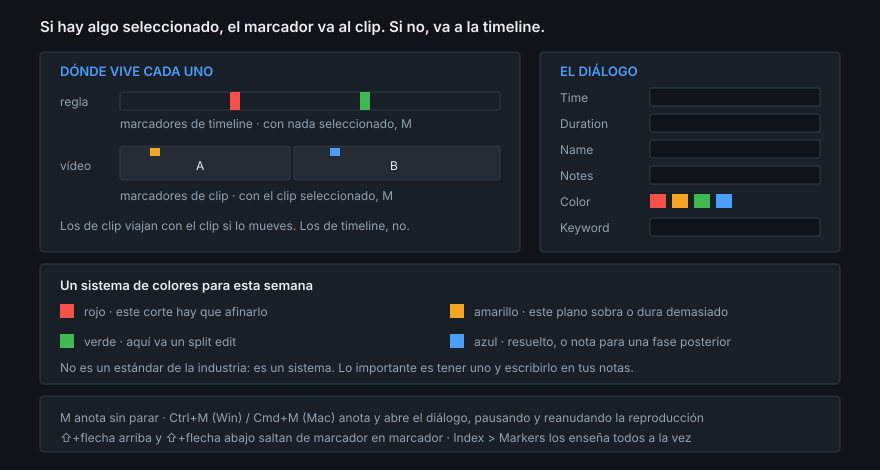

# Marcadores

> Un marcador es una nota clavada en un fotograma. Parece lo más tonto de la semana y es lo que
> convierte «hay algo raro por el minuto tres» en una lista de trabajo con la que se puede
> avanzar. Además es la única cosa de esta semana que el verificador puede leer entera.

## 🎯 Objetivos

- Poner marcadores en la timeline y en un clip, y saber en cuál has puesto cuál
- Ponerles nombre, nota y color, y saber para qué sirve cada campo
- Crear marcadores con duración a partir de un rango marcado
- Navegar entre marcadores sin ratón
- Usar el `Marker Index` para trabajar con todos a la vez
- Decidir si los marcadores deben desplazarse con los ripples

---

## 1. Qué problema resuelve

Afinar un montaje empieza siempre igual: ver la pieza entera sin tocar nada. Y ahí aparece el
problema práctico: **mientras la ves, se te ocurren quince cosas, y si paras a arreglar la primera
ya no ves las otras catorce.**

Los marcadores son la respuesta. Reproduces, y cada vez que algo te chirría pulsas `M` sin parar.
Al final de la pasada tienes quince marcadores, cada uno en su fotograma, y esa es tu lista de
trabajo de la semana.

Y hay un segundo uso, menos obvio y más útil de lo que parece: como **regla de medir**. Con el
imán activado, los bordes de los clips se pegan a los marcadores. Poner un marcador donde quieres
que empiece un sonido y arrastrar hasta que se pegue es más exacto que contar fotogramas.

---

## 2. Cómo funciona

### 2.1 Dos clases de marcador, y confundirlas es el error clásico

| | **Marcador de timeline** | **Marcador de clip** |
| --- | --- | --- |
| Dónde vive | En la **regla de tiempo**, arriba | En la barra de título del **clip** |
| Cómo se pone | Con **nada seleccionado**, `M` | Con **el clip seleccionado**, `M` |
| Qué pasa si mueves el clip | Se queda donde estaba | **Viaja con el clip** |
| Para qué sirve | «En el minuto 2:14 pasa esto» | «Este plano tiene un problema» |

La regla para acordarse: **si hay algo seleccionado, el marcador va al clip. Si no hay nada
seleccionado, va a la timeline.** Por eso conviene deseleccionar todo —`Ctrl+Shift+A` (Win) /
`Cmd+Shift+A` (Mac)— antes de una pasada de anotación.

Los marcadores de clip aparecen además **colgando del clip en la vista de lista del media pool**,
y desde ahí se pueden abrir en el visor o convertir en subclips, como los de la Semana 05.

### 2.2 Los campos de un marcador

El diálogo tiene seis campos, y cada uno tiene su función:

| Campo | Qué es |
| ----- | ------ |
| **`Time`** | El fotograma donde está. Es editable: se puede mover el marcador escribiendo |
| **`Duration`** | Opcional. Si es mayor que uno, el marcador cubre un tramo en vez de un fotograma |
| **`Name`** | El nombre. De fábrica es `Marker 1`, `Marker 2`… en orden de creación |
| **`Notes`** | Texto libre. Es donde va lo que realmente querías anotar |
| **`Color`** | Uno de los colores disponibles. Es lo que permite filtrar |
| **`Keyword`** | Palabra clave, igual que las de los clips en la Semana 04. Sirve para buscarlos y para las smart bins |

Cuando un marcador tiene texto en `Notes`, le aparece **un punto pequeño encima** para que se
distinga de los que están vacíos.

### 2.3 El color es una categoría, no una decoración

Un marcador sin sistema de colores es un marcador que no vas a filtrar. El sistema que se propone
para esta semana:

| Color | Significa |
| ----- | --------- |
| **Rojo** | Este corte hay que afinarlo |
| **Amarillo** | Este plano sobra o dura demasiado |
| **Verde** | Aquí va un split edit |
| **Azul** | Resuelto, dejado a propósito, o nota para una fase posterior |

No es un estándar de la industria: es un sistema, y lo importante es tener uno y escribirlo en tus
notas para acordarte dentro de tres semanas.

> [!NOTE]
> Los marcadores de timeline sirven además como **puntos de capítulo** al exportar: en la Deliver
> page, con formato QuickTime o MP4, la casilla `Chapters from Markers` mete los marcadores de un
> color concreto en el archivo como capítulos navegables. Todos los marcadores de capítulo tienen
> que ser del mismo color. Eso es de la Semana 28; el dato importante de hoy es que **el color de
> tus marcadores va a significar algo más adelante**.

### 2.4 Marcadores con duración

Un marcador normal ocupa un fotograma. Uno con duración cubre un tramo, y se dibuja como una barra.

Se crean de dos formas:

- Marcando `I` y `O` y luego clic derecho sobre la barra de transporte del visor `> Convert In and
  Out to Duration Marker`
- `Alt` (Win) / `Opt` (Mac) + arrastrar un marcador ya puesto hacia los lados

Para qué sirven de verdad: para señalar **un tramo problemático** en vez de un fotograma. «Estos
ocho segundos van demasiado deprisa» es un marcador con duración; «este corte cae tarde» es un
marcador normal.

### 2.5 Los marcadores y el ripple

Los marcadores de timeline están anclados a un **tiempo**, no a un clip. Si rippleas y acortas la
pieza, por defecto se quedan donde estaban y dejan de señalar lo que señalaban.

`Timeline > Ripple Timeline Markers` cambia eso: con la opción activada, **todos los marcadores
que estén a la derecha de un ripple se desplazan con el resto de la timeline**.

Cuál conviene:

- **Activado** mientras afinas, que es toda esta semana. Tus marcadores son notas sobre planos
  concretos y tienen que seguirlos.
- **Desactivado** cuando los marcadores señalan tiempos absolutos: puntos de capítulo, la marca de
  los treinta segundos de un anuncio, un pie de entrada de música.

---

## 3. Cómo se hace en Resolve 21

### 3.1 Poner marcadores

| Qué quieres | Cómo |
| ----------- | ---- |
| Un marcador en la timeline | Deselecciona todo, y `M` |
| Un marcador en un clip | Selecciona el clip, y `M` |
| Un marcador y escribir dentro al momento | `Ctrl+M` (Win) / `Cmd+M` (Mac), o `M` dos veces |
| Un marcador de un color concreto | Menú `Mark > Add Marker >` y el color |
| Un marcador desde el botón de la barra | El botón `Add Marker`, con su desplegable de colores al lado |
| Uno con duración, desde un rango | `I` y `O`, clic derecho `> Convert In and Out to Duration Marker` |

`Ctrl+M` / `Cmd+M` **pausa la reproducción** para que escribas, y la reanuda al cerrar el diálogo.
Es la forma de anotar sin perder el hilo durante una pasada de visionado.

### 3.2 Editarlos

Para abrir el diálogo de un marcador:

- Doble clic sobre él
- `Shift+M` con el marcador seleccionado
- Cabezal encima del marcador y `M`
- `Mark > Modify Marker`

Dentro, `Tab` salta al campo siguiente y `Shift+Tab` al anterior.

### 3.3 Moverlos y borrarlos

| Qué | Cómo |
| --- | ---- |
| Mover uno | Arrástralo por la regla de tiempo |
| Mover varios | `Ctrl` / `Cmd` + clic para seleccionarlos, o arrastra un rectángulo desde la timeline hacia la regla, y arrastra |
| Moverlo exacto | Abre su diálogo y escribe en `Time` |
| Darle duración | `Alt` / `Opt` + arrastra uno de sus extremos, o escribe en `Duration` |
| Quitarle la duración | Pon `Duration` a `00:00:00:00` |
| Borrar uno | Selecciónalo y `Supr`, o cabezal encima y `Alt+M` (Win) / `Opt+M` (Mac) |
| Borrar todos los de un clip | Selecciona el clip y `Clear All` en el desplegable del botón `Add Marker` |
| Borrar todos los de la timeline | Con todo deseleccionado, clic derecho en la regla `> Remove All Markers` |

### 3.4 Navegar y leer

- **`Shift+Flecha arriba`** y **`Shift+Flecha abajo`** llevan el cabezal al marcador anterior o al
  siguiente. Los de clip y los de timeline se recorren mezclados.
- **Pasar el puntero por encima** de un marcador enseña su información en un globo.
- **`Show Marker Overlays`**, en el menú de tres puntos del visor, superpone la información del
  marcador sobre la imagen cuando el cabezal está encima y la reproducción está parada.

### 3.5 El `Marker Index`

`Index > Markers` abre la lista de todos los marcadores de la timeline, y es donde se trabaja
cuando hay más de diez:

- **Doble clic** en una fila lleva el cabezal ahí
- Los campos `Name`, `Notes` y `Keyword` **se editan directamente en la lista**
- La lupa busca en todos los campos a la vez
- El menú de opciones filtra por color con `Show All` o `Show Only`
- Se puede ordenar por cualquier columna haciendo clic en su cabecera
- Hay vista de lista y vista de miniaturas

Y para sacarlos fuera de Resolve: el `Edit Index` permite exportar los marcadores filtrados como
`.txt` o `.csv`, y clic derecho sobre la timeline en el media pool
`> Timelines > Export > Timeline Markers to EDL` los exporta como EDL.

---

## 4. Antipatrones

| Antipatrón | Por qué duele | Qué hacer |
| ---------- | ------------- | --------- |
| Poner marcadores sin nombre ni nota | `Marker 7` no te dice nada mañana | `Ctrl+M` / `Cmd+M` y escribe una frase |
| Un solo color para todo | No puedes filtrar, y el índice se vuelve inútil | Cuatro colores y un significado para cada uno |
| Poner el marcador en el clip creyendo que era de timeline | Al mover el plano, la nota se va con él | Deselecciona antes de anotar |
| Parar la reproducción para anotar | Pierdes el hilo y no ves la pieza seguida | `Ctrl+M` / `Cmd+M` pausa y reanuda sola |
| No borrarlos cuando el problema está resuelto | Acabas con cuarenta marcadores y ninguno vigente | Bórralo o pásalo a azul al arreglarlo |
| Afinar sin lista de marcadores | Arreglas lo primero que ves y se te olvida el resto | Pasada de visionado primero |
| Dejar `Ripple Timeline Markers` desactivado toda la semana | Los marcadores dejan de señalar lo que señalaban tras el primer ripple | Actívalo mientras afinas |

---

## 5. Trucos

| Truco | Cómo |
| ----- | ---- |
| Anotar sin parar la reproducción | `M` mientras se reproduce |
| Anotar y escribir al momento | `Ctrl+M` (Win) / `Cmd+M` (Mac) |
| Marcador en la timeline y no en el clip | Deselecciona todo antes: `Ctrl+Shift+A` / `Cmd+Shift+A` |
| Poner un color concreto sin tocar el desplegable | `Mark > Add Marker >` y el color; se le puede asignar atajo |
| Saltar al marcador siguiente o al anterior | `Shift+Flecha abajo` y `Shift+Flecha arriba` |
| Editar un marcador | Doble clic, o `Shift+M` |
| Borrar el marcador que hay bajo el cabezal | `Alt+M` (Win) / `Opt+M` (Mac) |
| Marcar un tramo entero | `I`, `O`, clic derecho `> Convert In and Out to Duration Marker` |
| Alargar un marcador | `Alt` / `Opt` + arrástralo hacia un lado |
| Ver la nota sobre la imagen | Menú de tres puntos del visor `> Show Marker Overlays` |
| Trabajar con todos los marcadores a la vez | `Index > Markers` |
| Buscar un marcador por lo que escribiste | La lupa del `Marker Index` |
| Sacar la lista de marcadores a un `.csv` | `Edit Index`, menú de opciones `> Export Edit Index` |
| Copiar marcadores de una timeline a otra | Selecciónalos, `Ctrl+C` / `Cmd+C`, y `Ctrl+V` / `Cmd+V` en la otra |
| Que los marcadores acompañen a los ripples | `Timeline > Ripple Timeline Markers` |

---

## 📚 Recursos Adicionales

- [DaVinci Resolve Reference Manual](https://www.blackmagicdesign.com/support/family/davinci-resolve-and-fusion) — capítulo 48, «Marking and Finding Clips in the Timeline», sección «Using Markers»: los campos del diálogo, los marcadores con duración y el `Marker Index`.
- [Semana 04 · Keywords, flags y colores](../../week-04-media_page_ingesta_y_organizacion/1-teoria/07-keywords-flags-y-colores.md) — de dónde vienen las palabras clave que también aceptan los marcadores.
- [Semana 05 · Subclips](../../week-05-proxies_cache_y_sincronizacion/1-teoria/08-subclips.md) — la otra forma de guardar un rango de un clip.

---

## ✅ Checklist de Verificación

- [ ] Sé poner un marcador de timeline y uno de clip, y sé cuál he puesto
- [ ] Sé anotar durante la reproducción sin pararla
- [ ] Tengo un sistema de colores escrito
- [ ] Sé crear un marcador con duración
- [ ] Sé navegar entre marcadores sin ratón
- [ ] Sé usar el `Marker Index` para editar y filtrar
- [ ] Sé qué hace `Ripple Timeline Markers` y cuándo quiero cada estado

---

| Anterior | Actual | Siguiente |
| -------- | ------ | --------- |
| [08 · Trim asimétrico y split edits](08-trim-asimetrico-y-split-edits.md) | **09 · Marcadores** | — |

← [Volver a la Semana 09](../README.md)
