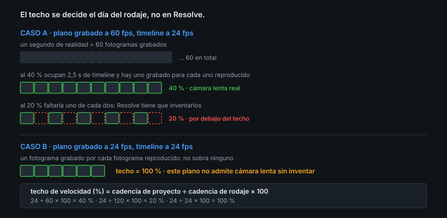

# El techo de la cámara lenta

> La Semana 07 te enseñó a cambiar la velocidad de un plano. Esta empieza por lo que aquella dejó
> fuera: **cuánta cámara lenta admite tu material**. Ese número no se decide en Resolve. Se decidió
> el día del rodaje, y ninguna función del programa lo cambia.

## 🎯 Objetivos

- Distinguir **cadencia de rodaje** de **cadencia de proyecto**, y saber cuál es cuál en tu material
- Calcular el techo de cámara lenta de un plano a partir de esas dos cifras
- Explicar por qué un plano ralentizado por debajo de su techo se ve a saltos
- Reconocer los tres tipos de defecto que produce un retime, y saber cuál es de cuál
- Decidir si un plano se ralentiza, se acelera o se deja quieto, antes de tocar nada

---

## 1. Qué problema resuelve

Ralentizas un plano al 25 %, lo miras y se ve **a saltos**: la imagen avanza a tirones en vez de
fluir. Tu primer instinto es que Resolve lo ha hecho mal, o que hace falta una opción escondida.

No es eso. Es que le has pedido cuatro veces más fotogramas de los que hay grabados.

Este archivo explica de dónde sale ese límite, cómo se calcula antes de perder media hora, y qué
se puede y qué no se puede arreglar después. Es el archivo que decide si el resto de la semana te
sale bien: **casi todos los retimes feos son retimes por debajo del techo del plano**.

---

## 2. Cómo funciona



### 2.1 Dos cadencias distintas que se confunden todo el rato

Un **fotograma** (*frame*) es una imagen fija. Un vídeo es una tira de fotogramas que se enseñan
uno detrás de otro. La **cadencia** o **frame rate** es cuántos se enseñan por segundo, y se mide
en `fps` (*frames per second*). Hasta aquí, la Semana 01.

Lo que cambia esta semana es que hay **dos** cadencias en juego y no son la misma:

| Cadencia | Qué es | Dónde se mira |
| -------- | ------ | ------------- |
| **De rodaje** | Cuántos fotogramas por segundo grabó la cámara | El campo `FPS` del clip en el media pool |
| **De proyecto** | Cuántos reproduce tu timeline por segundo | `File > Project Settings > Master Settings > Timeline frame rate` |

Tu proyecto del bootcamp es de **24 fps**: lo fijaste en la Semana 03 y ya no se puede cambiar.
Tu material puede estar grabado a 24, a 25, a 30, a 50, a 60 o a 120 fps, según con qué y cómo lo
grabaras.

> [!NOTE]
> Grabar a más fotogramas por segundo de los que se van a reproducir se llama **sobrecadenciar**
> (*overcranking*), por la manivela de las cámaras de cine antiguas: cuanto más rápido girabas la
> manivela, más lenta salía la imagen al proyectarla a velocidad normal.

### 2.2 El techo, en una división

Un plano grabado a 60 fps tiene 60 imágenes por cada segundo de realidad. Tu timeline consume 24
por segundo. Con esas 60 imágenes puedes rellenar **dos segundos y medio** de timeline:

```
techo de velocidad (%) = cadencia de proyecto ÷ cadencia de rodaje × 100
```

| Grabado a | En una timeline a 24 fps | Techo |
| --------- | ------------------------ | ----- |
| 24 fps | Un fotograma grabado por fotograma reproducido | **100 %** — no admite cámara lenta sin inventar |
| 30 fps | Sobran seis por segundo | **80 %** |
| 50 fps | Sobran veintiséis | **48 %** |
| 60 fps | Sobran treinta y seis | **40 %** |
| 120 fps | Sobran noventa y seis | **20 %** |

Por encima del techo —es decir, con un porcentaje **mayor** que el de la tabla— hay fotograma
grabado para cada fotograma reproducido y la cámara lenta es real. Por debajo, faltan, y Resolve
tiene que **inventárselos**. Ese es el tema de la [teoría 06](06-como-resolve-inventa-fotogramas.md).

### 2.3 Los tres defectos, y cuál es cuál

Los defectos de un retime se confunden entre sí y se arreglan de formas distintas. Aprender a
distinguirlos ahorra la mitad del tiempo de esta semana:

| Lo que ves | Se llama | Por qué pasa | Se arregla |
| ---------- | -------- | ------------ | ---------- |
| La imagen avanza a **tirones**, como una presentación de diapositivas | *judder* | Faltan fotogramas y Resolve repite el anterior | Subiendo el porcentaje, o con `Optical Flow` |
| El movimiento se ve **doble o fantasmal**, dos posiciones a la vez | *ghosting* | Resolve está mezclando dos fotogramas para inventar el que falta | Cambiando de `Frame Blend` a `Optical Flow`, o al revés |
| Los bordes de lo que se mueve se **derriten** o se doblan | *warping* | `Optical Flow` ha calculado mal hacia dónde iba un objeto | Bajando a `Frame Blend`, o cambiando el plano |

Los tres empeoran cuanto más lejos del techo estés. Ninguno se arregla con nitidez ni con
reducción de ruido: no son un problema de imagen, son un problema de **tiempo**.

### 2.4 El obturador, que también cuenta

Un plano grabado con un tiempo de exposición largo lleva **movimiento borroso** (*motion blur*)
grabado dentro de cada fotograma. Eso, que a velocidad normal es lo que hace que el movimiento se
vea natural, en cámara lenta se convierte en un estorbo: se ve una mancha que se mueve despacio.

Por eso la cámara lenta de verdad se graba con obturador rápido, y por eso un plano de móvil
grabado de noche a 60 fps casi nunca aguanta el 40 % aunque la cuenta diga que sí. **La cuenta
da el techo teórico; el obturador y el ruido bajan el techo real.**

### 2.5 Qué le pasa al audio

Un cambio de velocidad **lineal** —una velocidad constante para todo el clip— arrastra el audio
con él. El manual es explícito en dos cosas:

- En Windows y en Linux el audio se retima **sin corrección de tono**: al 50 % la voz suena grave.
  En macOS (Yosemite y posteriores) se retima **con** corrección de tono.
- Hay una casilla `Pitch Correction` en el diálogo de velocidad y en el Inspector para forzar la
  corrección.

Y una regla que no tiene excepción:

> [!IMPORTANT]
> **El audio de un efecto de velocidad variable se silencia.** Si un clip tiene dos velocidades
> distintas dentro —una rampa, un freeze intermedio—, Resolve enmudece su audio entero. No es un
> ajuste que se pueda desactivar. Si necesitas ese sonido, va en otra pista, sin retimar.

---

## 3. Cómo se hace en Resolve 21

### 3.1 Leer la cadencia de rodaje de un clip

1. Media page o Edit page, panel `Media Pool`
2. Vista `List View` — el botón de la esquina superior derecha del panel
3. Busca la columna `FPS`. Si no está, clic derecho sobre la cabecera de columnas y actívala

Con el clip ya en la timeline, la otra vía es el `Inspector`: seleccionas el clip y miras
`Inspector > File` (la pestaña de información del archivo).

### 3.2 Leer la cadencia del proyecto

`File > Project Settings > Master Settings > Timeline frame rate`.

En tu proyecto pone **24**, el campo está atenuado y no se puede tocar. Eso es correcto y es lo
que comprueba el check `frame-rate-bloqueado` desde la Semana 03.

### 3.3 Calcular el techo antes de retimar

Con las dos cifras, la división de la sección 2.2. Escríbela en tus notas junto al nombre del
plano: te la vas a preguntar tres veces durante la semana.

Un atajo mental que funciona: **divide la cadencia de rodaje entre la del proyecto y tienes cuántas
veces puedes estirar el plano.** 60 ÷ 24 = 2,5 veces. 120 ÷ 24 = 5 veces.

### 3.4 Comprobar el techo mirando, no calculando

La cuenta da el número; el ojo da la respuesta. El procedimiento de cinco segundos:

1. Aplica la velocidad que quieres
2. Reproduce el plano en bucle: `Ctrl+/` (Win) / `Cmd+/` (Mac) y luego `/`
3. Mira **el borde de lo que se mueve**, no el centro del cuadro
4. Si tiembla, tirita o se derrite, has pasado el techo

---

## 4. Antipatrones

| Antipatrón | Por qué duele | Qué hacer |
| ---------- | ------------- | --------- |
| Ralentizar sin mirar la cadencia del clip | Descubres el judder cuando ya has recolocado media pieza | Mira el `FPS` primero: son cinco segundos |
| Creer que `Optical Flow` arregla cualquier porcentaje | Inventar treinta fotogramas de cada cuarenta no es interpolar, es dibujar | Optical Flow rescata cerca del techo, no lejos |
| Poner el 50 % «porque es un número redondo» | El número redondo del plano es su techo, no el 50 | Calcula el techo y quédate por encima |
| Ralentizar un plano nocturno con ruido | El ruido es aleatorio y confunde al análisis de movimiento | Ese plano no se ralentiza; se acelera o se corta |
| Buscar el sonido de un plano con rampa | El audio de la velocidad variable está silenciado por diseño | Duplica el sonido en otra pista antes de hacer la rampa |
| Retimar para arreglar un plano aburrido | La velocidad no añade interés, solo dura distinto | Si el plano sobra, sobra: eso era la Semana 09 |
| Ralentizar un plano con la cámara en mano y sin estabilizar | La cámara lenta amplifica el temblor en lugar de disimularlo | Estabiliza primero, ralentiza después ([teoría 09](09-estabilizacion-en-la-edit-page.md)) |

---

## 5. Trucos

| Truco | Cómo |
| ----- | ---- |
| Ver la cadencia de todo el material de golpe | `Media Pool` en `List View`, columna `FPS`, y ordena por ella |
| Saber cuántas veces estira un plano | Cadencia de rodaje ÷ cadencia de proyecto |
| Juzgar un retime sin pararlo | `Ctrl+/` (Win) / `Cmd+/` (Mac) para el bucle, y `/` |
| Ver el defecto donde de verdad está | Mira los bordes de lo que se mueve, no el centro |
| Comparar antes y después al momento | `Clip > Enable Clip` apaga y enciende el clip; no trae atajo de fábrica, se le asigna en `Keyboard Customization` |
| Anotar el techo de un plano donde no se pierda | Marcador con el porcentaje en el campo `Name` |

---

## 📚 Recursos Adicionales

- [DaVinci Resolve Reference Manual](https://www.blackmagicdesign.com/support/family/davinci-resolve-and-fusion) — capítulo 58, sección «Speed Effects and Retiming», y el recuadro «Speed Effects and Audio», que es donde está escrito lo del audio silenciado.
- [Semana 01 · Frame rate y obturador](../../week-01-fundamentos_de_imagen_en_movimiento/1-teoria/02-frame-rate.md) — de dónde sale la cadencia y por qué 24.
- [Semana 07 · Cambios de velocidad](../../week-07-cut_page_acabado_y_quick_export/1-teoria/05-cambios-de-velocidad.md) — la versión Cut page de esto, con el peaje ya mencionado.
- [06 · Cómo Resolve inventa los fotogramas que faltan](06-como-resolve-inventa-fotogramas.md) — qué hace exactamente el programa cuando le pides más de lo que hay.

---

## ✅ Checklist de Verificación

- [ ] Sé dónde se lee la cadencia de rodaje de un clip y la de mi timeline
- [ ] Sé calcular el techo de cámara lenta de un plano con una división
- [ ] Sé por qué un plano a 24 fps no admite cámara lenta real
- [ ] Distingo judder, ghosting y warping al verlos
- [ ] Sé que el obturador baja el techo real por debajo del teórico
- [ ] Sé que el audio de una velocidad variable se silencia siempre
- [ ] He anotado el techo de los planos que voy a retimar esta semana

---

| Anterior | Actual | Siguiente |
| -------- | ------ | --------- |
| — | **01 · El techo de la cámara lenta** | [02 · Las cuatro formas de cambiar la velocidad](02-las-cuatro-formas-de-cambiar-la-velocidad.md) |

← [Volver a la Semana 10](../README.md)
