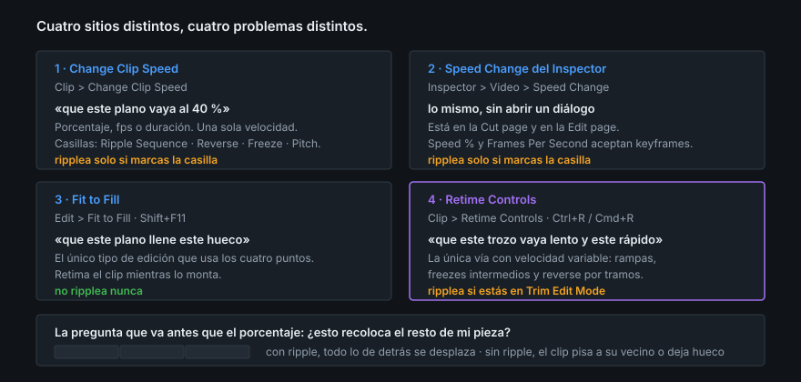

# Las cuatro formas de cambiar la velocidad

> Resolve tiene cuatro sitios distintos donde cambiar la velocidad de un plano. No son cuatro
> caminos al mismo destino: cada uno hace algo que los otros no, y elegir mal es la causa número
> uno de que la pieza se descoloque entera.

## 🎯 Objetivos

- Enumerar las cuatro formas y decir qué resuelve cada una
- Usar el diálogo `Change Clip Speed` y saber qué hace cada una de sus casillas
- Usar los controles `Speed Change` del Inspector, y saber por qué existen los dos
- Hacer un `Fit to Fill` y entender por qué es un retime disfrazado de edición
- Predecir si un cambio de velocidad va a descolocar la pieza, **antes** de hacerlo
- Leer el distintivo de retime de un clip para saber que lleva velocidad cambiada

---

## 1. Qué problema resuelve

Tienes un plano de doce segundos y un hueco de seis. Tienes un plano que dura lo que dura y una
acción que pide leerse despacio. Tienes catorce planos de recurso y una música que manda.

Los tres problemas son de velocidad, pero **no se resuelven en el mismo sitio**:

- El primero es «que este plano quepa aquí» → `Fit to Fill`
- El segundo es «que este plano vaya al 40 %» → `Change Clip Speed` o el Inspector
- El tercero es «que este trozo vaya despacio y este otro deprisa» → los `Retime Controls`
  ([teoría 04](04-velocidad-variable-rampas-y-rewind.md))

Este archivo cubre los tres primeros, que son los **lineales**: una sola velocidad para todo el
clip. Y cubre, sobre todo, la pregunta que va antes que todas: **¿esto va a mover el resto de mi
pieza?**

---

## 2. Cómo funciona

### 2.1 La tabla que decide

| Vía | Dónde | Para qué sirve | ¿Velocidad variable? |
| --- | ----- | -------------- | -------------------- |
| **`Change Clip Speed`** | `Clip > Change Clip Speed` | Una velocidad exacta, por porcentaje, fps o duración | No |
| **`Speed Change` del Inspector** | `Inspector > Video > Speed Change` | Lo mismo, sin abrir un diálogo, y con keyframes | No, pero sus valores se pueden keyframear |
| **`Fit to Fill`** | `Edit > Fit to Fill`, `Shift+F11` | Que un plano concreto llene un hueco concreto | No |
| **`Retime Controls`** | `Clip > Retime Controls`, `Ctrl+R` / `Cmd+R` | Rampas, freezes intermedios, reverse por tramos | **Sí** |

Las tres primeras son de este archivo. La cuarta tiene el suyo.

### 2.2 La pregunta que va primero: ¿ripplea o no?

Cambiar la velocidad de un clip cambia su duración. Y ahí hay dos comportamientos posibles:

| Comportamiento | Qué pasa | Cuándo |
| -------------- | -------- | ------ |
| **Ripple** | Todo lo que viene detrás se recoloca. La pieza cambia de duración | Con la casilla `Ripple Sequence` activada |
| **Overwrite** | El clip crece y **pisa** al vecino, o encoge y deja un hueco | Con la casilla desactivada |

La casilla `Ripple Sequence` está en el diálogo `Change Clip Speed` **y** en los controles del
Inspector. Es la casilla más importante de la semana.

> [!WARNING]
> Con `Ripple Sequence` **desactivada**, ralentizar un clip lo hace crecer y **borra** parte del
> plano siguiente sin avisar. Con ella **activada**, la pieza entera se recoloca y los rótulos y
> recursos de las pistas de encima pueden quedarse donde estaban. Ninguna de las dos es la
> correcta siempre: la correcta depende de lo que haya alrededor, y hay que decidirla antes de
> tocar el valor.

La regla práctica para tu pieza esta semana: **con `Ripple Sequence` activada y comprobando después
las pistas de arriba**. Es la que no destruye material. Lo que se descoloca, se recoloca; lo que se
pisa, no vuelve sin `Ctrl+Z`.

Y hay un caso aparte, porque no tiene casilla:

> [!NOTE]
> Con los `Retime Controls` no hay casilla: lo que decide si la timeline se recoloca es **el modo
> en el que estés**. En `Selection Mode` (`A`) no ripplea; en `Trim Edit Mode` (`T`) sí. Es la
> misma lógica de la Semana 09, aplicada a la velocidad.

### 2.3 El distintivo de retime

Un clip con la velocidad cambiada lleva un **distintivo** (*badge*) a la izquierda de su nombre en
la timeline. Es la única señal permanente: el porcentaje solo se ve con los `Retime Controls`
abiertos.

Mirar los distintivos antes de cerrar la semana es cómo se descubre el clip que retimaste sin
querer con un arrastre.

---

## 3. Cómo se hace en Resolve 21

### 3.1 `Change Clip Speed`: el diálogo

**Ruta**: selecciona el clip y `Clip > Change Clip Speed`. También con clic derecho sobre el clip
`> Change Clip Speed`. Se puede aplicar a **varios clips seleccionados a la vez**.

El diálogo `Edit Speed Change` tiene estos controles:

| Control | Qué hace |
| ------- | -------- |
| **`Speed`, `Frames Per Second`, `Duration`** | Los tres campos del mismo valor: el porcentaje, la cadencia equivalente o la duración final. Cambiar uno recalcula los otros dos |
| **`Ripple Sequence`** | Si la timeline se recoloca o no. Ver 2.2 |
| **`Reverse Speed`** | Pone el valor en negativo: el plano se reproduce hacia atrás |
| **`Freeze Frame`** | Convierte el clip entero en una imagen fija del fotograma donde esté el cabezal |
| **`Pitch Correction`** | Corrige el tono del audio para que no suene grave o agudo |
| **`Maintain Timing` / `Stretch to fit`** | Qué pasa con los keyframes que ya haya dentro del clip. Ver 3.2 |

### 3.2 Los keyframes que ya estaban dentro

Los dos botones de radio del final resuelven un problema que aparece cuando ya has animado algo:

- **`Maintain Timing`**: los keyframes se quedan **en su fotograma original**. El movimiento que
  animaste ocurre en el mismo momento aunque el clip dure el doble
- **`Stretch to fit`**: los keyframes de `Composite`, `Transform` y `Cropping` se estiran o se
  comprimen **el mismo porcentaje que el clip**

Esta semana vas a animar transformaciones ([teoría 08](08-keyframes-inspector-y-curve-editor.md)),
así que el orden importa: **primero la velocidad, después los keyframes**. Si lo haces al revés,
tienes que acordarte de este par de botones.

### 3.3 `Speed Change` en el Inspector

**Ruta**: selecciona el clip, `Inspector > Video`, grupo `Speed Change`.

Es el mismo cambio de velocidad sin diálogo, y con dos ventajas: está en la **Cut page y en la
Edit page** —es el panel que ya usaste en la Semana 07—, y sus valores se pueden **keyframear**.

| Control | Qué hace |
| ------- | -------- |
| **`Direction`** | Tres botones: hacia delante, hacia atrás, o fotograma congelado |
| **`Speed %`** | El porcentaje. **Se puede keyframear** |
| **`Frames Per Second`** | El mismo valor expresado en cadencia. **Se puede keyframear** |
| **`Duration`** | La duración final, en `HH:MM:SS:FF` |
| **`Ripple Sequence`** | Igual que en el diálogo |
| **`Pitch Correction`** | Igual que en el diálogo |

### 3.4 `Fit to Fill`: el retime que se hace al editar

`Fit to Fill` es el único tipo de edición que **usa los cuatro puntos** —entrada y salida en el
origen, entrada y salida en la timeline— y el único que retima el clip mientras lo monta.

**Ruta**: `Edit > Fit to Fill`, atajo `Shift+F11`.

1. Marca `I` y `O` en la timeline sobre el hueco que quieres llenar. O borra los puntos de la
   timeline con `Alt+X` (Win) / `Opt+X` (Mac) y coloca el cabezal dentro del hueco: se usa la
   duración de ese hueco
2. Marca `I` y `O` en el `Source Viewer` sobre el tramo del plano que quieres meter
3. Comprueba los `Source Track Selector`: a qué pistas va
4. `Shift+F11`

El clip entra retimado para caber exactamente. Lleva su distintivo de retime, como cualquier otro.

> [!IMPORTANT]
> **`Fit to Fill` no ripplea la timeline.** Está escrito así en el manual, y tiene sentido: el
> objetivo es rellenar un hueco de una duración dada, no cambiar la duración de la pieza. Es la
> herramienta correcta cuando el hueco manda; es la incorrecta cuando lo que manda es el plano.

### 3.5 Deshacer una velocidad

Tres caminos, según lo que quieras conservar:

| Quiero | Cómo |
| ------ | ---- |
| Volver al 100 % | Con los `Retime Controls` abiertos, `Reset to 100%` en el desplegable de velocidad |
| Quitar solo el freeze | `Change Clip Speed` y desmarca `Freeze Frame` |
| Quitar la velocidad y dejar el resto | `Edit > Remove Attributes` y marca solo el atributo de velocidad |

---

## 4. Antipatrones

| Antipatrón | Por qué duele | Qué hacer |
| ---------- | ------------- | --------- |
| Retimar sin mirar `Ripple Sequence` | O se pisa el plano siguiente, o se descoloca media pieza | Decide la casilla antes que el porcentaje |
| Retimar un clip que ya tiene rótulos encima | El rótulo se queda donde estaba y rotula el plano equivocado | Retima antes de titular; es la Semana 11 por algo |
| Usar `Fit to Fill` para «acelerar un poco» | No ripplea, y acabas con la pieza cuadrada a la fuerza | `Change Clip Speed` con la duración que quieras |
| Escribir el porcentaje sin calcular el techo | El plano no lo aguanta y hay que rehacerlo | [Teoría 01](01-el-techo-de-la-camara-lenta.md), la división |
| Retimar el mismo clip tres veces seguidas | Los porcentajes se acumulan y pierdes la cuenta | `Reset to 100%` y vuelve a poner el valor bueno |
| No mirar los distintivos al cerrar | Un arrastre accidental deja un clip al 97 % que nadie ve | Recorre la timeline mirando los distintivos |
| Cambiar la velocidad de un clip con audio sincronizado | La voz se va de labios y suena grave | Retima solo planos sin voz, o separa el audio antes |

---

## 5. Trucos

| Truco | Cómo |
| ----- | ---- |
| Cambiar la velocidad de varios clips a la vez | Selecciónalos todos y `Clip > Change Clip Speed` |
| Poner una duración exacta en vez de un porcentaje | El campo `Duration` del diálogo o del Inspector |
| Invertir un plano sin calcular nada | Casilla `Reverse Speed` |
| Que la voz no suene grave al ralentizar | Casilla `Pitch Correction` |
| Rellenar un hueco con un plano que no da | `I`, `O` en el hueco y `Shift+F11` |
| Usar el hueco que cruza el cabezal como destino | Borra los puntos de la timeline con `Alt+X` / `Opt+X` antes del `Fit to Fill` |
| Ver de un vistazo qué clips llevan velocidad | Los distintivos de retime, a la izquierda del nombre |
| Volver un clip al 100 % sin tocar nada más | `Reset to 100%` en el desplegable de velocidad |
| Quitar la velocidad conservando el resto de ajustes | `Edit > Remove Attributes` |

---

## 📚 Recursos Adicionales

- [DaVinci Resolve Reference Manual](https://www.blackmagicdesign.com/support/family/davinci-resolve-and-fusion) — capítulo 58, secciones «Creating Simple Linear Speed Effects» y «Speed Change Controls in the Video Inspector»; y capítulo 46, sección «Fit to Fill».
- [Semana 07 · Cambios de velocidad](../../week-07-cut_page_acabado_y_quick_export/1-teoria/05-cambios-de-velocidad.md) — el mismo panel del Inspector, visto desde la Cut page.
- [Semana 09 · Ripple y roll](../../week-09-trimming_quirurgico/1-teoria/03-ripple-y-roll.md) — qué es exactamente un ripple, que es lo que hace la casilla.
- [04 · Velocidad variable: rampas y rewind](04-velocidad-variable-rampas-y-rewind.md) — la cuarta vía, la que sí hace varias velocidades en un clip.

---

## ✅ Checklist de Verificación

- [ ] Sé nombrar las cuatro vías y qué resuelve cada una
- [ ] Sé qué hace la casilla `Ripple Sequence` y qué pasa sin ella
- [ ] Sé que los `Retime Controls` rippean según el modo, no según una casilla
- [ ] Sé para qué sirven `Maintain Timing` y `Stretch to fit`
- [ ] Sé hacer un `Fit to Fill` y sé que no ripplea
- [ ] Sé reconocer el distintivo de retime de un clip
- [ ] Sé devolver un clip al 100 % de tres maneras distintas

---

| Anterior | Actual | Siguiente |
| -------- | ------ | --------- |
| [01 · El techo de la cámara lenta](01-el-techo-de-la-camara-lenta.md) | **02 · Las cuatro formas de cambiar la velocidad** | [03 · Freeze frame y reverse](03-freeze-frame-y-reverse.md) |

← [Volver a la Semana 10](../README.md)
