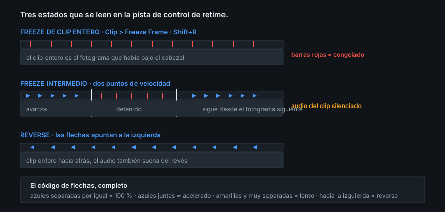

# Freeze frame y reverse

> Congelar y rebobinar son los dos retimes que no cambian de ritmo: cambian de **estado**. El plano
> deja de avanzar, o avanza al revés. Los dos son fáciles de hacer y fáciles de hacer mal, y los
> dos tienen un detalle técnico que sorprende la primera vez.

## 🎯 Objetivos

- Congelar un plano entero y saber en qué fotograma se congela
- Congelar solo un tramo dentro de un plano, sin congelar el resto
- Distinguir el fotograma congelado de la imagen fija importada, y saber cuándo usar cada una
- Invertir un plano entero y un tramo de un plano
- Predecir qué le pasa al audio en cada uno de los cuatro casos
- Quitar un freeze o un reverse sin tocar nada más del clip

---

## 1. Qué problema resuelve

Un **fotograma congelado** (*freeze frame*) resuelve tres cosas concretas:

1. **Detener la acción** en el instante exacto en el que pasa algo, para que se lea
2. **Alargar un plano que no da**, cuando lo que se ve al final es un plano quieto de todas formas
3. **Sostener una imagen** debajo de un rótulo, un crédito o un cartel de sección

Un plano **invertido** (*reverse*) resuelve dos:

1. **Devolver algo a su sitio**: la taza que se recompone, el humo que vuelve al cigarro
2. **Convertir una salida en una entrada**: alguien que sale de cuadro, del revés, entra

Los dos son efectos con fecha de caducidad: gastados una vez en una pieza de cinco minutos,
funcionan; gastados cinco veces, son un tic.

---

## 2. Cómo funciona

### 2.1 Los dos tipos de freeze

No son lo mismo y no se hacen igual:

| Tipo | Qué congela | Cómo se hace |
| ---- | ----------- | ------------ |
| **Freeze de clip entero** | El clip completo pasa a ser una sola imagen | `Clip > Freeze Frame`, atajo `Shift+R` |
| **Freeze intermedio** | Un tramo dentro del clip; antes y después sigue habiendo movimiento | Dos puntos de velocidad en los `Retime Controls` |

El primero es un cambio de velocidad lineal: el clip entero al 0 %. El segundo es un cambio de
velocidad **variable**, y arrastra su consecuencia: **el audio del clip se silencia**.

### 2.2 Qué fotograma se congela

El que esté **bajo el cabezal** en el momento de dar la orden. No el primero del clip, no el que
tengas seleccionado en el media pool: el que estés viendo.

Esto es lo que hace que un freeze salga bien o mal, y es lo que hay que colocar con cuidado:

1. Cabezal aproximadamente donde quieres
2. `Flecha izquierda` y `Flecha derecha` para moverte fotograma a fotograma
3. Ahora sí, `Shift+R`

Un fotograma antes o después cambia el gesto que se congela. En un salto, la diferencia entre el
punto más alto y el fotograma siguiente son cuatro centímetros de altura.

### 2.3 Freeze frame frente a imagen fija

Se parecen en el resultado y no se parecen en nada más:

| | Fotograma congelado | Imagen fija importada |
| - | ------------------- | --------------------- |
| **De dónde sale** | Del propio plano | De un archivo `.jpg`, `.png`, `.tif`… |
| **Calidad** | La del vídeo: comprimida y con el movimiento borroso del obturador | La del archivo |
| **Coincide con el plano** | Exactamente: es el mismo fotograma | Casi nunca |
| **Se usa para** | Detener la acción dentro de la pieza | Un plano de recurso que no se rodó |

Para detener la acción, siempre el fotograma congelado: es el único que continúa el plano sin
salto. Una foto del mismo sitio, aunque sea mejor, se nota como un corte.

> [!NOTE]
> El fotograma congelado hereda el **movimiento borroso** que llevara grabado ese fotograma. Un
> plano de acción congelado en mitad de un movimiento rápido sale borroso, y no hay ajuste que lo
> arregle: la nitidez no estaba grabada. Si el freeze tiene que verse nítido, elige un fotograma
> en el que la acción esté parada, o graba ese plano con obturador rápido.

### 2.4 El reverse y sus flechas

Un plano invertido se reconoce **sin abrir nada**: en la pista de control de retime, las flechas
apuntan a la **izquierda** en vez de a la derecha.

Ese código de flechas es el mismo que se usa para todo lo demás:

| Flechas | Significa |
| ------- | --------- |
| Azules, separadas por igual, hacia la derecha | 100 %, velocidad normal |
| Azules, **juntas**, hacia la derecha | Acelerado, por encima del 100 % |
| **Amarillas**, separadas, hacia la derecha | Ralentizado, por debajo del 100 % |
| Azules, hacia la **izquierda** | Reverse |

### 2.5 Qué le pasa al audio, caso por caso

| Caso | El audio |
| ---- | -------- |
| Freeze de clip entero | Se retima con el vídeo: en la práctica, enmudece |
| Freeze intermedio (velocidad variable) | **Silenciado**, todo el clip |
| Reverse del clip entero (velocidad lineal) | Se reproduce **hacia atrás** |
| Reverse de un tramo (velocidad variable) | **Silenciado**, todo el clip |

La conclusión práctica es siempre la misma: **si el sonido de ese plano importa, sácalo a otra
pista antes de retimarlo**. `Alt` (Win) / `Opt` (Mac) + clic desengancha el audio del vídeo solo
para ese clic, como en la Semana 09.

---

## 3. Cómo se hace en Resolve 21

### 3.1 Congelar un clip entero

1. Coloca el cabezal sobre el fotograma exacto, ajustando con las flechas
2. Selecciona el clip
3. `Clip > Freeze Frame`, atajo `Shift+R`

El clip entero pasa a ser ese fotograma. Su duración no cambia.

Para quitarlo: `Clip > Change Clip Speed` y desmarca la casilla `Freeze Frame`. También sirve
`Edit > Remove Attributes` marcando el atributo de velocidad.

### 3.2 Congelar un tramo dentro de un clip

1. `Ctrl+R` (Win) / `Cmd+R` (Mac) — abre los `Retime Controls` sobre el clip
2. Lleva el cabezal al fotograma que quieres congelar
3. En el desplegable de velocidad —el que está abajo en el centro del clip y enseña el
   porcentaje—, elige `Freeze Frame`
4. Aparecen **dos puntos de velocidad** y, entre ellos, unas **barras rojas verticales** en la
   pista de control: ese es el tramo congelado
5. Arrastra el segundo punto para decidir cuánto dura la congelación

Pasado el segundo punto, el plano sigue **desde el fotograma siguiente**, no desde el principio.

### 3.3 Invertir un clip entero

Dos caminos que hacen lo mismo:

- `Clip > Change Clip Speed` y marca `Reverse Speed`
- `Inspector > Video > Speed Change > Direction` y el botón de hacia atrás

### 3.4 Invertir un tramo

1. `Ctrl+R` / `Cmd+R`
2. Con los puntos de velocidad ya puestos alrededor del tramo, abre su desplegable
3. `Reverse Segment`

### 3.5 Cerrar los controles sin deshacer nada

Los `Retime Controls` abiertos ocupan el clip y se tocan sin querer con el ratón. Cerrarlos **no
deshace nada**:

- El botón `X` de la esquina superior izquierda del recuadro de retime
- La tecla `Esc`
- `Ctrl+R` / `Cmd+R` otra vez, con el clip seleccionado

Con los controles cerrados, el clip conserva su distintivo de retime a la izquierda del nombre.

---

## 4. Antipatrones

| Antipatrón | Por qué duele | Qué hacer |
| ---------- | ------------- | --------- |
| Congelar sin ajustar el cabezal al fotograma | Se congela el gesto de al lado, que no es el bueno | Flechas izquierda y derecha antes de `Shift+R` |
| Congelar un fotograma en pleno movimiento rápido | Sale borroso y parece un fallo técnico | Elige un fotograma con la acción parada |
| Congelar el último fotograma para alargar un plano | El corte a la imagen quieta se nota siempre | Si el plano no da, es que falta plano |
| Buscar el audio de un freeze intermedio | Está silenciado por diseño | Duplica el audio en otra pista antes de congelar |
| Invertir un plano con alguien hablando | El habla al revés es inconfundible y saca de la pieza | Solo se invierten planos sin voz |
| Invertir un plano con humo, agua o polvo | El movimiento del aire hacia atrás se nota aunque no sepas por qué | Compruébalo mirando, no dando por hecho |
| Dejar los `Retime Controls` abiertos toda la semana | Un arrastre accidental cambia una velocidad y no te enteras | `Esc` en cuanto termines con cada clip |
| Usar el freeze como recurso de estilo | La tercera vez ya no significa nada | Uno por pieza, dos como mucho |

---

## 5. Trucos

| Truco | Cómo |
| ----- | ---- |
| Congelar el clip entero | `Shift+R` |
| Colocar el cabezal al fotograma | `Flecha izquierda` y `Flecha derecha` |
| Congelar solo un tramo | `Ctrl+R` / `Cmd+R` y `Freeze Frame` en el desplegable de velocidad |
| Invertir el clip entero | `Change Clip Speed` y `Reverse Speed` |
| Invertir un tramo | `Reverse Segment` en el desplegable de ese tramo |
| Saber si un plano va al revés sin abrir nada | Las flechas de la pista de retime apuntan a la izquierda |
| Cerrar los controles sin deshacer | `Esc` |
| Quitar el freeze conservando lo demás | `Change Clip Speed` y desmarca `Freeze Frame` |
| Copiar el mismo retime a otro clip | `Edit > Paste Attributes` — `Alt+V` (Win) / `Opt+V` (Mac)—, con su casilla `Ripple Sequence` |
| Salvar el sonido de un plano que vas a congelar | `Alt` (Win) / `Opt` (Mac) + clic para desengancharlo, y súbelo a otra pista |

---

## 📚 Recursos Adicionales

- [DaVinci Resolve Reference Manual](https://www.blackmagicdesign.com/support/family/davinci-resolve-and-fusion) — capítulo 58, secciones «Creating Freeze Frames», «Creating Variable Speed Effects Using the Retime Controls» y «Closing Retime Controls».
- [Semana 01 · Obturador y desenfoque de movimiento](../../week-01-fundamentos_de_imagen_en_movimiento/1-teoria/03-obturador-y-desenfoque-de-movimiento.md) — por qué un freeze sale borroso.
- [Semana 09 · Trim asimétrico y split edits](../../week-09-trimming_quirurgico/1-teoria/08-trim-asimetrico-y-split-edits.md) — el `Alt` / `Opt` + clic que desengancha imagen y sonido.
- [04 · Velocidad variable: rampas y rewind](04-velocidad-variable-rampas-y-rewind.md) — los puntos de velocidad, en su archivo.

---

## ✅ Checklist de Verificación

- [ ] Sé congelar un clip entero y sé qué fotograma se congela
- [ ] Sé congelar solo un tramo, con dos puntos de velocidad
- [ ] Sé por qué un freeze puede salir borroso y qué hacer
- [ ] Sé cuándo usar un fotograma congelado y cuándo una imagen fija
- [ ] Sé invertir un clip entero y un tramo
- [ ] Sé leer las flechas de la pista de retime
- [ ] Sé qué le pasa al audio en los cuatro casos
- [ ] Sé cerrar los `Retime Controls` sin deshacer nada

---

| Anterior | Actual | Siguiente |
| -------- | ------ | --------- |
| [02 · Las cuatro formas de cambiar la velocidad](02-las-cuatro-formas-de-cambiar-la-velocidad.md) | **03 · Freeze frame y reverse** | [04 · Velocidad variable: rampas y rewind](04-velocidad-variable-rampas-y-rewind.md) |

← [Volver a la Semana 10](../README.md)
