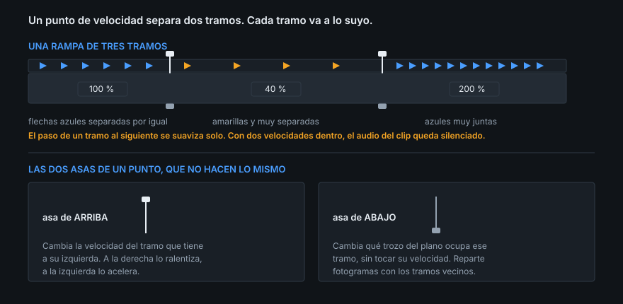

# Velocidad variable: rampas y rewind

> Hasta aquí, un clip tenía una velocidad. A partir de aquí puede tener cinco. Los puntos de
> velocidad parten el clip en tramos y cada tramo va a lo suyo: es la diferencia entre «este plano
> va lento» y «este plano se para justo aquí y luego arranca».

## 🎯 Objetivos

- Explicar qué es un punto de velocidad y qué separa exactamente
- Crear un efecto de velocidad variable de tres tramos, desde cero
- Distinguir el asa de arriba del asa de abajo de un punto, que hacen cosas distintas
- Usar los presets `Rewind` y `Speed Ramp` y saber qué colocan
- Leer un efecto variable mirando las flechas, sin abrir ningún panel
- Borrar un punto de velocidad y saber cuál se borra

---

## 1. Qué problema resuelve

Un cambio de velocidad lineal responde a «este plano dura de más». Un cambio de velocidad variable
responde a otra pregunta distinta: **«quiero que el espectador mire aquí»**.

Una **rampa de velocidad** (*speed ramp*) es el plano que va a velocidad normal, frena justo antes
del golpe, lo enseña despacio y vuelve a arrancar. No cambia lo que se ve: cambia **dónde cae la
atención**. Es el recurso más gastado del vídeo de internet y sigue funcionando cuando se usa una
vez y en el sitio correcto.

Un **rewind** es el plano que se ve, se rebobina a toda velocidad y se vuelve a ver. Se usa para
repetir algo que pasó muy rápido, y para el chiste visual.

Los dos se construyen con la misma pieza: los **puntos de velocidad**.

---

## 2. Cómo funciona

### 2.1 Qué es un punto de velocidad

Un **punto de velocidad** (*speed point*) es una marca vertical dentro del clip que separa dos
tramos. A cada lado puede haber una velocidad distinta.

Reglas que conviene tener claras desde el principio:

- Hacen falta **dos puntos como mínimo** para tener un efecto: uno solo no separa nada
- Cada tramo tiene su propio desplegable de velocidad, con su propio porcentaje
- El paso de un tramo al siguiente **se suaviza automáticamente**. Resolve no pega un salto de
  velocidad: lo acelera o lo frena de forma gradual
- En cuanto hay dos velocidades distintas dentro de un clip, **su audio se silencia**

### 2.2 Las dos asas de un punto, que no hacen lo mismo

Esto es lo que más confunde de los `Retime Controls`, y es donde la gente abandona:

| Asa | Dónde está | Qué hace al arrastrarla |
| --- | ---------- | ----------------------- |
| **De arriba** | En la pista de control de retime, encima del clip | Cambia la **velocidad** del tramo que tiene a su izquierda. Arrastrar a la derecha lo ralentiza; a la izquierda, lo acelera |
| **De abajo** | En la base del punto | Cambia **qué trozo del plano** ocupa ese tramo, manteniendo su velocidad. Reparte fotogramas con los tramos vecinos |

Dicho en corto: **arriba cambias a qué velocidad va; abajo cambias cuánto plano va a esa
velocidad**. Las dos alargan o acortan el clip, pero por motivos distintos y en cantidades
distintas.

### 2.3 Los dos presets

Resolve trae dos submenús que colocan varios puntos de golpe. No hacen nada que no puedas hacer a
mano; hacen que tardes diez segundos en vez de dos minutos.

**`Rewind`** — añade **dos puntos** después del punto más a la derecha del tramo actual. El
resultado: el tramo se reproduce hacia atrás y a toda velocidad, y luego se vuelve a reproducir
desde el principio. Se elige el porcentaje de la marcha atrás en el propio submenú.

Dónde empieza el tramo rebobinado depende del cabezal:

- Cabezal **dentro** del tramo → el rebobinado va desde el final del tramo hasta el cabezal
- Cabezal **fuera** → va desde el principio del tramo

**`Speed Ramp`** — sustituye el efecto de velocidad actual por **cinco tramos** que arrancan al
**10 %** y suben progresivamente al **30 %**, **50 %**, **70 %** y **90 %**. Hay dos opciones en
el submenú, según en qué sentido quieras la rampa. Después se arrastran los puntos para ajustar
las duraciones.

> [!IMPORTANT]
> `Speed Ramp` **sustituye** el efecto de velocidad que hubiera en el clip, no se suma a él. Si ya
> habías colocado puntos a mano, desaparecen. Aplícalo primero y ajusta después, nunca al revés.

### 2.4 Leer un efecto variable de un vistazo

La pista de control de retime dibuja lo que pasa sin que tengas que abrir nada:

| Lo que ves | Qué significa |
| ---------- | ------------- |
| Flechas azules, separadas por igual | 100 % |
| Flechas azules **juntas** | Acelerado |
| Flechas **amarillas** y **muy separadas** | Ralentizado |
| Flechas hacia la **izquierda** | Ese tramo va del revés |
| **Barras rojas verticales** | Tramo congelado |
| Un número en el desplegable de cada tramo | La velocidad exacta de ese tramo |

Cuanto más separadas las flechas, más lento. Es una regla que se lee sin pensar en cuanto la sabes.

---

## 3. Cómo se hace en Resolve 21

### 3.1 Abrir y cerrar los controles

- **Abrir**: selecciona el clip y `Clip > Retime Controls`, atajo `Ctrl+R` (Win) / `Cmd+R` (Mac).
  También con clic derecho sobre el clip `> Retime Clip`
- **Cerrar**: el botón `X` del recuadro, la tecla `Esc`, o `Ctrl+R` / `Cmd+R` otra vez

Cerrarlos no deshace nada. Es solo para no tocar el clip sin querer.

### 3.2 Construir una rampa a mano, en cinco pasos

1. `Ctrl+R` / `Cmd+R` sobre el clip
2. Cabezal en el fotograma donde quieres que **empiece** a frenar. Abre el desplegable de
   velocidad y elige `Add Speed Point`
3. Cabezal donde quieres que **acabe** de ir despacio. `Add Speed Point` otra vez
4. Abre el desplegable **del tramo del medio** y elige el porcentaje en el submenú
   `Change Speed`. También vale arrastrar el asa de arriba del segundo punto
5. `/` para escuchar y ver el resultado en contexto

El paso 4 es donde se decide todo. El porcentaje del tramo lento tiene el mismo techo que
cualquier otro retime: la [teoría 01](01-el-techo-de-la-camara-lenta.md) sigue mandando.

### 3.3 Cambiar la velocidad de un tramo, tres caminos

| Camino | Cuándo |
| ------ | ------ |
| Arrastrar el **asa de arriba** del punto de la derecha del tramo | Cuando lo estás buscando a ojo |
| Desplegable del tramo `> Change Speed >` y el valor | Cuando ya sabes el número |
| Desplegable del tramo `> Reverse Segment` | Para que ese tramo vaya del revés |

### 3.4 Aplicar un preset

Con los controles abiertos, en **cualquier** desplegable de velocidad del clip:

- `Rewind >` y el porcentaje
- `Speed Ramp >` y una de las dos opciones

### 3.5 Borrar un punto de velocidad

Desplegable de velocidad `> Clear Speed Point`.

> [!WARNING]
> `Clear Speed Point` borra **el punto que está a la izquierda del desplegable que has abierto**,
> no el que tengas más cerca del ratón ni el último que pusiste. Si borras el que no era,
> `Ctrl+Z` y ábrelo desde el desplegable correcto.

### 3.6 Volver el clip al 100 %

Desplegable de velocidad `> Reset to 100%`. Se van todos los puntos y todos los tramos.

---

## 4. Antipatrones

| Antipatrón | Por qué duele | Qué hacer |
| ---------- | ------------- | --------- |
| Poner un punto y esperar que pase algo | Un punto solo no separa nada | Hacen falta dos como mínimo |
| Arrastrar el asa de abajo creyendo que cambia la velocidad | Cambia el reparto de fotogramas y la velocidad se queda igual | Arriba la velocidad, abajo el reparto |
| Aplicar `Speed Ramp` sobre puntos ya colocados | Los sustituye, no los respeta | Primero el preset, luego los ajustes |
| Rampas en la mitad de los planos | Deja de ser un acento y pasa a ser un tic | Una o dos por pieza |
| Frenar **en** el golpe en vez de **antes** | Cuando la imagen frena, el golpe ya pasó | El tramo lento empieza unos fotogramas antes |
| Rampas con la pieza ya sonorizada | El audio del clip se silencia y te quedas sin ese sonido | Saca el audio a otra pista primero |
| Rampas por debajo del techo del plano | El tramo lento sale a tirones y arruina el efecto | Calcula el techo antes de elegir el porcentaje |
| Dejar los controles abiertos en veinte clips | Un arrastre accidental y ya no sabes cuál cambió | `Esc` al terminar cada uno |

---

## 5. Trucos

| Truco | Cómo |
| ----- | ---- |
| Abrir o cerrar los controles de retime | `Ctrl+R` (Win) / `Cmd+R` (Mac) |
| Cerrarlos sin deshacer nada | `Esc` |
| Añadir un punto donde está el cabezal | Desplegable de velocidad `> Add Speed Point` |
| Cambiar la velocidad de un tramo por número | Desplegable del tramo `> Change Speed >` |
| Invertir solo un tramo | `Reverse Segment` |
| Rampa de cinco tramos en un clic | `Speed Ramp >` en cualquier desplegable |
| Rebobinado automático | `Rewind >` y el porcentaje |
| Decidir dónde empieza el rebobinado | Coloca el cabezal dentro del tramo antes de aplicarlo |
| Ver la velocidad de cada tramo sin abrir nada | Las flechas: juntas rápido, separadas y amarillas lento |
| Borrar el punto correcto | Abre el desplegable que está a su derecha y `Clear Speed Point` |
| Empezar de cero | `Reset to 100%` |
| Comprobar la rampa en contexto | `/` reproduce alrededor de la selección |

---

## 📚 Recursos Adicionales

- [DaVinci Resolve Reference Manual](https://www.blackmagicdesign.com/support/family/davinci-resolve-and-fusion) — capítulo 58, secciones «Clip Retiming Controls», «Reading Clip Speed Arrows» y «Creating Variable Speed Effects Using the Retime Controls».
- [Semana 07 · Cambios de velocidad](../../week-07-cut_page_acabado_y_quick_export/1-teoria/05-cambios-de-velocidad.md) — donde se mencionó `Add Speed Point` y se dejó para esta semana.
- [05 · Las curvas de retime](05-las-curvas-de-retime.md) — la otra cara del mismo efecto, con control fino sobre la aceleración.
- [06 · Cómo Resolve inventa los fotogramas que faltan](06-como-resolve-inventa-fotogramas.md) — de qué depende que el tramo lento se vea bien.

---

## ✅ Checklist de Verificación

- [ ] Sé qué es un punto de velocidad y por qué hacen falta dos
- [ ] Sé qué hace el asa de arriba y qué hace el asa de abajo
- [ ] Sé construir una rampa de tres tramos a mano
- [ ] Sé qué coloca `Speed Ramp` y qué coloca `Rewind`
- [ ] Sé que `Speed Ramp` sustituye lo que hubiera
- [ ] Sé leer las flechas y las barras rojas de la pista de retime
- [ ] Sé qué punto borra `Clear Speed Point`
- [ ] Sé que un efecto variable silencia el audio del clip

---

| Anterior | Actual | Siguiente |
| -------- | ------ | --------- |
| [03 · Freeze frame y reverse](03-freeze-frame-y-reverse.md) | **04 · Velocidad variable: rampas y rewind** | [05 · Las curvas de retime](05-las-curvas-de-retime.md) |

← [Volver a la Semana 10](../README.md)
