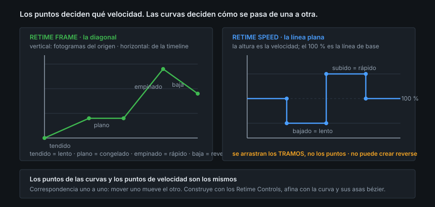

# Las curvas de retime

> Los puntos de velocidad deciden **qué** velocidad tiene cada tramo. Las curvas deciden **cómo se
> pasa** de una a otra. Es la diferencia entre una rampa que funciona y una rampa que se nota, y es
> el único sitio donde ese paso se controla de verdad.

## 🎯 Objetivos

- Abrir las dos curvas de retime y saber cuál estás mirando
- Leer una curva `Retime Frame` y decir, mirándola, qué hace el plano
- Leer una curva `Retime Speed` y hacer lo mismo
- Saber cuál de las dos permite invertir el movimiento y cuál no
- Ajustar la aceleración de un cambio de velocidad con las asas bézier
- Elegir entre trabajar con puntos o con curvas según el problema

---

## 1. Qué problema resuelve

Haces una rampa con los `Retime Controls`: el plano va al 100 %, baja al 40 % y vuelve al 100 %.
La miras y algo no está bien. No es la velocidad del tramo lento —esa está bien elegida—: es que
**frena de golpe**, o que **tarda demasiado en frenar**.

Los puntos de velocidad no tienen ningún control para eso. Resolve suaviza el paso de un tramo al
siguiente automáticamente, con la cantidad que él decide, y ahí se acaba lo que puedes hacer.

Las curvas de retime son ese control. Y de paso son la otra forma de construir el efecto entero,
para quien piense mejor en gráficos que en tramos.

---

## 2. Cómo funciona

### 2.1 Una idea antes de las curvas: el gráfico de tiempo

Un retime es, en el fondo, una **correspondencia**: qué fotograma del archivo original se enseña
en cada fotograma de la timeline.

Si dibujas eso en un gráfico con los fotogramas del origen en vertical y los de la timeline en
horizontal, a velocidad normal sale una **diagonal perfecta**: fotograma 1 con fotograma 1,
fotograma 2 con fotograma 2. Cambiar la velocidad es cambiar la inclinación de esa línea.

Eso es exactamente la curva `Retime Frame`, y es un gráfico que existe igual en casi todos los
programas de montaje.

### 2.2 `Retime Frame`: la diagonal

| Lo que ves | Qué hace el plano |
| ---------- | ----------------- |
| Diagonal recta de esquina a esquina | 100 % |
| Tramo **poco inclinado**, largo y tendido | Cámara lenta: muchos fotogramas de timeline para pocos de origen |
| Tramo **muy inclinado**, corto y empinado | Acelerado |
| Tramo **plano**, horizontal | Congelado: el mismo fotograma de origen durante varios de timeline |
| Tramo que **baja** en vez de subir | Reverse |

La regla completa, tal y como la enuncia el manual: para dos puntos de control cualesquiera, si el
de la izquierda está **más abajo** que el de la derecha, hay movimiento hacia delante. Si está más
arriba, ese tramo va del revés.

### 2.3 `Retime Speed`: la línea plana

La otra curva enseña directamente la velocidad. Una línea horizontal a la altura del 100 %.

| Lo que haces | Qué pasa |
| ------------ | -------- |
| **Subes** un tramo | Se acelera, y ese tramo **se acorta** |
| **Bajas** un tramo | Se ralentiza, y ese tramo **se alarga** |

Y una particularidad que hay que saber antes de intentarlo:

> [!IMPORTANT]
> En la curva `Retime Speed` se arrastran **los tramos, no los puntos de control**. Arrastrar un
> punto no cambia la velocidad. Y hay algo que esta curva **no puede hacer**: crear movimiento
> invertido. Para un reverse hay que usar los `Retime Controls` o la curva `Retime Frame`.

Mientras arrastras un tramo, un rótulo emergente te dice el porcentaje exacto. Es la forma más
cómoda de poner un tramo en un número redondo.

### 2.4 Las dos curvas y los puntos son lo mismo

No son tres efectos distintos: son tres vistas del mismo efecto.

Los puntos de control de las curvas tienen una **correspondencia uno a uno** con los puntos de
velocidad de los `Retime Controls`. Si tienes las dos cosas abiertas a la vez, mover un punto en
una mueve el otro en la otra.

De ahí sale la forma sensata de trabajar:

1. **Los `Retime Controls` para construir**: los tramos y sus velocidades
2. **La curva para afinar**: cómo se entra y cómo se sale de cada cambio

### 2.5 Las asas bézier: dónde está el control fino

Cada punto de control de una curva puede llevar dos **asas** (*handles*) que estiran la curva a
sus lados. Con ellas se decide la **aceleración**: si el cambio de velocidad entra de golpe o poco
a poco.

Una **curva bézier** es una curva definida por sus extremos y por esas asas. No hay que saber la
matemática: hay que saber que **alargar el asa suaviza y acortarla endurece**.

En una rampa, esto es lo que separa las dos sensaciones:

| Asas | Cómo se siente |
| ---- | -------------- |
| Cortas, casi sin curva | El plano frena de golpe. Sirve para un impacto |
| Largas, curva muy tendida | El plano se va deteniendo. Sirve para un gesto |

---

## 3. Cómo se hace en Resolve 21

### 3.1 Abrir las curvas de retime

El manual da el procedimiento exacto:

1. Selecciona el clip en la timeline
2. Abre la pestaña **`Keyframes`** en la parte superior de la interfaz
3. Pulsa el icono de **curvas** (`Keyframe Curves`) para pasar del `Keyframe Editor` al
   `Curve Editor`
4. En la lista de parámetros, marca **`Retime Speed`** y **`Retime Frame`**

A partir de ahí se editan como cualquier otra curva: se añaden, se mueven y se borran puntos de
control.

> [!NOTE]
> Es el **mismo** `Curve Editor` de la [teoría 08](08-keyframes-inspector-y-curve-editor.md), el
> que sirve para animar el zoom o la posición. El retime no tiene un editor propio: aparece como
> dos parámetros más en la lista.

### 3.2 Añadir un punto a una curva

`Alt` (Win) / `Opt` (Mac) + clic sobre la curva.

También está el icono `Add Keyframes` en la barra de herramientas del editor, que deja poner
varios seguidos haciendo clic.

### 3.3 Cambiar la velocidad de un tramo

- En **`Retime Frame`**: arrastra un punto de control hacia arriba o hacia abajo. Cambias qué
  fotograma de origen cae ahí, y con eso la inclinación de los dos tramos que tocan ese punto
- En **`Retime Speed`**: arrastra **el tramo** hacia arriba o hacia abajo, y lee el porcentaje en
  el rótulo emergente

### 3.4 Suavizar o endurecer un cambio

1. Selecciona el punto de control donde cambia la velocidad
2. Si no tiene asas, cambia su interpolación a suave desde el menú contextual del punto
3. Arrastra las asas: más largas, más suave

### 3.5 Volver atrás

Un clip con curvas de retime sigue siendo un clip con puntos de velocidad. `Reset to 100%` desde
el desplegable de los `Retime Controls` lo devuelve todo al principio, curvas incluidas.

---

## 4. Antipatrones

| Antipatrón | Por qué duele | Qué hacer |
| ---------- | ------------- | --------- |
| Buscar el reverse en la curva `Retime Speed` | No lo tiene: es una limitación del gráfico, no un fallo | `Retime Controls` o curva `Retime Frame` |
| Arrastrar puntos en `Retime Speed` esperando cambiar la velocidad | En esa curva se arrastran los tramos | Agarra la línea entre dos puntos |
| Construir el efecto entero en la curva desde cero | Se tarda el triple y sale peor | Puntos para construir, curva para afinar |
| Poner asas larguísimas en todo | El plano parece que flota; se pierde el acento | Asa larga para un gesto, corta para un impacto |
| Tocar la curva con el clip sin seleccionar | El editor enseña otra cosa y no entiendes qué pasa | Selecciona el clip primero: el editor es por clip |
| Confundir el gráfico de fotogramas con el de velocidad | Se interpreta al revés: lo plano es congelado, no lento | Mira qué parámetro tienes marcado en la lista |
| Afinar curvas antes de decidir las velocidades | Se afina algo que va a cambiar | Primero el qué, después el cómo |

---

## 5. Trucos

| Truco | Cómo |
| ----- | ---- |
| Abrir las curvas de retime | Pestaña `Keyframes` `>` icono de curvas `>` marca `Retime Speed` y `Retime Frame` |
| Añadir un punto de control | `Alt` (Win) / `Opt` (Mac) + clic sobre la curva |
| Poner varios puntos seguidos | El icono `Add Keyframes` de la barra del editor |
| Saber el porcentaje exacto de un tramo | Arrastra el tramo en `Retime Speed` y lee el rótulo emergente |
| Ver la curva y los puntos a la vez | Abre los `Retime Controls` con el `Curve Editor` abierto: se mueven juntos |
| Distinguir congelado de lento en `Retime Frame` | Congelado es horizontal; lento es poco inclinado, pero sube |
| Endurecer una entrada de rampa | Acorta el asa del punto donde empieza a frenar |
| Empezar de cero sin cerrar nada | `Reset to 100%` en el desplegable de velocidad |

---

## 📚 Recursos Adicionales

- [DaVinci Resolve Reference Manual](https://www.blackmagicdesign.com/support/family/davinci-resolve-and-fusion) — capítulo 58, sección «Using Retime Curves», con las capturas de las dos curvas y sus casos.
- [08 · Keyframes: Inspector, Keyframe Editor y Curve Editor](08-keyframes-inspector-y-curve-editor.md) — el editor donde viven estas curvas, explicado entero.
- [04 · Velocidad variable: rampas y rewind](04-velocidad-variable-rampas-y-rewind.md) — la otra vista del mismo efecto.

---

## ✅ Checklist de Verificación

- [ ] Sé abrir el `Curve Editor` y exponer `Retime Speed` y `Retime Frame`
- [ ] Sé leer una curva `Retime Frame`: lento, rápido, congelado y del revés
- [ ] Sé que en `Retime Speed` se arrastran los tramos, no los puntos
- [ ] Sé que `Retime Speed` no puede crear movimiento invertido
- [ ] Sé que los puntos de la curva y los de velocidad son los mismos
- [ ] Sé para qué sirven las asas bézier de un punto de control
- [ ] Sé cuándo usar los puntos y cuándo la curva

---

| Anterior | Actual | Siguiente |
| -------- | ------ | --------- |
| [04 · Velocidad variable: rampas y rewind](04-velocidad-variable-rampas-y-rewind.md) | **05 · Las curvas de retime** | [06 · Cómo Resolve inventa los fotogramas que faltan](06-como-resolve-inventa-fotogramas.md) |

← [Volver a la Semana 10](../README.md)
