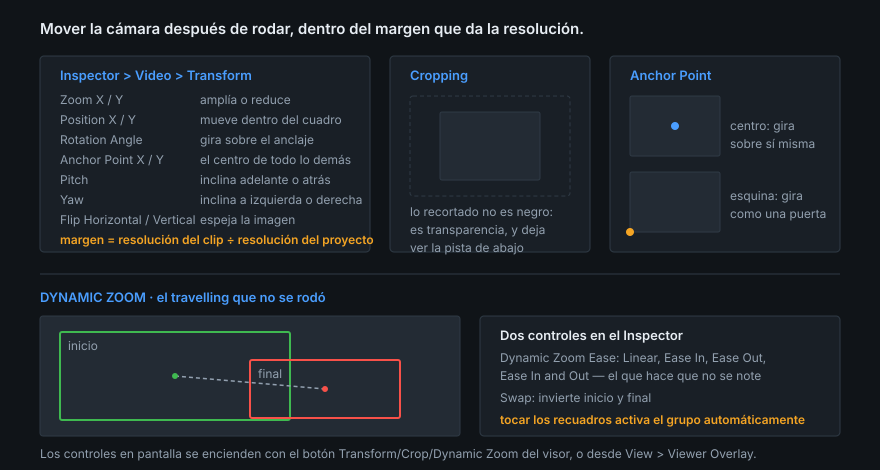

# Transform, crop y dynamic zoom

> Reencuadrar es mover la cámara después de rodar. Se puede, dentro de un límite muy concreto, y
> ese límite es la resolución del plano. Este archivo es el mapa del grupo `Transform` del
> Inspector: qué hace cada parámetro, cuánto se puede empujar y a partir de dónde se ve.

## 🎯 Objetivos

- Nombrar los parámetros del grupo `Transform` y decir qué mueve cada uno
- Explicar qué es el punto de anclaje y por qué cambia el resultado de una rotación
- Recortar un plano y saber que el recorte crea transparencia, no negro
- Usar `Dynamic Zoom` para un movimiento de cámara falso, con sus dos recuadros
- Saber a partir de qué ampliación se empieza a ver la pérdida de nitidez
- Distinguir estas transformaciones de las de la Color page, que son otras

---

## 1. Qué problema resuelve

Un plano está mal encuadrado: hay demasiado aire arriba, o el sujeto está descentrado, o entra un
enchufe por la esquina. Se rodó así y no se puede volver a rodar.

Otro plano es correcto pero **estático**, y en la pieza pide un movimiento suave hacia dentro.

Un tercero está a 4K y la pieza es HD: hay margen para ampliar sin perder un solo píxel.

Los tres se resuelven en el mismo sitio: el grupo `Transform` del Inspector de vídeo. Es la
herramienta que más se usa de esta semana y la que menos tiene que notarse.

---

## 2. Cómo funciona

### 2.1 Resolve es independiente de la resolución

Antes de tocar nada, la idea que lo explica todo: **Resolve es independiente de la resolución**
(*resolution independent*). Puedes mezclar clips 4K, HD y SD en la misma timeline, y cada uno se
escala a la resolución del proyecto cuando toca.

La consecuencia práctica es la que importa esta semana:

> [!IMPORTANT]
> Un plano grabado a **3840 × 2160** en un proyecto **1920 × 1080** admite un `Zoom` de hasta
> **2,0** sin perder ni un píxel de nitidez: le sobra el doble de resolución en cada eje. Un plano
> grabado a 1920 × 1080 en el mismo proyecto empieza a perder nitidez **en cuanto pasas de 1,0**.
>
> El cálculo es una división: `resolución del clip ÷ resolución del proyecto`. Escríbelo antes de
> ampliar.

### 2.2 Los parámetros de `Transform`

Están en `Inspector > Video > Transform`, y son los mismos que el modo `Edit Sizing` de la paleta
`Sizing` de la Color page:

| Parámetro | Qué hace |
| --------- | -------- |
| **`Zoom X` / `Zoom Y`** | Amplía o reduce. Los dos ejes van enlazados de fábrica; al soltar el enlace se puede estirar o achatar la imagen |
| **`Position X` / `Position Y`** | Mueve la imagen dentro del cuadro. `X` a los lados, `Y` arriba y abajo |
| **`Rotation Angle`** | Gira la imagen alrededor del punto de anclaje |
| **`Anchor Point X` / `Y`** | La coordenada alrededor de la cual ocurre **todo** lo demás |
| **`Pitch`** | Inclina la imagen adelante o atrás, sobre un eje horizontal que la cruza de izquierda a derecha |
| **`Yaw`** | Lo mismo sobre un eje vertical que la cruza de arriba abajo |
| **`Flip Horizontal`** | Espeja la imagen de izquierda a derecha |
| **`Flip Vertical`** | La pone del revés, arriba abajo |

`Pitch` y `Yaw` producen un efecto de perspectiva: valores positivos de `Pitch` alejan la parte de
arriba y acercan la de abajo. Cuanto más alto el valor, más se estira la imagen.

### 2.3 El punto de anclaje, que es donde todo el mundo tropieza

El **punto de anclaje** (*anchor point*) es el punto de la imagen alrededor del cual se aplican el
zoom y la rotación. De fábrica está en el centro.

- Con el anclaje en el centro, una rotación gira la imagen sobre sí misma
- Con el anclaje en una esquina, la misma rotación la hace **girar como una puerta**
- Con el anclaje descentrado, un zoom amplía **hacia** ese punto en vez de hacia el centro

Ahí está el truco útil: para ampliar hacia una cara que está a la izquierda del cuadro, se mueve
el anclaje a la cara y se sube el zoom. Sale a la primera, sin corregir la posición después.

### 2.4 El recorte crea transparencia

`Inspector > Video > Cropping`:

| Parámetro | Qué hace |
| --------- | -------- |
| **`Crop Left`, `Right`, `Top`, `Bottom`** | Cortan cada lado, en píxeles |
| **`Softness`** | Difumina el borde del recorte. En negativo, hacia dentro; en positivo, hacia fuera |

El detalle que hay que saber: **recortar crea transparencia, no negro**. Lo que se ve por el
recorte es **lo que haya en la pista de abajo**. Si no hay nada, se ve negro y parece lo mismo,
pero no lo es: en cuanto pongas algo debajo, asoma.

Esto es un problema cuando no lo sabes y una herramienta cuando sí: es la base de un split screen
y de tapar una esquina con otra toma.

### 2.5 `Dynamic Zoom`: el travelling que no se rodó

`Dynamic Zoom` anima automáticamente un movimiento de un encuadre a otro dentro del mismo plano.
Es lo que se conoce como **efecto Ken Burns**: la panorámica lenta sobre una imagen fija.

Viene **desactivado** de fábrica. Al activarlo aparecen dos controles:

| Control | Qué hace |
| ------- | -------- |
| **`Dynamic Zoom Ease`** | Cómo acelera el movimiento: `Linear`, `Ease In`, `Ease Out`, `Ease In and Out` |
| **`Swap`** | Invierte el principio y el final: lo que era un zoom hacia dentro pasa a ser hacia fuera |

En el visor, con el modo `Dynamic Zoom` activo, se ven **dos recuadros**:

- El **verde** es el encuadre de **inicio**
- El **rojo** es el encuadre de **final**
- Entre los dos, una línea que dibuja la trayectoria del movimiento

> [!NOTE]
> Tocar los recuadros en el visor **activa automáticamente** el grupo `Dynamic Zoom` en el
> Inspector. No hace falta activarlo antes si empiezas por el visor.

`Ease In and Out` es el valor que hace que un `Dynamic Zoom` no parezca un `Dynamic Zoom`: el
movimiento arranca y para suavemente, como pararía una cabeza de trípode.

### 2.6 Los controles en pantalla

El botón `Transform/Crop/Dynamic Zoom`, abajo a la izquierda del visor de timeline, enciende los
controles gráficos. Tiene un desplegable con los tres modos:

| Modo | Qué se puede arrastrar |
| ---- | ---------------------- |
| **`Transform`** | Dentro del recuadro para mover; una esquina para escalar en proporción; un lado para estirar; el tirador del centro para rotar |
| **`Cropping`** | Un tirador por cada lado |
| **`Dynamic Zoom`** | Los dos recuadros, el verde y el rojo, y sus esquinas |

También se eligen desde `View > Viewer Overlay`. El manual precisa que esos comandos **no traen
atajo de fábrica**, pero el overlay que tengas seleccionado se enciende y se apaga con
``Shift+` `` (la tecla de la tilde) o con `View > Viewer Overlay > Toggle On/Off`.

Mientras arrastras, hay **imanes**: el objeto se pega al centro en `X` y en `Y`, y al tercio
exterior del cuadro. `Shift` mientras arrastras un objeto de texto restringe el movimiento a un
solo eje.

### 2.7 Estas transformaciones no son las de la Color page

Hay dos juegos de parámetros de tamaño y posición, y son **independientes**:

| | Edit page | Color page |
| - | --------- | ---------- |
| **Dónde** | `Inspector > Video > Transform` | Paleta `Sizing`, modo `Input Sizing` |
| **Para qué** | El reencuadre de montaje, y lo que se importa por AAF o XML | El pan and scan del etalonador |
| **Se pisan** | No: son dos capas de ajustes distintas | No |

Que sean dos evita que el colorista de la Semana 17 te borre el reencuadre que hiciste hoy. Es un
detalle de flujo de trabajo profesional que conviene saber ya.

---

## 3. Cómo se hace en Resolve 21

### 3.1 Reencuadrar un plano

1. Selecciona el clip en la timeline
2. `Inspector > Video`, grupo `Transform`
3. Sube `Zoom` hasta que el encuadre te sirva
4. Ajusta `Position X` y `Position Y`
5. Comprueba: ¿ha entrado blanking —bordes negros— por algún lado?

Para escribir un valor exacto, clic sobre el número y teclearlo. Para devolver un parámetro a su
valor de fábrica, el icono de reinicio que hay a la derecha del grupo.

### 3.2 Ampliar hacia un punto concreto

1. Mueve `Anchor Point X` / `Y` hasta el punto al que quieres ampliar
2. Sube `Zoom`
3. Retoca `Position` solo si hace falta

### 3.3 Recortar un lado

1. `Inspector > Video`, grupo `Cropping`
2. El lado que toque, en píxeles
3. `Softness` si el borde tiene que difuminarse

### 3.4 Un `Dynamic Zoom` de principio a fin

1. Selecciona el clip
2. Botón `Transform/Crop/Dynamic Zoom` del visor `>` modo `Dynamic Zoom`
3. Coloca el **recuadro verde**: el encuadre con el que empieza
4. Coloca el **recuadro rojo**: el encuadre con el que acaba
5. `Inspector > Video > Dynamic Zoom > Dynamic Zoom Ease` `>` `Ease In and Out`
6. Reproduce. Si el movimiento va al revés de lo que querías, botón `Swap`
7. Apaga el botón del visor cuando termines

### 3.5 Comprobar que no has ampliado de más

1. Visor al 100 % de escala: `Alt+Shift+Z` (Win) / `Opt+Shift+Z` (Mac), o el desplegable de
   porcentaje del visor
2. Mira un borde con detalle fino: una rama, un texto, una reja
3. Si se ve blando comparado con el plano de al lado, has pasado el margen del clip

---

## 4. Antipatrones

| Antipatrón | Por qué duele | Qué hacer |
| ---------- | ------------- | --------- |
| Ampliar un plano HD en un proyecto HD | Cada punto de zoom por encima de 1,0 es nitidez perdida | Divide resolución del clip entre la del proyecto |
| Reencuadrar mirando el visor pequeño | La pérdida de nitidez no se ve hasta el 100 % | Visor al 100 % antes de decidir |
| Rotar sin mirar el punto de anclaje | La imagen gira alrededor de donde no esperabas | Anclaje primero, rotación después |
| Recortar y creer que el negro es negro | Es transparencia: en cuanto haya algo debajo, asoma | Si quieres negro, pon negro debajo |
| Dynamic Zoom en `Linear` | El movimiento arranca y para de golpe: se nota | `Ease In and Out` |
| Dynamic Zoom en la mitad de los planos | La pieza entera parece que respira | Dos o tres, donde aporten |
| Reencuadrar antes de estabilizar | La estabilización amplía por su cuenta y te descoloca el encuadre | Estabiliza primero, reencuadra después |
| Dejar el botón de transformación encendido | Un clic en el visor mueve un plano sin que te enteres | Apágalo al terminar |
| Buscar el reencuadre en la Color page | Son otros parámetros; los de Edit siguen ahí | `Inspector > Video > Transform` |

---

## 5. Trucos

| Truco | Cómo |
| ----- | ---- |
| Escribir un valor exacto | Clic sobre el número del parámetro y teclea |
| Devolver un grupo a su valor de fábrica | El icono de reinicio a la derecha del nombre del grupo |
| Ampliar hacia una cara descentrada | Mueve el `Anchor Point` a la cara y sube el `Zoom` |
| Estirar o achatar la imagen a propósito | Suelta el enlace entre `Zoom X` y `Zoom Y` |
| Encender los controles gráficos del visor | El botón `Transform/Crop/Dynamic Zoom`, abajo a la izquierda |
| Elegir el modo de overlay por menú | `View > Viewer Overlay` |
| Encender y apagar el overlay que tengas | ``Shift+` `` |
| Que un movimiento se pegue al centro | Los imanes actúan solos al arrastrar |
| Restringir un arrastre de texto a un eje | Mantén `Shift` |
| Invertir el sentido de un dynamic zoom | El botón `Swap` |
| Que el dynamic zoom no parezca un efecto | `Ease In and Out` |
| Copiar el mismo reencuadre a otro clip | `Edit > Paste Attributes` — `Alt+V` (Win) / `Opt+V` (Mac) |
| Poner el visor al 100 % para juzgar la nitidez | `Alt+Shift+Z` (Win) / `Opt+Shift+Z` (Mac) |
| Ver el margen de ampliación de un clip | Resolución del clip ÷ resolución del proyecto |

---

## 📚 Recursos Adicionales

- [DaVinci Resolve Reference Manual](https://www.blackmagicdesign.com/support/family/davinci-resolve-and-fusion) — capítulo 57, secciones «Transform and Cropping in the Video Inspector», «Dynamic Zoom» y «Onscreen Controls for Transform, Crop, and Dynamic Zoom».
- [Semana 01 · Resolución](../../week-01-fundamentos_de_imagen_en_movimiento/1-teoria/04-resolucion.md) — de dónde sale el margen para ampliar.
- [Semana 01 · Aspect ratio y encuadre seguro](../../week-01-fundamentos_de_imagen_en_movimiento/1-teoria/05-aspect-ratio-y-encuadre-seguro.md) — hasta dónde se puede recortar sin comerse lo importante.
- [08 · Keyframes: Inspector, Keyframe Editor y Curve Editor](08-keyframes-inspector-y-curve-editor.md) — cómo se anima cualquiera de estos parámetros.

---

## ✅ Checklist de Verificación

- [ ] Sé nombrar los parámetros de `Transform` y qué hace cada uno
- [ ] Sé calcular cuánto puedo ampliar un plano sin perder nitidez
- [ ] Sé qué es el punto de anclaje y cómo se usa para ampliar hacia un punto
- [ ] Sé que un recorte crea transparencia y no negro
- [ ] Sé montar un `Dynamic Zoom` con sus dos recuadros y su easing
- [ ] Sé encender y apagar los controles del visor
- [ ] Sé que las transformaciones de Edit y las de Color son independientes

---

| Anterior | Actual | Siguiente |
| -------- | ------ | --------- |
| [06 · Cómo Resolve inventa los fotogramas que faltan](06-como-resolve-inventa-fotogramas.md) | **07 · Transform, crop y dynamic zoom** | [08 · Keyframes: Inspector, Keyframe Editor y Curve Editor](08-keyframes-inspector-y-curve-editor.md) |

← [Volver a la Semana 10](../README.md)
