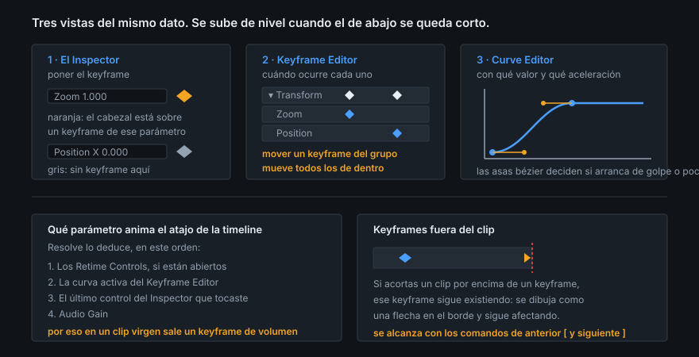

# Keyframes: Inspector, Keyframe Editor y Curve Editor

> Un keyframe dice «en este fotograma, este parámetro vale esto». Dos keyframes con valores
> distintos son un movimiento. Todo lo animado de aquí a la Semana 36 —un zoom, una opacidad, una
> máscara, un volumen— sale de esta idea y de los tres sitios donde se maneja.

## 🎯 Objetivos

- Poner y quitar un keyframe desde el Inspector, que es el sitio básico
- Explicar qué decide qué parámetro se anima al pulsar el atajo de la timeline
- Abrir el `Keyframe Editor` y organizarlo para no ver cuarenta pistas
- Abrir el `Curve Editor` y saber qué enseña que el otro no
- Cambiar la aceleración de un movimiento con las asas de una curva
- Saber que un keyframe puede quedarse fuera del clip, y cómo se recupera

---

## 1. Qué problema resuelve

Con lo de la [teoría 07](07-transform-crop-y-dynamic-zoom.md) puedes reencuadrar un plano. Pero el
reencuadre es **el mismo durante todo el plano**: si el sujeto se mueve, se sale.

Un **keyframe** (*fotograma clave*) resuelve eso. Es una marca que fija el valor de un parámetro
en un fotograma concreto. Pon dos con valores distintos y Resolve calcula todos los intermedios:
eso es **interpolar**, y eso es una animación.

Con keyframes se hace el reencuadre que sigue a alguien —la alternativa en Free al `Smart Reframe`
de Studio—, la entrada suave de un recurso, el zoom que acompaña una frase y, en semanas
posteriores, el movimiento de una máscara o la curva de un volumen.

---

## 2. Cómo funciona

### 2.1 Los tres sitios, y para qué es cada uno

| Sitio | Dónde | Para qué |
| ----- | ----- | -------- |
| **El Inspector** | Rombo gris a la derecha de cada parámetro | Poner el keyframe. El 80 % del trabajo |
| **El `Keyframe Editor`** | Pestaña `Keyframes`, arriba a la izquierda | Ver **cuándo** ocurre cada keyframe y moverlo en el tiempo |
| **El `Curve Editor`** | Icono de curvas dentro del `Keyframe Editor` | Ver **con qué valor y con qué aceleración**, y afinarlo |

Los tres editan lo mismo. Se sube de nivel solo cuando el de abajo se queda corto.

### 2.2 El rombo del Inspector

Cualquier parámetro que se pueda animar tiene un **rombo gris** a la derecha de su deslizador.

| Estado del rombo | Significa |
| ---------------- | --------- |
| **Gris** | Ese parámetro no tiene keyframe en este fotograma |
| **Naranja** | El cabezal está justo sobre un keyframe de ese parámetro |

Cuando el cabezal está sobre un keyframe, aparecen además unas **flechas de navegación** a los
lados del rombo, para saltar al keyframe anterior y al siguiente.

El procedimiento básico, que no cambia nunca:

1. Cabezal donde empieza el movimiento
2. Ajusta el valor y **pulsa el rombo**: ahí queda el primer keyframe
3. Cabezal donde acaba el movimiento
4. Cambia el valor: el segundo keyframe **se pone solo**, porque ya hay animación en ese parámetro
5. Reproduce

El paso 4 sorprende: a partir del primer keyframe, cambiar el valor con el cabezal en otro sitio
crea un keyframe nuevo automáticamente.

### 2.3 Keyframear en la timeline durante la reproducción

Se pueden poner keyframes **mientras la pieza suena**, con el comando `Mark > Add Keyframe`, y
borrarlos con `Mark > Delete Keyframe`. Los dos vienen con atajo asignado; el atajo exacto aparece
al lado del comando en el propio menú `Mark`.

Y aquí está la parte que confunde: **¿qué parámetro se anima?** No lo eliges tú, lo deduce
Resolve. El manual publica el orden de decisión, y es este:

1. Los **`Retime Controls`**, si están abiertos
2. La **curva activa** del `Keyframe Editor`, si está abierto
3. **El último control del Inspector que tocaste**
4. **`Audio Gain`**

Es decir: sobre un clip virgen, sin haber tocado nada, el atajo pone un keyframe de **volumen**.
Si acabas de mover el `Zoom`, pone uno de zoom.

> [!NOTE]
> Ese orden explica el desconcierto clásico: «he pulsado el atajo y me ha salido un keyframe de
> audio». No es un error, es la cuarta regla de la lista. Si quieres control explícito, usa el
> rombo del Inspector o el `Keyframe Editor`.

### 2.4 El `Keyframe Editor`

Se abre desde la pestaña **`Keyframes`**, arriba a la izquierda de la interfaz, en la Cut page y
en la Edit page. Enseña **una pista por cada parámetro animable** del clip seleccionado.

De entrada son muchas. Están **agrupadas por categoría** —`Transform`, `Cropping`, la velocidad—,
con un triángulo de despliegue por grupo. Y hay algo importante en los grupos:

> [!IMPORTANT]
> Mover un keyframe **sobre la pista de un grupo** mueve a la vez todos los keyframes que haya en
> esa posición dentro del grupo. Es cómodo cuando quieres desplazar un movimiento entero, y es un
> desastre cuando creías estar moviendo solo el zoom. Despliega el grupo y trabaja sobre la pista
> del parámetro concreto.

El menú de tres puntos, a la derecha de la columna de parámetros, es lo que hace usable el panel:

| Opción | Qué hace |
| ------ | -------- |
| `Display Parameters with Keyframes` | Solo enseña las pistas que ya tienen algún keyframe |
| `Display All Video Parameters` | Esconde todo lo de audio |
| `Display Selected Parameters` | Casillas para elegir pista por pista |
| `Expand All Parameters` | Abre todos los grupos |
| `Collapse All Parameters` | Los cierra todos |

Cada pista tiene además sus propios controles: visibilidad de la curva, **candado** para no tocarla
sin querer, color, el rombo para añadir un keyframe en el cabezal y un botón que borra todos los
keyframes de esa pista.

Hay una versión reducida sin salir de la timeline: el botón **`Show Keyframe Tray`** de la barra
de herramientas, que despliega las mismas pistas debajo del clip seleccionado.

### 2.5 El `Curve Editor`

Se abre con el icono de curvas de la esquina superior izquierda del `Keyframe Editor`. Cambia las
pistas por un **gráfico**: el tiempo en horizontal, el valor en vertical.

Lo que aporta y el otro no:

- Se ve **el valor**, no solo el momento
- Se ve **la aceleración**: si el movimiento entra de golpe o poco a poco
- Se pueden poner **asas bézier** en cada punto para modelar esa aceleración

Solo se edita **una curva a la vez**. Las demás se ven en gris de fondo; se hace clic sobre una
gris para pasar a editarla. El color de cada curva coincide con el color de su pista en el
`Keyframe Editor`.

### 2.6 El easing, en una frase

Un movimiento con **interpolación lineal** va a velocidad constante de un keyframe al otro:
arranca de golpe y para de golpe. Un movimiento con **easing** acelera y decelera.

Casi nada en el mundo físico arranca de golpe. Por eso un zoom con `Ease In and Out` parece una
cámara y un zoom lineal parece un efecto.

### 2.7 Los keyframes que se quedan fuera del clip

Un aviso del manual que ahorra una tarde de desconcierto:

> [!WARNING]
> Los keyframes **pueden quedarse fuera de los límites del clip**. Si animas algo y luego acortas
> el clip por encima de uno de los keyframes, ese keyframe **sigue existiendo**: se dibuja como una
> flecha de dirección en vez de como un punto, en el borde de la pista.
>
> Sigue afectando a la animación, y sigue siendo alcanzable con los comandos de keyframe anterior y
> siguiente —`[` y `]`— y con las flechas del rombo del Inspector.

Es la explicación de «he acortado el plano y ahora el zoom llega a otro sitio».

---

## 3. Cómo se hace en Resolve 21

### 3.1 Animar un parámetro desde el Inspector

1. Selecciona el clip
2. Cabezal en el fotograma de inicio
3. `Inspector > Video`, pon el valor inicial y pulsa el **rombo** del parámetro
4. Cabezal en el fotograma final
5. Cambia el valor: el segundo keyframe se crea solo
6. Reproduce el tramo con `/`

### 3.2 Un reencuadre que sigue a alguien

La alternativa en Free al `Smart Reframe` de Studio, y sirve igual para el reencuadre vertical:

1. Sube el `Zoom` lo que haga falta para que quepa lo que quieres seguir
2. Cabezal al principio, coloca `Position X` / `Y` y pulsa su rombo
3. Cabezal en un punto intermedio donde el sujeto se haya movido, recoloca `Position`
4. Repite en tres o cuatro puntos, no en veinte
5. Afina la aceleración en el `Curve Editor`

Cuantos menos keyframes, más suave sale. Un keyframe cada dos segundos es un movimiento; uno cada
cinco fotogramas es un temblor.

### 3.3 Abrir y ordenar el `Keyframe Editor`

1. Pestaña `Keyframes`, arriba a la izquierda
2. Menú de tres puntos `>` `Display Parameters with Keyframes`
3. Despliega el grupo que te interese con su triángulo
4. Bloquea con el candado las pistas que no quieras tocar

Para más espacio, el icono de expandir lo abre en su **propia ventana redimensionable**, solo en
la Edit page.

### 3.4 Trabajar en el `Curve Editor`

| Qué | Cómo |
| --- | ---- |
| Abrirlo | El icono de curvas, arriba a la izquierda del `Keyframe Editor` |
| Elegir qué curvas se ven | El menú `Parameters` y sus casillas |
| Pasar a editar otra curva | Clic sobre la curva gris del fondo |
| Añadir un punto | `Alt` (Win) / `Opt` (Mac) + clic sobre la curva |
| Añadir varios seguidos | El icono `Add Keyframes` de la barra del editor |
| Ver el nombre y el valor de una curva | Pasa el ratón por encima |

### 3.5 Mover, copiar y borrar keyframes

| Qué | Cómo |
| --- | ---- |
| Seleccionar uno | Clic sobre él |
| Seleccionar varios sueltos | `Ctrl` (Win) / `Cmd` (Mac) + clic |
| Seleccionar varios seguidos | Arrastra un rectángulo sobre la pista |
| Moverlos en el tiempo | Arrastra a izquierda o derecha |
| Moverlos un fotograma exacto | `Mark > Move Selected Keyframe …`; conviene asignarles atajo |
| Copiar y pegar | `Ctrl+C` / `Ctrl+V` (Win) · `Cmd+C` / `Cmd+V` (Mac); se pegan desde el cabezal |
| Borrar | Selecciónalos y `Supr` |
| Borrar todos los de una pista | El botón de reinicio de esa pista en el `Keyframe Editor` |

---

## 4. Antipatrones

| Antipatrón | Por qué duele | Qué hacer |
| ---------- | ------------- | --------- |
| Poner treinta keyframes para un movimiento simple | Sale a tirones y no se puede corregir | Tres o cuatro, y afina la curva |
| Animar sin poner el primer keyframe | Cambias el valor de todo el clip y no entiendes por qué | Rombo primero, valor después |
| Pulsar el atajo de keyframe sin mirar qué se anima | Sale un keyframe de `Audio Gain` | Mira el orden de decisión de 2.3 |
| Mover keyframes sobre la pista de grupo | Se mueven todos los del grupo a la vez | Despliega y trabaja en la pista concreta |
| Dejar todo en interpolación lineal | Los movimientos arrancan y paran de golpe | Easing en la entrada y en la salida |
| Acortar un clip animado sin mirar | Los keyframes de fuera siguen mandando | Recórrelos con `[` y `]` |
| Animar el zoom antes de decidir la velocidad | Un cambio de velocidad estira o mantiene los keyframes | Velocidad primero, keyframes después |
| Trabajar con las cuarenta pistas del editor abiertas | No encuentras la que buscas | `Display Parameters with Keyframes` |

---

## 5. Trucos

| Truco | Cómo |
| ----- | ---- |
| Poner un keyframe | El rombo a la derecha del parámetro en el Inspector |
| Saber si el cabezal está sobre un keyframe | El rombo está naranja |
| Saltar al keyframe anterior o siguiente | Las flechas a los lados del rombo, o `[` y `]` |
| Poner keyframes con la pieza en marcha | `Mark > Add Keyframe`, con su atajo del menú |
| Saber qué se va a animar con ese atajo | El orden: retime, curva activa, último control tocado, `Audio Gain` |
| Abrir el editor de keyframes | Pestaña `Keyframes`, arriba a la izquierda |
| Verlo debajo del clip sin cambiar de panel | El botón `Show Keyframe Tray` de la barra de la timeline |
| Quitarse de encima las pistas vacías | Tres puntos `>` `Display Parameters with Keyframes` |
| Proteger una pista ya terminada | Su candado |
| Bloquear o desbloquear todas de golpe | `Shift` + clic sobre un candado |
| Dejar una sola pista activa | `Alt` (Win) / `Opt` (Mac) + clic sobre su candado |
| Más sitio para trabajar | El icono de expandir: ventana propia, solo en Edit |
| Añadir un punto a una curva | `Alt` / `Opt` + clic sobre ella |
| Ver el valor exacto de una curva en un punto | Pasa el ratón por encima |

---

## 📚 Recursos Adicionales

- [DaVinci Resolve Reference Manual](https://www.blackmagicdesign.com/support/family/davinci-resolve-and-fusion) — capítulo 60 entero: «Basic Keyframing in the Video Inspector», «Keyframe Directly in the Timeline During Playback», «The Keyframe Editor» y «The Curve Editor».
- [07 · Transform, crop y dynamic zoom](07-transform-crop-y-dynamic-zoom.md) — los parámetros que vas a animar.
- [05 · Las curvas de retime](05-las-curvas-de-retime.md) — el mismo `Curve Editor`, con los dos parámetros de velocidad.
- [docs/free-vs-studio.md](../../../docs/free-vs-studio.md) — `Smart Reframe` y por qué esta es su alternativa.

---

## ✅ Checklist de Verificación

- [ ] Sé poner y quitar un keyframe desde el rombo del Inspector
- [ ] Sé por qué el segundo keyframe aparece solo
- [ ] Sé el orden con el que Resolve decide qué parámetro anima el atajo
- [ ] Sé abrir el `Keyframe Editor` y dejar solo las pistas que uso
- [ ] Sé que mover un keyframe de grupo mueve todos los del grupo
- [ ] Sé abrir el `Curve Editor` y cambiar de curva
- [ ] Sé para qué sirve el easing y cuándo hace falta
- [ ] Sé que hay keyframes que pueden quedarse fuera del clip

---

| Anterior | Actual | Siguiente |
| -------- | ------ | --------- |
| [07 · Transform, crop y dynamic zoom](07-transform-crop-y-dynamic-zoom.md) | **08 · Keyframes: Inspector, Keyframe Editor y Curve Editor** | [09 · Estabilización en la Edit page](09-estabilizacion-en-la-edit-page.md) |

← [Volver a la Semana 10](../README.md)
