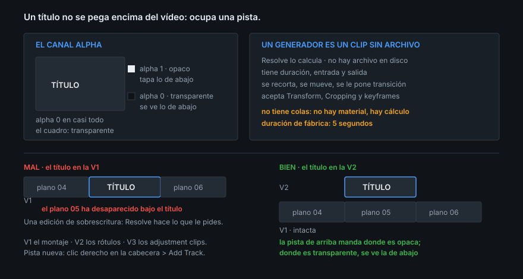

# El título es un clip

> Antes de escribir una sola letra hay que entender una cosa que ahorra media semana de
> confusión: en Resolve un título **no es un texto que se pega encima del vídeo**. Es un clip como
> cualquier otro, que ocupa su sitio en una pista, tiene duración, tiene entrada y salida, y se
> monta con las mismas herramientas que un plano.

## 🎯 Objetivos

- Explicar qué es un **generador** y en qué se diferencia de un clip de archivo
- Decir por qué un título tiene que ir en una **pista superpuesta** y qué pasa si no
- Definir **canal alpha** y explicar por qué es lo que hace que un título deje ver lo de abajo
- Añadir una pista de vídeo y saber dónde aparece
- Cambiar la duración de fábrica de los generadores
- Distinguir los dos paneles del Inspector de un título: `Title` y `Settings`

---

## 1. Qué problema resuelve

Tu pieza está montada, afinada al fotograma y con la velocidad y el encuadre decididos. Y aun así
no se entiende del todo: nadie sabe cómo se llama la persona que habla, ni dónde está grabado
esto, ni cómo se titula la pieza.

Eso es lo que resuelve un título: **información que la imagen no da**.

El problema técnico que hay detrás es otro, y es el que confunde a todo el mundo la primera
semana: si arrastras un título a la pista donde está tu montaje, **el título sustituye al plano**.
No se pone encima: lo tapa, y tu montaje se rompe.

Este archivo trata ese problema, y no el texto. El texto es el archivo 02.

---

## 2. Cómo funciona

### 2.1 Un generador es un clip sin archivo

Un **generador** (*generator*) es un clip que Resolve **calcula** en vez de leer de un archivo. No
hay nada en tu disco duro que se corresponda con él: existe solo dentro del proyecto.

Resolve trae dos familias de generadores, y las dos viven en el mismo sitio, la
**Effects Library** — el panel de efectos, que se abre con el botón `Effects` de la barra de
herramientas de la Edit page:

| Familia | Dónde | Qué genera |
| ------- | ----- | ---------- |
| **`Titles`** | `Effects Library > Toolbox > Titles` | Texto |
| **`Generators`** | `Effects Library > Toolbox > Generators` | Imagen sin texto: color plano, barras de color, degradados, una ventana blanca |

Aparte de eso, un generador se comporta **exactamente igual que un plano**: se arrastra a la
timeline, se recorta, se mueve, se le hace ripple, se le pone una transición, se le cambia la
velocidad y se le aplica un `Transform`. Todo lo que aprendiste en las Semanas 08, 09 y 10 vale
aquí sin excepciones.

> [!NOTE]
> El manual lo dice con estas palabras: *«Titles and generators can be edited much like any other
> clip»*, y añade que cuando están seleccionados exponen los mismos grupos `Composite`,
> `Transform` y `Cropping` que cualquier otro clip. Es literal, no una analogía.

### 2.2 La duración de fábrica: 5 segundos

Cuando arrastras un título o un generador directamente a la timeline, el clip que sale dura
**5 segundos**. No es un número mágico ni depende de nada: es un ajuste, y se cambia.

`DaVinci Resolve > Preferences > User > Editing`, campo de la duración estándar de los
generadores. Si tu pieza lleva quince rótulos de dos segundos, cambiarlo una vez te ahorra quince
recortes.

Las otras dos formas de colocar un generador con la duración que quieres:

1. **Con puntos de entrada y salida en la timeline.** Marcas `I` y `O` sobre la pista de destino,
   y arrastras el generador al *overlay* de edición del visor de timeline. Sale exactamente con
   esa duración. Es edición de tres puntos de la Semana 08, aplicada a un generador.
2. **Recortándolo después**, como cualquier clip. Un generador **no tiene colas**: no hay más
   material del que se ve, porque no hay material. Se puede estirar todo lo que quieras — es
   cálculo, no archivo — pero eso significa que un `slip` sobre un título no hace nada.

### 2.3 El canal alpha, que es lo que hace que funcione

El **canal alpha** (*alpha channel*) es un cuarto canal que acompaña a los tres de color —rojo,
verde y azul— y que no guarda color sino **opacidad**: por cada píxel, cuánto se ve de esa imagen
y cuánto se ve de lo que hay detrás.

- Alpha a **1** (blanco): el píxel es opaco. Tapa lo de abajo
- Alpha a **0** (negro): el píxel es transparente. Se ve lo de abajo
- Valores intermedios: mezcla proporcional. Es lo que hace que el borde de una letra no salga
  dentado

Un título es, casi todo él, **alpha 0**. Solo las letras —y la sombra, y el fondo si lo pones—
tienen alpha por encima de 0. Por eso un título colocado sobre un plano deja ver el plano: no
porque Resolve lo trate distinto, sino porque su alpha dice que casi todo él es transparente.

> [!IMPORTANT]
> Esto es lo mismo que viste en la Semana 10 con el recorte: `Cropping` no pinta negro, **crea
> transparencia**. Ahora es al revés y por el mismo mecanismo: el título no pinta un rectángulo
> negro con letras, pinta letras y deja el resto transparente.

### 2.4 Y por eso hace falta una pista de encima

Aquí se junta todo. Una pista de vídeo en Resolve tapa a las que tiene debajo. La pista más alta
manda; lo que hay debajo se ve **solo donde la de arriba es transparente**.

Con esas dos piezas —el alpha del título y el orden de las pistas— sale la regla de la semana:

> **Un título va siempre en una pista por encima de la que tiene la imagen.** Nunca en la misma.

Si lo dejas caer sobre la `V1`, donde está tu montaje, Resolve hace lo que le pides: una edición
de sobrescritura. El plano desaparece bajo el título y tu montaje pierde ese trozo de imagen.

En este bootcamp la convención es:

| Pista | Qué lleva |
| ----- | --------- |
| **`V1`** | El montaje. Los planos. No se toca esta semana |
| **`V2`** | Los rótulos y los títulos |
| **`V3`** y superiores | Los adjustment clips, que se explican en la teoría 08 |

### 2.5 Añadir una pista de vídeo

No hay una entrada de menú global: se hace desde la **cabecera de la pista**, que es la zona de la
izquierda de la timeline donde están los botones de cada pista.

- **Clic derecho sobre la cabecera de una pista de vídeo `>` `Add Track`**. La pista nueva se crea
  **justo encima** de aquella sobre la que pulsaste
- **Clic derecho en cualquier punto de la zona de cabeceras `>` `Add Tracks`** abre un diálogo
  donde eliges cuántas pistas de vídeo y de audio quieres y en qué posición

Dos detalles que se agradecen:

- Una pista se **renombra** haciendo clic sobre su nombre de fábrica (`Video 2`) y escribiendo.
  Requiere que la vista de la timeline sea `Filmstrip` o `Thumbnail` y que la pista sea lo bastante
  alta para que el nombre se vea
- **`Delete Empty Tracks`**, en el mismo menú contextual, borra de golpe todas las pistas sin clips

> [!WARNING]
> `Delete Track` sobre una pista **con clips los borra**. No hay diálogo de confirmación que
> distinga una pista vacía de una llena. Antes de borrar una pista, mírala.

### 2.6 Los dos paneles del Inspector de un título

Selecciona un título y abre el Inspector. Vas a ver **dos pestañas**, y confundirlas es el segundo
error más común de la semana:

| Panel | Qué contiene |
| ----- | ------------ |
| **`Title`** | Todo lo que tiene que ver con el **texto**: el contenido, la fuente, el color, el tamaño, la sombra, el contorno, el fondo |
| **`Settings`** | `Composite`, `Transform` y `Cropping`: **los mismos parámetros que cualquier clip**. Sirven para componer y animar el título, no para escribirlo |

Regla de bolsillo: **si estás moviendo letras dentro del rótulo, es `Title`. Si estás moviendo el
rótulo entero por el cuadro, es `Settings`.**

Los dos aceptan keyframes, con el mismo rombo y las mismas curvas de la Semana 10.

### 2.7 `Opacity`: la otra forma de que se vea lo de abajo

En el panel `Settings`, dentro del grupo `Composite`, hay dos controles que conviene conocer ya:

| Control | Qué hace |
| ------- | -------- |
| **`Composite Mode`** | Cómo se combina matemáticamente este clip con lo que tiene debajo. De fábrica, `Normal`: el alpha manda y nada más |
| **`Opacity`** | Cuánta transparencia se le añade al clip **entero**, por encima de lo que diga su alpha |

Esta semana solo vas a usar `Opacity`, y para una cosa: **hacer que un rótulo entre y salga con un
fundido**. Dos keyframes de `Opacity` de 0 a 100 al principio, dos de 100 a 0 al final, y ya está.
Los modos de composición son materia de la Fase 6, con Fusion.

---

## 3. Cómo se hace en Resolve 21

### 3.1 Preparar la pista de rótulos

1. Clic derecho sobre la cabecera de la pista **`Video 1`**
2. **`Add Track`**. Aparece `Video 2` justo encima
3. Clic sobre el nombre `Video 2` y escribe `Rotulos`, si tu vista de timeline lo permite

### 3.2 Colocar un título con la duración que quieres

1. Marca `I` y `O` en la timeline, sobre el tramo que tiene que llevar el rótulo
2. Comprueba el **control de destino** de la pista `V2`: es lo que decide en qué pista cae la
   edición
3. `Effects Library > Toolbox > Titles`, arrastra el título al *overlay* `Overwrite` del visor de
   timeline

O, si te vale la duración de fábrica: arrástralo directamente sobre la `V2` y luego recórtalo.

### 3.3 Cambiar la duración de fábrica

1. `DaVinci Resolve > Preferences > User > Editing`
2. El campo de duración estándar de los generadores
3. `Save`

### 3.4 Fundir un rótulo por `Opacity`

1. Selecciona el rótulo `>` `Inspector > Settings > Composite`
2. Cabezal al primer fotograma del rótulo. `Opacity` a `0`, y pulsa su **rombo**
3. Cabezal doce fotogramas después. `Opacity` a `100`: el keyframe se pone solo
4. Repite al revés en el final del rótulo

> [!TIP]
> Un rótulo también se funde con las **asas de fundido** (*fader handles*) del propio clip en la
> timeline, sin tocar el Inspector: los dos tiradores blancos que aparecen en las esquinas
> superiores del clip al pasar el ratón por encima. Es más rápido y hace lo mismo.

---

## 4. Antipatrones

| Antipatrón | Por qué duele | Qué hacer |
| ---------- | ------------- | --------- |
| Arrastrar un título sobre la `V1` | Sobrescribe el plano: pierdes imagen del montaje | Siempre en una pista por encima |
| Trabajar sin darse cuenta de que hay dos paneles | Buscas la fuente en `Settings` y no está | `Title` es el texto, `Settings` es el clip |
| Estirar un título esperando colas | No las tiene: no hay material, hay cálculo | Se estira sin límite, pero `slip` no hace nada |
| Recortar quince rótulos a mano | La duración de fábrica se puede cambiar una vez | Preferencias `>` `Editing` |
| Poner cada rótulo en una pista distinta | Acabas con nueve pistas y no sabes qué hay en cada una | Todos los rótulos en la `V2`, salvo que se solapen |
| Borrar una pista para «limpiar» | `Delete Track` se lleva los clips que haya dentro | Mírala antes, o usa `Delete Empty Tracks` |
| Bajar el `Opacity` para que un rótulo «no cante» | Un rótulo a medio gas se lee peor y sigue estorbando | Cámbiale el tamaño, el color o la posición |
| Confundir alpha con negro | Lo mismo que el recorte de la Semana 10 | Si quieres negro, pon negro debajo |

---

## 5. Trucos

| Truco | Cómo |
| ----- | ---- |
| Abrir el panel de efectos | El botón `Effects` de la barra de herramientas |
| Buscar un título, efecto o transición por nombre | `Shift+Espacio`, y escribe |
| Previsualizar un título sin colocarlo | `Hover Scrub Preview` marcado, y pasa el ratón por la miniatura |
| Añadir una pista de vídeo encima de otra | Clic derecho en su cabecera `>` `Add Track` |
| Añadir varias pistas de golpe y elegir dónde | Clic derecho en la zona de cabeceras `>` `Add Tracks` |
| Quitar las pistas vacías que sobran | Clic derecho `>` `Delete Empty Tracks` |
| Poner un rótulo con la duración exacta | `I`, `O`, control de destino en la `V2`, y arrastra al overlay del visor |
| Cambiar la duración de fábrica de los generadores | `DaVinci Resolve > Preferences > User > Editing` |
| Fundir un rótulo sin abrir el Inspector | Las asas de fundido de las esquinas superiores del clip |
| Abrir el Inspector de un generador de un golpe | Doble clic sobre el generador en la timeline |
| Ver qué clips llevan algún efecto | Se pintan de un tono más oscuro que los que no llevan nada |

---

## 📚 Recursos Adicionales

- [DaVinci Resolve Reference Manual](https://www.blackmagicdesign.com/support/family/davinci-resolve-and-fusion) — capítulo 56, secciones «Adding Titles», «Using Generators» y «Title Generator Settings Parameters»; capítulo 41, «Naming Timeline Tracks» y los métodos para añadir y borrar pistas.
- [Semana 08 · La edición de tres puntos](../../week-08-edit_page_anatomia_y_edicion_basica/1-teoria/07-la-edicion-de-tres-puntos.md) — de dónde sale el truco de colocar un generador con `I` y `O`.
- [Semana 10 · Transform, crop y dynamic zoom](../../week-10-velocidad_transformaciones_y_estabilizacion/1-teoria/07-transform-crop-y-dynamic-zoom.md) — los parámetros del panel `Settings`, ya explicados uno a uno.
- [02 · Text frente a Text+](02-text-frente-a-text-plus.md) — ahora sí, el texto.

---

## ✅ Checklist de Verificación

- [ ] Sé qué es un generador y por qué no tiene archivo en disco
- [ ] Sé por qué un título va en una pista por encima de la imagen
- [ ] Sé qué es el canal alpha y qué significa alpha 0
- [ ] Sé añadir, renombrar y borrar una pista de vídeo, y qué se lleva por delante `Delete Track`
- [ ] Sé cambiar la duración de fábrica de los generadores
- [ ] Distingo el panel `Title` del panel `Settings` sin pensarlo
- [ ] Sé fundir un rótulo con `Opacity` o con las asas de fundido

---

| Anterior | Actual | Siguiente |
| -------- | ------ | --------- |
| — | **01 · El título es un clip** | [02 · Text frente a Text+](02-text-frente-a-text-plus.md) |

← [Volver a la Semana 11](../README.md)
