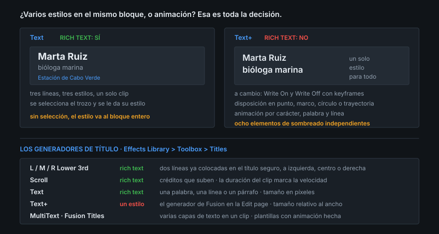

# Text frente a Text+

> En `Effects Library > Toolbox > Titles` hay siete generadores de texto y ninguno se llama «el
> bueno». Elegir mal cuesta una hora de rehacer un rótulo que no se podía animar, o media hora
> peleando por poner dos colores en un `Text+` que no los admite. La elección se decide con una
> pregunta, y este archivo es esa pregunta.

## 🎯 Objetivos

- Enumerar los generadores de título que trae Resolve 21 y decir qué hace cada uno
- Definir **rich text** y saber qué generadores lo soportan y cuál no
- Elegir entre `Text` y `Text+` con un criterio, no por costumbre
- Explicar por qué `Text+` puede etalonarse sin compound clip y `Text` no lo necesita tampoco
- Saber qué es `MultiText` y cuándo ahorra pistas
- Editar el texto de un título directamente en el visor

---

## 1. Qué problema resuelve

Necesitas poner el nombre de quien habla abajo a la izquierda. Y el título de la pieza en medio.
Y, en el minuto cuatro, una palabra que aparece letra a letra.

Los tres son «texto», y los tres se hacen con generadores distintos. Si eliges el mismo para los
tres, dos de ellos te van a costar el triple.

El problema real es que la diferencia entre `Text` y `Text+` **no es de calidad**. Los dos rinden
lo mismo en pantalla. La diferencia es de **capacidades**, y van en direcciones opuestas: uno hace
fácil lo que el otro no puede hacer.

---

## 2. Cómo funciona

### 2.1 Qué es rich text

**Rich text** (*rich text*) significa que puedes **seleccionar un trozo del texto y darle un estilo
distinto** al del resto, dentro del mismo clip. Tres líneas, tres tamaños, tres colores, un solo
generador.

Es exactamente lo que hace un procesador de textos y lo que no hace un rótulo de televisión
clásico. Y es la línea que parte en dos la lista de generadores de Resolve.

> [!IMPORTANT]
> **`Text+` no soporta rich text.** Todo el texto de un `Text+` comparte un único estilo. Está
> escrito así en el manual: *«Text+: (does not support rich text)»*. No es una limitación que se
> quite en un ajuste; es cómo está construido.

### 2.2 Los generadores de título de Resolve 21

`Effects Library > Toolbox > Titles`:

| Generador | Rich text | Qué hace |
| --------- | --------- | -------- |
| **`L Lower 3rd`** | Sí | Dos líneas de texto colocadas solas en la **esquina inferior izquierda** del título seguro, cada una con sus controles de posición, zoom y rotación |
| **`M Lower 3rd`** | Sí | Lo mismo, **abajo en el centro** |
| **`R Lower 3rd`** | Sí | Lo mismo, **abajo a la derecha** |
| **`Scroll`** | Sí | Un rótulo que sube de abajo arriba. **La duración del clip decide la velocidad del scroll** |
| **`Text`** | Sí | Una palabra, una línea o un párrafo. Un bloque de texto con un juego de controles de rich text |
| **`Text+`** | **No** | El generador de texto 2D de la página Fusion, disponible dentro de la Edit page. Muchísimas más opciones de estilo, renderizado y animación, pero **un solo estilo para todo el texto** |
| **`MultiText`** | — | Construido sobre `Text+`. Añade una **lista de capas de texto** dentro de un solo clip, cada una con su estilo y su posición |
| **`Fusion Titles`** | — | Una categoría entera de plantillas con animación ya hecha. Es la teoría 04 |

Un detalle que se agradece cuando llevas prisa: **un `Scroll` se acelera o se frena cambiando la
duración del clip**. No hay un control de velocidad. Si los créditos van demasiado rápido, estira
el clip.

### 2.3 La pregunta que decide

No hay que memorizar la tabla. Hay que hacerse una pregunta:

> **¿Este rótulo necesita más de un estilo dentro del mismo bloque de texto, o necesita animarse?**

| Respuesta | Generador |
| --------- | --------- |
| **Varios estilos**, sin animación: un nombre grande y un cargo pequeño debajo | **`Text`**, o uno de los tres `Lower 3rd`, que ya vienen colocados |
| **Un solo estilo**, con animación o con un acabado tipográfico fino | **`Text+`** |
| **Varios estilos y varias capas**, todo dentro de un clip | **`MultiText`** |
| Quieres una animación ya hecha y no vas a diseñarla tú | **`Fusion Titles`** (teoría 04) |

El manual lo resume igual de corto: el `Text` sigue siendo muy útil para **páginas de texto con
varios estilos**, y el `Text+` destaca **creando texto para motion graphics animados**.

### 2.4 La solución cuando quieres las dos cosas

Necesitas un nombre grande y un cargo pequeño —dos estilos— y además que entren animados con un
*write on* letra a letra, que solo tiene `Text+`.

No hay generador que haga las dos cosas. Hay dos salidas, y las dos son legítimas:

1. **Dos clips de `Text+` superpuestos**, uno con el nombre y otro con el cargo, cada uno con su
   estilo. Es lo que hace todo el mundo. Requiere una pista más, o colocarlos en el mismo tramo de
   la `V2` y la `V3`
2. **Un `MultiText`**, que es precisamente el generador que existe para esto: varias capas de
   texto con estilos distintos dentro de un solo clip

La salida que **no** funciona es pelearse con el `Text+` buscando el ajuste que ponga dos colores.
No está.

### 2.5 Qué gana el `Text+` a cambio

`Text+` viene de la página Fusion, y trae de allí cosas que el `Text` no tiene:

- **Controles de `Write On` y `Write Off`** con keyframes: el texto aparece y desaparece
  progresivamente, carácter a carácter
- **Disposición sobre formas**: el texto no tiene por qué ir en línea recta. Puede seguir un punto,
  un marco, un **círculo** o una **trayectoria**
- **Transformaciones y animación por carácter, por palabra y por línea**, no solo del bloque entero
- **Sombreado avanzado**: hasta ocho capas de relleno, contorno, sombra y borde, en vez de una
- Soporte de **emoji y fuentes de color** — se insertan con `Tecla Windows + .` en Windows y con
  `Control+Cmd+Espacio` en macOS

Y una cosa más, que importa a partir de la Fase 5: **un `Text+` se puede etalonar como cualquier
otro clip, sin necesidad de convertirlo antes en compound clip.** El manual lo dice
explícitamente. La teoría 09 explica por qué eso es una ventaja.

> [!NOTE]
> Con el cabezal sobre un `Text+`, si abres la página Fusion te encuentras el nodo `Text+` como una
> operación de Fusion de verdad, lista para conectarle más nodos. Es la misma herramienta, vista
> desde otro sitio. En la Semana 26 se trabaja desde ahí.

### 2.6 Editar el texto en el visor, sin abrir el Inspector

Los generadores de título originales de Resolve —los de la mitad de arriba de la tabla— traen
controles en pantalla:

| Acción | Cómo |
| ------ | ---- |
| **Seleccionar el bloque** | Clic sobre el texto en el visor de timeline. Aparece su recuadro |
| **Mover, escalar, rotar** | Arrastrando el recuadro, sus esquinas y su tirador de rotación. Corresponden a `Position`, `Zoom` y `Rotation Angle` del Inspector |
| **Editar el texto** | **Doble clic** sobre el texto: aparece el cursor y escribes ahí mismo |

Al arrastrar hay imanes: el texto se pega al centro en `X` y en `Y`, y al tercio exterior del
cuadro. **`Shift`** mientras arrastras restringe el movimiento a un solo eje.

Para `Text+` el mecanismo es distinto y hay que encenderlo: **`Fusion Overlay`**, en el desplegable
de overlays del visor de timeline. Con eso activo se puede seleccionar y editar el texto de un
`Text+` en el visor igual que el de un `Text`.

### 2.7 El corrector ortográfico

Resolve 21 subraya en rojo las palabras mal escritas, en el visor y en el Inspector. Clic derecho
sobre una para ver sugerencias o ignorarla.

- Se configura en `DaVinci Resolve > Preferences > User > Language and Spelling`
- Los subrayados rojos del visor se apagan con **`View > Show Spelling Errors on Viewer`**, que es
  lo que hay que hacer **antes de enseñarle la pieza a alguien**: si no, los ve

---

## 3. Cómo se hace en Resolve 21

### 3.1 Un rótulo de identificación con dos estilos

1. `Effects Library > Toolbox > Titles`, arrastra **`L Lower 3rd`** a la `V2`
2. `Inspector > Title`. Hay dos campos de texto, uno por línea
3. Escribe el nombre en el primero y el cargo en el segundo
4. Cada línea tiene sus propios controles de tamaño, color y posición: úsalos

### 3.2 Un `Text` con tres estilos en un bloque

1. Arrastra **`Text`** a la `V2`
2. `Inspector > Title > Rich Text`, escribe las tres líneas en el campo `Text`
3. **Selecciona con el ratón** la primera línea, dentro del campo
4. Cambia `Size` y `Color`: solo cambia lo seleccionado
5. Repite con las otras dos

> [!TIP]
> Si no seleccionas nada, los controles de estilo afectan **al bloque entero**. Esa es la regla, y
> es lo que confunde: parece que el rich text no funciona cuando lo que pasa es que no había nada
> seleccionado.

### 3.3 Un `Text+` con un solo estilo

1. Arrastra **`Text+`** a la `V2`
2. `Inspector > Title`, campo de texto
3. Estilo, tamaño, color: afectan a todo, siempre
4. Para editarlo en el visor: desplegable de overlays del visor `>` **`Fusion Overlay`**

### 3.4 Comprobar la ortografía antes de entregar

1. Reproduce la pieza mirando los rótulos
2. Clic derecho sobre cualquier palabra subrayada en rojo
3. Cuando esté limpio: `View > Show Spelling Errors on Viewer` para apagar los subrayados

---

## 4. Antipatrones

| Antipatrón | Por qué duele | Qué hacer |
| ---------- | ------------- | --------- |
| Usar `Text+` para todo «porque es el bueno» | No tiene rich text: un rótulo de dos estilos se vuelve dos clips | La pregunta de 2.3, cada vez |
| Usar `Text` para todo «porque es más simple» | No tiene `Write On` ni animación por carácter | Lo mismo |
| Buscar en `Text+` el ajuste que pone dos colores | No existe | `MultiText`, o dos clips |
| Escribir el rótulo y luego seleccionar el estilo | Sin selección, el estilo va al bloque entero | Selecciona **antes** de tocar `Size` o `Color` |
| Hacer un `Lower 3rd` a mano con un `Text` | Los tres `Lower 3rd` ya vienen colocados en el título seguro | Úsalos y ahorra la colocación |
| Acelerar un `Scroll` buscando un control de velocidad | No hay: la velocidad es la duración del clip | Estira o acorta el clip |
| Editar texto en el visor de un `Text+` sin encender nada | Sin `Fusion Overlay` el visor no te deja | Desplegable de overlays `>` `Fusion Overlay` |
| Entregar con los subrayados rojos encendidos | Salen en la reproducción y quien mira los ve | `View > Show Spelling Errors on Viewer` |
| Dejar el rótulo con el texto de fábrica en un clip | Se cuela en la entrega y nadie lo ve hasta el final | Reproduce la pieza entera leyendo los rótulos |

---

## 5. Trucos

| Truco | Cómo |
| ----- | ---- |
| Ver de un vistazo qué generadores admiten varios estilos | Todos menos `Text+` |
| Colocar un lower third sin colocarlo | `L`, `M` o `R Lower 3rd`: vienen en el título seguro |
| Cambiar la velocidad de unos créditos | Estira o acorta el clip de `Scroll` |
| Dar un estilo distinto a una línea | Selecciónala dentro del campo `Text` antes de tocar nada |
| Editar el texto sin abrir el Inspector | Doble clic sobre el texto en el visor |
| Restringir el arrastre de un texto a un eje | Mantén `Shift` |
| Soltar los imanes al colocar un texto | Mantén `Alt` (Win) / `Opt` (Mac) mientras arrastras |
| Editar un `Text+` en el visor | Overlays del visor `>` `Fusion Overlay` |
| Meter un emoji en un `Text+` o un `MultiText` | `Tecla Windows + .` (Win) / `Control+Cmd+Espacio` (Mac) |
| Varias capas de texto sin gastar pistas | `MultiText` |
| Abrir el `Text+` como nodo de Fusion | Cabezal encima y cambia a la página Fusion |
| Quitar los subrayados rojos del visor | `View > Show Spelling Errors on Viewer` |

---

## 📚 Recursos Adicionales

- [DaVinci Resolve Reference Manual](https://www.blackmagicdesign.com/support/family/davinci-resolve-and-fusion) — capítulo 56, secciones «Types of Title Generators», «Shared Title Generator Parameters», «The Text+ Title Generator», «Text+ Viewer Controls», «MultiText Titles» y «Spell Checking for all Text Elements».
- [01 · El título es un clip](01-el-titulo-es-un-clip.md) — dónde va el título antes de decidir cuál.
- [03 · Los cuatro paneles de Text+](03-los-cuatro-paneles-de-text-plus.md) — qué hay dentro del generador que acabas de elegir.
- [05 · Legibilidad: safe areas, tipografía y contraste](05-legibilidad-safe-areas-y-contraste.md) — dónde ponerlo para que se lea.

---

## ✅ Checklist de Verificación

- [ ] Sé qué es rich text y qué generador no lo tiene
- [ ] Sé enumerar los generadores de título de Resolve 21 y qué hace cada uno
- [ ] Sé decidir entre `Text` y `Text+` con la pregunta de 2.3
- [ ] Sé qué hago cuando necesito varios estilos **y** animación
- [ ] Sé cambiar la velocidad de un `Scroll`
- [ ] Sé editar el texto de un título en el visor, y qué hace falta para un `Text+`
- [ ] Sé apagar los subrayados del corrector antes de enseñar la pieza

---

| Anterior | Actual | Siguiente |
| -------- | ------ | --------- |
| [01 · El título es un clip](01-el-titulo-es-un-clip.md) | **02 · Text frente a Text+** | [03 · Los cuatro paneles de Text+](03-los-cuatro-paneles-de-text-plus.md) |

← [Volver a la Semana 11](../README.md)
