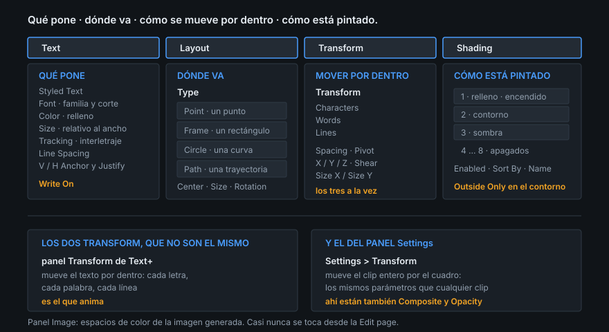

# Los cuatro paneles de Text+

> `Text+` tiene más controles que ningún otro generador de Resolve, y por eso se abandona a los
> cinco minutos. Pero están **agrupados en cuatro paneles con una lógica clara**, y con saber qué
> vive en cada uno ya no hace falta buscar: sabes en qué pestaña está lo que quieres antes de
> abrirla.

## 🎯 Objetivos

- Nombrar los cuatro paneles de `Text+` y decir qué se ajusta en cada uno
- Escribir y dar formato al texto en el panel `Text`
- Elegir el **tipo de disposición** en `Layout` y saber cuándo sirve cada uno
- Animar por carácter, por palabra o por línea desde `Transform`
- Construir un contorno y una sombra con los **elementos de sombreado** de `Shading`
- Hacer un `Write On` con dos keyframes

---

## 1. Qué problema resuelve

Un rótulo que se ve mal no se arregla subiendo el tamaño. Se arregla con **contorno**, con
**sombra**, con la **posición** correcta y a veces con un fondo. Y un rótulo que entra de golpe se
arregla con **animación**.

Las cuatro cosas están en `Text+`, y hasta que no sabes en qué panel vive cada una, cada rótulo es
una expedición por el Inspector.

Este archivo es el mapa. No hace falta memorizar los controles: hace falta saber **en qué panel
buscar**.

---

## 2. Cómo funciona

### 2.1 El mapa en una tabla

Con `Text+` seleccionado y el Inspector abierto, arriba hay una fila de pestañas:

| Panel | Qué se ajusta | Cuándo vas |
| ----- | ------------- | ---------- |
| **`Text`** | **Qué pone** y con qué tipografía: contenido, fuente, color de relleno, tamaño, interletraje, interlineado, anclaje, justificación, `Write On` | Siempre, es donde empiezas |
| **`Layout`** | **Dónde va y con qué forma**: el tipo de disposición, el centro, el tamaño del elemento de disposición, la rotación y el color de fondo | Cuando el texto tiene que seguir un círculo o una curva, o caber en un marco |
| **`Transform`** | **Animar y deformar por partes**: cada carácter, cada palabra o cada línea por separado | Cuando el rótulo tiene que moverse |
| **`Shading`** | **Cómo está pintado**: hasta **ocho** elementos de relleno, contorno, sombra y borde | Siempre que haya que hacerlo legible |
| `Image` | Aspecto, espacios de color y de gamma de la imagen que genera | Casi nunca en la Edit page |
| `Settings` | `Composite`, `Transform` y `Cropping` del clip, como cualquier otro clip | Para mover el rótulo entero o fundirlo |

> [!IMPORTANT]
> Ojo con los dos `Transform`: el del panel `Transform` de `Text+` mueve **el texto por dentro**
> —carácter a carácter, palabra a palabra—, y el del panel `Settings` mueve **el clip entero**.
> Son dos cosas distintas y no se pisan.

### 2.2 El panel `Text`

El campo grande de arriba se llama **`Styled Text`**: es donde se escribe. Acepta copiar y pegar
con los atajos de siempre, y en Windows los emoji entran con `Tecla Windows + .`.

Los controles que se usan a diario:

| Control | Qué hace |
| ------- | -------- |
| **`Font`** | Dos desplegables: la familia y el corte (regular, negrita, cursiva). El icono de al lado abre el **`Font Browser`**, que enseña las fuentes con muestra |
| **`Color`** | El color de relleno. Es el mismo que el del primer elemento del panel `Shading` |
| **`Size`** | El tamaño. **No son puntos**: es un tamaño **relativo al ancho de la imagen**, así que el mismo valor se ve igual en HD y en 4K |
| **`Tracking`** | El espacio entre caracteres, uniforme |
| **`Line Spacing`** | El espacio entre líneas. En tipografía se llama *interlineado* |
| **`V Anchor` / `H Anchor`** | A qué punto del propio texto se ancla: arriba, en medio, abajo; izquierda, centro, derecha |
| **`V Justify` / `H Justify`** | Justificación, para repartir el texto en el alto o el ancho disponibles |
| **`Write On`** | El control de aparición progresiva. Es el de 2.5 |

Y dentro de `Advanced Controls`, dos que se agradecen cuando una fuente se porta mal:

- **`Force Monospaced`**: a `0` manda el kerning de la fuente; a `1`, todos los caracteres ocupan
  lo mismo
- **`Use Font Defined Kerning`**: encendido de fábrica. Apagarlo desactiva el ajuste fino de
  espaciado que trae la fuente

> [!NOTE]
> Que `Size` sea relativo al ancho de la imagen es una de las mejores propiedades de `Text+`: si
> algún día cambias la resolución del proyecto, los rótulos siguen viéndose igual de grandes en
> proporción. Un `Text` normal, con su tamaño en píxeles, no.

### 2.3 El panel `Layout`: los cuatro tipos

El desplegable **`Type`** decide la geometría sobre la que se coloca el texto:

| Tipo | Qué hace | Para qué sirve |
| ---- | -------- | -------------- |
| **`Point`** | El texto se organiza alrededor de un **punto** ajustable. Es el modo de fábrica | Un rótulo normal |
| **`Frame`** | Define un **rectángulo** y el texto se justifica dentro. Aparecen `Width` y `Height` | Un párrafo que tiene que caber en un sitio |
| **`Circle`** | El texto se coloca sobre la **curva de un círculo o una elipse**. Aparecen `Width` y `Fit Characters` | Un sello, un logotipo circular |
| **`Path`** | El texto sigue una **trayectoria** que dibujas. Aparece `Position on Path`, que se puede animar | Texto que recorre una curva |

Los demás controles del panel colocan y giran ese elemento de disposición: `Center X`, `Y`, `Z`,
`Size`, `Perspective`, los ángulos de rotación en los tres ejes, y `Background Color`, que es el
color del fondo — de fábrica el texto se genera con **fondo transparente**.

> [!TIP]
> Las justificaciones `V Justify` y `H Justify` del panel `Text` solo tienen sentido cuando hay un
> espacio en el que justificar. Por eso el manual dice que se usan sobre todo con el `Layout` en
> **`Frame`**. Si las mueves en modo `Point` y no pasa nada, es esto.

### 2.4 El panel `Transform`: animar por partes

Este panel es el que hace de `Text+` una herramienta de motion graphics. El desplegable
**`Transform`** de arriba elige **sobre qué actúa** todo lo demás:

- **`Characters`**: cada carácter se transforma sobre su propio eje
- **`Words`**: cada palabra, sobre el suyo
- **`Lines`**: cada línea, sobre el suyo

Los tres niveles se pueden aplicar **a la vez**; el desplegable solo decide cuál estás editando en
este momento, para no enseñar treinta controles de golpe.

Y sobre el nivel elegido:

| Control | Qué hace |
| ------- | -------- |
| **`Spacing`** | El espacio entre esos elementos. Por debajo de `1` empiezan a solaparse |
| **`Pivot X` / `Y` / `Z`** | Desplaza el eje sobre el que giran y escalan. De fábrica, el centro calculado de cada elemento |
| **`X` / `Y` / `Z`** | El ángulo, en los tres ejes |
| **`Shear X` / `Y`** | Inclina los elementos |
| **`Size X` / `Y`** | Los escala |

Un ejemplo concreto de para qué sirve: poner `Transform` en `Characters` y animar `Size` de `0` a
`1` no escala el rótulo, **escala cada letra sobre sí misma**. Es un efecto que no se puede hacer
con un `Text`.

### 2.5 `Write On`, con dos keyframes

**`Write On`** es un control de **rango**: tiene un principio y un final, los dos entre `0` y `1`,
y lo que hay entre ellos es el texto que se ve.

| Efecto | Qué se anima |
| ------ | ------------ |
| **`Write On`** — el texto aparece | El **final** del rango, de `1` a `0`, a lo largo del tiempo que quieras |
| **`Write Off`** — el texto desaparece | El **principio** del rango, de `0` a `1` |

Dos keyframes y ya está. No hace falta la página Fusion.

### 2.6 El panel `Shading`: los ocho elementos

Aquí es donde un rótulo se vuelve legible. `Text+` no tiene «una sombra» y «un contorno»: tiene
**ocho elementos de sombreado** (*shading elements*), numerados del 1 al 8, y cada uno se
configura entero por separado.

- El **elemento 1** es el **relleno** (*fill*), y viene encendido de fábrica. Su color es el mismo
  que el `Color` del panel `Text`
- Los elementos **2 a 8** están apagados. Se encienden con su casilla `Enabled`
- **`Sort By`** decide el orden de dibujado: por número, con el 1 arriba y el 8 abajo, o por
  profundidad en `Z`
- **`Name`** deja ponerle un nombre descriptivo a cada elemento, que se agradece a partir del
  tercero

Cada elemento tiene un botón de **apariencia** que decide **a qué parte del texto se aplica**:
`Text Fill` —a todo el texto, que es el modo de fábrica—, contorno, sombra o borde. Y de ahí para
abajo, sus propios controles de color, opacidad, grosor, suavizado y desplazamiento.

Los dos que se usan siempre:

| Quiero | Elemento nuevo con apariencia | Controles que importan |
| ------ | ---------------------------- | ---------------------- |
| **Un contorno** que despegue el texto del fondo | Contorno | `Color`, `Thickness`, `Outside Only`, `Join Style` |
| **Una sombra** que dé profundidad | Sombra | `Color`, opacidad, `Position X` / `Y` |

Dos detalles del contorno que se notan mucho:

- **`Outside Only`**: de fábrica el contorno va **centrado sobre el borde de la letra** y se come
  parte del relleno, lo que engorda la tipografía. Marcado, el contorno se dibuja solo por fuera
- **`Join Style`**: cómo se resuelven las esquinas del contorno — `Sharp`, `Rounded`, `Beveled`.
  En cuerpos pequeños, `Rounded` es más limpio

---

## 3. Cómo se hace en Resolve 21

### 3.1 Un rótulo legible en cuatro pasos

1. Arrastra **`Text+`** a la `V2` y escribe en `Text > Styled Text`
2. `Text > Font`, `Size` y `Color`
3. `Shading`: elige el elemento **2**, marca `Enabled`, apariencia **contorno**, `Color` negro,
   `Thickness` bajo y **`Outside Only`** marcado
4. `Shading`: elemento **3**, `Enabled`, apariencia **sombra**, opacidad al 50 %, `Position Y`
   ligeramente hacia abajo

### 3.2 Un `Write On` de dos segundos

1. Cabezal al primer fotograma del rótulo
2. `Text > Write On`: pon el **final** del rango a `0` y pulsa su **rombo**
3. Cabezal dos segundos después
4. Pon el final del rango a `1`: el keyframe se pone solo
5. Reproduce con `/`

### 3.3 Texto sobre un círculo

1. `Layout > Type` `>` **`Circle`**
2. `Width` para el diámetro
3. `Center X` / `Y` para colocarlo
4. `Fit Characters` para el reparto de los caracteres a lo largo de la circunferencia

### 3.4 Animar letra a letra

1. `Transform > Transform` `>` **`Characters`**
2. Cabezal al principio. `Size X` y `Size Y` a `0`, keyframe
3. Cabezal un segundo después. `Size X` y `Size Y` a `1`
4. Si arranca demasiado seco, afínalo en el `Curve Editor`, como en la Semana 10

---

## 4. Antipatrones

| Antipatrón | Por qué duele | Qué hacer |
| ---------- | ------------- | --------- |
| Buscar la fuente en `Layout` | La tipografía está en `Text` | El mapa de 2.1 |
| Mover el rótulo entero desde el panel `Transform` | Ese panel mueve el texto por dentro | `Settings > Transform` |
| Subir `Size` hasta que el rótulo «se lea» | Un rótulo enorme tapa la imagen y sigue sin contrastar | Contorno y sombra en `Shading` |
| Contorno sin `Outside Only` | Se come el relleno y engorda la letra | Marca la casilla |
| Ocho elementos de sombreado en un rótulo | Se vuelve ilegible e imposible de mantener | Dos: contorno y sombra |
| Justificar en modo `Point` | No hay marco en el que justificar | `Layout > Type > Frame` |
| Animar `Write On` con cuatro keyframes | Con dos basta y sale más limpio | Principio y final, nada más |
| Poner el mismo rótulo a mano quince veces | Se pierde media hora y salen quince estilos distintos | Guarda el estilo en el media pool (teoría 05) |
| Tocar el panel `Image` sin saber para qué | Cambia espacios de color y te descuadra la Fase 5 | Déjalo como está |

---

## 5. Trucos

| Truco | Cómo |
| ----- | ---- |
| Saber en qué panel está lo que buscas | Qué pone: `Text`. Dónde y con qué forma: `Layout`. Animar por partes: `Transform`. Cómo está pintado: `Shading` |
| Elegir fuente viendo cómo queda | El icono del `Font Browser` al lado del desplegable de fuente |
| Marcar una fuente como favorita | La estrella de su recuadro en el `Font Browser` |
| Buscar una fuente por parte del nombre | El campo de búsqueda del `Font Browser` |
| Que el tamaño no dependa de la resolución | `Size` de `Text+` ya es relativo al ancho de la imagen |
| Igualar el espaciado de una fuente irregular | `Advanced Controls > Force Monospaced` a `1` |
| Texto en curva | `Layout > Type > Circle` o `Path` |
| Animar la aparición del texto | El **final** del rango `Write On`, de `1` a `0` |
| Animar la desaparición | El **principio** del rango `Write On`, de `0` a `1` |
| Animar cada letra por su cuenta | `Transform > Transform > Characters` |
| Que el contorno no engorde la letra | `Outside Only` marcado |
| Esquinas de contorno limpias en cuerpo pequeño | `Join Style > Rounded` |
| Ponerle nombre a un elemento de sombreado | El campo `Name` del propio elemento |
| Fondo de color detrás del texto | `Layout > Background Color` |

---

## 📚 Recursos Adicionales

- [DaVinci Resolve Reference Manual](https://www.blackmagicdesign.com/support/family/davinci-resolve-and-fusion) — capítulo 56, «The Text+ Title Generator»; capítulo 103 «Generator Nodes», nodo `Text+`, con las pestañas `Text`, `Layout`, `Transform` y `Shading` control a control.
- [02 · Text frente a Text+](02-text-frente-a-text-plus.md) — por qué elegiste este generador.
- [05 · Legibilidad: safe areas, tipografía y contraste](05-legibilidad-safe-areas-y-contraste.md) — qué valores poner en estos controles para que se lea.
- [Semana 10 · Keyframes: Inspector, Keyframe Editor y Curve Editor](../../week-10-velocidad_transformaciones_y_estabilizacion/1-teoria/08-keyframes-inspector-y-curve-editor.md) — cómo se afina la aceleración de un `Write On`.

---

## ✅ Checklist de Verificación

- [ ] Sé nombrar los cuatro paneles de `Text+` y qué vive en cada uno
- [ ] Distingo el `Transform` de `Text+` del `Transform` de `Settings`
- [ ] Sé que `Size` es relativo al ancho de la imagen y qué implica
- [ ] Sé elegir entre `Point`, `Frame`, `Circle` y `Path`
- [ ] Sé montar un `Write On` con dos keyframes
- [ ] Sé añadir un contorno y una sombra con elementos de sombreado
- [ ] Sé para qué sirve `Outside Only`

---

| Anterior | Actual | Siguiente |
| -------- | ------ | --------- |
| [02 · Text frente a Text+](02-text-frente-a-text-plus.md) | **03 · Los cuatro paneles de Text+** | [04 · Fusion Titles y plantillas](04-fusion-titles-y-plantillas.md) |

← [Volver a la Semana 11](../README.md)
