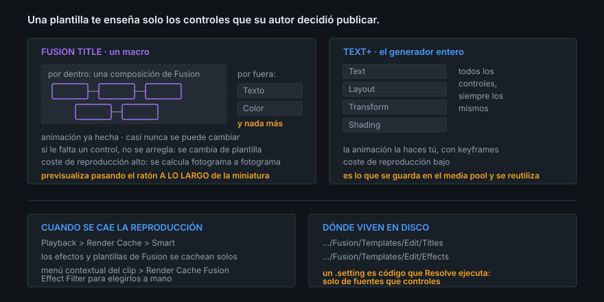

# Fusion Titles y plantillas

> Los `Fusion Titles` son la categoría que más rápido engancha y la que más piezas estropea. Son
> rótulos con animación ya hecha, y por eso tientan: en dos clics tienes algo que se mueve. Este
> archivo explica **qué son por dentro**, qué controles te dejan tocar, qué le cuestan a tu
> reproducción y cuándo elegirlos de verdad.

## 🎯 Objetivos

- Explicar qué es un **macro** de Fusion y por qué un `Fusion Title` es uno
- Distinguir un `Fusion Title` de un `Text+` en lo que se puede modificar
- Encontrar los controles personalizados de una plantilla en el Inspector
- Entender por qué un `Fusion Title` cuesta reproducción y qué hacer al respecto
- Saber dónde viven las plantillas en disco y cómo se añaden más
- Decidir cuándo una plantilla es la respuesta correcta y cuándo es una trampa

---

## 1. Qué problema resuelve

Quieres un rótulo de identificación que entre con una línea que se despliega y salga con un
barrido. Con `Text+` lo puedes hacer, pero son cuarenta minutos de keyframes y una hora si es la
primera vez.

`Effects Library > Toolbox > Titles`, categoría **`Fusion Titles`**: hay una plantilla que hace
exactamente eso. Se arrastra, se le escribe el texto, y ya está.

El precio es real y conviene saberlo antes: **pierdes control y pierdes reproducción en tiempo
real**. Este archivo es para que la decisión sea consciente.

---

## 2. Cómo funciona

### 2.1 Qué es un macro

Un **macro** (*macro*) es una composición de Fusion —varios nodos conectados entre sí— **empaquetada
como si fuera una sola herramienta**. Por fuera parece un efecto suelto con unos cuantos controles;
por dentro son diez o veinte nodos.

Quien construye el macro decide **qué controles se publican**, es decir, cuáles asoman por fuera.
El resto queda dentro, funcionando, pero inaccesible desde la Edit page.

Los `Fusion Titles` que trae Resolve son eso: composiciones de Fusion convertidas en macros e
instaladas con el programa, para usarlas desde la Edit page como cualquier otro generador. El
manual lo dice tal cual: *«these text generators are Fusion templates»*.

### 2.2 Qué se puede tocar y qué no

| | `Text+` | `Fusion Title` |
| - | ------- | -------------- |
| **Controles en el Inspector** | Todos los del generador, siempre los mismos | **Los que publicó su autor**, distintos en cada plantilla |
| **La animación** | La haces tú con keyframes | Viene hecha. A veces se puede regular la duración, a veces no |
| **Cambiar la tipografía** | Siempre | Casi siempre, pero no está garantizado |
| **Cambiar lo que hace** | Todo | Solo abriendo la página Fusion y desmontando el macro |
| **Coste de reproducción** | Bajo | **Alto**: es una composición de Fusion completa |
| **Se etalona sin compound clip** | Sí | Sí, es un clip como otro |

La consecuencia práctica: **una plantilla que casi te sirve no se arregla**. O te sirve como está,
o cambias de plantilla, o la haces tú con `Text+`. Perder media hora buscando el control que no
está es el error clásico de esta categoría.

### 2.3 Previsualizar antes de colocar

Los `Fusion Titles` están **animados**, así que la miniatura sola no dice nada. Con
`Hover Scrub Preview` marcado en el menú de opciones de la pestaña `Titles`, pasar el ratón **a lo
largo** de la miniatura reproduce la animación en el visor.

Es la diferencia entre probar veinte plantillas en un minuto y colocar, mirar, borrar y repetir
veinte veces.

### 2.4 Lo que cuesta en reproducción

Un `Fusion Title` no es texto pintado: es una composición que se calcula fotograma a fotograma.
Con dos o tres en la pieza no se nota; con quince, la timeline deja de ir a tiempo real.

Resolve tiene una respuesta específica para esto. En el menú contextual de un clip de la timeline
está **`Render Cache Fusion Effect Filter`**, con una opción **`Auto`** encendida de fábrica:

- Con el **render cache** del proyecto en **`Smart`** —`Playback > Render Cache > Smart`—, los
  efectos y plantillas de Fusion aplicados a un clip **se cachean solos**
- Desactivando `Auto` puedes elegir a mano qué efectos se cachean y cuáles no
- Con el render cache en **`User`**, `Auto` cachea los efectos de Fusion solo si el ajuste de
  proyecto correspondiente está activado; si no, hay que seleccionarlos uno a uno

> [!TIP]
> Si al poner el tercer `Fusion Title` la reproducción se te cae, no es tu ordenador: es lo
> esperable. `Playback > Render Cache > Smart` y espera a que la barra de encima de la timeline se
> ponga azul. Es lo mismo que hiciste en la Semana 05 con los proxies y en la Semana 10 con el
> `Optical Flow`.

### 2.5 Dónde viven, y cómo se añaden más

Las plantillas son archivos `.setting` en una carpeta concreta. Las de títulos:

| Sistema | Carpeta |
| ------- | ------- |
| **macOS** | `/Library/Application Support/Blackmagic Design/DaVinci Resolve/Fusion/Templates/Edit/Titles` |
| **Windows** | `C:\ProgramData\Blackmagic Design\DaVinci Resolve\Fusion\Templates\Edit\Titles` |
| **Linux** | `/opt/resolve/Fusion/Templates/Edit/Titles` |

Poner un `.setting` ahí y reiniciar Resolve lo hace aparecer en la categoría `Fusion Titles`. Es
así como se instalan los packs de plantillas de terceros, y es así como en la **Semana 26** vas a
guardar las tuyas.

La misma estructura sirve para los efectos, cambiando `Titles` por `Effects` en la última carpeta:
un macro guardado ahí aparece en la sección `Fusion Effects` del `Toolbox`.

> [!WARNING]
> No metas nada en esas carpetas que no sepas de dónde viene. Un `.setting` es un archivo de
> composición que Resolve ejecuta: instalar packs de sitios que no controlas es el mismo riesgo que
> instalar un plugin cualquiera. Y en Windows, `C:\ProgramData` es una carpeta de sistema: si no la
> ves, es que está oculta, no que no exista.

### 2.6 Los `Fusion Generators`, la otra mitad

En `Effects Library > Toolbox > Generators` hay una sección **`Fusion Generators`** que funciona
igual: efectos de Fusion convertidos en generadores reutilizables. De fábrica trae uno solo,
**`Noise Gradient`**, como ejemplo.

Se comportan como cualquier generador: se editan en la timeline y exponen sus controles en el
Inspector. Y, como los `Fusion Titles`, se pueden desmontar abriendo la página Fusion con el
cabezal encima — siempre que el generador esté **en la pista más alta** de la timeline.

### 2.7 Cuándo una plantilla es la respuesta

| Situación | Qué usar |
| --------- | -------- |
| Rótulo de identificación repetido quince veces, con estilo propio | **`Text+`** con el estilo guardado en el media pool |
| Título de entrada con una animación que no vas a saber hacer aún | **`Fusion Title`** |
| Créditos finales | **`Scroll`**, que ya lo hace y no cuesta nada |
| Un rótulo que casi te vale pero le falta un control | **`Text+`**, hecho por ti |
| Cinco rótulos distintos y ninguno se repite | El que dé menos guerra: si hay plantilla, plantilla |

La regla de fondo es de coherencia: **una pieza con cuatro plantillas distintas parece cuatro
piezas**. Elige una familia y quédate en ella.

---

## 3. Cómo se hace en Resolve 21

### 3.1 Colocar y ajustar un `Fusion Title`

1. `Effects Library > Toolbox > Titles`, sección **`Fusion Titles`**
2. Pasa el ratón **a lo largo** de las miniaturas hasta encontrar la que quieres
3. Arrástrala a la **`V2`**
4. Selecciónala y abre el `Inspector`: ahí están los controles que publicó su autor
5. Escribe el texto, cambia la fuente y el color si te deja
6. Ajusta la duración del clip como la de cualquier otro clip

### 3.2 Recuperar la reproducción

1. `Playback > Render Cache > Smart`
2. Deja la timeline parada unos segundos
3. La barra sobre la timeline pasa a azul en los tramos ya cacheados

### 3.3 Ver por dentro una plantilla

1. Coloca el cabezal sobre el `Fusion Title`
2. Cambia a la página **Fusion**
3. Ahí está su árbol de nodos

Esto es **mirar**, no editar: en la Semana 23 empieza Fusion de verdad. Pero abrirlo una vez y ver
que dentro hay diez nodos quita el misterio.

---

## 4. Antipatrones

| Antipatrón | Por qué duele | Qué hacer |
| ---------- | ------------- | --------- |
| Buscar el control que la plantilla no publica | No está y no va a estar | Cambia de plantilla o hazlo con `Text+` |
| Cuatro familias de plantilla en la misma pieza | Parece cuatro piezas | Una familia, y consistencia |
| Quince `Fusion Titles` en una pieza | La reproducción se cae y el render se dispara | `Text+` para los repetidos |
| Culpar al ordenador de la reproducción | Es una composición de Fusion por clip | `Playback > Render Cache > Smart` |
| Elegir plantilla por la miniatura estática | Están animadas: la miniatura no dice nada | `Hover Scrub Preview` y pasa el ratón a lo largo |
| Instalar packs de `.setting` de cualquier sitio | Es código que Resolve ejecuta | Solo de fuentes que controles |
| Meterse a editar el macro en Fusion en la Semana 11 | Fusion empieza en la Semana 23 | Míralo y sal |
| Usar una plantilla para unos créditos | El `Scroll` ya lo hace, y sin coste | `Scroll`, y la duración del clip manda |

---

## 5. Trucos

| Truco | Cómo |
| ----- | ---- |
| Ver la animación de una plantilla sin colocarla | `Hover Scrub Preview` marcado, y pasa el ratón **a lo largo** de la miniatura |
| Buscar una plantilla por nombre | `Shift+Espacio` y escribe |
| Marcar las plantillas que usas como favoritas | La estrella a la derecha de su nombre; salen en `Favorites` |
| Saber qué controles trae una plantilla | Colócala y mira el Inspector: no hay otra forma |
| Recuperar la reproducción con plantillas | `Playback > Render Cache > Smart` |
| Elegir a mano qué efectos de Fusion se cachean | Menú contextual del clip `>` `Render Cache Fusion Effect Filter` `>` desmarca `Auto` |
| Ver el árbol de nodos de una plantilla | Cabezal encima y cambia a la página Fusion |
| Instalar plantillas de títulos | `.setting` en `…/Fusion/Templates/Edit/Titles` y reinicia Resolve |
| Instalar plantillas de efectos | Lo mismo en `…/Fusion/Templates/Edit/Effects` |
| Créditos sin coste de render | El generador `Scroll` |

---

## 📚 Recursos Adicionales

- [DaVinci Resolve Reference Manual](https://www.blackmagicdesign.com/support/family/davinci-resolve-and-fusion) — capítulo 56, «Fusion Titles and Fusion Templates» y «Fusion Generators»; capítulo 54, «Converting Fusion Compositions to Edit Effects» y «Fusion Effect Templates Cache».
- [02 · Text frente a Text+](02-text-frente-a-text-plus.md) — la alternativa que sí controlas entera.
- [Semana 05 · La caché de render](../../week-05-proxies_cache_y_sincronizacion/1-teoria/04-la-cache-de-render.md) — el mecanismo que recupera la reproducción, ya explicado.
- [03 · Los cuatro paneles de Text+](03-los-cuatro-paneles-de-text-plus.md) — lo que hay que saber para hacer tú la animación que trae la plantilla.

---

## ✅ Checklist de Verificación

- [ ] Sé qué es un macro y por qué un `Fusion Title` es uno
- [ ] Sé por qué una plantilla solo enseña algunos controles
- [ ] Sé previsualizar una plantilla animada antes de colocarla
- [ ] Sé por qué las plantillas cuestan reproducción y cómo recuperarla
- [ ] Sé dónde viven las plantillas en disco en mi sistema
- [ ] Sé decidir entre una plantilla y un `Text+` con un criterio

---

| Anterior | Actual | Siguiente |
| -------- | ------ | --------- |
| [03 · Los cuatro paneles de Text+](03-los-cuatro-paneles-de-text-plus.md) | **04 · Fusion Titles y plantillas** | [05 · Legibilidad: safe areas, tipografía y contraste](05-legibilidad-safe-areas-y-contraste.md) |

← [Volver a la Semana 11](../README.md)
