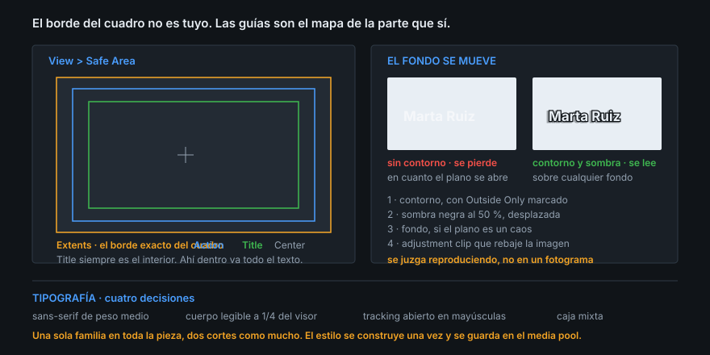

# Legibilidad: safe areas, tipografía y contraste

> Un rótulo tiene un solo trabajo: **leerse a la primera, en el tiempo que está en pantalla, en la
> pantalla en la que se vaya a ver**. Casi todo lo que lo impide es previsible, y casi todo se
> arregla con tres decisiones: dónde va, con qué tipografía y contra qué fondo.

## 🎯 Objetivos

- Definir **safe area**, **action safe** y **title safe**, y saber por qué siguen existiendo
- Encender las guías de encuadre y elegir la relación de aspecto que quieres proteger
- Elegir una tipografía por criterio de legibilidad, no por gusto
- Resolver el contraste de un rótulo sobre una imagen que cambia
- Calcular cuánto tiempo tiene que estar un rótulo en pantalla
- Guardar un rótulo con su estilo en el media pool y reutilizarlo

---

## 1. Qué problema resuelve

Tu rótulo se lee perfectamente en tu monitor de 27 pulgadas, a oscuras, mirándolo fijo y sabiendo
lo que pone.

Lo va a ver alguien en un móvil, con la mitad del brillo, mientras hace otra cosa, y con la
interfaz de una aplicación tapándole los bordes. Y si tu pieza se recorta a vertical para otra
plataforma, se le van a ir los lados.

Los tres problemas —**el recorte**, **la tipografía** y **el contraste**— tienen solución técnica y
se resuelven antes de escribir, no después.

---

## 2. Cómo funciona

### 2.1 Qué es una safe area

Una **safe area** (*safe area*, «zona segura») es un rectángulo, más pequeño que el cuadro, dentro
del cual se garantiza que lo que pongas se va a ver.

Nació con los televisores de tubo, que recortaban un porcentaje variable del borde de la imagen —el
*overscan*— y ninguno recortaba lo mismo. Las pantallas planas no hacen eso, así que la mitad del
motivo original ha desaparecido.

Pero la otra mitad sigue viva, y es más fuerte que la primera:

- Las **aplicaciones** ponen su interfaz encima del vídeo: barras de progreso, botones, nombres de
  cuenta, subtítulos automáticos
- Las **plataformas** recortan a otras relaciones de aspecto: lo que grabaste en 16:9 sale en 9:16
- Los **móviles** tienen muescas, esquinas redondeadas y barras de sistema

Traducido: el borde del cuadro **no es tuyo**. Las safe areas son el mapa de la parte que sí.

### 2.2 Las guías de Resolve

Todas las opciones están en **`View > Safe Area`**, y cada una se enciende y se apaga por separado:

| Guía | Qué dibuja |
| ---- | ---------- |
| **`On/Off`** | Enciende y apaga de golpe todas las que tengas seleccionadas |
| **`Extents`** | El **borde exacto del cuadro**. Útil cuando las guías están puestas en otra relación de aspecto que la del visor |
| **`Action`** | El rectángulo de **acción segura**: aquí dentro va todo el movimiento y todo lo que importa de la imagen |
| **`Title`** | El rectángulo de **título seguro**, más pequeño: aquí dentro va **todo el texto** |
| **`Center`** | Una cruz en el centro exacto del cuadro |
| **`Aspect`** | Habilita el submenú **`View > Select Aspect Ratio`** para cambiar la relación de aspecto de las guías: `1.33`, `1.66`, `1.77`, `1.85`, `2.35` |

Y en la esquina superior derecha del visor está el **icono de guías de encuadre**
(*Safe Area Framing Guide*), con un desplegable que superpone guías de otras relaciones de aspecto
para ver qué se perdería si cambiaras la de la timeline:

- **`Social Media`**: `1:1`, `4:5`, `9:16`, `1.91:1`, `16:9`
- **`Broadcast and Film`**: `Default` —la de tu timeline—, `1.33`, `1.66`, `1.77`, `1.85`, `2.35`

> [!IMPORTANT]
> Sobre los porcentajes, el manual de la versión 21 no es consistente consigo mismo: el capítulo de
> los visores de la página Color describe `Action` como el 90 % exterior del cuadro y `Title` como
> el 80 %, mientras que el capítulo de títulos documenta la casilla
> **«Use custom safe area overlays»** del panel `Editing` de las preferencias, cuyos valores de
> fábrica son **93 % para `Action Area` y 90 % para `Title Area`**.
>
> Lo que no cambia es el orden: **`Title` siempre es más pequeño que `Action`**. Enciende las dos
> guías y mira las tuyas en vez de fiarte de un número.
>
> *Discrepancia observada en el manual de la 21.0.4.5, agosto de 2026.*

### 2.3 La regla del título seguro

Es corta:

> **Todo el texto, dentro de `Title`. Toda la acción, dentro de `Action`. El borde, de nadie.**

Y si tu pieza va a salir en vertical o en cuadrado en algún sitio, enciende además la guía de
`Social Media` que corresponda **antes** de colocar los rótulos. Recolocar quince rótulos después
es una tarde.

### 2.4 La tipografía, en cuatro decisiones

No hace falta saber tipografía para acertar. Hacen falta cuatro decisiones:

| Decisión | Criterio | Por qué |
| -------- | -------- | ------- |
| **Familia** | **Sans-serif**, de peso medio o negrita | Las serifas —los remates de los palos— son detalle fino, y el detalle fino es lo primero que se come la compresión de vídeo |
| **Cuerpo** | Que se lea a **un cuarto del tamaño** al que lo estás mirando | Es la aproximación a un móvil. Reduce el visor y léelo |
| **Interletraje** (`Tracking`) | Un poco **abierto** en mayúsculas, normal en minúsculas | Las mayúsculas juntas se emborronan al escalar |
| **Caja** | **Mixta**, no todo mayúsculas | Las minúsculas tienen ascendentes y descendentes: dan forma reconocible a la palabra |

Y una decisión que no es tipográfica pero cuenta como tal: **una sola familia en toda la pieza**,
con dos cortes como mucho. Cambiar de fuente entre rótulos es la manera más rápida de que una
pieza parezca amateur.

> [!NOTE]
> Fuentes **variables** y fuentes de color: `Text+` y `MultiText` de la versión 21 admiten fuentes
> de color, fuentes de mapa de bits y estilos de fuente, y cuando la fuente lo soporta aparecen
> controles de `Color Palettes` en `Advanced Controls`. No te hace falta esta semana, pero si una
> fuente se ve rara, es un sitio donde mirar.

### 2.5 El contraste, que es donde se falla

Un rótulo blanco sobre un plano oscuro se lee. El mismo rótulo, cuando el plano se abre a un cielo,
desaparece.

Y ese es el problema de verdad: **el fondo de un rótulo se mueve**. No basta con que contraste en
el fotograma en el que lo colocaste.

Las cuatro soluciones, de menos a más invasiva:

| Solución | Cómo | Cuándo |
| -------- | ---- | ------ |
| **Contorno** | Elemento de sombreado con apariencia de contorno, color opuesto al del relleno, `Outside Only` marcado, grosor pequeño | Casi siempre. Es la primera que hay que probar |
| **Sombra** | Elemento de sombreado con apariencia de sombra, negro al 40-60 % de opacidad, desplazada un poco | Junto con el contorno. Las dos se complementan |
| **Fondo** | El grupo `Background` de los generadores clásicos, o `Layout > Background Color` en `Text+` | Cuando el fondo es un caos: multitud, follaje, agua |
| **Rebajar la imagen** | Un adjustment clip que oscurezca la zona por debajo del rótulo | Cuando ninguna de las tres funciona. Es la teoría 08 |

La comprobación es siempre la misma: **reproduce el tramo entero del rótulo**, no lo mires parado.
Si en algún fotograma se pierde, no vale.

> [!TIP]
> El truco más rápido para juzgar contraste: entorna los ojos mirando el visor. Lo que sobrevive al
> desenfoque es lo que se lee en un móvil. Si el rótulo desaparece al entornar, no contrasta lo
> suficiente.

### 2.6 Cuánto tiempo tiene que estar en pantalla

Hay una aproximación que funciona:

> **El tiempo que tú tardas en leerlo en voz alta, dos veces.**

Es generosa a propósito. Quien mira tu pieza no sabe lo que pone, no está esperando el rótulo, y
además está mirando la imagen. Un rótulo de identificación de dos líneas rara vez baja de **tres
segundos**, y con el fundido de entrada y salida se va a cuatro.

Lo contrario —un rótulo eterno— también molesta: cuando ya lo has leído, estorba.

### 2.7 Guardar el estilo y no repetirlo quince veces

Esta es la parte que ahorra la semana. Un rótulo que ya tiene tu tipografía, tu contorno, tu
sombra, tu posición y hasta tus keyframes se puede **guardar**:

> **Arrastra el título desde la timeline hasta el media pool.** Se guarda como un clip aparte, con
> una miniatura que enseña el texto que contiene. Si tenías texto animado o ajustes de vídeo con
> keyframes, **los keyframes se guardan también**.

A partir de ahí se comporta como cualquier clip del media pool: se abre en el visor de origen, se
edita a la timeline, se le cambia el texto y listo.

Es la diferencia entre quince rótulos idénticos y quince rótulos parecidos. En este bootcamp el
sitio donde va es el bin **`13-Titulos`**.

---

## 3. Cómo se hace en Resolve 21

### 3.1 Encender las guías antes de rotular

1. `View > Safe Area > On/Off`
2. `View > Safe Area > Action` y `View > Safe Area > Title`
3. Si tu pieza va a salir también en vertical: el icono de guías de encuadre del visor `>`
   `Social Media > 9:16`

### 3.2 Un rótulo legible sobre cualquier fondo

1. Colócalo dentro de `Title`
2. `Shading`: contorno negro con `Outside Only`, grosor pequeño
3. `Shading`: sombra negra al 50 %, desplazada
4. **Reproduce el tramo entero** y mira si se pierde en algún fotograma
5. Si se pierde: fondo, o adjustment clip que rebaje la imagen debajo

### 3.3 Guardar el estilo en el media pool

1. Selecciona en la `V2` el rótulo que ya está como quieres
2. Selecciona el bin **`13-Titulos`** en el media pool
3. **Arrastra el rótulo desde la timeline al media pool**
4. Renómbralo: doble clic sobre el nombre en el media pool

### 3.4 Reutilizarlo

1. Doble clic sobre el rótulo guardado: se abre en el visor de origen
2. Edítalo a la `V2` donde toque
3. Selecciónalo en la timeline y **cámbiale el texto** en el Inspector

Todo lo demás —fuente, contorno, sombra, posición— ya está.

---

## 4. Antipatrones

| Antipatrón | Por qué duele | Qué hacer |
| ---------- | ------------- | --------- |
| Rotular con las guías apagadas | Los rótulos acaban pegados al borde | `View > Safe Area` antes de escribir |
| Confundir `Action` con `Title` | El texto acaba fuera del rectángulo pequeño | `Title` siempre es el interior |
| Juzgar el contraste en un fotograma | El fondo se mueve | Reproduce el tramo entero |
| Rótulo blanco sin contorno | Desaparece en cuanto el plano se abre | Contorno y sombra, siempre |
| Serifa fina en cuerpo pequeño | La compresión se come el detalle | Sans-serif de peso medio |
| Todo en mayúsculas «porque queda potente» | Se lee peor y ocupa más | Caja mixta |
| Tres familias tipográficas en una pieza | Parece un collage | Una familia, dos cortes |
| Rótulo de un segundo | No da tiempo a leerlo | Léelo en voz alta dos veces y mide |
| Rótulo de doce segundos | Estorba cuando ya lo has leído | Lo mismo, al revés |
| Rehacer el estilo en cada rótulo | Media hora y quince estilos distintos | Guárdalo en el media pool |
| Colocar rótulos en horizontal para una entrega vertical | Se van los lados y hay que recolocarlos todos | Enciende la guía `9:16` antes |

---

## 5. Trucos

| Truco | Cómo |
| ----- | ---- |
| Encender y apagar todas las guías de golpe | `View > Safe Area > On/Off` |
| Ver el borde exacto del cuadro | `View > Safe Area > Extents` |
| Proteger otra relación de aspecto | `View > Safe Area > Aspect` y `View > Select Aspect Ratio` |
| Ver qué se perdería en vertical o en cuadrado | El icono de guías de encuadre del visor `>` `Social Media` |
| Cambiar los porcentajes de las zonas seguras | `DaVinci Resolve > Preferences > User > Editing` `>` casilla de zonas seguras personalizadas |
| Juzgar si un rótulo contrasta | Entorna los ojos mirando el visor |
| Simular cómo se ve en un móvil | Reduce el visor a un cuarto y léelo |
| Que un rótulo aguante cualquier fondo | Contorno con `Outside Only` **y** sombra |
| Medir cuánto tiene que durar un rótulo | Léelo en voz alta dos veces |
| Guardar un rótulo con su estilo y sus keyframes | Arrástralo de la timeline al media pool |
| Reutilizarlo | Doble clic en el media pool, edítalo a la timeline y cámbiale el texto |
| Ponerle nombre al estilo guardado | Doble clic sobre su nombre en el media pool |

---

## 📚 Recursos Adicionales

- [DaVinci Resolve Reference Manual](https://www.blackmagicdesign.com/support/family/davinci-resolve-and-fusion) — capítulo 56, «Using Safe Area Overlays», «Custom Action and Title Safe Areas» y «Saving Titles in the Media Pool for Future Use»; capítulo 127, «Safe Area Overlays in the Viewer».
- [Semana 01 · Aspect ratio y encuadre seguro](../../week-01-fundamentos_de_imagen_en_movimiento/1-teoria/05-aspect-ratio-y-encuadre-seguro.md) — de dónde vienen las relaciones de aspecto y el encuadre seguro.
- [03 · Los cuatro paneles de Text+](03-los-cuatro-paneles-de-text-plus.md) — dónde están el contorno y la sombra.
- [08 · Adjustment clips](08-adjustment-clips.md) — la solución de contraste cuando ninguna otra vale.

---

## ✅ Checklist de Verificación

- [ ] Sé qué es una safe area y por qué sigue importando sin televisores de tubo
- [ ] Sé encender `Action`, `Title`, `Extents` y `Center`, y cuál es más pequeño
- [ ] Sé proteger otra relación de aspecto antes de colocar los rótulos
- [ ] Sé elegir tipografía con criterio de legibilidad
- [ ] Sé resolver el contraste de un rótulo cuyo fondo cambia
- [ ] Sé calcular cuánto tiene que durar un rótulo
- [ ] Sé guardar un rótulo con su estilo en el media pool y reutilizarlo

---

| Anterior | Actual | Siguiente |
| -------- | ------ | --------- |
| [04 · Fusion Titles y plantillas](04-fusion-titles-y-plantillas.md) | **05 · Legibilidad: safe areas, tipografía y contraste** | [06 · Transiciones a fondo](06-transiciones-a-fondo.md) |

← [Volver a la Semana 11](../README.md)
