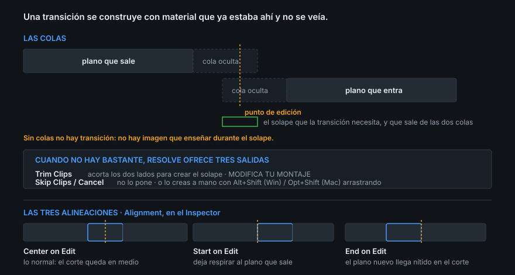

# Transiciones a fondo

> Una transición no se «pone entre dos planos». Se construye **con material que ya estaba ahí y no
> se veía**: las colas. Entender eso explica de golpe por qué a veces Resolve te deja poner una
> disolución y a veces te saca un diálogo, y por qué la respuesta correcta a ese diálogo depende de
> lo que estés montando.

## 🎯 Objetivos

- Explicar de dónde sale el material de una transición y por qué hacen falta **colas**
- Colocar una transición de cinco formas y saber cuál conviene en cada caso
- Decidir entre `Start on Edit`, `Center on Edit` y `End on Edit` con criterio
- Cambiar la transición estándar y su duración de fábrica
- Leer los parámetros del Inspector de una transición: `Style`, ratios, `Ease` y curva
- Saber qué hace `Smooth Cut` y para qué material funciona
- Guardar una transición ajustada como preset

---

## 1. Qué problema resuelve

Dos planos, un corte. A veces el corte es lo correcto y no hay más que hablar.

Pero hay tres sitios donde no lo es:

1. **Un cambio de tiempo o de lugar.** Una disolución dice «ha pasado un rato» sin narrarlo
2. **Un principio o un final.** Un fundido desde negro dice «empieza»
3. **Un corte que no funciona.** Dos planos que casi encajan y chocan

Y hay un cuarto, técnico y muy común: **un salto de eje en una entrevista**. Has quitado un «eh»
del medio de una frase y ahora la persona da un brinco. Eso es un *jump cut*, y hay una transición
hecha específicamente para taparlo.

---

## 2. Cómo funciona

### 2.1 Las colas, que es de donde sale el material

Cuando recortas un clip, el material que dejas fuera **no desaparece**: sigue en el archivo. A esos
fotogramas de más, antes de la entrada y después de la salida, se les llama **colas** (*handles*).

Una transición necesita que los dos planos se **solapen** durante su duración. Y para solaparse,
cada uno tiene que aportar fotogramas que ahora mismo no se ven:

- El plano que sale necesita cola **después** de su punto de salida
- El plano que entra necesita cola **antes** de su punto de entrada

> **Sin colas no hay transición.** No es una limitación de Resolve: es que no hay imagen que
> enseñar durante el solape.

Esto tiene una consecuencia directa sobre cómo montaste en las Semanas 08 y 09: si apuraste un
plano hasta el último fotograma del archivo, ahí no vas a poder poner una disolución.

### 2.2 Qué pasa cuando no hay colas suficientes

Si intentas poner una transición donde no cabe, Resolve abre un diálogo con tres salidas:

| Opción | Qué hace | Cuándo elegirla |
| ------ | -------- | --------------- |
| **`Trim Clips`** | **Acorta** los dos lados del punto de edición lo justo para crear el solape que falta | Cuando el ritmo de esos dos planos aguanta perder unos fotogramas |
| **`Skip Clips`** | No pone transición en los puntos que no dan | Cuando estás poniendo transiciones en varios sitios a la vez y algunos no llegan |
| **`Cancel`** | Cancela todo | Cuando prefieres decidirlo tú, plano a plano |

> [!WARNING]
> **`Trim Clips` modifica tu montaje.** Acorta los dos planos, y si venías de la Semana 09 con el
> ritmo afinado al fotograma, eso lo toca. No deja hueco —el solape se come lo recortado— pero el
> plano ya no dura lo que decidiste. Mira el resultado antes de seguir.

Y hay una forma de crear el solape a mano, arrastrando: **`Alt+Shift`** (Win) / **`Opt+Shift`**
(Mac) mientras arrastras un punto de edición, un clip entero o un clip desde el media pool, hace
que se solape con su vecino y la transición aparece.

### 2.3 Las cinco formas de poner una transición

| Forma | Cómo | Cuándo |
| ----- | ---- | ------ |
| **Arrastrar** | Arrastra la transición desde la `Effects Library` al punto de edición, soltándola centrada, al principio o al final | Cuando quieres una transición concreta y controlar la alineación con el ratón |
| **Doble clic en el icono** | Doble clic sobre la transición en la `Effects Library`: se aplica al final del clip que está bajo el cabezal | Cuando ya sabes dónde está el cabezal |
| **Menú contextual del punto de edición** | Clic derecho sobre un punto de edición entre dos clips con colas `>` una de las cuatro duraciones: **un cuarto de segundo, medio segundo, un segundo o dos segundos** | La más rápida para una disolución estándar |
| **Teclado** | Selecciona el punto de edición y **`Ctrl+T`** (Win) / **`Cmd+T`** (Mac) — `Timeline > Add Transition` | Cuando estás montando con teclado y no quieres soltarlo |
| **A varios puntos a la vez** | Selecciona varios puntos de edición, clic derecho sobre la transición en la `Effects Library` `>` **`Add to Selected Edit Points`** | Cuando quieres la misma transición en diez sitios |

Y dos atajos que separan vídeo de audio, porque muchas veces no quieres las dos cosas:

| Atajo | Qué hace |
| ----- | -------- |
| **`Alt+T`** (Win) / **`Opt+T`** (Mac) | `Timeline > Add Video Only Transition` |
| **`Shift+T`** | `Timeline > Add Audio Only Transition` |

También: **`Shift+Espacio`** abre el buscador de efectos, que incluye transiciones. Al pulsar sobre
una de la lista se aplica **al punto de edición más cercano al cabezal**.

> [!NOTE]
> El manual de la 21.0.4.5 nombra ese comando de dos formas distintas según el capítulo:
> **`Add to Selected Edit Points`** en el capítulo 55, que es el de la Edit page, y
> **`Add to Selected Edit Points and Clips`** en el capítulo 38, que es el de la Cut page. Es el
> mismo comando. Si en tu menú contextual lees la versión larga, es esa.
>
> *Discrepancia observada en el manual de la 21.0.4.5, agosto de 2026.*

### 2.4 La alineación: tres opciones, tres significados

Una transición de un segundo colocada sobre un corte puede repartirse de tres formas:

| Alineación | Dónde queda | Qué significa |
| ---------- | ----------- | ------------- |
| **`Center on Edit`** | Medio segundo antes del corte y medio después | Lo normal. El corte queda en el centro de la disolución |
| **`Start on Edit`** | El segundo entero **después** del corte | El plano nuevo entra disolviéndose sobre el anterior, que ya se había ido |
| **`End on Edit`** | El segundo entero **antes** del corte | El plano nuevo llega limpio justo en el corte |

La diferencia importa cuando el corte está atado a algo: un golpe de música, una palabra, un
gesto. Con `Center on Edit` ese instante queda a medio disolver; con `End on Edit`, llega nítido.

Se cambia después de colocarla: clic derecho sobre la transición `>` alineación, o doble clic para
abrirla en el Inspector y usar el desplegable **`Alignment`**.

Y con teclado: selecciona el punto de edición, pulsa **`U`** hasta elegir principio, centro o
final, y luego `Ctrl+T` / `Cmd+T`. La transición se coloca según lo que hayas seleccionado.

### 2.5 La transición estándar

La transición que sale con `Ctrl+T` / `Cmd+T` y con las opciones del menú contextual es la
**transición estándar**. De fábrica es `Cross Dissolve` y dura **un segundo**.

- **Cambiar cuál es**: clic derecho sobre cualquier transición de la `Effects Library` `>`
  **`Set as Standard Transition`**. Queda marcada con un indicador naranja a la izquierda de su
  nombre
- **Cambiar cuánto dura**: `DaVinci Resolve > Preferences > User > Editing`, ajuste de duración de
  la transición estándar, en segundos o en fotogramas. `Save` al terminar

> [!TIP]
> Si tu pieza pide disoluciones de doce fotogramas, cambia la duración estándar **una vez** y
> ahórrate ajustar cada transición. Es el mismo razonamiento que con la duración de fábrica de los
> generadores.

### 2.6 Los parámetros del Inspector

Doble clic sobre una transición la abre en el Inspector, en su pestaña `Transition`:

| Parámetro | Qué hace |
| --------- | -------- |
| **`Transition Type`** | Cambia a otra transición sin borrar esta |
| **`Duration`** | En segundos y en fotogramas |
| **`Alignment`** | `Start on Edit`, `Center on Edit`, `End on Edit` |
| **`Style`** | Solo en las disoluciones: cómo se mezclan las dos imágenes |
| **`Start Ratio`** | En qué punto del recorrido empieza la transición, de 0 a 100 %. Por encima de 0 arranca **ya empezada** |
| **`End Ratio`** | En qué punto acaba. Por debajo de 100 **no termina de resolver** |
| **`Reverse`** | Invierte la transición. **Desactivado en las disoluciones**: una disolución al revés es la misma |
| **`Ease`** | La aceleración: `None`, `In`, `Out`, `In & Out`, `Custom` |
| **`Transition Curve`** | Con `Ease` en `Custom`, los keyframes que controlan el avance a mano |

Los seis valores de **`Style`** de una `Cross Dissolve`, que es la que más se usa:

| Estilo | Qué hace |
| ------ | -------- |
| **`Video`** | Disolución lineal. El plano que sale se desvanece mientras entra el otro |
| **`Film`** | Disolución logarítmica, imitando la de una copiadora óptica de cine |
| **`Additive`** | Los dos se mezclan en modo aditivo: **la transición se aclara** en la mitad |
| **`Subtractive`** | Modo sustractivo: **se oscurece** en la mitad |
| **`Highlights`** | Modo aclarar: manda lo más claro de cada imagen |
| **`Shadows`** | Modo oscurecer: manda lo más oscuro |

`Film` y `Additive` son los dos que hay que probar cuando una disolución «no se siente bien»: la
lineal se apaga en el centro, y esos dos no.

### 2.7 Las categorías de transición

`Effects Library > Toolbox > Video Transitions`:

| Categoría | Qué hay |
| --------- | ------- |
| **`Dissolve`** | `Additive Dissolve`, `Blur Dissolve`, `Cross Dissolve`, `Dip to Color Dissolve`, `Non-Additive Dissolve`, `Smooth Cut` |
| **`Iris`** | Transiciones que abren o cierran una forma: flecha, cruz, diamante, óvalo… |
| **`Motion`** | Transiciones con desplazamiento |
| **`Shape`** | Transiciones por formas geométricas |
| **`Wipe`** | Barridos |
| **`User`** | **Tus presets**, al final de la lista |
| **`Fusion Transitions`** | Transiciones construidas como composiciones de Fusion |
| **`Resolve FX Transitions`** | Incluye `Burn Away` y `DCTL` |

Y aparte, **`Audio Transitions`**, que son fundidos cruzados de audio, y las transiciones OpenFX de
terceros que tengas instaladas.

En el 95 % de las piezas honradas se usan tres: `Cross Dissolve`, `Dip to Color Dissolve` a negro
—que es el fundido a negro de toda la vida— y `Smooth Cut`. El resto de categorías existen y hay
que saber que están, pero un barrido en forma de estrella tiene un uso muy concreto y casi nunca
es el tuyo.

### 2.8 `Smooth Cut`, la que arregla un salto

**`Smooth Cut`** está en la categoría `Dissolve` pero no es una disolución: es una transición de
propósito específico para **disimular un jump cut**, es decir, un corte en medio de un mismo plano.

Cómo funciona: analiza los dos lados del corte, localiza los mismos rasgos en ambos y **deforma**
uno hacia el otro a lo largo de la transición, de modo que el sujeto pasa de una posición a la
siguiente sin brinco.

Dónde funciona bien, según el manual:

- **Entrevistas sentadas y planos cortos de cabeza**, con poco movimiento de fondo y de sujeto
- Cuando la posición del sujeto **no cambia mucho** entre los dos lados del corte
- Con duraciones **cortas**: aunque la duración de fábrica de cualquier transición es un segundo,
  `Smooth Cut` funciona mucho mejor entre **2 y 6 fotogramas**

Y dónde no: cuanto más se mueva el fondo y más cambie de posición quien habla, peor sale.

Su desplegable **`Mode`** tiene dos opciones: **`Better`**, que es la de fábrica y conserva el
movimiento del sujeto durante la transición, y **`Faster`**, que interpola entre dos imágenes
fijas. `Better` gana casi siempre.

> [!IMPORTANT]
> Desde DaVinci Resolve 20, `Smooth Cut` usa un motor de `Speed Warp` con inteligencia artificial,
> y su Inspector trae una casilla `Speed Warp` que, al desmarcarla, vuelve al método anterior
> basado en flujo óptico.
>
> El manual **no marca `Smooth Cut` como función exclusiva de Studio**, pero el motor `Speed Warp`
> sí lo es cuando se usa en un retime, como viste en la Semana 10. Si en tu instalación de Free la
> casilla no aparece o el resultado es el de flujo óptico, es esperable y la transición sigue
> funcionando. **Compruébalo en tu instalación antes de contar con ello para un entregable.**
>
> *Comportamiento documentado en el manual de la 21.0.4.5; no verificado en Free, agosto de 2026.*

### 2.9 Copiar, mover y guardar

| Quiero | Cómo |
| ------ | ---- |
| **Mover** una transición a otro corte | Selecciónala y arrástrala |
| **Copiar** una transición a otro corte | **`Alt`** (Win) / **`Opt`** (Mac) + arrastrar |
| **Copiarla a muchos cortes** | Clic derecho `>` `Copy` (o `Ctrl+C` / `Cmd+C`); mantén **`Ctrl`** / **`Cmd`** y selecciona todos los puntos de edición, que se marcan en verde; suelta, clic derecho en uno `>` `Paste` |
| **Cambiar el tipo** sin borrarla | Arrastra otra transición encima, o cámbiala en `Transition Type` |
| **Cambiar la duración** | Arrastra su borde, o `Ctrl+D` / `Cmd+D` (`Change Transition Duration`), o el campo del Inspector |
| **Cambiar solo un lado** | **`Ctrl`** / **`Cmd`** mientras arrastras el borde |
| **Seleccionarlas todas** | `Timeline > Select Transitions` |
| **Borrarla** | Selecciónala y `Suprimir` |
| **Guardarla como preset** | Ajústala, clic derecho `>` **`Create Transition Preset`**, ponle nombre. Aparece en la categoría `User` |
| **Borrar un preset** | Clic derecho sobre él `>` `Delete Transition Preset` |

---

## 3. Cómo se hace en Resolve 21

### 3.1 Una disolución donde hay colas

1. Coloca el cabezal cerca del corte y pulsa **`V`** para seleccionar el punto de edición
2. **`Ctrl+T`** (Win) / **`Cmd+T`** (Mac)
3. Reproduce
4. Si es larga o corta: arrastra su borde, o **`Ctrl+D`** / **`Cmd+D`** y escribe la duración

### 3.2 Una disolución donde no hay colas

1. Intenta ponerla igual
2. En el diálogo, decide:
   - Ese corte aguanta perder fotogramas `>` **`Trim Clips`**
   - No los aguanta `>` **`Cancel`**, y crea el solape a mano con `Alt+Shift` / `Opt+Shift`
     arrastrando, o busca otra solución para ese corte

### 3.3 Un fundido desde negro al principio de la pieza

1. `Effects Library > Toolbox > Video Transitions > Dissolve > Dip to Color Dissolve`
2. Arrástralo al **primer** punto de edición
3. Inspector `>` `Color` en negro
4. `Alignment` `>` `Start on Edit`, para que el negro esté antes de la imagen

> [!NOTE]
> Para fundir desde negro al principio del **primer** clip no hace falta transición: bastan las
> asas de fundido del propio clip, o dos keyframes de `Opacity`. La transición es para fundir
> **entre** dos cosas.

### 3.4 Tapar un jump cut con `Smooth Cut`

1. Localiza el corte que da el brinco
2. `Effects Library > Toolbox > Video Transitions > Dissolve > Smooth Cut`, arrástralo encima
3. Inspector `>` `Duration`: bájala a **4 fotogramas**
4. Reproduce a velocidad normal
5. Si se ve la deformación, prueba con 2 fotogramas. Si sigue viéndose, ese corte no es para
   `Smooth Cut`: tápalo con un plano de recurso

### 3.5 Guardar tu disolución como preset

1. Pon una `Cross Dissolve` y ajústala: duración, `Style` en `Film`, `Ease` en `In & Out`
2. Clic derecho `>` **`Create Transition Preset`**
3. Nómbrala
4. Clic derecho sobre ella en `User` `>` **`Set as Standard Transition`** si va a ser la de la pieza

---

## 4. Antipatrones

| Antipatrón | Por qué duele | Qué hacer |
| ---------- | ------------- | --------- |
| Poner transiciones «para que no quede seco» | Un corte bien puesto no queda seco | La transición dice algo: tiempo, lugar, principio o final |
| Aceptar `Trim Clips` sin mirar | Te acorta los dos planos y te toca el ritmo de la Semana 09 | Míralo, o crea el solape a mano |
| Montar sin dejar colas y luego querer disolver | No hay imagen que enseñar | Deja colas al recortar, desde ahora |
| Dejar todas las transiciones centradas | Cuando el corte está atado a un golpe, `Center` lo emborrona | `End on Edit` en esos casos |
| Ajustar quince transiciones una a una | La estándar y su duración se cambian una vez | Preferencias, y `Set as Standard Transition` |
| `Smooth Cut` de un segundo | Se ve la deformación | Entre 2 y 6 fotogramas |
| `Smooth Cut` sobre un plano con movimiento | No hay rasgos estables que emparejar | Tápalo con un recurso |
| Barridos con forma en una pieza seria | Llaman la atención sobre sí mismos | `Cross Dissolve`, `Dip to Color`, `Smooth Cut` |
| Cuatro tipos de transición en la misma pieza | Parece una demostración de transiciones | Uno o dos, y consistencia |
| Poner una transición de vídeo y que arrastre el audio | El audio hace un fundido que no querías | `Alt+T` / `Opt+T` para vídeo solo |

---

## 5. Trucos

| Truco | Cómo |
| ----- | ---- |
| Seleccionar el punto de edición más cercano | `V` |
| Elegir principio, centro o final de un punto de edición | `U`, que va rotando |
| Transición estándar de vídeo y audio | `Ctrl+T` (Win) / `Cmd+T` (Mac) |
| Solo vídeo | `Alt+T` (Win) / `Opt+T` (Mac) |
| Solo audio | `Shift+T` |
| Cuatro duraciones sin abrir nada | Clic derecho sobre el punto de edición |
| La misma transición en diez cortes | Selecciona los puntos, clic derecho en la transición `>` `Add to Selected Edit Points` |
| Buscar una transición por nombre | `Shift+Espacio` |
| Previsualizar una transición sin colocarla | `Hover Scrub Preview` y pasa el ratón por la miniatura |
| Crear el solape que falta a mano | `Alt+Shift` (Win) / `Opt+Shift` (Mac) + arrastrar |
| Cambiar la duración con un número | `Ctrl+D` (Win) / `Cmd+D` (Mac) |
| Alargar solo un lado de la transición | `Ctrl` / `Cmd` mientras arrastras el borde |
| Copiar una transición a otro corte | `Alt` / `Opt` + arrastrar |
| Copiarla a muchos cortes de golpe | `Ctrl+C`, `Ctrl`/`Cmd` + clic en los puntos, `Paste` |
| Cambiar el tipo sin borrarla | Arrastra otra encima |
| Seleccionar todas las transiciones | `Timeline > Select Transitions` |
| Cambiar la transición estándar | Clic derecho `>` `Set as Standard Transition` |
| Cambiar su duración de fábrica | `DaVinci Resolve > Preferences > User > Editing` |
| Guardar tu transición ajustada | Clic derecho `>` `Create Transition Preset` |
| Marcar tus transiciones como favoritas | La estrella a la derecha del nombre |
| Que una disolución no se apague en el centro | `Style` en `Film` o en `Additive` |
| Convertir una transición en composición de Fusion | Clic derecho `>` `Convert to Fusion Cross Dissolve`, y luego `Open in Fusion Page` |

---

## 📚 Recursos Adicionales

- [DaVinci Resolve Reference Manual](https://www.blackmagicdesign.com/support/family/davinci-resolve-and-fusion) — capítulo 55 entero: «Adding and Editing Transitions», «Adding Transitions When There's Not Enough Handles», «Transition Properties in the Inspector», «Changing the Standard Transition», «Creating Transition Presets» y el catálogo de transiciones de vídeo.
- [Semana 09 · Trimming quirúrgico](../../week-09-trimming_quirurgico/README.md) — de dónde salen las colas que ahora hacen falta.
- [Semana 10 · Cómo Resolve inventa los fotogramas que faltan](../../week-10-velocidad_transformaciones_y_estabilizacion/1-teoria/06-como-resolve-inventa-fotogramas.md) — el flujo óptico y el `Speed Warp` que usa `Smooth Cut`.
- [07 · Las categorías de ResolveFX](07-las-categorias-de-resolvefx.md) — los efectos, que se colocan de otra forma.

---

## ✅ Checklist de Verificación

- [ ] Sé qué son las colas y por qué una transición las necesita
- [ ] Sé qué hacen `Trim Clips`, `Skip Clips` y `Cancel`, y cuál toca mi montaje
- [ ] Sé poner una transición de al menos tres formas distintas
- [ ] Sé elegir entre las tres alineaciones con un criterio
- [ ] Sé cambiar la transición estándar y su duración
- [ ] Sé qué hacen `Style`, los ratios y `Ease` en el Inspector
- [ ] Sé para qué material sirve `Smooth Cut` y con qué duración
- [ ] Sé guardar una transición ajustada como preset

---

| Anterior | Actual | Siguiente |
| -------- | ------ | --------- |
| [05 · Legibilidad: safe areas, tipografía y contraste](05-legibilidad-safe-areas-y-contraste.md) | **06 · Transiciones a fondo** | [07 · Las categorías de ResolveFX](07-las-categorias-de-resolvefx.md) |

← [Volver a la Semana 11](../README.md)
