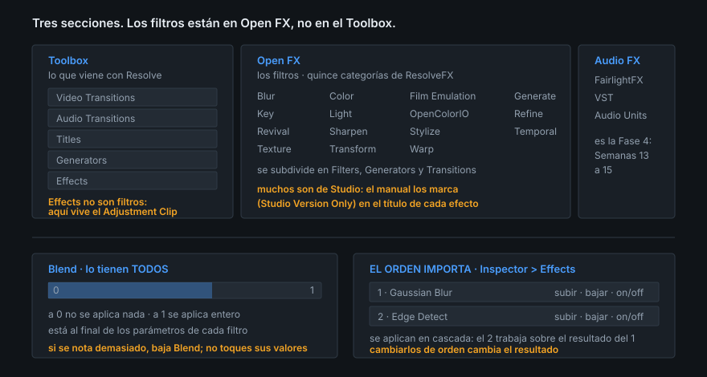

# Las categorías de ResolveFX

> La `Effects Library` tiene cientos de efectos y ninguna forma obvia de saber cuál sirve para qué.
> Pero está ordenada, y su orden significa algo. Con entender **las tres secciones grandes y las
> quince categorías de ResolveFX** dejas de buscar a ciegas: sabes en qué carpeta está lo que
> necesitas antes de abrirla.

## 🎯 Objetivos

- Distinguir las tres secciones de la `Effects Library`: `Toolbox`, `Open FX` y `Audio FX`
- Enumerar las quince categorías de **ResolveFX** y decir para qué sirve cada una
- Aplicar un filtro a un clip de cuatro formas distintas
- Manejar la pestaña `Effects` del Inspector: orden, apagado, borrado y reinicio
- Explicar qué hace el parámetro **`Blend`**, que tienen todos
- Saber cuáles son de Studio y cómo se reconoce uno antes de perder el tiempo
- Saber qué es `Render in Place` y por qué no es un camino de ida

---

## 1. Qué problema resuelve

Un plano tiene un logotipo que no debería salir. Otro está demasiado plano y pide algo. Otro va a
llevar un rótulo encima y necesita que la esquina se oscurezca para que se lea.

Los tres se resuelven con un **filtro**: un efecto que se aplica a un clip y modifica su imagen.

El problema no es aplicarlo —es arrastrar— sino **encontrar el correcto** y **saber en qué orden se
aplican** cuando pones dos.

---

## 2. Cómo funciona

### 2.1 Las tres secciones

El panel se abre con el botón **`Effects`** de la barra de herramientas de la Edit page, y tiene
una lista de carpetas a la izquierda:

| Sección | Qué contiene |
| ------- | ------------ |
| **`Toolbox`** | Todo lo que **viene con Resolve**: `Video Transitions`, `Audio Transitions`, `Titles`, `Generators` y `Effects` |
| **`Open FX`** | Los **filtros de ResolveFX** y los plugins OpenFX de terceros que tengas instalados. Se subdivide en `Filters`, `Generators` y `Transitions` |
| **`Audio FX`** | Los **FairlightFX** nativos, y en macOS y Windows los VST de terceros; en macOS, además, los Audio Units |

Un matiz que confunde: la carpeta **`Effects`** del `Toolbox` **no son filtros**. El manual la
describe como marcadores de posición en la timeline que permiten composición en Fusion o que
modifican las pistas de debajo con un adjustment clip. Ahí es donde vive el `Adjustment Clip` de
la teoría 08.

Los filtros de verdad están en **`Open FX > Filters`**.

### 2.2 Las quince categorías de ResolveFX

Los ResolveFX vienen ordenados por categoría, y la categoría dice para qué sirven:

| Categoría | Para qué |
| --------- | -------- |
| **`Resolve FX Blur`** | Desenfoques de distintos tipos: caja, direccional, gaussiano, mosaico, radial, de zoom |
| **`Resolve FX Color`** | Operaciones de color que no están en las ruedas: transformaciones de espacio de color, compresores, estabilizadores |
| **`Resolve FX Film Emulation`** | Emular características del cine fotoquímico: grano, halación, daño de película, viñeta |
| **`Resolve FX Generate`** | Generar imagen: patrones, paletas |
| **`Resolve FX Key`** | Recortar por color o por luminancia. Es la materia de la Semana 25 |
| **`Resolve FX Light`** | Efectos ópticos y de luz: `Glow`, `Light Rays`, `Cinematic Haze`, destellos de lente |
| **`Resolve FX OpenColorIO`** | Conversiones de color por OpenColorIO |
| **`Resolve FX Refine`** | Retoque fino sobre personas y sobre profundidad: piel, imperfecciones, mapas de profundidad |
| **`Resolve FX Revival`** | Reparar material dañado: suciedad, parpadeo, líneas muertas |
| **`Resolve FX Sharpen`** | Enfoque por niveles de detalle. **Toda la categoría es de Studio** |
| **`Resolve FX Stylize`** | Modificaciones artísticas: `Prism Blur`, `Edge Detect`, `Emboss`, `Mirrors`, `Scanlines`, sustitución de cielo |
| **`Resolve FX Temporal`** | Efectos que usan varios fotogramas a la vez |
| **`Resolve FX Texture`** | Añadir textura: ruido rápido, daño de JPEG, daño analógico |
| **`Resolve FX Transform`** | Transformaciones que no caben en el Inspector: seguimiento de movimiento, collage de vídeo |
| **`Resolve FX Warp`** | Deformar la imagen: `Dent`, `Ripples`, `Vortex`, `Waviness` |

No hace falta memorizarlas. Hace falta saber que **existen quince** y que la respuesta a «¿dónde
está el desenfoque?» es `Blur`, y la de «¿dónde está el brillo bonito?» es `Light`.

> [!TIP]
> El buscador de la `Effects Library` **acepta el nombre de la categoría como término de búsqueda**.
> Escribir `Stylize` en el campo de búsqueda saca todos los ResolveFX de esa sección. También
> funciona con `Shift+Espacio`.

### 2.3 `Blend`: el parámetro que tienen todos

**Todos y cada uno** de los ResolveFX tienen un control **`Blend`** al final de sus parámetros.
Mezcla el resultado del filtro con la imagen original: a `0` no se aplica nada, a `1` se aplica
entero.

Es la herramienta de dosificación. Cuando un efecto «funciona pero se nota demasiado», casi nunca
hay que rehacer sus parámetros: hay que bajar `Blend`.

### 2.4 Cuáles son de Studio

Muchos ResolveFX son exclusivos de DaVinci Resolve Studio. El manual los marca en su propio título
con **`(Studio Version Only)`**, y en una instalación de Free sencillamente no aparecen en la
lista.

Algunos verificados en el manual de la 21.0.4.5:

| Categoría | De Studio |
| --------- | --------- |
| `Blur` | `CineFocus`, `Lens Blur` |
| `Color` | `Color Compressor`, `Color Stabilizer`, `Contrast Pop`, `DCTL`, `Dehaze`, `False Color`, `Gamut Mapping` |
| `Film Emulation` | `Camera Shake`, `Film Grain`, `Film Look Creator`, `Halation` |
| `Light` | `Aperture Diffraction`, `Lens Flare`, `Lens Reflections` |
| `Sharpen` | **Los tres**: `Sharpen`, `Sharpen Edges`, `Soften and Sharpen` |
| `Stylize` | `Abstraction`, `Pencil Sketch in DaVinci Resolve` |
| `Texture` | `Analog Damage`, `Detail Recovery`, `Texture Pop` |
| `Transform` | `Match Move`, `Surface Tracker` |
| `Warp` | `Lens Distortion`, `Warper` |

Y algunos que **sí** están en Free, que son con los que se trabaja esta semana: `Box Blur`,
`Directional Blur`, `Gaussian Blur`, `Mosaic Blur`, `Radial Blur`, `Zoom Blur`, `Glow`,
`Light Rays`, `Prism Blur`, `Edge Detect`, `Emboss`, `Mirrors`, `Scanlines`, `Dent`, `Ripples`,
`Vortex`, `Waviness`, `Fast Noise`, `JPEG Damage`.

> [!IMPORTANT]
> **Ningún entregable de esta semana depende de un ResolveFX de Studio.** El efecto de la práctica
> 03 es un `Gaussian Blur`, que está en Free.
>
> La fuente de verdad sobre qué está en cada versión es la comparativa oficial:
> <https://www.blackmagicdesign.com/products/davinciresolve/studio>. Cualquier tabla de terceros,
> esta incluida, va por detrás.
>
> *Marcas de Studio leídas del manual de la 21.0.4.5, agosto de 2026.*

### 2.5 `Show Legacy Resolve FX`

Con el tiempo algunos ResolveFX se retiran, porque su función se absorbe en otro o porque se
reescriben. Siguen accesibles: menú de tres puntos de la pestaña `Effects` `>`
**`Show Legacy Resolve FX`**. Desmarcarlo los vuelve a esconder.

Sirve para abrir un proyecto viejo que los usaba. No es sitio para empezar nada nuevo.

### 2.6 Las cuatro formas de aplicar un filtro

| Forma | Cómo |
| ----- | ---- |
| **Arrastrar al clip** | Del panel a un clip de la timeline |
| **Doble clic** | Sobre el filtro en la `Effects Library`, con el clip **seleccionado** |
| **Arrastrar al Inspector** | Del panel al Inspector, con el clip seleccionado |
| **Arrastrar al visor** | Del panel al visor: se aplica al clip que se está viendo |

Y para **varios clips a la vez**: selecciónalos todos y arrastra el filtro sobre cualquiera de
ellos. Esta operación se puede deshacer con `Ctrl+Z` / `Cmd+Z`.

También `Shift+Espacio` abre el buscador: con un clip seleccionado, pulsar sobre un efecto de la
lista lo aplica.

### 2.7 La pestaña `Effects` del Inspector

Los filtros aplicados a un clip viven en la pestaña **`Effects`** del Inspector, agrupados por tipo:
`Fusion`, `Open FX` o `Audio`. **Si el clip no tiene ningún efecto, la pestaña está atenuada.**

Cada filtro tiene su propia barra de título con estos controles:

| Control | Qué hace |
| ------- | -------- |
| **Flechas de subir y bajar** | **Cambian el orden en el que se aplican**. Están a la izquierda del icono de papelera |
| **Interruptor** | Apaga y enciende ese filtro. Naranja es encendido, gris apagado |
| **Papelera** | Lo borra |
| **`Reset`** | Devuelve sus parámetros a los de fábrica |
| **Doble clic en la barra** | Abre y cierra sus parámetros |

> [!IMPORTANT]
> **El orden importa.** Los filtros se aplican en cascada: el segundo trabaja sobre el resultado del
> primero. Un desenfoque seguido de un realce de bordes no da lo mismo que un realce de bordes
> seguido de un desenfoque. Cuando un apilamiento de dos efectos «no hace lo que debería», lo
> primero que hay que probar es cambiarlos de orden con las flechas.

Los filtros aceptan **keyframes**, con el mismo mecanismo de la Semana 10. Y algunos traen
controles en pantalla, que se encienden desde el modo **`OFX`** del desplegable de overlays del
visor de timeline.

### 2.8 `Render in Place`, cuando la reproducción no da

Si un clip con efectos no se reproduce en tiempo real y el render cache no basta, existe
**`Render in Place`**: clic derecho sobre el clip `>` `Render in Place`. Crea un **archivo nuevo**
con los efectos ya incrustados y lo pone en lugar del clip original en la timeline. El archivo
aparece también en el media pool.

El diálogo deja elegir formato, códec, colas y qué se incrusta: efectos de vídeo, composición de
Fusion, etalonaje, y si se renderiza a la resolución del original o a la de la timeline.

Y lo importante: **no es un camino de ida**. Clic derecho `>` **`Decompose to Original`** devuelve
el clip original con sus efectos editables. El archivo renderizado no se borra —se queda en disco y
en el media pool—, pero la timeline vuelve a tener el clip de antes.

> [!WARNING]
> `Render in Place` **escribe un archivo nuevo en disco**, en la misma carpeta que el material de
> origen. En una pieza con veinte clips renderizados en sitio eso son veinte archivos más que hay
> que llevarse en el archivado de la Semana 30. Úsalo cuando haga falta, no por costumbre.

---

## 3. Cómo se hace en Resolve 21

### 3.1 Aplicar un desenfoque a un clip

1. `Effects Library > Open FX > Filters > Resolve FX Blur > Gaussian Blur`
2. Arrástralo sobre el clip
3. `Inspector > Effects`: ahí están sus parámetros
4. Ajusta la intensidad, y si se pasa, baja **`Blend`**

### 3.2 Encontrar un efecto sin saber dónde está

1. **`Shift+Espacio`**
2. Escribe una palabra: el nombre del efecto o el de su categoría
3. Con el clip seleccionado, pulsa sobre el resultado

### 3.3 Cambiar el orden de dos filtros

1. `Inspector > Effects`
2. Flechas de subir o bajar en la barra de título del filtro que quieras mover
3. Compara: apaga y enciende los interruptores

### 3.4 Copiar un efecto a otros clips

1. Selecciona el clip que ya lo tiene y **`Ctrl+C`** / **`Cmd+C`**
2. Selecciona los clips de destino
3. `Edit > Paste Attributes` — **`Alt+V`** (Win) / **`Opt+V`** (Mac)
4. Marca la casilla del efecto que quieres pegar y `Apply`

### 3.5 Quitar un efecto de varios clips

1. Selecciónalos
2. `Edit > Remove Attributes`
3. Marca lo que quieras quitar y `Apply`

---

## 4. Antipatrones

| Antipatrón | Por qué duele | Qué hacer |
| ---------- | ------------- | --------- |
| Buscar los filtros en el `Toolbox` | Ahí están las transiciones, títulos, generadores y el adjustment clip | `Open FX > Filters` |
| Bajar los parámetros de un efecto para dosificarlo | Cambias su carácter en vez de su cantidad | `Blend` |
| Apilar tres efectos sin mirar el orden | El resultado depende del orden y no lo controlas | Las flechas de la barra de título |
| Aplicar el mismo efecto clip a clip a diez planos | Diez veces el mismo trabajo y diez valores distintos | Adjustment clip (teoría 08) o `Paste Attributes` |
| Empezar en `Legacy Resolve FX` | Son efectos retirados | Solo para abrir proyectos viejos |
| Perder media hora buscando un efecto que no está en Free | Está marcado `(Studio Version Only)` en el manual | La tabla de 2.4 y la comparativa oficial |
| `Render in Place` en veinte clips por comodidad | Veinte archivos nuevos que arrastras hasta la Semana 30 | Render cache primero |
| Creer que `Render in Place` no tiene vuelta atrás | Sí la tiene | `Decompose to Original` |
| Poner un efecto porque el plano «está soso» | Un plano soso con un efecto es un plano soso con un efecto | El problema suele ser de montaje o de color |

---

## 5. Trucos

| Truco | Cómo |
| ----- | ---- |
| Buscar un efecto por nombre o por categoría | `Shift+Espacio`, o la lupa del panel |
| Buscar en toda la biblioteca o solo en la carpeta abierta | El desplegable a la derecha de la lupa |
| Previsualizar un efecto sin aplicarlo | `Hover Scrub Preview` y pasa el ratón por la miniatura |
| Aplicar un efecto al clip seleccionado sin arrastrar | Doble clic sobre el efecto |
| Aplicarlo a varios clips | Selecciónalos todos y arrastra sobre cualquiera |
| Dosificar cualquier ResolveFX | `Blend`, que lo tienen todos |
| Ver qué clips llevan efectos | Se pintan de un tono más oscuro |
| Cambiar el orden de aplicación | Las flechas de la barra de título del filtro |
| Comparar con y sin | El interruptor de la barra de título |
| Devolver un filtro a sus valores de fábrica | El botón `Reset` de su barra |
| Abrir o cerrar todos los filtros de un clip | `Alt` (Win) / `Opt` (Mac) + clic en una barra de título |
| Encender los controles en pantalla de un efecto | Desplegable de overlays del visor `>` `OFX` |
| Copiar efectos de un clip a otros | `Ctrl+C` y `Edit > Paste Attributes` — `Alt+V` / `Opt+V` |
| Quitar efectos de varios clips | `Edit > Remove Attributes` |
| Ver los efectos retirados | Menú de tres puntos `>` `Show Legacy Resolve FX` |
| Incrustar los efectos de un clip en un archivo | Clic derecho `>` `Render in Place` |
| Deshacerlo | Clic derecho `>` `Decompose to Original` |

---

## 📚 Recursos Adicionales

- [DaVinci Resolve Reference Manual](https://www.blackmagicdesign.com/support/family/davinci-resolve-and-fusion) — capítulo 54, «Using the Effects Library», «The Toolbox», «Open FX», «Adding Filters to Video Clips», «Render in Place» y «Paste Attributes»; capítulo 154, «Catalogue of Resolve FX Filters» y «Show Legacy Resolve FX», y los capítulos 155 a 169, uno por categoría.
- [Comparativa oficial Free / Studio](https://www.blackmagicdesign.com/products/davinciresolve/studio) — la fuente de verdad sobre qué efecto está en cada versión.
- [08 · Adjustment clips](08-adjustment-clips.md) — cómo aplicar uno de estos efectos a diez planos de una vez.
- [Semana 10 · Keyframes: Inspector, Keyframe Editor y Curve Editor](../../week-10-velocidad_transformaciones_y_estabilizacion/1-teoria/08-keyframes-inspector-y-curve-editor.md) — cómo se animan los parámetros de un filtro.

---

## ✅ Checklist de Verificación

- [ ] Sé qué hay en `Toolbox`, en `Open FX` y en `Audio FX`
- [ ] Sé que la carpeta `Effects` del `Toolbox` no son filtros
- [ ] Sé enumerar las categorías de ResolveFX y para qué sirve cada una
- [ ] Sé qué hace `Blend` y por qué lo tienen todos
- [ ] Sé cómo se reconoce un efecto de Studio antes de buscarlo
- [ ] Sé cambiar el orden en el que se aplican dos filtros y por qué importa
- [ ] Sé qué hace `Render in Place` y cómo se deshace

---

| Anterior | Actual | Siguiente |
| -------- | ------ | --------- |
| [06 · Transiciones a fondo](06-transiciones-a-fondo.md) | **07 · Las categorías de ResolveFX** | [08 · Adjustment clips](08-adjustment-clips.md) |

← [Volver a la Semana 11](../README.md)
