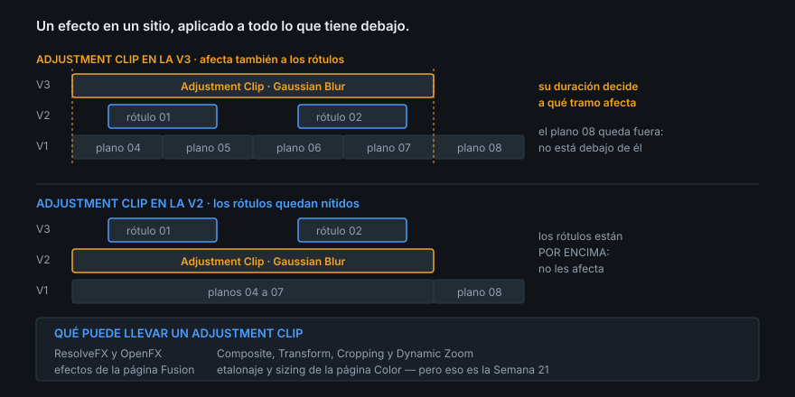

# Adjustment clips

> Un efecto aplicado a diez planos, uno a uno, son diez trabajos que hay que rehacer diez veces
> cuando cambies de idea. El **adjustment clip** convierte esos diez trabajos en uno: un clip
> transparente que se pone encima y afecta a todo lo que tiene debajo, mientras dure.

## 🎯 Objetivos

- Explicar qué es un adjustment clip y por qué afecta a las pistas de abajo
- Enumerar los cuatro tipos de ajuste que puede aplicar
- Colocarlo en la pista correcta y saber por qué esa y no otra
- Decidir entre adjustment clip, `Paste Attributes` y efecto por clip
- Guardarlo en el media pool con su configuración
- Reconocer los tres casos en los que un adjustment clip es la respuesta y los dos en los que no

---

## 1. Qué problema resuelve

Tres situaciones concretas de esta semana:

1. Tienes **cuatro planos seguidos** que forman un recuerdo, y quieren un desenfoque suave y una
   viñeta. Los cuatro igual
2. Vas a poner un rótulo sobre una **esquina clara** y necesitas oscurecerla para que se lea, en
   ese tramo y solo ahí
3. La pieza entera pide un **último toque** común: un grano, un ligero recorte, un realce

En los tres, aplicar el efecto clip a clip funciona… hasta que cambias de idea. Entonces hay que
tocar cuatro Inspectores, o quince, y los valores se descuadran.

El adjustment clip lo convierte en **un solo sitio donde tocar**.

---

## 2. Cómo funciona

### 2.1 Qué es

Un **adjustment clip** (*adjustment clip*) es un clip **transparente**, disponible en
`Effects Library > Toolbox > Effects`, que no genera imagen propia. Su único trabajo es **llevar
efectos**.

La regla es una:

> **Los efectos que le pongas a un adjustment clip se aplican a todos los clips que estén debajo
> de él, durante el tiempo que dure.**

«Debajo» es literal: **pistas inferiores**. Un adjustment clip en la `V3` afecta a lo que haya en
la `V2` y en la `V1` mientras él exista. Ni antes ni después.

### 2.2 Los cuatro tipos de ajuste que puede llevar

El manual los enumera, y son más de los que la gente supone:

| Tipo | Qué significa |
| ---- | ------------- |
| **ResolveFX y plugins OpenFX** | Cualquier filtro de la sección `Open FX` |
| **Parámetros del Inspector** | `Composite`, `Transform`, `Cropping` y `Dynamic Zoom` |
| **Efectos de la página Fusion** | Una composición aplicada al adjustment clip afecta a todo lo de debajo |
| **Etalonaje y sizing de la página Color** | Un grado aplicado al adjustment clip se aplica a todo lo de debajo |

El segundo tiene una consecuencia práctica que se usa mucho: un adjustment clip con un `Transform`
**reencuadra todo lo que hay debajo a la vez**. Y el cuarto es la base de una técnica que verás en
la Semana 21: el look global de la pieza en un solo sitio.

### 2.3 Dónde va, exactamente

En este bootcamp la convención es:

| Pista | Qué lleva | Por qué |
| ----- | --------- | ------- |
| `V1` | El montaje | |
| `V2` | Los rótulos | |
| **`V3` y superiores** | **Los adjustment clips** | Porque tienen que estar **por encima de todo lo que quieren afectar** |

Y de ahí sale la decisión que hay que tomar en cada caso:

| Si el adjustment clip está… | Afecta a… |
| --------------------------- | --------- |
| En la **`V3`**, encima de imagen y rótulos | **Todo**, rótulos incluidos |
| En la **`V2`**, entre los rótulos | Solo la imagen. **Los rótulos no**, porque están a su lado, no debajo |

Las dos son útiles y hay que elegir a conciencia. Un desenfoque general que también desenfoque los
rótulos casi nunca es lo que quieres; un grano de película que también los granule, sí.

> [!IMPORTANT]
> Un adjustment clip colocado **entre** los rótulos en la `V2` ocupa sitio en esa pista y puede
> desplazarlos. Si tienes que afectar solo a la imagen, la solución limpia es **mover los rótulos a
> la `V3`** y dejar el adjustment clip en la `V2`, en vez de apretujarlo entre ellos.

### 2.4 Se comporta como un clip

Todo lo demás es lo que ya sabes:

- Se **recorta** arrastrando sus bordes, y ahí es donde se decide a qué tramo afecta
- Se **mueve**, se copia y se pega
- Se le pueden poner **keyframes**: un efecto que entra y sale progresivamente
- Se **cachea** como cualquier clip de vídeo, con `Playback > Render Cache`
- Se le puede poner un **nombre** desde el Inspector, que es lo que hay que hacer en cuanto tengas
  dos

### 2.5 Guardarlo para reutilizarlo

Igual que un título: **arrastra el adjustment clip desde la timeline al media pool** y se guarda
como un elemento más, con sus efectos y sus valores. A partir de ahí se gestiona como cualquier
otro medio y se edita a otra timeline cuando haga falta.

En este bootcamp va al bin **`13-Titulos`**, junto con el estilo de rótulo guardado.

### 2.6 Adjustment clip, `Paste Attributes` o efecto por clip

Las tres formas de aplicar lo mismo a varios planos, y cuándo cada una:

| Forma | Qué hace | Cuándo |
| ----- | -------- | ------ |
| **Adjustment clip** | Un solo sitio donde tocar; afecta a un **tramo continuo** | Planos **seguidos** que necesitan lo mismo, o cuando vas a cambiar de idea |
| **`Paste Attributes`** | Copia los efectos a cada clip. Quedan **independientes** | Planos **dispersos** por la pieza, o cuando cada uno va a necesitar su ajuste fino |
| **Selección múltiple y arrastrar el efecto** | Aplica el mismo efecto a todos los seleccionados de golpe. También quedan independientes | Cuando quieres el efecto en varios sitios y luego ajustar cada uno |
| **Efecto por clip** | Un efecto en un clip | Cuando el problema es de **ese** plano |

La pregunta que decide es siempre la misma: **¿esto va a cambiar?** Si va a cambiar, adjustment
clip. Si es la corrección definitiva de un plano concreto, efecto por clip.

### 2.7 Cuándo no es la respuesta

Dos casos claros:

1. **Cuando los planos no son seguidos.** Un adjustment clip cubre un tramo continuo de timeline.
   Para tres planos repartidos por la pieza harían falta tres adjustment clips, y entonces ya no
   hay un solo sitio donde tocar: `Paste Attributes` es mejor
2. **Cuando el ajuste es distinto en cada plano.** Un adjustment clip aplica lo mismo a todo lo que
   cubre. Si cada plano necesita su cantidad, es efecto por clip

Y un tercero, de disciplina: **un adjustment clip con etalonaje no es la Semana 11**. Se puede
hacer, y de hecho es la técnica de la Semana 21, pero esta semana la pieza no se etalona.

---

## 3. Cómo se hace en Resolve 21

### 3.1 Un desenfoque sobre cuatro planos seguidos

1. Clic derecho sobre la cabecera de la `V2` `>` `Add Track`: aparece la `V3`
2. `Effects Library > Toolbox > Effects > Adjustment Clip`
3. Arrástralo a la **`V3`**, encima del primero de los cuatro planos
4. Arrastra sus bordes hasta cubrir los cuatro
5. Con el adjustment clip seleccionado: `Effects Library > Open FX > Filters >`
   `Resolve FX Blur > Gaussian Blur`, y arrástralo **sobre el adjustment clip**
6. `Inspector > Effects`, ajusta la intensidad y dosifica con `Blend`
7. Ponle nombre en el Inspector

### 3.2 Oscurecer una esquina para que se lea un rótulo

1. Adjustment clip en la `V3`, cubriendo exactamente la duración del rótulo
2. Aplícale un efecto que oscurezca —o baja su `Opacity` sobre un `Solid Color` negro debajo, si
   prefieres esa vía—
3. **Comprueba que el rótulo está en la `V2`**: si estuviera en la `V3` junto al adjustment clip,
   no le afectaría; y si el adjustment clip estuviera encima del rótulo, lo oscurecería también

### 3.3 Un efecto que entra y sale

1. Adjustment clip colocado y con su efecto
2. Cabezal al principio. `Blend` a `0`, y pulsa su **rombo**
3. Cabezal un segundo después. `Blend` a `1`
4. Al final del clip, al revés

### 3.4 Guardarlo

1. Selecciona el bin **`13-Titulos`** en el media pool
2. Arrastra el adjustment clip desde la timeline al media pool
3. Renómbralo con doble clic sobre su nombre

---

## 4. Antipatrones

| Antipatrón | Por qué duele | Qué hacer |
| ---------- | ------------- | --------- |
| Adjustment clip en la `V1` | Sustituye un plano de tu montaje | Siempre por encima de lo que afecta |
| Adjustment clip debajo de los rótulos sin querer | Los rótulos se quedan fuera del efecto | Decide a conciencia y coloca en consecuencia |
| Adjustment clip encima de los rótulos sin querer | El desenfoque también desenfoca el texto | Lo mismo |
| Un adjustment clip por plano | Es lo mismo que un efecto por clip, con una pista de más | Efecto por clip |
| Un adjustment clip para tres planos dispersos | No cubre tramos discontinuos | `Paste Attributes` |
| Adjustment clips sin nombre | Con tres ya no sabes cuál es cuál | Nómbralos en el Inspector |
| Estirar el adjustment clip «un poco de más» | Afecta a medio plano vecino y se ve el salto | Bórdalo al fotograma, en `Detail Zoom` |
| Etalonar con un adjustment clip esta semana | Es la Semana 21, y aquí descuadra la evaluación | Efectos, no color |
| Olvidar que también se puede cachear | Cuatro planos con desenfoque tiran la reproducción | `Playback > Render Cache > Smart` |

---

## 5. Trucos

| Truco | Cómo |
| ----- | ---- |
| Dónde está el adjustment clip | `Effects Library > Toolbox > Effects` |
| Decidir a qué afecta | Su pista y su duración, nada más |
| Que no afecte a los rótulos | Rótulos en una pista **por encima** del adjustment clip |
| Que afecte también a los rótulos | Adjustment clip por encima de ellos |
| Reencuadrar diez planos de golpe | Un adjustment clip con `Transform` |
| Dosificar el efecto entero | El `Blend` del filtro, en el adjustment clip |
| Que el efecto entre y salga | Keyframes de `Blend` |
| Bordarlo al fotograma | Recórtalo en `Detail Zoom`, como cualquier clip |
| Ponerle nombre | El campo de nombre del Inspector |
| Guardarlo con su configuración | Arrástralo de la timeline al media pool |
| Recuperar la reproducción | `Playback > Render Cache > Smart` |
| Ver qué está afectando de verdad | Apágalo y enciéndelo con `D`, o con `Clip > Enable/Disable Clip` |

---

## 📚 Recursos Adicionales

- [DaVinci Resolve Reference Manual](https://www.blackmagicdesign.com/support/family/davinci-resolve-and-fusion) — capítulo 54, «Adjustment Clips» y «Adjusting Multiple Clips at the Same Time»; capítulo 54, «Paste Attributes» para la alternativa.
- [07 · Las categorías de ResolveFX](07-las-categorias-de-resolvefx.md) — qué efecto poner encima del adjustment clip.
- [01 · El título es un clip](01-el-titulo-es-un-clip.md) — el orden de las pistas, que es lo que hace funcionar todo esto.
- [09 · Compound clips y nesting](09-compound-clips-y-nesting.md) — la otra forma de tratar varios clips como uno, y en qué se diferencia.

---

## ✅ Checklist de Verificación

- [ ] Sé qué es un adjustment clip y a qué afecta exactamente
- [ ] Sé los cuatro tipos de ajuste que puede llevar
- [ ] Sé colocarlo para que afecte a los rótulos o para que no
- [ ] Sé decidir entre adjustment clip, `Paste Attributes` y efecto por clip
- [ ] Sé animar la entrada y la salida de su efecto
- [ ] Sé guardarlo en el media pool con su configuración
- [ ] Sé en qué dos casos no es la respuesta

---

| Anterior | Actual | Siguiente |
| -------- | ------ | --------- |
| [07 · Las categorías de ResolveFX](07-las-categorias-de-resolvefx.md) | **08 · Adjustment clips** | [09 · Compound clips y nesting](09-compound-clips-y-nesting.md) |

← [Volver a la Semana 11](../README.md)
