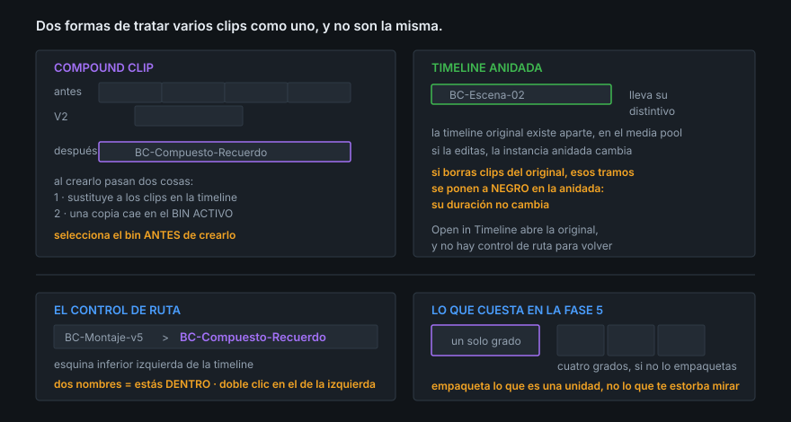

# Compound clips y nesting

> Un bloque de planos que ya está terminado y que estorba mirar cada vez es un candidato a
> **compound clip**: se empaqueta en un solo clip, se trata como uno, y se abre cuando haga falta.
> Es la herramienta que más orden pone en una timeline larga y la que más se usa mal.

## 🎯 Objetivos

- Explicar qué es un compound clip y qué gana la timeline al hacer uno
- Crearlo por selección y por rango de entrada y salida, y saber en qué se diferencian
- Abrirlo, editarlo por dentro y volver, sin perderse
- Deshacerlo con `Decompose in Place` y saber qué se recupera
- Distinguir un compound clip de una **timeline anidada** y decir cuándo cada una
- Saber qué le pasa a un compuesto en las páginas Color y Fusion
- Reconocer los tres casos en los que un compound clip es la respuesta y los tres en los que es una
  trampa

---

## 1. Qué problema resuelve

Tres problemas concretos que aparecen justo ahora:

1. **Una transición sobre un bloque.** Quieres que un montaje de cuatro planos entre entero con una
   disolución. No se puede: una transición va entre **dos** clips
2. **Un efecto sobre una capa completa.** Un rótulo con su sombra, su fondo y un logotipo encima,
   que tiene que moverse todo junto
3. **Una timeline ilegible.** Sesenta clips en la `V1` y no encuentras nada

Los tres se resuelven igual: **convertir un grupo de clips en uno solo**.

---

## 2. Cómo funciona

### 2.1 Qué es un compound clip

Un **compound clip** (*compound clip*) es **un solo clip de la timeline que por dentro contiene
varios**, de vídeo y de audio, seguidos o apilados en varias pistas.

Lo que ganas, en palabras del manual: trabajar con un bloque de clips **como si fuera una sola
unidad**, gobernada por un solo juego de controles del Inspector, y que se puede conectar con otro
clip mediante **una sola transición**.

Y se comporta como cualquier clip: se edita, se recorta, se borra, se le ponen efectos, se le
cambia la velocidad y se le pone una transición.

Cuando lo creas pasan **dos** cosas a la vez, y la segunda se olvida:

1. El compuesto **sustituye** en la timeline a los clips que seleccionaste
2. Una **copia** del compuesto aparece en el **bin activo del media pool**

Esa segunda es la que hace que el bin activo importe: si tenías `Master` seleccionado, ahí cae. Por
eso en este bootcamp se selecciona **`13-Titulos`** antes de crearlo.

### 2.2 Las dos formas de crearlo

| Forma | Cómo | Qué se lleva |
| ----- | ---- | ------------ |
| **Por selección** | Selecciona los clips `>` clic derecho sobre uno `>` **`New Compound Clip`** `>` nombre `>` `Create` | **Los clips enteros** que seleccionaste |
| **Por rango de entrada y salida** | Marca `I` y `O` en la timeline `>` clic derecho sobre el rango `>` **`Convert In and Out to Compound Clip`** `>` nombre `>` `Create` | **Solo lo que hay entre `I` y `O`**, incluidos trozos parciales del primer y el último clip |

La segunda tiene un detalle que hay que tener presente: se lleva **todas las pistas** dentro del
rango, aunque estén desactivadas o con el autoselect apagado.

El diálogo pide un nombre y admite un timecode de inicio opcional. **El nombre no es opcional en la
práctica**: un compuesto sin nombre propio es imposible de encontrar dentro de tres semanas.

Se renombra después con doble clic sobre su nombre en el media pool.

### 2.3 Entrar, editar y salir

Para editar por dentro: **clic derecho sobre el compuesto `>` `Open in Timeline`**. La timeline
cambia y enseña el contenido del compuesto, que se re-edita como cualquier otra.

Y para volver, **el control de ruta**: en la esquina inferior izquierda de la timeline aparece un
rastro con el nombre de la timeline que lo contiene. **Doble clic sobre ese nombre** y vuelves.

> [!WARNING]
> Este es el fallo que más checks tira esta semana. Con el compuesto abierto, la **timeline activa
> ya no es `BC-Montaje-v5`**: es el compuesto. Cualquier verificación que lea la timeline activa
> —siete de los diez checks— falla de golpe aunque tu trabajo esté perfecto.
>
> Antes de verificar: **mira el control de ruta de la esquina inferior izquierda**. Si hay dos
> nombres, estás dentro. Doble clic en el de la izquierda.

### 2.4 Deshacerlo

**Clic derecho sobre el compuesto `>` `Decompose in Place`**. El compuesto se sustituye por los
clips individuales que lo formaban.

Lo que se recupera: los clips, con sus recortes y su sitio. Lo que **no** vuelve solo: los efectos
que le pusiste **al compuesto**, porque estaban en el compuesto, no en los clips de dentro.

Y hay un modo relacionado, para cuando editas un compuesto **desde el media pool** a una timeline:
**`Edit > Decompose Compound Clips on Edit`**. Con esa opción marcada, cualquier método de edición
—salvo `Fit to Fill` y `Place on Top`— coloca el compuesto **ya deshecho** en sus clips
individuales. Desmarcada, lo coloca como un bloque.

### 2.5 Las timelines anidadas, que no son lo mismo

Una **timeline anidada** (*nested timeline*) es una timeline entera editada **dentro de otra**. Se
arrastra desde el media pool como cualquier clip.

Se distinguen a simple vista: un clip de timeline anidada lleva **un distintivo propio a la
izquierda de su nombre**.

| | Compound clip | Timeline anidada |
| - | ------------- | ---------------- |
| **Qué es** | Un contenedor creado desde una selección de clips | Una timeline del proyecto, editada dentro de otra |
| **Dónde vive el original** | Solo dentro del compuesto | Es una timeline propia del proyecto, que existe aparte |
| **Al abrirlo** | `Open in Timeline`, con **control de ruta** para volver | `Open in Timeline`, **sin** control de ruta: has abierto la timeline original |
| **Volver** | Doble clic en el control de ruta | Doble clic en la timeline en el media pool, o el desplegable de timelines del visor |
| **Si editas el original** | No hay «original» aparte | **La instancia anidada cambia**, y si borras clips esos tramos **se ponen a negro** |
| **Deshacerlo** | `Decompose in Place` | `Decompose in Place` también |

Ese «se ponen a negro» es la diferencia que importa: **la duración de la instancia anidada no
cambia** aunque cambies la timeline original. Si acortas la original, el hueco que queda dentro de
la anidada es negro.

Las timelines anidadas son la herramienta de las piezas por bobinas o por escenas: cada escena en
su timeline, y una timeline final que las monta todas.

### 2.6 Qué le pasa en Color y en Fusion

Esta es la parte que decide muchas veces si conviene o no hacer un compuesto:

> Un compound clip **aparece como un solo nodo `MediaIn` en la página Fusion** y se **etalona como
> un solo clip** en la página Color.

Traducido: **un compuesto es un solo grado**. Cuatro planos empaquetados dejan de poder etalonarse
por separado desde la timeline principal.

Se puede recuperar el acceso: `Open in Timeline` sobre el compuesto y, con él abierto, ir a Color o
a Fusion; ahí cada clip de dentro vuelve a estar disponible por separado. Pero es un paso más, cada
vez, durante las once semanas de color que vienen.

> [!IMPORTANT]
> Este es el argumento de peso contra empaquetar por comodidad: **un compound clip hecho hoy para
> ordenar la timeline es un grado menos disponible en la Semana 17**. Empaqueta lo que de verdad
> tenga que comportarse como una unidad, no lo que te estorba mirar.

Y el apunte inverso, que ya viste en la teoría 02: **un `Text+` se puede etalonar sin necesidad de
convertirlo en compound clip**. Eso era necesario en versiones antiguas y ya no lo es.

### 2.7 Cuándo sí y cuándo no

| Sí | Por qué |
| -- | ------- |
| Un bloque que tiene que entrar o salir **con una sola transición** | Es el caso para el que existe |
| Un **rótulo compuesto** de varias capas que se mueven juntas | Un solo `Transform` para todo |
| Un tramo **terminado** que no vas a volver a tocar | Ordena y no cuesta nada |

| No | Por qué |
| -- | ------- |
| Empaquetar «para ordenar» un tramo que sí vas a tocar | Un grado menos disponible y un `Open in Timeline` cada vez |
| Empaquetar clips que necesitan **grados distintos** | Son un solo grado |
| Empaquetar la pieza entera | Pierdes todo el acceso y no ganas nada |

---

## 3. Cómo se hace en Resolve 21

### 3.1 Un compuesto de un bloque de planos

1. Selecciona el bin **`13-Titulos`** en el media pool: ahí va a caer la copia
2. En la timeline, selecciona los tres o cuatro clips del bloque
3. Clic derecho sobre uno `>` **`New Compound Clip`**
4. Nómbralo **`BC-Compuesto-<loquesea>`** y `Create`
5. Ponle la transición que querías, ahora que es un solo clip

### 3.2 Un compuesto de un rango exacto

1. Marca `I` y `O` en la timeline
2. Clic derecho sobre la barra gris del rango `>` **`Convert In and Out to Compound Clip`**
3. Nombre y `Create`

### 3.3 Editarlo por dentro y volver

1. Clic derecho sobre el compuesto `>` **`Open in Timeline`**
2. Edita lo que haga falta
3. **Doble clic en el nombre de la timeline que lo contiene**, en el control de ruta de la esquina
   inferior izquierda
4. Comprueba que el control de ruta ha vuelto a enseñar un solo nombre

### 3.4 Deshacerlo

1. Clic derecho sobre el compuesto `>` **`Decompose in Place`**
2. Comprueba que los efectos que tenía el compuesto han desaparecido, porque eran suyos

---

## 4. Antipatrones

| Antipatrón | Por qué duele | Qué hacer |
| ---------- | ------------- | --------- |
| Verificar con el compuesto abierto | La timeline activa es el compuesto: fallan siete checks | Mira el control de ruta antes de verificar |
| Compound clip sin nombre propio | En tres semanas no sabes cuál es | Nómbralo en el diálogo de creación |
| Crear el compuesto con `Master` como bin activo | La copia cae en la raíz y ensucia el media pool | Selecciona `13-Titulos` antes |
| Empaquetar «para ordenar» medio montaje | Un grado para cinco planos, y `Open in Timeline` cada vez | Empaqueta solo lo que es una unidad |
| Empaquetar planos que van a llevar grados distintos | Son un solo grado | Déjalos sueltos |
| Convertir un `Text+` en compuesto para etalonarlo | No hace falta desde hace versiones | Etalónalo directamente |
| Confundir compuesto con timeline anidada | Se comportan distinto al editar el original | La tabla de 2.5 |
| Borrar clips de una timeline que está anidada en otra | En la anidada esos tramos se ponen a **negro** | Mira dónde está anidada antes de tocarla |
| Esperar que `Decompose in Place` devuelva los efectos del compuesto | Eran del compuesto, no de los clips | Anótalos antes de deshacerlo |
| Meter un compuesto dentro de otro sin necesidad | Cada nivel es un `Open in Timeline` más | Un nivel basta casi siempre |

---

## 5. Trucos

| Truco | Cómo |
| ----- | ---- |
| Empaquetar clips enteros | Selecciónalos `>` clic derecho `>` `New Compound Clip` |
| Empaquetar exactamente un rango | `I`, `O` `>` clic derecho `>` `Convert In and Out to Compound Clip` |
| Decidir dónde cae la copia | Selecciona el bin **antes** de crear el compuesto |
| Renombrarlo | Doble clic sobre su nombre en el media pool |
| Cambiarle el timecode de inicio | Clic derecho en el media pool `>` `Starting Timecode` |
| Entrar a editarlo | Clic derecho `>` `Open in Timeline` |
| Saber si estás dentro de un compuesto | El control de ruta de la esquina inferior izquierda |
| Salir | Doble clic sobre el nombre de la timeline que lo contiene |
| Deshacerlo | Clic derecho `>` `Decompose in Place` |
| Editar un compuesto del media pool ya deshecho | `Edit > Decompose Compound Clips on Edit` marcado |
| Reconocer una timeline anidada | El distintivo a la izquierda de su nombre |
| Filtrar la timeline por compuestos y anidadas | `Show Compound Clips and Nested Timelines` en el índice de la timeline |
| Etalonar por dentro de un compuesto | `Open in Timeline` y luego cambia a la página Color |
| Poner una transición a un bloque entero | Conviértelo en compuesto primero |

---

## 📚 Recursos Adicionales

- [DaVinci Resolve Reference Manual](https://www.blackmagicdesign.com/support/family/davinci-resolve-and-fusion) — capítulo 50 entero: «Compound Clips», «Compositing With and Grading Compound Clips», «Nested Timelines», «Decomposing Nested Timelines» y «Match Frame for Nested Timelines and Compound Clips».
- [06 · Transiciones a fondo](06-transiciones-a-fondo.md) — el problema que resuelve empaquetar un bloque.
- [08 · Adjustment clips](08-adjustment-clips.md) — la otra forma de tratar varios clips a la vez, sin empaquetarlos.
- [Semana 12 · Gestión de timeline](../../week-12-multicam_subtitulos_y_gestion_de_timeline/README.md) — versiones de timeline, que es la tercera forma de organizar lo mismo.

---

## ✅ Checklist de Verificación

- [ ] Sé qué es un compound clip y qué dos cosas pasan al crearlo
- [ ] Sé crearlo por selección y por rango, y en qué se diferencian
- [ ] Sé entrar, editar y salir sin quedarme dentro
- [ ] Sé que verificar desde dentro de un compuesto tira los checks
- [ ] Sé deshacerlo y qué no se recupera
- [ ] Sé distinguir un compound clip de una timeline anidada
- [ ] Sé que un compuesto es un solo grado, y qué implica para la Fase 5

---

| Anterior | Actual | Siguiente |
| -------- | ------ | --------- |
| [08 · Adjustment clips](08-adjustment-clips.md) | **09 · Compound clips y nesting** | — |

← [Volver a la Semana 11](../README.md)
