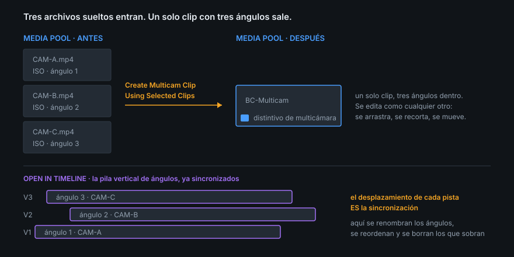

# El clip multicámara

> Tres cámaras grabando lo mismo son tres archivos que no saben nada el uno del otro. El **clip
> multicámara** es lo que los convierte en un solo objeto que sí lo sabe: un clip con tres ángulos
> dentro, alineados al fotograma, que se edita como si fuera uno.

## 🎯 Objetivos

- Explicar qué es un ISO y qué es un ángulo, y por qué no son lo mismo
- Explicar qué es un clip multicámara y qué problema resuelve
- Enumerar las tres fases del montaje multicámara
- Crear un clip multicámara desde el media pool y decidir en qué bin cae
- Reconocer el distintivo de multicámara en el media pool y en la timeline
- Abrir el clip con `Open in Timeline`, renombrar sus ángulos y volver

---

## 1. Qué problema resuelve

Grabas una entrevista con dos cámaras: un plano medio y un primer plano. O una charla con tres. O
un concierto con cuatro. Al volver a casa tienes esto:

```
CAM-A.mp4    18 min 04 s    empieza a las 19:12:31
CAM-B.mp4    17 min 52 s    empieza a las 19:12:38
CAM-C.mp4    18 min 11 s    empieza a las 19:12:29
```

Tres archivos que empiezan en momentos distintos y duran cosas distintas, porque nadie pulsó
*rec* a la vez. Sin herramientas, montar eso es así:

1. Pones `CAM-A` en la `V1` y `CAM-B` en la `V2`
2. Deslizas `CAM-B` hasta que el audio cuadre —a ojo, o mirando la onda
3. Cortas a mano cada vez que quieres cambiar de cámara
4. En el minuto siete descubres que `CAM-B` está un fotograma desplazado y ya has hecho cuarenta
   cortes encima

El **clip multicámara** resuelve las cuatro cosas a la vez: sincroniza una sola vez, guarda esa
sincronía dentro de un objeto, y a partir de ahí cambiar de cámara es un clic, no un corte a mano.

### 1.1 Dos palabras antes de seguir

- **ISO** (*isolated camera*) — cada uno de los archivos que grabó **una** cámara. El manual los
  llama así porque es el término de directo: la señal aislada de una cámara, frente a la mezcla que
  saca el realizador. En este bootcamp, un ISO es un archivo del bin `03-Multicamara`.
- **Ángulo** (*angle*) — cada ISO **una vez está dentro** del clip multicámara. El mismo material,
  pero ya con un número, un nombre y un desplazamiento propio. Un ISO es un archivo; un ángulo es un
  papel dentro de un clip.

Un ángulo puede contener **más de un ISO** si activas `Detect clips from same camera`: si la cámara
paró y volvió a grabar, sus dos archivos van al mismo ángulo, uno detrás de otro.

---

## 2. Cómo funciona



### 2.1 Las tres fases

El manual lo dice en tres pasos, y conviene tenerlos separados en la cabeza porque los fallos de
cada uno se parecen poco:

| Fase | Qué haces | Dónde |
| ---- | --------- | ----- |
| **1 · Crear** | Convertir los ISOs en un clip multicámara sincronizado | Media pool |
| **2 · Editar al timeline** | Meter el clip multicámara en una timeline | Timeline |
| **3 · Cortar y conmutar** | Elegir qué ángulo se ve en cada momento | Multicam Viewer |

Los problemas de la fase 1 son de **sincronía**: los ángulos no cuadran. Los de la fase 3 son de
**criterio**: cuadran, pero has cortado donde no tocaba. No se arreglan en el mismo sitio.

### 2.2 Qué es exactamente un clip multicámara

Un **clip multicámara** (*multicam clip*) es un elemento del media pool que **no tiene archivo
propio en disco**. Por dentro es una lista de ángulos, cada uno apuntando a su ISO, cada uno con su
desplazamiento en fotogramas respecto a los demás. En eso se parece a una timeline y a un compound
clip: es una estructura, no un vídeo.

Por fuera se comporta como un clip normal:

- Se arrastra a una timeline
- Se recorta con `I` y `O` antes de editarlo
- Se le ponen marcadores —y **todos los ángulos comparten los mismos marcadores**
- Se mueve, se copia y se pega en la timeline

Lo que lo distingue es un **distintivo** (*badge*): un icono pequeño en la esquina inferior
izquierda de la miniatura en el media pool, y a la izquierda del nombre del clip en la timeline. Es
la forma de saber de un vistazo que ese clip tiene ángulos dentro.

### 2.3 Dónde cae al crearlo

Igual que un compound clip de la Semana 11: **en el bin que esté seleccionado** en el media pool en
el momento de crearlo. No en el bin de los ISOs, no en `Master`. En el activo.

De ahí sale la costumbre que ahorra la reorganización: **selecciona el bin antes de crear nada**.
En este bootcamp los clips multicámara viven en `03-Multicamara`, junto a sus ISOs.

Hay una casilla en el diálogo de creación que ayuda a que ese bin no se convierta en un
desorden: **`Move Source Clips to "Original Clips" Bin`**. Si la marcas, Resolve mueve los ISOs a
un bin llamado `Original Clips` en cuanto termina, y en `03-Multicamara` te queda solo el clip
multicámara.

> [!NOTE]
> En este bootcamp **no la marcamos**. El check `bin-multicamara` de la Semana 05 pide tres clips o
> más en `03-Multicamara`, y mover los ISOs a otro bin lo tira. Es una casilla útil en un proyecto
> real; aquí descuadra la evaluación de una semana anterior.

### 2.4 Abrir el clip: la pila vertical

`Open in Timeline`, sobre el clip multicámara en el media pool, **sustituye el contenido de la
timeline** por una pila vertical: una pista de vídeo por ángulo, cada una desplazada respecto al
principio para quedar alineada con las demás.

Ese desplazamiento **es** la sincronía. No hay un dato oculto en ninguna parte: los ángulos están
sincronizados porque sus pistas están corridas la cantidad exacta.

Dentro, el manual permite seis cosas:

| Qué | Cómo |
| --- | ---- |
| Corregir la sincronía de un ángulo | Selecciónalo y desplázalo con `.` y `,` |
| Quitar un ángulo que no vas a usar | Clic derecho en su cabecera `>` `Delete Track` |
| Cambiar el orden de los ángulos | Clic derecho en la cabecera `>` `Move Track Up` / `Move Track Down` |
| Renombrar un ángulo | Doble clic sobre el nombre de la pista |
| Apagar un ángulo sin borrarlo | El control de habilitación de la pista |
| Etalonar un ángulo por separado | Página Color, con el clip abierto |

El renombrado no es cosmético: **el nombre de la pista es el nombre del ángulo** que vas a ver en el
Multicam Viewer y en la timeline al cortar. Con `Video 1`, `Video 2` y `Video 3` estás eligiendo
ángulos por número; con `Plano medio`, `Primer plano` y `Recurso`, por lo que son.

### 2.5 Salir: el control de ruta otra vez

Es el mismo mecanismo del compound clip de la Semana 11. En la **esquina inferior izquierda de la
timeline** aparece un rastro de nombres. Dos nombres significa que estás dentro; doble clic en el de
la izquierda te devuelve a tu timeline.

> [!IMPORTANT]
> Es el mismo fallo de la semana pasada por otra puerta: si verificas sin haber salido, la timeline
> activa es el clip multicámara y los checks que leen la timeline abierta fallan todos.

### 2.6 Convertir un compuesto o una timeline en multicámara

Hay una vía que no pasa por los ISOs: **clic derecho sobre un compound clip o una timeline en el
media pool `>` `Convert Compound Clips (Timelines) to Multicam Clips`**.

Sirve cuando ya tienes los ángulos apilados a mano en una timeline y quieres el Multicam Viewer sin
rehacer la sincronía.

> [!WARNING]
> **Es un proceso de un solo sentido.** No se puede volver a convertir un clip multicámara en una
> timeline ni en un compuesto. Si quieres conservar el original, **duplícalo antes** y convierte la
> copia. El manual lo dice con esas palabras.

---

## 3. Cómo se hace en Resolve 21

### 3.1 Crear el clip multicámara

1. Asegúrate de que los ISOs están importados y en el bin `03-Multicamara`
2. **Selecciona el bin `03-Multicamara`** en la lista de bins
3. Selecciona los ángulos —los tres, o los que sean— en el media pool
4. Clic derecho sobre la selección `>` **`Create Multicam Clip Using Selected Clips`**
5. Se abre el diálogo `New Multicam Clip Properties`. Los ajustes son la Teoría 02
6. `Create`

Si el método de sincronía elegido es por forma de onda, aparece una barra de progreso mientras
analiza el audio. Al terminar, el clip nuevo aparece en el bin activo con su distintivo.

### 3.2 Meterlo en una timeline

Como cualquier clip:

- Arrastrarlo del media pool a la timeline, o
- Abrirlo en el visor de origen, marcar `I` y `O`, y usar el método de edición que quieras

Aparece en la timeline con su distintivo a la izquierda del nombre.

### 3.3 Abrir, renombrar los ángulos y volver

1. Clic derecho sobre el clip multicámara **en el media pool** `>` `Open in Timeline`
2. Doble clic sobre el nombre de cada pista y escribe el nombre del ángulo
3. Si un ángulo sobra, clic derecho en su cabecera `>` `Delete Track`
4. **Mira el control de ruta** de la esquina inferior izquierda y haz doble clic en el nombre de la
   izquierda para salir

### 3.4 Cambiar el timecode de inicio

Clic derecho sobre el clip multicámara en el media pool `>` `Starting Timecode`, y escribe el nuevo
valor en el diálogo `Set New Start Timecode`. Sirve igual para un compound clip.

---

## 4. Antipatrones

| Antipatrón | Por qué duele | Qué hacer |
| ---------- | ------------- | --------- |
| Apilar ángulos a mano en pistas y montar así | Cada cambio de cámara es un corte manual en dos pistas | Clip multicámara, y el Multicam Viewer |
| Crear el multicámara con el bin equivocado seleccionado | Acaba en `Master`, entre las timelines | Selecciona el bin **antes** |
| Dejar los ángulos con nombre `Video 1`, `Video 2` | Cortas por número y te equivocas de cámara | Renómbralos dentro de `Open in Timeline` |
| Marcar `Move Source Clips to "Original Clips" Bin` en este bootcamp | Vacía `03-Multicamara` y tira el check de la Semana 05 | Déjala sin marcar |
| Convertir una timeline a multicámara sin duplicarla | El proceso es de un solo sentido | Duplica y convierte la copia |
| Verificar sin salir del clip abierto | La timeline activa es el multicámara | Control de ruta: dos nombres, estás dentro |
| Meter en el mismo multicámara material de dos momentos distintos | No hay sincronía posible: no pasaron a la vez | Un clip multicámara por toma |
| Borrar un ángulo «por si acaso» dentro del clip abierto | Se pierde el ángulo para todas las timelines que usen ese clip | Apágalo en vez de borrarlo |

---

## 5. Trucos

| Truco | Cómo |
| ----- | ---- |
| Saber si un clip es multicámara | El distintivo de la esquina inferior izquierda de la miniatura |
| Saberlo en la timeline | El distintivo a la izquierda del nombre del clip |
| Decidir en qué bin cae | Selecciónalo antes de crear el clip |
| Poner marcadores antes de montar | En el clip multicámara: **todos los ángulos los comparten** |
| Ver varios ángulos en la página Media | Menú de opciones del visor, y elige cuántos |
| Renombrar un ángulo | Doble clic sobre el nombre de su pista, dentro de `Open in Timeline` |
| Corregir la sincronía de un ángulo | Selecciónalo y desplaza con `.` y `,` |
| Reordenar los ángulos | `Move Track Up` / `Move Track Down` en la cabecera |
| Saber si estás dentro del clip | El control de ruta de la esquina inferior izquierda |
| Salir | Doble clic sobre el nombre de la izquierda del control de ruta |
| Cambiar el timecode de inicio | Clic derecho en el media pool `>` `Starting Timecode` |

---

## 📚 Recursos Adicionales

- [DaVinci Resolve Reference Manual](https://www.blackmagicdesign.com/support/family/davinci-resolve-and-fusion) — capítulo 49, «Multicam Editing»: «Introduction to Multicam Editing», «Creating and Modifying Multicam Clips» y «Opening and Altering Multicam Clips».
- [02 · Sincronizar los ángulos](02-sincronizar-los-angulos.md) — los ajustes del diálogo de creación, uno a uno.
- [03 · Cortar y conmutar](03-cortar-y-conmutar.md) — la fase 3, que es donde se monta de verdad.
- [Semana 05 · 07 · Preparar el material multicámara](../../week-05-proxies_cache_y_sincronizacion/1-teoria/07-preparar-el-material-multicamara.md) — de dónde salen los ISOs que usa esta semana.

---

## ✅ Checklist de Verificación

- [ ] Sé qué es un ISO y qué es un ángulo, y en qué se diferencian
- [ ] Sé qué es un clip multicámara y por qué no tiene archivo en disco
- [ ] Sé las tres fases del montaje multicámara y qué falla en cada una
- [ ] Sé en qué bin cae el clip al crearlo y cómo decidirlo
- [ ] Sé reconocer el distintivo en el media pool y en la timeline
- [ ] Sé abrir el clip, renombrar sus ángulos y salir por el control de ruta
- [ ] Sé que convertir una timeline en multicámara no tiene vuelta atrás

---

| Anterior | Actual | Siguiente |
| -------- | ------ | --------- |
| — | **01 · El clip multicámara** | [02 · Sincronizar los ángulos](02-sincronizar-los-angulos.md) |

← [Volver a la Semana 12](../README.md)
