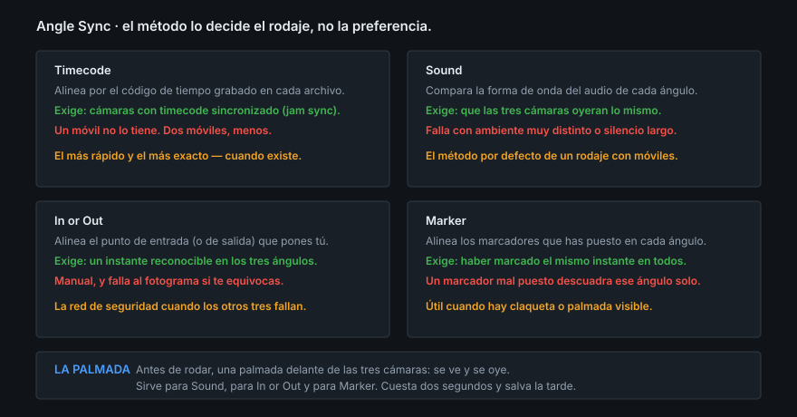

# Sincronizar los ángulos

> Un clip multicámara mal sincronizado no avisa. Se ve bien en la miniatura, se edita sin protestar,
> y el desfase aparece en el minuto siete, cuando ya hay cuarenta cortes encima. Los treinta segundos
> que se tarda en elegir bien el método de sincronía son los treinta segundos mejor invertidos de la
> semana.

## 🎯 Objetivos

- Enumerar los cuatro métodos de `Angle Sync` y decir qué necesita cada uno del rodaje
- Elegir el método correcto para un material concreto
- Explicar las cuatro opciones de `Multicam Audio` y cuándo se usa cada una
- Nombrar los ángulos con criterio desde el propio diálogo de creación
- Comprobar la sincronía **antes** de montar, y arreglarla si está mal
- Saber qué hacer cuando ningún método automático funciona

---

## 1. Qué problema resuelve

Sincronizar es responder a una pregunta: **¿qué fotograma de `CAM-B` corresponde a este fotograma de
`CAM-A`?** Resolve puede contestarla de cuatro maneras, y las cuatro necesitan que el rodaje le haya
dejado algo con lo que contestar.

Ninguna es «la buena». La buena es la que tu material permite.

Y todas comparten un límite que conviene tener claro desde el principio: **la sincronía se decide una
vez, al crear el clip**. Si te equivocas, no se cambia el método a posteriori: se borra el clip
multicámara y se vuelve a crear. Por eso la comprobación va **antes** de montar, no después.

---

## 2. Cómo funciona

### 2.1 Los cuatro métodos de `Angle Sync`

**`Timecode`** — alinea por el **timecode** grabado dentro de cada archivo. El *timecode* es el
reloj que la cámara escribe en el material, fotograma a fotograma, y del que ya hablamos en la
Semana 01.

Funciona a la perfección **si las cámaras llevaban el mismo reloj**. Eso se consigue con *jam sync*:
antes de rodar se conectan las cámaras a una fuente de timecode común y se les pone la hora a todas
a la vez. Es lo normal en producción profesional y no existe en un rodaje con móviles: un móvil no
escribe timecode, y dos móviles menos.

**`Sound`** — analiza la **forma de onda** del audio de cada ángulo y busca el desplazamiento que
las hace coincidir. La *forma de onda* es el dibujo del sonido: los picos y los valles del volumen a
lo largo del tiempo.

Es el método por defecto de cualquier rodaje casero, porque solo exige una cosa: **que todas las
cámaras oyeran lo mismo**. Aunque el audio de la cámara sea malo —y lo va a ser—, para sincronizar
no importa: se compara el dibujo, no la calidad.

Falla en dos casos: cuando los ángulos tienen ambientes muy distintos —una cámara dentro y otra
fuera— y cuando hay silencios largos sin nada que comparar.

**`In or Out`** — alinea el punto de entrada, o el de salida, que hayas puesto tú en cada ángulo. Es
manual y es la red de seguridad: si los otros tres fallan, este siempre funciona, porque el que
decide eres tú.

Exige un **instante reconocible en todos los ángulos**: una palmada, una puerta que se cierra, el
primer golpe de la música. Y exige precisión: si te equivocas de fotograma en un ángulo, ese ángulo
queda desplazado ese fotograma para siempre.

**`Marker`** — alinea los **marcadores** que hayas puesto en cada ISO. Es `In or Out` pero con
marcadores en vez de puntos de entrada, y tiene la ventaja de que los marcadores se ven en el media
pool y sobreviven a que muevas los puntos de entrada.

### 2.2 La palmada

Los métodos manuales —y `Sound`— necesitan un instante reconocible. La forma barata de garantizarlo
es la de siempre: **una palmada delante de las tres cámaras antes de rodar**, con las tres ya
grabando.

Una palmada se ve —las manos juntándose— y se oye —un pico limpio en la onda—. Sirve para `Sound`,
para `In or Out` y para `Marker`. Es lo que hace una claqueta, con menos presupuesto.

Cuesta dos segundos. La alternativa es media hora deslizando pistas.

### 2.3 `Multicam Audio`: qué audio entra en el clip

El otro ajuste que decide de verdad. Un clip multicámara tiene que decidir **qué audio se queda**,
porque hay tantas pistas de audio como ángulos y no se pueden oír todas a la vez sin que suene a
cueva.

| Opción | Qué hace | Cuándo |
| ------ | -------- | ------ |
| **`Source Audio Channels`** (por defecto) | Da acceso a las pistas y canales individuales de cada ángulo | Cuando quieres decidir clip a clip |
| **`Reference Audio`** | Usa **una sola** pista como audio de todos los ángulos | Cuando hay una grabadora externa, o una cámara con el mejor sonido |
| **`Adaptive Tracks`** | Mete todas las pistas y canales de un ángulo en una sola pista adaptativa | Cuando cada ángulo tiene varios canales y quieres tratarlos como un bloque |
| **`All Angles`** | Incluye **todas** las pistas de audio de **todos** los ángulos | Cuando vas a mezclar de verdad y quieres todo disponible |

`Reference Audio` tiene un comportamiento que conviene conocer: al elegirlo, Resolve **identifica el
primer ángulo que sea solo audio** y lo usa como referencia para todos los demás. Si no hay ningún
ángulo de solo audio, usa el primer ángulo.

> [!TIP]
> En este bootcamp, el caso típico es tres móviles sin grabadora externa. `Source Audio Channels`
> —el valor por defecto— está bien, y el audio bueno se elige más tarde, en la Fase 4. Si grabaste
> con una grabadora aparte, importa también ese archivo como un ángulo más y elige
> **`Reference Audio`**: es exactamente el caso para el que existe.

### 2.4 `Angle Name`: cómo se llaman los ángulos

Cuatro formas, y la diferencia se nota en la fase 3:

| Opción | Resultado |
| ------ | --------- |
| **`Sequential`** | Numeración: 1, 2, 3… |
| **`Angle`** o **`Camera`** | El campo de metadata `Angle` o `Camera #` del clip |
| **`Clip Name`** | El nombre del clip en el media pool |
| **`File Name`** | El nombre del archivo en disco |

`Sequential` es el valor rápido y el que peor envejece: cortar por número obliga a recordar qué es
el 2. Si en la Semana 04 rellenaste el campo `Camera #` de la metadata, esta es la semana en que
eso se paga. Y si no, siempre se pueden renombrar después, desde `Open in Timeline`.

### 2.5 Los otros ajustes del diálogo

| Ajuste | Qué hace |
| ------ | -------- |
| **`Multicam Clip Name`** | El nombre del clip que vas a crear. En este bootcamp, `BC-Multicam-<algo>` |
| **`Start Timecode`** | El timecode de inicio del clip nuevo. Sale del punto de sincronía |
| **`Frame Rate`** | La cadencia, deducida de los clips seleccionados. Con una casilla `Drop Frame` |
| **`Channel`** | Solo con `Sound`: qué canal de audio usar para comparar |
| **`Split Multicam at gaps`** | Solo con `Sound`: parte el multicámara donde hay un hueco en el audio |
| **`Use full clip extents`** | Cada ángulo usa su duración entera, aunque el multicámara sea más corto |
| **`Detect clips from same camera`** | Varios archivos de la misma cámara van al mismo ángulo |
| **`Detect Using`** | Qué campo de metadata identifica la cámara: `Camera #`, `Angle`, `Reel Number`, `Reel Name`, `Roll/Card #` |

`Detect clips from same camera` es el que salva el caso más común de un rodaje largo: la cámara
llegó al límite de tamaño de archivo y partió la grabación en tres. Sin esa casilla te salen tres
ángulos de la misma cámara; con ella, un ángulo con tres trozos seguidos.

### 2.6 Comprobar la sincronía antes de montar

Esto no es opcional y no lleva más de un minuto:

1. Abre el clip multicámara con `Open in Timeline`
2. Ve a un punto con un sonido seco: la palmada, una puerta, una consonante fuerte
3. Amplía hasta ver fotogramas sueltos
4. Compara: el instante en que las manos se juntan tiene que caer en el **mismo fotograma** en todos
   los ángulos

Si un ángulo está corrido, selecciónalo y desplázalo con `.` y `,` hasta cuadrarlo. Si están
corridos todos y por cantidades distintas, el método era el equivocado: borra el clip y créalo de
nuevo con otro.

> [!IMPORTANT]
> Un fotograma de desfase entre imagen y sonido **se nota** en una cara hablando. Dos, seguro. No
> es una comprobación de perfeccionista: es la diferencia entre una entrevista que se ve y una que
> molesta sin que el espectador sepa por qué.

---

## 3. Cómo se hace en Resolve 21

### 3.1 Elegir método según tu material

| Tu material | Método |
| ----------- | ------ |
| Cámaras con timecode sincronizado por jam sync | `Timecode` |
| Varios móviles o cámaras de consumo, todos con audio | `Sound` |
| Un ángulo sin audio, o ambientes muy distintos | `In or Out`, con la palmada |
| Ya pusiste marcadores en el instante de la palmada | `Marker` |

### 3.2 Sincronizar por sonido

1. Bin `03-Multicamara` seleccionado
2. Selecciona los ángulos
3. Clic derecho `>` `Create Multicam Clip Using Selected Clips`
4. `Angle Sync` `>` **`Sound`**
5. `Channel`: el canal de audio a comparar, si tus clips tienen más de uno
6. `Angle Name` `>` `Clip Name`, si tus archivos tienen nombres que dicen algo
7. `Create`, y espera al análisis

### 3.3 Sincronizar por puntos de entrada

1. Abre **cada ISO** en el visor de origen
2. Encuentra el fotograma exacto de la palmada —el primero en que las manos están juntas
3. Pulsa **`I`** ahí
4. Repítelo en todos los ángulos
5. Selecciónalos todos, `Create Multicam Clip Using Selected Clips`
6. `Angle Sync` `>` **`In`**
7. `Create`

### 3.4 Arreglar un ángulo desplazado

1. `Open in Timeline` sobre el clip multicámara
2. Selecciona el clip del ángulo mal sincronizado
3. `.` lo mueve un fotograma adelante, `,` un fotograma atrás
4. Comprueba en un punto con sonido seco
5. Sal por el control de ruta

---

## 4. Antipatrones

| Antipatrón | Por qué duele | Qué hacer |
| ---------- | ------------- | --------- |
| Elegir `Timecode` porque suena a profesional | Sin jam sync, los relojes no coinciden y el resultado es basura | `Sound` para material de consumo |
| No comprobar la sincronía antes de montar | El desfase aparece con cuarenta cortes encima | Un minuto de comprobación en un sonido seco |
| Rodar sin palmada | Te quedas sin las tres vías manuales | Palmada delante de todas las cámaras, con todas grabando |
| Dejar `Angle Name` en `Sequential` | Cortas por número y te equivocas de cámara | `Clip Name`, o renombrar después |
| `All Angles` sin necesitarlo | Un clip con doce pistas de audio que no vas a usar | `Source Audio Channels` salvo que sepas por qué |
| Meter en un multicámara tomas de momentos distintos | No hay sincronía posible | Un clip multicámara por toma |
| Corregir el desfase moviendo el clip **en la timeline** | Descuadra todo lo montado y no arregla el clip | Arréglalo dentro de `Open in Timeline` |
| Rehacer el multicámara con el montaje ya hecho | Los cortes apuntan al clip viejo | Comprueba antes de montar |

---

## 5. Trucos

| Truco | Cómo |
| ----- | ---- |
| Garantizar la sincronía en cualquier rodaje | Una palmada con todas las cámaras ya grabando |
| Sincronizar sin timecode | `Angle Sync > Sound` |
| Sincronizar sin audio útil | `Angle Sync > In`, con el punto de entrada en la palmada |
| Que los ángulos se llamen como tus archivos | `Angle Name > Clip Name` |
| Unir en un ángulo los trozos de una misma cámara | `Detect clips from same camera` y elige el campo en `Detect Using` |
| Usar una grabadora externa como audio de todos | Impórtala como un ángulo más y elige `Reference Audio` |
| Partir el multicámara donde hay silencio | `Split Multicam at gaps`, solo con `Sound` |
| Que cada ángulo use su duración entera | `Use full clip extents` |
| Comprobar la sincronía en diez segundos | Un sonido seco, ampliar a fotogramas, comparar |
| Corregir un fotograma de desfase | Dentro de `Open in Timeline`, con `.` y `,` |

---

## 📚 Recursos Adicionales

- [DaVinci Resolve Reference Manual](https://www.blackmagicdesign.com/support/family/davinci-resolve-and-fusion) — capítulo 49, «Creating and Modifying Multicam Clips», «Multicam Audio Options» y «Selecting a Single Reference Audio Track for Multicam Clips».
- [01 · El clip multicámara](01-el-clip-multicamara.md) — qué es lo que estás sincronizando.
- [03 · Cortar y conmutar](03-cortar-y-conmutar.md) — lo que se puede hacer una vez está bien sincronizado.
- [Semana 05 · 06 · Sincronizar audio y vídeo](../../week-05-proxies_cache_y_sincronizacion/1-teoria/06-sincronizar-audio-y-video.md) — la sincronía de dos fuentes, que es el caso simple de esto.

---

## ✅ Checklist de Verificación

- [ ] Sé los cuatro métodos de `Angle Sync` y qué exige cada uno del rodaje
- [ ] Sé cuál elegir para material grabado con móviles
- [ ] Sé por qué una palmada resuelve tres de los cuatro métodos
- [ ] Sé las cuatro opciones de `Multicam Audio` y cuándo se usa `Reference Audio`
- [ ] Sé qué hace `Detect clips from same camera` y qué problema resuelve
- [ ] Sé comprobar la sincronía antes de montar
- [ ] Sé corregir un ángulo desplazado sin rehacer el clip

---

| Anterior | Actual | Siguiente |
| -------- | ------ | --------- |
| [01 · El clip multicámara](01-el-clip-multicamara.md) | **02 · Sincronizar los ángulos** | [03 · Cortar y conmutar](03-cortar-y-conmutar.md) |

← [Volver a la Semana 12](../README.md)
