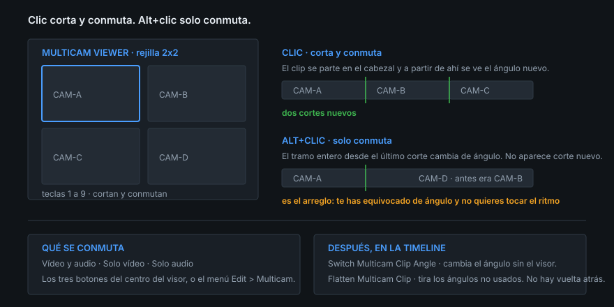

# Cortar y conmutar

> Montar multicámara no se parece a montar. Se parece a **realizar**: la pieza corre, tú la miras, y
> vas eligiendo cámara en tiempo real. Los cortes van cayendo en la timeline mientras suena. Es la
> única parte del montaje que se hace a la velocidad de la vida.

## 🎯 Objetivos

- Poner el visor de origen en modo `Multicam` y entender qué muestra
- Distinguir **cortar y conmutar** de **solo conmutar**, y saber cuándo usa cada uno
- Elegir si el cambio afecta a vídeo, a audio o a los dos
- Montar con las teclas `1` a `9` sin soltar el ratón
- Corregir un ángulo equivocado después, desde la timeline
- Decidir si aplanar el clip, sabiendo lo que se pierde

---

## 1. Qué problema resuelve

Ya tienes el clip multicámara sincronizado y metido en una timeline. Ahora hay que decidir qué
cámara se ve en cada instante, y son muchos instantes: una entrevista de diez minutos con tres
ángulos lleva entre treinta y ochenta cambios.

Hacerlo a mano —cortar, elegir ángulo, cortar, elegir ángulo— es lento y, peor, **es sordo**: cortas
mirando la timeline, no escuchando la pieza. Y los cambios de cámara son una decisión de ritmo: se
cambia cuando alguien empieza a hablar, cuando reacciona, cuando el plano ya ha dicho lo que tenía
que decir. Eso se decide oyendo.

El Multicam Viewer permite decidirlo **mientras se reproduce**.

---

## 2. Cómo funciona

### 2.1 El Multicam Viewer

Se enciende en el **desplegable de modo del visor de origen**, eligiendo `Multicam`. El visor deja
de mostrar un clip y pasa a mostrar **todos los ángulos del clip multicámara que cruza el cabezal**,
en rejilla, cada uno con su nombre debajo.

Cada ángulo es un **botón**. Eso es todo el mecanismo.

Cuántos ves lo decide el desplegable de la esquina inferior derecha del visor: rejillas de **1x1,
1x2, 2x2, 3x3 o 4x4**. No es solo estética: cada ángulo visible es un vídeo descodificándose a la
vez. Si la reproducción va a tirones, baja la rejilla.

Si hay más ángulos de los que caben en la rejilla, aparecen unos **controles de página** a la
izquierda del desplegable: puntos para saltar a un grupo de ángulos y flechas para pasar al
siguiente. También están en `Edit > Multicam > Previous Page` y `Next Page`.

### 2.2 Las dos operaciones

Es la distinción de la semana:

| Operación | Cómo | Qué pasa en la timeline |
| --------- | ---- | ----------------------- |
| **Cortar y conmutar** (*cut*) | **Clic** en un ángulo, o teclas **`1`** a **`9`** | Inserta un corte en el cabezal y desde ahí se ve el ángulo nuevo |
| **Solo conmutar** (*switch*) | **`Alt`+clic** (Win) / **`Opt`+clic** (Mac), o `Alt`+`1` a `9` | **No** añade corte: cambia el ángulo del tramo actual, desde el último corte |

La primera es la que usas montando: cada clic es un cambio de cámara nuevo.

La segunda es la que usas **arreglando**: has cortado en el sitio correcto pero elegiste la cámara
equivocada. Conmutar cambia el ángulo sin tocar el ritmo, que era lo que estaba bien.

> [!NOTE]
> Que no confunda el vocabulario: **conmutar** aquí es cambiar de fuente sin cortar, como el
> conmutador de un realizador de directo. Cortar y conmutar hace las dos cosas; conmutar a secas,
> solo la segunda.

### 2.3 Vídeo, audio o los dos

Tres botones en el centro inferior del Multicam Viewer, y sus atajos en `Edit > Multicam`:

| Qué se cambia | Menú | Atajo |
| ------------- | ---- | ----- |
| Vídeo y audio | `Edit > Multicam > Video and Audio` | `Alt+Shift+[` (Win) / `Opt+Shift+[` (Mac) |
| Solo vídeo | `Edit > Multicam > Video Only` | `Alt+Shift+]` (Win) / `Opt+Shift+]` (Mac) |
| Solo audio | `Edit > Multicam > Audio Only` | `Alt+Shift+\` (Win) / `Opt+Shift+\` (Mac) |

**Solo vídeo** es lo que quieres casi siempre en una entrevista o una charla: el audio bueno es
uno —el de la cámara mejor situada, o el de la grabadora— y no tiene ningún sentido que salte de
micrófono cada vez que cambias de plano. Un cambio de imagen es invisible; un cambio de micrófono se
oye como un tropiezo.

**Vídeo y audio** tiene su sitio: un concierto con cuatro cámaras y cuatro micrófonos en sitios
distintos, donde el cambio de perspectiva sonora es parte del efecto.

### 2.4 Montar con las manos quietas

El flujo que hace que esto merezca la pena:

1. Cabezal al principio, o donde empieces
2. Modo `Multicam` en el visor de origen
3. `Solo vídeo`, salvo que sepas por qué no
4. **Reproduce**
5. Con la pieza sonando, pulsa **`1`**, **`2`**, **`3`**… según qué cámara quieras
6. Los cortes van apareciendo en la timeline mientras avanza la reproducción
7. Para parar de montar, para la reproducción

Las teclas hacen lo mismo que los botones: `1` a `9` cortan y conmutan; `Alt+1` a `Alt+9` solo
conmutan. Se monta sin soltar el teclado y sin mirar la timeline.

Mientras montas suena **la mezcla entera de la timeline**, no solo el ángulo elegido. Es
deliberado: te permite cortar contra la música o contra el diálogo que ya tienes puesto.

### 2.5 Después: los cortes son cortes normales

Cuando paras, lo que queda en la timeline son clips normales, con el distintivo de multicámara.
Vuelve el visor a modo `Source` y ya puedes recortar como en la Semana 09: ripple, roll, slip.

Con un detalle que solo tienen los multicámara: técnicamente estás añadiendo *through edits* —cortes
dentro de un mismo clip—, así que **seleccionar un punto de edición y pulsar `Supr` lo elimina** y
une los dos tramos. Deshacer un cambio de cámara es una tecla.

Y para cambiar de ángulo sin abrir el visor: **clic derecho sobre el clip `>` submenú
`Switch Multicam Clip Angle`**, y elige. Es la vía cómoda para los tres o cuatro arreglos que
siempre quedan.

### 2.6 `Flatten Multicam Clip`: cuándo y qué cuesta

Clic derecho sobre un clip multicámara en la timeline `>` **`Flatten Multicam Clip`**. Elimina todos
los ángulos no usados y te deja **un clip normal**, sin ángulos y sin distintivo.

Al hacerlo, Resolve pregunta qué hacer con el etalonaje:

| Opción | Qué hace |
| ------ | -------- |
| **`Copying Multicam Grades`** | Aplica al clip aplanado el grado que tenía el multicámara |
| **`Retaining Grades from Angles`** | Conserva los grados hechos sobre cada ángulo por separado |

Qué se gana: un clip más ligero, sin ángulos que descodificar, y una timeline que se entiende sin
saber que hubo multicámara.

Qué se pierde: **la posibilidad de cambiar de cámara**. Para siempre, en esa timeline. Si en la
Fase 5 descubres que ese plano tenía la cara desenfocada y el otro ángulo la tenía bien, ya no hay
otro ángulo.

> [!WARNING]
> **Aplanar es irreversible en esa timeline.** No lo hagas para «ordenar». Hazlo cuando la pieza
> esté cerrada, si acaso, y con el respaldo de la semana ya exportado. En este bootcamp
> **no se aplana**: quedan once semanas por delante y cambiar de ángulo va a hacer falta.

### 2.7 Volver al material original

Dos comandos que resuelven el «¿de dónde salía este plano?»:

- **`Clip > Match Frame to Source Clip`**, con el cabezal sobre el fotograma: encuentra el ISO que
  hay debajo del ángulo que se está viendo
- **`F`** con el clip multicámara abierto en el visor de origen: lleva el cabezal de la timeline al
  fotograma exacto que estás viendo en el visor. Si ese fotograma no está en la timeline, no pasa
  nada

---

## 3. Cómo se hace en Resolve 21

### 3.1 Montar una entrevista con tres ángulos

1. Clip multicámara editado en la timeline
2. Cabezal al principio del clip
3. Desplegable de modo del visor de origen `>` **`Multicam`**
4. Desplegable de la esquina inferior derecha `>` **`2x2`**
5. `Edit > Multicam > Video Only`
6. Reproduce y pulsa `1`, `2` o `3` cuando quieras cambiar
7. Para la reproducción cuando termines
8. Vuelve el visor a `Source`

### 3.2 Arreglar un cambio de cámara equivocado

**Sin tocar el ritmo**: clic derecho sobre el clip `>` `Switch Multicam Clip Angle` `>` el ángulo
bueno.

**Con el visor**: cabezal sobre ese tramo, modo `Multicam`, y `Alt`+clic sobre el ángulo bueno.

### 3.3 Quitar un cambio de cámara que sobra

1. Selecciona el punto de edición entre los dos tramos —`V` selecciona el más cercano
2. `Supr`

Los dos tramos se unen y queda el ángulo del primero.

### 3.4 Si la reproducción va a tirones

1. Baja la rejilla a `1x2` o `2x2`
2. Si sigue, `Playback > Render Cache > Smart` y espera a que las barras se pongan azules
3. Si sigue, monta con los proxies de la Semana 05

---

## 4. Antipatrones

| Antipatrón | Por qué duele | Qué hacer |
| ---------- | ------------- | --------- |
| Cortar mirando la timeline en vez de escuchando | Los cambios caen donde toca visualmente, no donde pide la pieza | Reproduce y corta con las teclas |
| Conmutar vídeo **y** audio en una entrevista | El micrófono salta en cada corte y se oye | `Video Only` |
| Rejilla 4x4 en un equipo justo | La reproducción se cae y montas contra un vídeo a tirones | Baja la rejilla, o cachea |
| Cambiar de cámara cada dos segundos | Cansa y llama la atención sobre el montaje | Un cambio cuando el plano ya dijo lo suyo |
| Rehacer el corte cuando solo te equivocaste de ángulo | Pierdes el ritmo, que estaba bien | `Switch Multicam Clip Angle` |
| Aplanar para «dejarlo limpio» | Pierdes los ángulos para siempre en esa timeline | No aplanes hasta cerrar la pieza |
| Montar multicámara antes de comprobar la sincronía | Cuarenta cortes sobre un clip mal sincronizado | Teoría 02, apartado 2.6 |
| Cortar sin marcar antes dónde pasa lo importante | Se monta a ciegas en diez minutos de material | Marcadores en el clip multicámara: los comparten todos los ángulos |

---

## 5. Trucos

| Truco | Cómo |
| ----- | ---- |
| Encender el Multicam Viewer | Desplegable de modo del visor de origen `>` `Multicam` |
| Elegir cuántos ángulos ver | Desplegable de la esquina inferior derecha: `1x1`, `1x2`, `2x2`, `3x3`, `4x4` |
| Pasar a otro grupo de ángulos | `Alt+Shift+←` / `Alt+Shift+→` (Win) · `Opt+Shift` en Mac |
| Cortar y conmutar sin ratón | Teclas `1` a `9` |
| Solo conmutar | `Alt`+clic, o `Alt`+`1` a `9` |
| Cambiar solo la imagen | `Alt+Shift+]` (Win) / `Opt+Shift+]` (Mac) |
| Cambiar solo el sonido | `Alt+Shift+\` |
| Cambiar los dos | `Alt+Shift+[` |
| Saltar al ángulo anterior o siguiente | `Ctrl+Shift+←` / `Ctrl+Shift+→` (Win) · `Cmd+Shift` en Mac |
| Cambiar el ángulo desde la timeline | Clic derecho `>` `Switch Multicam Clip Angle` |
| Quitar un cambio de cámara | Selecciona el punto de edición con `V` y pulsa `Supr` |
| Encontrar el ISO de un plano | `Clip > Match Frame to Source Clip` |
| Llevar el cabezal al fotograma que ves en el visor | `F` |
| Editar un ángulo suelto a la timeline | Arrástralo desde el Multicam Viewer, con `I` y `O` puestos |
| Recuperar la reproducción | `Playback > Render Cache > Smart` |

---

## 📚 Recursos Adicionales

- [DaVinci Resolve Reference Manual](https://www.blackmagicdesign.com/support/family/davinci-resolve-and-fusion) — capítulo 49, «Performing a Multicam Edit», «Multicam Controls in the Source Viewer», «Multicam Keyboard Controls» y «Editing Multicam Clips in the Timeline».
- [02 · Sincronizar los ángulos](02-sincronizar-los-angulos.md) — sin esto bien hecho, nada de este archivo sirve.
- [Semana 09 · 03 · Ripple y roll](../../week-09-trimming_quirurgico/1-teoria/03-ripple-y-roll.md) — los cortes que salen de aquí se afinan con esas herramientas.

---

## ✅ Checklist de Verificación

- [ ] Sé encender el Multicam Viewer y elegir la rejilla
- [ ] Sé la diferencia entre cortar y conmutar, y cuándo uso cada uno
- [ ] Sé por qué en una entrevista se conmuta solo vídeo
- [ ] Sé montar con las teclas `1` a `9` mientras se reproduce
- [ ] Sé corregir un ángulo desde la timeline sin tocar el ritmo
- [ ] Sé quitar un cambio de cámara que sobra
- [ ] Sé qué se pierde al aplanar y por qué esta semana no se aplana

---

| Anterior | Actual | Siguiente |
| -------- | ------ | --------- |
| [02 · Sincronizar los ángulos](02-sincronizar-los-angulos.md) | **03 · Cortar y conmutar** | [04 · La pista de subtítulos](04-la-pista-de-subtitulos.md) |

← [Volver a la Semana 12](../README.md)
