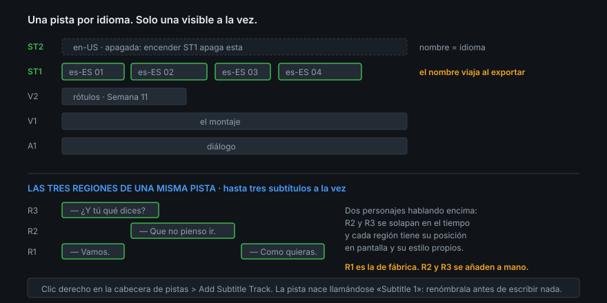

# La pista de subtítulos

> Un subtítulo no es un título. Un título va en una pista de vídeo y es una imagen; un subtítulo va
> en una **pista aparte, de un tipo propio**, y puede salir del render como texto que el espectador
> apaga. La diferencia no es de estilo: es de qué se puede hacer con él después.

## 🎯 Objetivos

- Distinguir subtítulo, *closed caption* y rótulo, y saber cuándo es cada cosa
- Explicar por qué la pista de subtítulos es un tipo de pista distinto
- Crear una pista de subtítulos y nombrarla como manda la convención
- Explicar por qué solo se ve una pista de subtítulos a la vez
- Usar el control de destino `ST1`, `ST2`… para elegir dónde caen los subtítulos
- Añadir subtítulos por las tres vías que ofrece Resolve
- Explicar qué son las **regiones** y para qué sirven

---

## 1. Qué problema resuelve

En la Semana 11 pusiste rótulos: el título de entrada, los nombres de quien habla. Eran clips de
`Text+` en la `V2`, y eran **imagen**: al renderizar, esas letras son píxeles como los del plano de
debajo.

Para tres rótulos eso está bien. Para la transcripción entera de diez minutos de diálogo, no, por
cuatro razones:

1. **Son ciento cincuenta clips.** Cada uno con su estilo, en una pista de vídeo, estorbando
2. **No se pueden apagar.** Quien no los necesita se los come igual
3. **No se pueden traducir sin rehacerlos.** Otra lengua es otros ciento cincuenta clips
4. **No hay forma de exportarlos como texto.** YouTube, Vimeo y cualquier plataforma con
   accesibilidad piden un archivo de subtítulos, no letras quemadas en la imagen

La **pista de subtítulos** resuelve las cuatro. Es un tipo de pista distinto, con sus propios clips
—los generadores de subtítulo—, su propio panel en el Inspector y su propia salida en el render.

### 1.1 Tres palabras que no son sinónimas

- **Subtítulo** (*subtitle*) — el texto de lo que se dice, pensado para quien **oye pero no
  entiende** el idioma. Solo diálogo.
- **Closed caption** (*closed caption*, «subtítulo para sordos» en español) — pensado para quien
  **no oye**. Lleva el diálogo **y** la información sonora: quién habla, qué se oye fuera de cuadro,
  la música. Suele ir en un formato con especificación técnica propia —CEA-608— y viaja incrustado
  en el archivo.
- **Rótulo** (*lower third*, *title*) — lo de la Semana 11. Un nombre, un lugar, un dato. Es imagen.

Resolve trata los tres primeros casos con **la misma pista de subtítulos** y decide qué son al
exportar. La diferencia está en lo que escribes y en el formato de salida.

---

## 2. Cómo funciona

### 2.1 Es una pista de un tipo propio

Resolve tiene **tres tipos de pista**: vídeo, audio y subtítulos. No es una pista de vídeo con
nombre bonito. Un ejemplo de que son cosas distintas: la propia API de scripting las cuenta por
separado, y por eso el verificador de este bootcamp puede preguntar por ellas sin confundirlas con
las de vídeo.

Las pistas de subtítulos aparecen **encima** de las de vídeo, en su propia zona de la timeline, y
tienen lo mismo que las demás:

- Control de **bloqueo** (*lock*)
- Control de **sincronía** (*sync lock*)
- Control de **habilitación**, para encenderlas y apagarlas
- Un **control de destino** propio, etiquetado `ST1`, `ST2`, `ST3`…

Sus clips —los generadores de subtítulo— se mueven, se recortan, se sobrescriben y se recortan con
las herramientas de trimming de la Semana 09, como cualquier otro clip.

### 2.2 Solo una visible a la vez

Esta es la diferencia importante con una pista de vídeo, y sorprende la primera vez:

> **Solo una pista de subtítulos puede estar visible en cada momento.** Encender el control de
> habilitación de una **apaga todas las demás**.

Tiene sentido: cada pista es un idioma, y una pieza no se ve en dos idiomas a la vez. Pero implica
que no puedes «superponer» dos pistas de subtítulos para conseguir dos líneas: para eso están las
regiones del apartado 2.6.

También se pueden **ocultar todas** para recuperar espacio vertical: el botón de subtítulos del
desplegable `Timeline View Options`. Ojo: ocultar la pista **no apaga los subtítulos** en el visor.
La que esté habilitada se sigue viendo.

### 2.3 El control de destino `ST`

Con varias pistas de subtítulos, hay que decirle a Resolve en cuál caen los subtítulos nuevos. Eso
lo hace el **control de destino** de la cabecera, el primero por la izquierda, etiquetado `ST1`,
`ST2`, `ST3`…

Es el mismo mecanismo del control de destino de vídeo de la Semana 08, y falla igual: un subtítulo
que «no aparece» casi siempre ha caído en la otra pista.

### 2.4 El nombre de la pista **es** un dato de entrega

De fábrica, una pista de subtítulos nueva se llama **`Subtitle 1`**. Se renombra con doble clic
sobre su nombre, y hay que hacerlo antes de escribir nada, porque:

> **El nombre de la pista de subtítulos se usa al exportar y al codificar.** No es una etiqueta
> interna: viaja al archivo de salida.

La convención es identificar el idioma con los códigos de la norma **ISO 639-1** —dos letras: `es`,
`en`, `fr`— o **ISO 639-2/B** —tres letras: `spa`, `eng`, `fre`—, y a veces con el código de país de
la **ISO 3166-1**: `es-ES`, `es-MX`, `en-US`, `en-GB`.

Algunas plataformas lo exigen con un formato concreto. El manual cita el de Facebook:
`NombreDelVideo.[código de idioma]_[código de país].srt`.

> [!TIP]
> En este bootcamp la pista se llama con su código: **`es-ES`**, o el que corresponda a tu pieza. El
> check `subtitulos-pista-con-nombre` comprueba precisamente que **no** se quedó en `Subtitle 1`.

### 2.5 Las tres vías para añadir un subtítulo

Con la pista creada y su control de destino elegido, el cabezal donde quieras que empiece, y una de
estas tres:

| Vía | Cómo |
| --- | ---- |
| **Desde el Inspector** | `Inspector > Captions >` botón `Create Caption`. Si ya hay subtítulos en esa pista, el botón es `Add New`, encima de la lista |
| **Desde la timeline** | Clic derecho en cualquier punto de la pista de subtítulos `>` `Add Subtitle` |
| **Desde la Effects Library** | Categoría `Titles`, y arrastra un generador `Subtitle` a la pista |

La primera es la que se usa escribiendo en serie, porque el foco se queda en el Inspector y puedes
escribir el texto sin mover la mano.

### 2.6 Las regiones: hasta tres subtítulos a la vez

Un caso real: dos personajes hablando encima. Poner sus frases una detrás de otra no cuenta lo que
pasa, que es que se interrumpen.

Para eso están las **regiones** (*subtitle regions*). Una pista de subtítulos puede tener hasta
**tres**: `R1`, `R2` y `R3`. Cada región es como una mini-pista dentro de la pista, con:

- Su propia lista de subtítulos
- Su propio estilo, incluida la **posición en pantalla**
- Su propio momento en el tiempo

Cuando dos regiones se solapan, **se ven las dos a la vez**. Y como cada una tiene su posición, se
puede poner la de un personaje a la izquierda y la del otro a la derecha, que es la forma de indicar
quién dice qué sin escribir el nombre.

De fábrica todo va a `R1`. Las otras se crean a mano: clic derecho **dentro de la pista** —no en la
cabecera— `>` `Add Subtitle Region`. Y un subtítulo se pasa de una región a otra arrastrándolo
arriba o abajo dentro de la pista.

### 2.7 Los umbrales de control de calidad

En `Project Settings` hay un panel **`Subtitles`** con tres valores que Resolve usa para avisarte de
que un subtítulo no es legible:

| Umbral | Qué mide |
| ------ | -------- |
| **`Characters Per Line`** | Cuántos caracteres caben en una línea |
| **`Minimum Caption Duration`** | Lo mínimo que un subtítulo tiene que estar en pantalla |
| **`Maximum Characters Per Second`** | La velocidad máxima de lectura |

Cuando un subtítulo se pasa, **el valor de CPS se pone rojo** en el panel `Captions`. No te impide
nada: te avisa.

Se pueden fijar por pista, que es lo que se hace cuando hay varios idiomas y unos son más largos que
otros: `Inspector > Track > Subtitle Settings`, desmarca `Use Project Settings` y ajusta
`Max Line Length`, `Min Duration` y `Max CPS` para esa pista.

---

## 3. Cómo se hace en Resolve 21

### 3.1 Crear la pista y nombrarla

1. Clic derecho **en cualquier cabecera de pista** de la timeline abierta `>` **`Add Subtitle Track`**
2. Aparece arriba del todo, llamada `Subtitle 1`
3. **Doble clic sobre su nombre** y escribe el código de idioma: `es-ES`

### 3.2 Escribir el primer subtítulo

1. Clic en el control de destino `ST1` de esa pista
2. Cabezal en el fotograma donde tiene que empezar
3. `Inspector > Captions >` `Create Caption`
4. Escribe el texto en el campo `Caption`. Aparece sobre el clip mientras escribes
5. Ajusta la duración arrastrando el borde del clip

### 3.3 Añadir una región

1. Clic derecho **dentro de la pista**, no en su cabecera
2. `Add Subtitle Region`
3. Para renombrarla: clic derecho `>` `Rename Subtitle Region`
4. Para borrarla: clic derecho `>` `Delete Subtitle Region` `>` la región

### 3.4 Ajustar los umbrales de calidad

Del proyecto: `File > Project Settings > Subtitles`.

De una pista: selecciona la pista, `Inspector > Track > Subtitle Settings`, desmarca
`Use Project Settings`.

### 3.5 Ocultar la zona de subtítulos

Desplegable `Timeline View Options`, a la izquierda de la timeline, y el botón de subtítulos.

---

## 4. Antipatrones

| Antipatrón | Por qué duele | Qué hacer |
| ---------- | ------------- | --------- |
| Subtitular con clips de `Text+` en una pista de vídeo | Ciento cincuenta clips que no se apagan ni se exportan | Pista de subtítulos |
| Dejar la pista llamada `Subtitle 1` | El nombre viaja al archivo exportado | Renómbrala con su código de idioma, antes de escribir |
| Esperar ver dos pistas de subtítulos a la vez | Solo una puede estar visible | Regiones, no pistas |
| Escribir sin mirar el control de destino | Los subtítulos caen en la pista equivocada | Comprueba el `ST` antes |
| Buscar los subtítulos «que han desaparecido» | La zona de subtítulos está oculta | `Timeline View Options` |
| Ignorar el CPS en rojo | El espectador no llega a leerlo | Corta la frase, o alarga el clip |
| Subtitular en la timeline equivocada | Se subtitula una versión que ya no es la buena | Subtitula la última: `BC-Montaje-v6` |
| Mezclar diálogo y descripción sonora sin criterio | Ni es subtítulo ni es caption | Decide para quién es antes de escribir |

---

## 5. Trucos

| Truco | Cómo |
| ----- | ---- |
| Crear una pista de subtítulos | Clic derecho en cualquier cabecera de pista `>` `Add Subtitle Track` |
| Renombrarla | Doble clic sobre su nombre |
| Elegir en qué pista caen los subtítulos nuevos | El control de destino `ST1`, `ST2`… |
| Añadir un subtítulo en el cabezal | `Inspector > Captions >` `Create Caption` |
| Añadirlo desde la timeline | Clic derecho en la pista `>` `Add Subtitle` |
| Ver la lista de todos los subtítulos de una pista | Selecciona su cabecera y abre `Inspector > Captions` |
| Navegar por esa lista | Los botones `Prev` y `Next` del panel `Captions` |
| Ganar sitio para leer la lista | Pon el Inspector a altura completa |
| Ocultar la zona de subtítulos | `Timeline View Options` `>` el botón de subtítulos |
| Poner dos subtítulos a la vez en pantalla | Clic derecho dentro de la pista `>` `Add Subtitle Region` |
| Mover un subtítulo de región | Arrástralo arriba o abajo dentro de la pista |
| Saber si un subtítulo es ilegible | El CPS se pone rojo |
| Ajustar los umbrales de un idioma concreto | `Inspector > Track > Subtitle Settings`, sin `Use Project Settings` |
| Fundir la entrada y la salida de un subtítulo | Las asas de fundido de sus esquinas, como en un clip de vídeo |

---

## 📚 Recursos Adicionales

- [DaVinci Resolve Reference Manual](https://www.blackmagicdesign.com/support/family/davinci-resolve-and-fusion) — capítulo 59, «Subtitles and Closed Captioning»: «Subtitles and Closed Captioning Support», «Adding Subtitles and Captions Manually», «Subtitle Regions» y «Naming Subtitle Tracks».
- [Lista oficial de códigos ISO 639-2](http://www.loc.gov/standards/iso639-2/php/code_list.php) — la tabla que cita el manual para nombrar las pistas.
- [05 · Escribir y estilar subtítulos](05-escribir-y-estilar-subtitulos.md) — qué se escribe dentro y cómo se le da forma.
- [Semana 11 · 01 · El título es un clip](../../week-11-titulos_texto_plus_efectos_y_compuestos/1-teoria/01-el-titulo-es-un-clip.md) — la otra forma de poner texto, y en qué se diferencia.

---

## ✅ Checklist de Verificación

- [ ] Sé diferenciar subtítulo, closed caption y rótulo
- [ ] Sé por qué la pista de subtítulos es un tipo de pista propio
- [ ] Sé crear una pista de subtítulos y por qué hay que renombrarla
- [ ] Sé que solo una pista de subtítulos se ve a la vez
- [ ] Sé usar el control de destino `ST`
- [ ] Sé las tres vías para añadir un subtítulo
- [ ] Sé qué son las regiones y cuándo hacen falta
- [ ] Sé qué mide el CPS y qué hacer cuando se pone rojo

---

| Anterior | Actual | Siguiente |
| -------- | ------ | --------- |
| [03 · Cortar y conmutar](03-cortar-y-conmutar.md) | **04 · La pista de subtítulos** | [05 · Escribir y estilar subtítulos](05-escribir-y-estilar-subtitulos.md) |

← [Volver a la Semana 12](../README.md)
