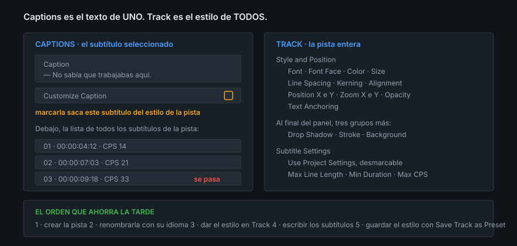

# Escribir y estilar subtítulos

> Subtitular bien es sobre todo **cortar bien**: decidir dónde termina una frase, cuánto tiempo está
> en pantalla y qué se deja fuera. El estilo se decide una vez para toda la pista; el texto se decide
> subtítulo a subtítulo, y es donde se gana o se pierde la legibilidad.

## 🎯 Objetivos

- Distinguir el panel `Captions` del panel `Track`, y saber qué vive en cada uno
- Dar estilo a una pista entera de una vez
- Sacar un subtítulo suelto del estilo de la pista con `Customize Caption`
- Guardar el estilo como preajuste y reutilizarlo
- Aplicar las reglas de escritura de subtítulos: longitud, corte de línea, duración
- Buscar y reemplazar texto en toda la pista
- Marcar la diferencia entre Free y Studio en esta parte

---

## 1. Qué problema resuelve

Tienes ciento cincuenta subtítulos que escribir. Dos cosas van a pasar seguro:

1. A mitad decides que la fuente es muy grande, o que están muy abajo, o que hace falta contorno
2. Habrás escrito mal un nombre propio, y aparece dieciocho veces

Si cada subtítulo lleva su estilo propio, lo primero son ciento cincuenta ediciones. Y lo segundo,
dieciocho.

Resolve separa las dos cosas: **el estilo es de la pista**, y **el texto es del clip**. Cambiar la
fuente de los ciento cincuenta es un ajuste; corregir el nombre en los dieciocho, un
`Replace All`.

---

## 2. Cómo funciona



### 2.1 Los dos paneles del Inspector

| Panel | Qué es | Qué contiene |
| ----- | ------ | ------------ |
| **`Captions`** | El subtítulo **seleccionado** | El campo de texto, la casilla `Customize Caption`, y la **lista** de todos los subtítulos de la pista |
| **`Track`** | La **pista entera** | El estilo de todos: fuente, color, tamaño, posición, sombra, contorno, fondo, y los umbrales de calidad |

Regla para no perderse: **si quieres que cambie uno, `Captions`. Si quieres que cambien todos,
`Track`.**

Para abrir `Track` hay que **seleccionar la cabecera de la pista**, o un clip de esa pista, y luego
abrir el panel. Es el error de navegación más frecuente de la semana: se busca la fuente en
`Captions` y no está ahí.

### 2.2 Qué hay en `Track`

El manual agrupa los controles en cuatro bloques:

**`Style and Position`** — `Font` y `Font Face`, `Color`, `Size`, `Line Spacing`, `Kerning`,
`Alignment`, `Position X` y `Position Y`, `Zoom X` y `Zoom Y`, `Opacity`, y `Text Anchoring`.

**`Drop Shadow`** — la sombra. Es la primera herramienta contra un fondo que cambia, igual que en la
Semana 11.

**`Stroke`** — el contorno. La segunda.

**`Background`** — la caja detrás del texto. La tercera, y la más agresiva: siempre se lee, siempre
tapa imagen. En subtítulos es más aceptable que en un rótulo, porque el espectador que los necesita
prefiere leer a ver el plano completo.

Y **`Subtitle Settings`**, con los umbrales por pista de la Teoría 04.

### 2.3 La excepción: `Customize Caption`

A veces un subtítulo tiene que salirse del estilo. El caso típico: una frase en otro idioma, que por
convención va en cursiva.

1. Selecciona ese subtítulo
2. `Inspector > Captions`, y marca **`Customize Caption`**
3. Ajusta lo que necesite

Ese subtítulo deja de seguir a la pista. Los demás siguen igual.

Y se puede hilar más fino: con `Customize Caption` marcado, **selecciona unas palabras dentro del
campo `Caption`** y dales estilo. Cambia solo esa parte. Es lo que en la Semana 11 llamábamos
*rich text*, y aquí sí existe.

> [!TIP]
> `Customize Caption` es la puerta de atrás, no la puerta. Cada subtítulo personalizado es un
> subtítulo que se queda fuera del próximo cambio de estilo global. Úsalo para las excepciones de
> verdad y anótalas.

### 2.4 Guardar el estilo como preajuste

Igual que el estilo de rótulo de la Semana 11, pero por otra puerta: el **menú de opciones** —los
tres puntos— de la esquina superior derecha del Inspector de subtítulos.

| Acción | Ruta |
| ------ | ---- |
| Guardar el estilo actual | Menú de tres puntos `>` `Save Track as Preset`, y ponle nombre |
| Aplicar un preajuste a otra pista | Menú de tres puntos `>` el preajuste `>` `Load Preset` |
| Actualizar un preajuste | Menú `>` el preajuste `>` `Update Preset` `>` `Update` |
| Borrarlo | Menú `>` el preajuste `>` `Delete Preset` `>` `Delete` |
| Exportarlo a un archivo `.preset` | Menú `>` el preajuste `>` `Export Preset` |
| Importar uno | Menú `>` `Import Preset` |

> [!WARNING]
> **`Update Preset` y `Delete Preset` no tienen deshacer.** El manual lo dice de las dos. `Load
> Preset` sí lo tiene.

### 2.5 Cómo se escribe un subtítulo

Esto no es de Resolve, es de oficio, y es lo que separa un subtítulo que se lee de uno que se sufre.

**Longitud.** Dos líneas como máximo. Entre 35 y 42 caracteres por línea es el rango habitual en las
guías de la industria; el valor concreto lo fija el umbral `Characters Per Line` del proyecto.

**Velocidad.** Alrededor de **15 caracteres por segundo** para adulto general. El umbral
`Maximum Characters Per Second` es el que pone en rojo el CPS cuando te pasas.

**Duración mínima.** Un subtítulo por debajo de **un segundo** parpadea. `Minimum Caption Duration`
es ese umbral.

**Dónde se corta la línea.** No por donde cae: por donde la frase respira. Se corta **antes** de una
preposición o una conjunción, nunca separando un artículo de su sustantivo.

```
❌  No sabía que trabajabas en el
    hospital desde marzo.

✅  No sabía que trabajabas
    en el hospital desde marzo.
```

**Se resume.** Un subtítulo no es una transcripción. Las muletillas, las repeticiones y los titubeos
se caen. Lo que se escribe es lo que se dice, no cómo se dice.

**Se sincroniza con la voz, no con el corte.** El subtítulo entra cuando empieza la frase y sale
cuando termina, aunque haya un cambio de plano en medio. Salvo un caso: **nunca cruza un corte a
otra escena**, porque el espectador lee un texto sobre una imagen que ya no es la suya.

### 2.6 Buscar y reemplazar

En el Inspector de subtítulos, el **icono de búsqueda** de la esquina superior derecha:

1. Elige si buscas coincidencia parcial o el término entero
2. Escribe y pulsa el botón de búsqueda
3. Las coincidencias se resaltan en amarillo en el panel `Captions`, con un contador
4. Las flechas de al lado saltan de una a otra
5. Marca la casilla `Replace`, escribe el reemplazo y usa `Replace` o `Replace All`

Es la herramienta que arregla el nombre propio mal escrito dieciocho veces en un clic.

### 2.7 Free y Studio

Aquí está la línea de pago más visible de la semana.

**`Create Subtitles from Audio`** transcribe automáticamente el diálogo de la timeline y crea la
pista de subtítulos entera, con puntuación, mayúsculas en los nombres propios, signos de
interrogación y hasta un `[Music Playing]` cuando detecta música. Está en
`Timeline > AI Tools > Create Subtitles from Audio`. **Es exclusiva de Studio.**

**Los subtítulos animados** —la sección `Animated` de las plantillas de título, que resaltan cada
palabra según se dice— también son de Studio.

En **Free** se escribe a mano, con el flujo del apartado 3. Es más lento y es exactamente el mismo
resultado: la pista, los clips y el archivo exportado son idénticos.

> [!NOTE]
> Hay una tercera vía en Free que no es rendirse: transcribir con una herramienta externa que
> exporte `.srt` e importarlo. Cómo, en la [Teoría 06](06-los-formatos-de-subtitulo.md).

---

## 3. Cómo se hace en Resolve 21

### 3.1 El orden que ahorra la tarde

1. Crear la pista de subtítulos
2. **Renombrarla** con su código de idioma
3. Seleccionar su cabecera y dar el estilo entero en `Inspector > Track`
4. Guardar el estilo: menú de tres puntos `>` `Save Track as Preset`
5. **Ahora** escribir los subtítulos

Al revés —escribir primero y estilar después— funciona igual, pero se escribe leyendo mal.

### 3.2 Escribir en serie

1. Control de destino `ST1` marcado
2. Cabezal donde empieza la frase
3. `Inspector > Captions >` `Create Caption` —o `Add New` si ya hay alguno
4. Escribe el texto
5. Arrastra el borde del clip hasta donde termina la frase
6. Cabezal a la frase siguiente y vuelta al 3

### 3.3 Poner una frase en cursiva

1. Selecciona ese subtítulo
2. `Inspector > Captions`, marca `Customize Caption`
3. Cambia `Font Face` a la cursiva de tu familia

Para solo unas palabras: con `Customize Caption` marcado, selecciónalas dentro del campo `Caption`
antes de cambiar nada.

### 3.4 Cambiar la fuente de los ciento cincuenta

1. Clic en la **cabecera** de la pista
2. `Inspector > Track > Style and Position > Font`
3. Cambia

Los que tengan `Customize Caption` marcado **no** cambian. Es lo que significa esa casilla.

---

## 4. Antipatrones

| Antipatrón | Por qué duele | Qué hacer |
| ---------- | ------------- | --------- |
| Buscar la fuente en `Captions` | No está ahí: el estilo es de la pista | Selecciona la cabecera y abre `Track` |
| Estilar subtítulo a subtítulo | Cada cambio global son ciento cincuenta ediciones | Estilo en `Track`, una vez |
| Marcar `Customize Caption` por costumbre | Esos subtítulos se quedan fuera del próximo cambio | Solo para excepciones, y anótalas |
| Transcribir literalmente | Muletillas y titubeos llenan la pantalla de ruido | Se resume: lo que se dice, no cómo |
| Tres líneas de subtítulo | Tapa media imagen y no da tiempo | Dos como máximo |
| Cortar la línea por donde cae | Se lee a trompicones | Se corta antes de preposición o conjunción |
| Subtítulos de medio segundo | Parpadean y no se leen | Un segundo largo mínimo |
| Un subtítulo que cruza un corte de escena | Se lee sobre una imagen que ya no le corresponde | Que termine antes del corte |
| Ignorar el CPS rojo | El espectador no llega | Acorta el texto o alarga el clip |
| Corregir un nombre a mano dieciocho veces | Es media hora y te dejas dos | Icono de búsqueda `>` `Replace All` |

---

## 5. Trucos

| Truco | Cómo |
| ----- | ---- |
| Ver el estilo de la pista | Selecciona la **cabecera** y abre `Inspector > Track` |
| Cambiar la fuente de todos los subtítulos | `Track > Style and Position > Font` |
| Sacar un subtítulo del estilo de la pista | `Captions >` casilla `Customize Caption` |
| Poner dos palabras en cursiva dentro de una frase | Con `Customize Caption`, selecciónalas en el campo `Caption` |
| Guardar tu estilo de subtítulos | Menú de tres puntos `>` `Save Track as Preset` |
| Llevártelo a otro equipo | Menú de tres puntos `>` `Export Preset`, que da un `.preset` |
| Aplicarlo a otra pista | Menú de tres puntos `>` el preajuste `>` `Load Preset` |
| Corregir un nombre en toda la pista | Icono de búsqueda `>` `Replace` `>` `Replace All` |
| Navegar por los subtítulos sin buscar en la timeline | Botones `Prev` y `Next` del panel `Captions` |
| Ver de un vistazo cuáles se pasan de velocidad | La columna CPS de la lista: los rojos |
| Fundir la entrada de un subtítulo | Las asas de fundido de sus esquinas |
| Comprobar la legibilidad de verdad | Reduce el visor a un cuarto y lee la pieza entera |

---

## 📚 Recursos Adicionales

- [DaVinci Resolve Reference Manual](https://www.blackmagicdesign.com/support/family/davinci-resolve-and-fusion) — capítulo 59, «Styling Subtitles and Captions», «Using Subtitle Track Style Presets», «Find and Replace Subtitles» y «Create Subtitles from Audio (Studio Version Only)».
- [Comparativa oficial Free / Studio](https://www.blackmagicdesign.com/products/davinciresolve/studio) — la fuente de verdad sobre qué queda al otro lado, y se actualiza con cada versión.
- [04 · La pista de subtítulos](04-la-pista-de-subtitulos.md) — el contenedor de todo esto.
- [06 · Los formatos de subtítulo](06-los-formatos-de-subtitulo.md) — cómo entra y cómo sale el texto.

---

## ✅ Checklist de Verificación

- [ ] Sé qué vive en `Captions` y qué vive en `Track`
- [ ] Sé dar estilo a una pista entera de una vez
- [ ] Sé qué hace `Customize Caption` y por qué se usa poco
- [ ] Sé guardar mi estilo como preajuste y llevármelo
- [ ] Sé las reglas de longitud, velocidad y duración mínima
- [ ] Sé dónde se corta una línea de subtítulo
- [ ] Sé buscar y reemplazar en toda la pista
- [ ] Sé qué parte de esto es de Studio y qué hago en Free

---

| Anterior | Actual | Siguiente |
| -------- | ------ | --------- |
| [04 · La pista de subtítulos](04-la-pista-de-subtitulos.md) | **05 · Escribir y estilar subtítulos** | [06 · Los formatos de subtítulo](06-los-formatos-de-subtitulo.md) |

← [Volver a la Semana 12](../README.md)
